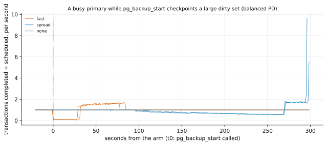

# EXP-57: Does a fast start checkpoint on a large dirty set hurt a busy primary?

Status: **done October 27, 2026 (one VM, 6 runs after a smoke; 1 and 3 held, the deciding 2 failed). On a busy primary with about 5 GB of dirty buffers on a balanced persistent disk, both start checkpoints cost the load heavily, and the spread one was not gentler in total:**
- **fast:** the load nearly stalled (worst second 94% short) for about 30 s, and lost 27.5 s of work;
- **spread:** it ran about half short for 4.5 minutes, and lost 51.8 s.

By the registered rule fast stays the default. O4's two numbers now disagree between pgdelta's start (fast) and `pg_basebackup`'s default (spread), so that is put to the owner. Pre-registered before any run. One VM (about an hour), no network. The C-ckpt row of `docs/FIRMNESS.md`, sized to its one question.

## Question

pgdelta reads a live primary between `pg_backup_start` and `pg_backup_stop`. It asks for a **fast** checkpoint (`--checkpoint fast`, the default), as `pg_basebackup -c fast` does. A fast checkpoint writes every dirty buffer at once. `pg_basebackup`'s own default is **spread**, which paces the same writes over `checkpoint_completion_target` of `checkpoint_timeout`.

Every slowdown test so far (EXP-12, -28, -30, -39) used a load database of about 30 MB (`pgbench -s 2`), so the start checkpoint never had much to write. On a primary with gigabytes of dirty buffers on a persistent disk, a fast checkpoint may saturate the disk that also holds the WAL, and stall commits. How much, against a spread checkpoint and against none?

## Design

`experiments/network/lab_exp57.sh`, run on one VM of the `ha` set:
- **The machine:** `MACHINE=n2-standard-8` (8 vCPUs, 32 GB) with its 150 GiB balanced persistent disk. That is EXP-48's disk, which wrote about 6,750 scattered pages a second. Data and WAL are both on it, as PostgreSQL's defaults put them.
- **The cluster:** PostgreSQL 17, `pgbench -i -s 400` (about 6 GB, all of it fitting in shared buffers). Settings:
  - `shared_buffers = 8GB`;
  - `max_wal_size = 32GB` and `checkpoint_timeout = 5min` (the default), so no checkpoint but the arm's own falls inside a trial;
  - `checkpoint_completion_target = 0.9` (the default);
  - `log_checkpoints = on`;
  - the database prewarmed into shared buffers (`pg_prewarm`).
- **The load:** pgbench's TPC-B script, 16 clients on 4 threads, open loop at 0.6 × C. C is the median of three 30-second closed-loop runs after a 30-second warm-up. Every transaction is logged (`-l`).
- **A trial:**
  1. `CHECKPOINT`, so every trial starts clean;
  2. the load at 0.6 × C for 180 s, to build the dirty set;
  3. the dirty buffers counted (`pg_buffercache`), then the arm at t0;
  4. 10 s of tail.

  The load runs 500 s in all, covering the slowest arm.
- **Arms**, each in one session:
  - `none`: 60 s of nothing;
  - `fast`: `pg_backup_start('exp57', true)`, then `pg_backup_stop(false)`;
  - `spread`: the same with `false`.

  Its start returns when the checkpoint is done (t1). 2 repeats of each, in a shuffled order (seed 570).
- **Measures** (EXP-12's, from the transaction log in 1-second buckets over [t0, t1 + 10 s]; `none`: [t0, t0 + 70 s]):
  - **D:** the worst drop, max(1 − completed ÷ scheduled);
  - **W:** the work lost, the sum of max(0, scheduled − completed) ÷ the rate, in seconds;
  - the p99 latency of the transactions that completed in the window.

  Net values subtract the `none` arm's medians. Also recorded: the buffers each checkpoint wrote and its write and sync times (from `log_checkpoints`), and how long `pg_backup_start` blocked.
- **The analysis,** committed before the data: `analysis/exp57.py`, figure `exp57-checkpoint-burst`.

## Predictions

1. **The dirty set is large** (the manipulation check): at t0, at least 1 GB of dirty buffers in every trial.
2. **Deciding: a fast checkpoint hurts the load far more than a spread one.** Medians:
   - fast's net worst-second drop D is at least 0.30;
   - fast's net work lost W is at least 2× spread's.
3. **A fast start blocks for a while:** `pg_backup_start(…, true)` takes at least 20 s, where it took well under a second on EXP-28's small dirty set.

## What follows

- **If 1 and 2 hold:**
  - **README and help:** advise `--checkpoint spread` on a busy primary with a large dirty set on persistent disks.
  - **The trade-off, with numbers:** fast starts reading at once but stalls the load; spread is gentle but adds up to 0.9 × `checkpoint_timeout` before reading.
  - **The default:** goes to the owner. O4's bar ("no worse than `pg_basebackup`") points to spread, `pg_basebackup`'s own default.
- **If 2 fails:** fast stays the default, with this measurement behind it.
- **If 1 fails:** the dirty set wasn't large, and nothing is concluded about it.

## Results (October 27)

One `n2-standard-8` in us-central1-f (a and c had no capacity), with its 150 GiB balanced persistent disk.
- **The smoke** (scale 20, 307 MB) ran every arm once, end to end.
- **The registered run:** a 5,989 MB database, all of it prewarmed into shared buffers; C = 10,517 TPC-B transactions a second, so the load ran at R = 6,310.

Data: `docs/experiments/data/exp57-runs.csv`; raw `results/exp04/exp57` (pgbench logs, 685 MB, not in git); analysis and figure `analysis/exp57.py`.

| Median of 2 | dirty at t0 | buffers the checkpoint wrote | `pg_backup_start` blocked | worst-second drop D (net) | work lost W (net) | p99 latency in the window |
|---|---|---|---|---|---|---|
| none | 5.07 GB | none | none | 0.00 | 0.0 s | 2.3 ms |
| **fast** | 4.94 GB | 603,850 (4.9 GB), written in 30.4 s | **30.8 s** | **0.94** | **27.5 s** | 27.6 s |
| **spread** | 4.86 GB | 594,632 (4.9 GB), written in 269.7 s | 270.1 s | 0.45 | **51.8 s** | 51.1 s |

| # | Prediction | Verdict |
|---|---|---|
| 1 | At least 1 GB dirty at t0 in every trial | **Held:** 4.7–5.1 GB |
| 2 | **Deciding: fast's net D at least 0.30, and fast's net W at least 2× spread's** | **Failed:** D held (0.94), but fast lost about half as much work as spread (27.5 s against 51.8), not twice as much |
| 3 | A fast start blocks at least 20 s | **Held:** 29–32 s (spread: 270 s) |

## What it means

- **A start checkpoint on a large dirty set is costly either way on this disk.** Writing about 4.9 GB of scattered pages to a balanced persistent disk that also holds the WAL:
  - **fast:** the load nearly stops for about 30 s, while the disk writes at about 20,000 pages a second, then catches up over about 50 s;
  - **spread:** the load runs normally for about 90 s, then slides to about 55% of its rate until the checkpoint ends at 270 s.

  So the spread checkpoint trades a deep, short stall for a long, shallow loss, and lost more work in total.
- **Why spread's loss deepens late** isn't diagnosed. It writes at only about 2,200 pages a second. Candidates are the kernel's write-back throttling as the checkpoint's buffered writes accumulate, and the WAL's flushes queuing behind them on the same disk.
- **For pgdelta:** this cost is the checkpoint's, not pgdelta's read. EXP-28 measured pgdelta's own reading at about 0.05–0.07 s of lost work.
  - **Against `pg_basebackup -c fast`,** pgdelta's start is the same checkpoint.
  - **Against `pg_basebackup`'s default (spread),** pgdelta's fast start loses about half the work (27.5 s against 51.8), with a far deeper worst second (0.94 against 0.45).

  O4's bar ("no worse than `pg_basebackup`") reads both numbers, so they split here. Which matters more is the owner's call.
- **Every slowdown result before this one** (EXP-12, -28, -30, -39) measured a primary whose start checkpoint had about 30 MB to write. On a large dirty set the checkpoint dominates whatever pgdelta itself costs. The README now says so.

## What was done

- **The default stays `fast`,** as the registered rule says for a failed 2.
- **The README and `--checkpoint`'s help** state the measured costs of both modes on a large dirty set, and that neither avoids it: one takes a short near-stall, the other a long partial slowdown with more work lost.
- **C-ckpt in FIRMNESS.md** is updated, and **the owner's question** is in the log: whether O4 should weigh the worst second or the work lost when they disagree.
