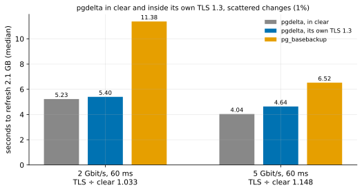

# EXP-58: What does pgdelta's own TLS cost at DR rates?

Status: **done October 27, 2026 (one session, 12 runs, all passing; all four predictions held): inside its own TLS 1.3, pgdelta took 1.033 of its in-clear time at 2 Gbit/s and 1.148 at 5 Gbit/s, and sent 0.3–0.6% more bytes. The handshake took 67 ms, about one round trip. Neither ratio is within 0.05 of its bar, so one session stands.** Lean: one default pair, about 40 minutes. Owner decision O6 requires the data stream encrypted. Native TLS was built on October 27 (063831e), and its cost was the open half of O6's goal.

## Question

pgdelta now runs its connection inside mutual TLS 1.3 when given `--tls-cert`, `--tls-key` and `--tls-ca` on both ends. Its tests show nothing crosses in clear, and that a peer from another CA, or one without TLS, is refused. They don't show what encryption costs. EXP-13 priced TLS only through an stunnel pair, an extra process and hop on each end. Does pgdelta's own TLS slow a DR refresh, and does it add bytes?

## Design

The default `n2-standard-8` pair with EXP-60's conditions:
- BBR on v1's data socket, tuned TCP buffers, realistic rows;
- `blake3` installed on both ends before the sweep.

| Setting | Value |
|---|---|
| Arms | `pgdelta_direct_inplace_bbr_b3` (v1, BBR, BLAKE3, in clear, as EXP-60's) and `pgdelta_direct_inplace_bbr_b3_tls` (the same inside pgdelta's TLS; new in `measure.py`); `full` for context |
| Certificates | The session's CA and certificates, made by the harness's `agent.py tls-material` (EC P-256): the receiver presents `server.crt`, the sender `client.crt`, both trusting only the session's CA. A local check showed pgdelta's own TLS contexts complete a mutual TLS 1.3 handshake with them. |
| Pattern | `uniform` (scattered), 1%, scale 70 (2.1 GB): about 610 MB sent, the most bytes of the patterns |
| Conditions | 2 Gbit/s (the O1 bar's DR cell) and 5 Gbit/s, both at 60 ms, tuned (`--conditions 2:60:tuned,5:60:tuned`) |
| Repeats | 2 |
| Order seed | 580 |

Each run's statistics record the TLS session the sender negotiated (version, cipher, peer, handshake time), now kept in its `tool_reported`. **The analysis,** committed before the data: `analysis/exp58.py`, figure `exp58-tls`.

## Predictions

1. **Deciding: at 2 Gbit/s and 60 ms, TLS takes at most 1.10 of clear's time.** TLS 1.3's AES-GCM runs at gigabytes a second a core with AES-NI, and 610 MB at 2 Gbit/s takes about 2.5 s of link time.
2. **At 5 Gbit/s, at most 1.20 of clear's time.** There the link time shrinks to about 1 s, so any per-byte cost on one sending thread shows more.
3. **TLS adds at most 2% to the bytes on the wire:** about 22 bytes of record framing per 16 KiB, plus the handshake.
4. **Every run passes.** Every TLS run negotiated TLS 1.3 with the session's server certificate, and no clear run negotiated TLS.

The sender's handshake time and both VMs' CPU are reported, not predicted. **Rule 11:** a ratio within 0.05 of its bar gets a second session, for that cell only.

## What follows

- **If 1 holds:** O6's goal is met at DR rates. The scorecard's TLS row moves to "Met", and the README says TLS costs at most 10% at 2 Gbit/s, with the measured figure.
- **If 1 fails:** the write-up attributes the cost from the CPU counters and the phase timers: encryption on the sender's thread, decryption on the receiver's, or the handshake. O6 then stays "Partly met", with the cost stated.
- **If 2 fails but 1 holds:** TLS is cheap at DR rates and costs something on fast links. Both are stated.

## Results (October 27)

The default pair in us-central1-a, 15:30–15:37 EDT, then deleted. `blake3` 1.0.11 was on both ends, and every pgdelta run hashed with BLAKE3. All 12 runs passed. Every TLS run negotiated TLS 1.3 with `TLS_AES_256_GCM_SHA384` and the session's server certificate, and no clear run negotiated TLS. Data: `docs/experiments/data/exp58-cells.csv`; raw `results/exp04/exp58/` (not in git).

| 60 ms | In clear | Inside TLS | TLS ÷ clear | `pg_basebackup` (in clear) |
|---|---:|---:|---:|---:|
| **2 Gbit/s:** time | 5.23 s | 5.40 s | **1.033** | 11.38 s |
| bytes, source to destination | 609.9 MB | 611.7 MB | 1.003 | 2,108.9 MB |
| CPU, source / destination | 4.56 / 6.28 s | 5.25 / 6.85 s | +0.69 / +0.57 s | |
| **5 Gbit/s:** time | 4.04 s | 4.64 s | **1.148** | 6.52 s |
| bytes | 609.9 MB | 613.3 MB | 1.006 | 2,108.9 MB |
| CPU, source / destination | 4.82 / 6.27 s | 5.41 / 6.91 s | +0.59 / +0.65 s | |
| handshake (sender) | | 0.067–0.068 s | | |

| # | Prediction | Outcome |
|---|---|---|
| 1 | Deciding: at most 1.10 of clear's time at 2 Gbit/s | **Held, 1.033** |
| 2 | At most 1.20 at 5 Gbit/s | **Held, 1.148** |
| 3 | At most 2% more bytes on the wire | **Held:** 0.3% and 0.6% |
| 4 | Every run passes, TLS 1.3 with the session's server on every TLS run, none in clear | **Held:** 12 of 12 |

**What it shows:**
- **At DR rates, encryption costs about 3%.** About 0.17 s of a 5.2 s refresh, with 0.6–0.7 CPU-seconds on each end for 610 MB, and under 1% more bytes.
- **On a fast link the cost shows more, about 15%.** The same per-byte work falls on the sending and receiving threads, and there is less link time to hide it behind.
- **pgdelta inside TLS still beats `pg_basebackup` in clear:** 0.47 of its time at 2 Gbit/s and 0.71 at 5 Gbit/s. `pg_basebackup` over TLS (libpq's `sslmode`) would pay for its own encryption on 3.5 times the bytes.
- **So O6's goal is met:** the data stream, the file names and the hash key cross only inside mutual TLS 1.3 when the options are given, at about 3% of a DR refresh's time.

**Note, October 28 (after the data; verdicts unchanged):** the transport measured here read and wrote one `ssl.SSLSocket` from two threads at once, which OpenSSL forbids. A full-duplex stress later crashed it (SIGBUS in OpenSSL) within 30 rounds of 64 MiB, three times in three tries, and CI's TLS session test hung once. No run here failed, and every copy passed its checks. The fix keeps the TLS state in an `ssl.SSLObject` under a lock (`transport._TlsConnection`). Locally it moved bulk data about 2.4 times as fast as the transport measured here (about 1,650 against 670 MiB/s, three trials). So the costs above are likely an upper bound for the fixed transport. That is inferred, not re-measured on VMs. **Measured since:** [EXP-72](EXP-72-tls-cost-fixed-transport.md) repeated this design on the fixed transport: 1.018 at 2 Gbit/s and 1.024 at 5 Gbit/s (here 1.033 and 1.148).

**What this does not show:** one session, at 2.1 GB and one pattern, scattered changes, the most bytes. Local changes send under 40 MB, so TLS's per-byte cost there is smaller still. TLS stays opt-in: making it the default would need a certificate set-up story for Omni, which is the owner's call.
