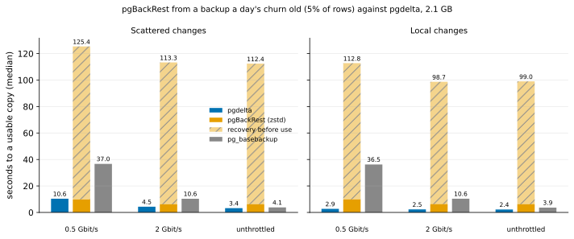

# EXP-59: Does pgBackRest still compete when its newest backup is a day old?

Status: **done October 27, 2026 (one session, 36 runs, all passing; all three predictions held): from a backup a day's churn old, pgBackRest reached a usable copy in 99–125 s, pgdelta in 2.4–10.6 s, 0.024–0.084 of pgBackRest's time. Nearly all of pgBackRest's time was its recovery, which fetched 166–205 WAL segments one per call. Whether asynchronous fetching changes the verdict is EXP-59b, pre-registered below.** Ledger test T11b, lean: one VM pair, about an hour. The owner asked for it on October 27.

## Question

EXP-08 compared pgdelta with pgBackRest's delta restore and found a mixed result:
- **pgdelta** was faster for local changes;
- **pgBackRest** was faster for scattered changes below about 6–9 Gbit/s.

That comparison flattered pgBackRest in two ways, both named in EXP-08's own caveats:
1. **Its backup was taken just before each restore,** so it already matched the source. A real repository's newest backup is up to a day old (Omni's default is a daily full).
2. **Its time stopped when the restore finished,** before the WAL replay the copy needs to be usable.

The realistic case is the one where pgdelta's old copy is recent (a former standby, minutes behind) and the backup is older:
- pgBackRest has to roll the copy back to the backup's state and replay every change since;
- pgdelta sends only the recent changes.

How do the two compare there, timed to a usable copy?

## Design

EXP-08's part B on the default `n2-standard-8` pair (the repository on the source, the restore over SSH with `process-max=4`), with three changes:
- **An old backup** (`--pgbackrest-aged-by 0.05`, new in `run_exp04.py`), in this order:
  1. the repository's full backup is taken first;
  2. 5% of `pgbench_accounts`' rows are updated at random (its own seed): the day's churn;
  3. B0 is taken;
  4. the trial's workload runs as before.

  So pgdelta's old copy B0 is behind the source by the workload alone, while the backup is behind by the churn and the workload. The WAL of both is archived to the repository.
- **Realistic rows** (`--hex-filler`): EXP-08's pgbench rows were blank padding, which compressed unusually well in pgBackRest's favour.
- **Timed to a usable copy:** each run's time plus its copy's start (`total_s + output_start_s`). pgBackRest's start includes its recovery through `archive-get`; pgdelta's copy starts at once.

| Setting | Value |
|---|---|
| Patterns | `uniform` (scattered) and `hot` (local), 1% |
| Scale | 70 (2.1 GB) |
| Speeds | 0.5 and 2 Gbit/s, and unthrottled (no added delay, as EXP-08) |
| Methods | `full`, `pgdelta_direct_inplace` (v1, as EXP-08), `pgbackrest_zst` (Omni's configuration) |
| Repeats | 2 |
| Order seed | 590 |
| Manifests | CRC32C |

Every output must start and match the source's own per-table digest. The workload's row-level check also counts the churn's rows, so it is reported but decides nothing.

**The analysis,** committed before the data: `analysis/exp59.py`, figure `exp59-old-backup`.

**Why 5%:** about a day's churn on a moderately busy OLTP table. It touches about 96% of `pgbench_accounts`' pages, so the restore must roll back nearly the whole table. A busier day only adds to pgBackRest's WAL replay, so 5% is not an extreme for it. The result is stated for this one churn.

## Predictions

1. **Deciding: pgdelta reaches a usable copy in at most 0.8 of pgBackRest's time, in every cell** (both patterns, all three speeds; medians of 2).
2. **pgBackRest moves more bytes than pgdelta in every cell:** its restore and its recovery's WAL, against pgdelta's pages.
3. **Every copy is correct:** each starts and matches the source's digest.

Rule 11 applies to 1: a cell within 20% of the 0.8 bar gets a second session.

## What follows

- **If 1 holds:** pgdelta is faster than pgBackRest even where a repository exists, once its newest backup is a day's churn old. The pitch widens from "no repository needed" to "faster than restoring from a day-old backup". RESULTS, DECISIONS (D01) and the deck say so, with this churn named.
- **If 1 fails:** the pitch stays "no repository needed". The analysis names the cells where pgBackRest wins, and EXP-08's crossover is restated with time to a usable copy.
- **If 3 fails anywhere:** that run is reported, and no time comparison stands for its cell.

## A code check after the predictions were written (October 27, before any run)

The analysis was run once on EXP-08's own data to check its code (its outputs were deleted). Timed to a usable copy, which EXP-08 never did, that data already favours pgdelta:
- **pgBackRest's recovery** took 10–14 s even from a backup taken just before, against pgdelta's 0.16 s start;
- **five of EXP-08's six cells** come out at 0.18–0.34 of pgBackRest's time;
- **its sixth,** scattered changes at 0.5 Gbit/s, is 0.72, within rule 11's 20% of the 0.8 bar.

EXP-08's rows were blank padding, and its backup was fresh, so this decides nothing here. The predictions above stand as written. It does mean the deciding cell to watch is scattered changes at 0.5 Gbit/s. The check also showed the harness names speeds `0.5g` and `2g`, which the analysis now uses.

## Results (October 27)

The default pair in us-central1-a, 13:19–14:05 EDT. All 36 runs passed:
- every pgdelta and `pg_basebackup` copy started and matched the source;
- every pgBackRest copy recovered, started and matched the source's per-table digest (the trial's logical check).

Data: `docs/experiments/data/exp59-cells.csv`; raw `results/exp04/exp59/` (not in git).

| Changes | Link | pgdelta (usable) | pgBackRest: restore + recovery = usable | `pg_basebackup` | pgdelta ÷ pgBackRest |
|---|---|---:|---:|---:|---:|
| Scattered | 0.5 Gbit/s | 10.6 s | 9.9 + 115.6 = **125.4 s** | 37.0 s | **0.084** |
| Scattered | 2 Gbit/s | 4.5 s | 6.2 + 107.1 = **113.3 s** | 10.6 s | **0.040** |
| Scattered | unthrottled | 3.4 s | 6.3 + 106.2 = **112.4 s** | 4.1 s | **0.030** |
| Local | 0.5 Gbit/s | 2.9 s | 9.9 + 102.9 = **112.8 s** | 36.5 s | **0.026** |
| Local | 2 Gbit/s | 2.5 s | 6.3 + 92.4 = **98.7 s** | 10.6 s | **0.025** |
| Local | unthrottled | 2.4 s | 6.2 + 92.8 = **99.0 s** | 3.9 s | **0.024** |

| # | Prediction | Outcome |
|---|---|---|
| 1 | Deciding: pgdelta at most 0.8 of pgBackRest's time to a usable copy, in every cell | **Held:** 0.024–0.084 |
| 2 | pgBackRest moves more bytes than pgdelta in every cell | **Held:** 1,689 MB against 484 (scattered), 1,497 MB against 36 (local) |
| 3 | Every copy is correct | **Held:** 36 of 36 |

**Where pgBackRest's time went:**
- **Restore:** the restore itself was quick, 6–10 s. It moved the same 414 MB for both patterns: the day's churn touched nearly every page of `pgbench_accounts`, so rolling B back to the backup's state meant fetching nearly the whole table, compressed.
- **Recovery:** the copy then needed 90–118 s of recovery before it could start. Recovery fetched 1.08–1.27 GB of WAL, 166–205 segments, through `archive-get` over SSH.

That WAL arrived at about 90 Mbit/s, far below every link rate tested. So recovery was bound by fetching one segment per call, or by replay, not by the link. pgdelta's copies started in 0.17 s.

**Corrections and gaps, found after the run:**
- **Bytes counted twice.** `analysis/exp59.py` counted pgBackRest's recovery bytes twice. The run's wire total already includes them (`measure.with_recovery_bytes`, by design since EXP-08). It first reported 2,963 and 2,579 MB. Fixed to 1,689 and 1,497 MB; prediction 2 holds either way.
- **The row-level check aborted each trial.** The trial-level row check failed at the end of both trials, after all their runs. It expects the trial's 70,000 changed rows, and the source also held the day's 350,000:
  - found: 416,423 and 416,463 changed rows, about the 416,500 expected from overlapping random draws;
  - the balance sum: exactly 420,000.

  So both workloads ran as designed. The design said this check decides nothing. But the harness treated it as fatal, so the check that B0 stayed unchanged, which follows it, never ran in this session. B0 is never patched itself (each method patches a copy of it), and every run started from a copy taken before the cache drop. The harness now skips the row check for aged trials and says why (`Orchestrator.trial_verify`, tested), so the B0 check runs in EXP-59b.

**What this does not settle:** the configuration `archive-get` ran with. The harness, like EXP-08, sets no `archive-async`, so recovery fetched one WAL segment per call, each over its own SSH connection. pgBackRest's own guide recommends asynchronous `archive-get` where WAL volume is high, and it could shorten this recovery by an unmeasured amount. Recovery can't go below replaying about 1.1–1.3 GB of compressed WAL, but that floor wasn't measured. EXP-59b tests it.

## EXP-59b: pgBackRest with asynchronous archive-get (pre-registered October 27, before it runs)

**Why:** EXP-59's margin rests mostly on pgBackRest's recovery. It fetched WAL one segment per call, which is how EXP-08 and EXP-59 configured it, not pgBackRest's recommended setting for high WAL volume. A deciding claim shouldn't rest on a configuration a reviewer would call unfair.

**Design:** EXP-59's design on a fresh default pair, with one more pgBackRest arm, `pgbackrest_zst_async`, new in `measure.py`:
- the same zstd repository settings on the source as `pgbackrest_zst` (its own repository, backed up at the same moment, before the day's churn);
- on the destination only, `archive-async=y` and `process-max=4`. Recovery's `archive-get` then prefetches WAL with 4 processes into the spool queue (default `archive-get-queue-max`).

The source's `archive-push` is unchanged. Scattered changes only (EXP-59's closest cell), at 0.5 Gbit/s and unthrottled; methods `full`, `pgdelta_direct_inplace`, `pgbackrest_zst`, `pgbackrest_zst_async`; 2 repeats; order seed 591. It runs before `blake3` is installed, so pgdelta hashes with BLAKE2b, as in EXP-59. Analysis: `analysis/exp59b.py`, figure `exp59b-async`, committed before the run.

**Predictions:**
1. **Deciding: pgdelta reaches a usable copy in at most 0.8 of asynchronous pgBackRest's time** at both speeds.
2. **Asynchronous `archive-get` shortens recovery** to at most 0.7 of the one-segment-per-call variant's, at both speeds, within the session.
3. **Every run passes,** including the B0 check now that the row check is skipped for aged trials.

**What follows:**
- **If 1 holds:** EXP-59's verdict stands against pgBackRest's recommended recovery setting, and the margin is quoted from the asynchronous arm.
- **If 1 fails:** EXP-59 is restated as holding only against one-segment-per-call recovery, with the asynchronous numbers beside it.
- **If 2 fails:** recovery is bound by replaying the WAL, not by fetching it, and EXP-59's margin isn't an artefact of the configuration.
