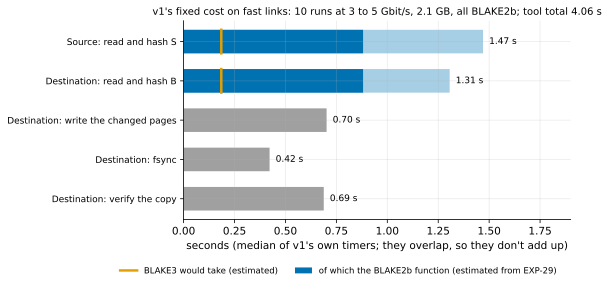
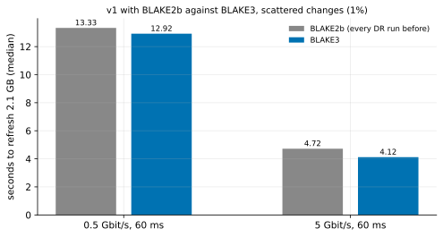

# EXP-60: How much of v1's fixed cost on fast links is the hash, and does BLAKE3 lower it?

Status: **first session done October 27, 2026 (8 runs, all passing, all four predictions held): at 5 Gbit/s v1 with BLAKE3 took 0.885 of v1 with BLAKE2b's time (4.12 s against 4.65), each hashing phase about 0.58 of BLAKE2b's. 0.885 is within 0.05 of the 0.90 bar, so rule 11's second session is pre-registered below and runs next.** Lean: the default pair, about 30 minutes, run on the same VMs after EXP-59.

## Why this experiment

The owner asked which limits pgdelta on fast links: hashing, or something else. The answers given in conversation contradicted each other:
- **One answer** drew pgdelta's time against the link rate levelling off at about 4.2 s at 2.1 GB and labelled that floor "hashing both copies".
- **A later answer** said hashing isn't what limits pgdelta: reading both copies is.

Neither was measured as stated. Two things settle it before any run.

**1. The runs' own timers split the floor (existing data).** v1 times its phases. Over EXP-52's and EXP-53's 10 passing v1 runs at 3 to 5 Gbit/s and 60 ms (2.1 GB, uniform 1%, 4 workers each end), the medians are:

| Phase (pgdelta's timer) | Median |
|---|---|
| Source: read and hash S | 1.47 s |
| Destination: read and hash B | 1.31 s |
| Destination: write the changed pages | 0.70 s |
| Destination: fsync | 0.42 s |
| Destination: verify the copy | 0.69 s |
| **pgdelta's own total** | **4.06 s** (4.57 s on the wall clock) |

The timers overlap: the two hashing phases run at the same time on different machines, and writing overlaps the transfer. So they don't add up to the total.

**2. Every one of these runs hashed with BLAKE2b, not BLAKE3.** Their senders' statistics logs say so (all 14 v1 runs of EXP-52 and EXP-53). Why:
- `--hash auto` picks BLAKE3 only where both ends have the `blake3` package;
- the VMs' startup script never installs it;
- only EXP-30's and EXP-39's lab runs did, in a virtual environment.

EXP-48's beyond-memory runs used BLAKE2b too.

From EXP-29's measured cost per page on this VM type (keyed BLAKE2b about 13.6 µs a page per core, BLAKE3 about 2.9), one pass over 259,035 pages on 4 workers takes about:
- **0.88 s of BLAKE2b,** about 60–67% of each 1.3–1.5 s hashing phase;
- **0.19 s of BLAKE3.**

This is inferred, not measured: it assumes the 4 workers share the work evenly and nothing else limits them.

So the two answers were each right in one regime, and each was stated too broadly:
- **At 2.1 GB on a fast link,** most of each hashing phase is likely the hash function, and BLAKE2b at that. The rest of the fixed cost is writing, fsync and verification.
- **Beyond memory** (EXP-48, 18 GB), reading B at the disk's 209.5 MB/s takes about 86 s. BLAKE2b on 4 workers would take about 7.5 s of it, so there the disk read is the floor and no hash can lower it.

The inference in (2) is what this experiment tests: a BLAKE3 arm should shorten both hashing phases, and the whole run on a fast link.

## Design

The default `n2-standard-8` pair, as EXP-53 (BBR on v1's data socket, tuned TCP buffers, realistic rows).
- **Install:** after EXP-59's runs, `blake3==1.0.11` (the version the Mac's tests use) is installed on both VMs. Its import is checked on each end before the sweep.
- **Arms:**
  - `pgdelta_direct_inplace_bbr_b2`: v1 with BBR and `--hash blake2b`, which every earlier DR run fell back to;
  - `pgdelta_direct_inplace_bbr_b3`: the same with `--hash blake3`;
  - `full`: one `pg_basebackup`, for context.

  The two hash arms are new in `measure.py`. Both pin their hash, so installing the package can't change what either measures. Each run's statistics record the hash both ends used (now also kept in its `tool_reported`).

| Setting | Value |
|---|---|
| Pattern | `uniform` (scattered), 1%, scale 70 (2.1 GB), `--hex-filler` |
| Conditions | 0.5 and 5 Gbit/s at 60 ms, tuned (`--conditions 0.5:60:tuned,5:60:tuned`) |
| Repeats | 2 |
| Order seed | 600 |
| Manifests | CRC32C |

**The analysis,** committed before the data: `analysis/exp60.py`. It writes the background table and figure above (`exp60-floor`) from data already on disk, then scores the run and draws `exp60-blake3`.

## Predictions

1. **Deciding: at 5 Gbit/s, v1 with BLAKE3 takes at most 0.90 of v1 with BLAKE2b's time** (median wall-clock time). The estimate above gives about 0.80–0.85: about 0.7 s saved in each hashing phase, and some in verification, out of 4.57 s.
2. **The mechanism:** at 5 Gbit/s, BLAKE3's median of each hashing phase (`hash_source`, `hash_basis`) is at most 0.6 of BLAKE2b's.
3. **The fixed cost adds to the link's time rather than hiding behind it:** the time saved (BLAKE2b's median minus BLAKE3's) at 0.5 Gbit/s is within 0.4 s of the time saved at 5 Gbit/s. This follows EXP-47's fit, in which v1's time was a fixed 3.71 s plus 4.4 s ÷ the rate in Gbit/s.
4. **Every run passes,** and each hash arm used the hash it pins: BLAKE2b on every `_b2` run and BLAKE3 on every `_b3` run.

**Rule 11:** EXP-53's sessions differed by about 5% in v1's time at 5 Gbit/s. A ratio within 0.05 of the 0.90 bar gets a second session, for that cell only.

## What follows

- **If 1 holds:** every DR number measured on VMs so far understates v1, because it ran BLAKE2b. RESULTS says so beside each fast-link number. The VMs install `blake3` from then on, and pgdelta's README recommends the package in production. The fast-link comparisons that matter (EXP-53's break-even, EXP-59) get a BLAKE3 arm when they next run.
- **If 1 fails but 2 holds:** the hash is not on the critical path at 5 Gbit/s; something else in the fixed cost is (the write, fsync and verification tail, or the protocol). The next step is that tail.
- **If 2 fails:** the hashing phases aren't bound by the hash function. The read, or the per-page Python work, is. The estimate in the background above is wrong, and RESULTS says so.
- **If 3 fails, with the saving smaller at 0.5 Gbit/s:** the hashing overlaps the slow link. The fixed-plus-link model is then wrong at slow rates, and the projections built on it (EXP-24, -47) get restated.
- **Beyond memory, no outcome changes the verdict:** there the disk read of B is the floor (EXP-48). Only reading fewer pages (change tracking, as discussed with the owner on October 27) could lower it.

## Cost

About 30 minutes on the pair EXP-59 creates: 3 methods × 2 conditions × 2 repeats, plus the blake3 install. The pair is torn down after both experiments.

## Results: the first session (October 27)

The pair EXP-59 created (us-central1-a), after EXP-59's runs. `blake3` 1.0.11 was installed and imported on both ends, and every run passed with the hash its arm pins: BLAKE2b on every `_b2` run, BLAKE3 on every `_b3` run. Data: `docs/experiments/data/exp60-cells.csv`; raw `results/exp04/exp60/` (not in git).

| | BLAKE2b | BLAKE3 | BLAKE3 ÷ BLAKE2b | `pg_basebackup` |
|---|---:|---:|---:|---:|
| **5 Gbit/s, 60 ms:** time | 4.65 s | **4.12 s** | **0.885** | 6.83 s |
| hash S (source) | 1.61 s | 0.96 s | 0.60 | |
| hash B (destination) | 1.49 s | 0.85 s | 0.57 | |
| verify | 0.76 s | 0.39 s | 0.51 | |
| **0.5 Gbit/s, 60 ms:** time | 13.36 s | 13.01 s | 0.974 | 37.24 s |

| # | Prediction | Outcome |
|---|---|---|
| 1 | Deciding: BLAKE3 at most 0.90 of BLAKE2b's time at 5 Gbit/s | **Held, 0.885**: within 0.05 of the bar, so a second session (rule 11) |
| 2 | Each hashing phase at most 0.6 of BLAKE2b's at 5 Gbit/s | **Held:** 0.598 and 0.573 |
| 3 | The saving at 0.5 Gbit/s within 0.4 s of the saving at 5 | **Held:** 0.35 s against 0.53 s |
| 4 | Every run passes with its arm's hash | **Held:** 8 of 8 |

**What it shows (one session, provisional until the second):**
- **The background's estimate held almost exactly.** EXP-29's cost per page put the BLAKE2b function at 0.88 s of each hashing phase. That predicts about 0.9 s per phase with BLAKE3, and the phases measured 0.96 and 0.85 s. What remains of each, about 0.7 s, is reading the copy and the per-page work outside the hash function.
- **The saving is real but partly hidden.** The two hashing phases each lost about 0.6 s, and verification lost 0.37 s, but the run as a whole lost 0.53 s, because the two ends hash at the same time and some of the work overlaps the transfer.
- **At 0.5 Gbit/s the saving is about the same in seconds (0.35 s)** but a small share (0.974), since the link dominates there.
- **So the fast-link numbers on VMs understated v1 by about 12% at 5 Gbit/s:** v1 took 0.60 of `pg_basebackup`'s time with BLAKE3, against 0.68 with BLAKE2b.

## The second session (rule 11), pre-registered October 27 before it runs

The same command on a fresh pair, after EXP-59b's runs (`--order-seed 601`, results in `results/exp04/exp60b`).
- **It is firm if the second session alone gives at most 0.90 at 5 Gbit/s, and both sessions' runs pooled do too** (`analysis/exp60.py --sweep results/exp04/exp60 --sweep results/exp04/exp60b`).
- **If the second session gives more than 0.90:** prediction 1 is recorded as not firm, and the pooled ratio is reported beside it.

Predictions 2–4 are scored again on the second session.
