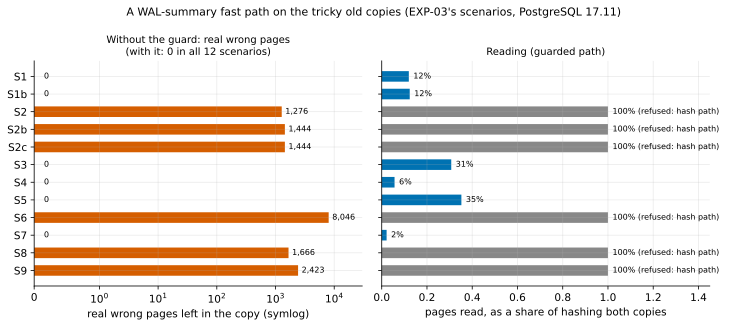

# EXP-61: Would a WAL-summary fast path ever leave a wrong page, and how much reading would it save?

Status: **done October 27, 2026 (one local build per scenario, PostgreSQL 17.11 and 18.6; pre-registered in 027e2fa before any run). The deciding prediction held: with the lineage guard, the summary path left no real wrong page in any of the 12 scenarios, and where the guard let it run (6 of 12) it read 2–35% of the pages that hashing both copies reads. Without the guard, the summaries left 1,276–8,046 real wrong pages in each of the other 6, the failover cases among them. Predictions 2 and 3 held; 4 failed in one scenario, on an over-send that is safe.** No VM, no change to pgdelta.

## Question

pgdelta hashes every page of both copies, so beyond memory its time is set by reading the old copy B (EXP-48). The owner asked on October 27 whether pages could instead carry a label, so the tool already knows what changed without another exchange with B.

PostgreSQL 17 keeps such labels as WAL summaries. With `summarize_wal = on`, a background process records which blocks of which relation forks each stretch of WAL touched. So a refresh could work from the summaries alone:
1. B reports one position: the redo point its recovery would start from (and its timeline).
2. S sends exactly the blocks the summaries list between that point and its own backup start.
3. Neither side reads, or hashes, any other page.

EXP-03 showed the simpler label, the page LSN, leaving stale or wrong pages in 4 of 8 same-cluster scenarios, including real stale data after a failover. Summaries are a different label:
- they come from the WAL itself, so a page whose change is logged can't be missed by a stale `pd_lsn`;
- they still can't see what was never logged: hint bits, `pg_checksums --enable`, an old primary's writes after a split.

Two paths are scored on EXP-03's tricky old copies:
- **Naive:** trust B's redo point and S's own timeline history.
- **Guarded:** use the summaries only when B's lineage is provable, and otherwise fall back to hashing everything, as pgdelta does now.

## Design

EXP-03's scenario builder, with the source cluster running `summarize_wal = on` from its creation (`run_scenarios.py build --wal-summaries`, new). Twelve scenarios:
- EXP-03's S1–S9;
- the two later variants of the failover case, S2b and S2c, whose old copy's redo point lies *before* the split.

Before the servers stop, the builder:
1. waits until the summarizer has passed S's start;
2. dumps every summary's blocks and limit blocks (a fork's truncation or creation), and S's timeline history.

**The guard** (all must hold, else hash everything):
- (a) B and S have the same system identifier;
- (b) the same major version;
- (c) the same data checksum version;
- (d) B's timeline is on S's history, and B's end lies within that timeline's stretch of S's history. B's end is the furthest of its latest checkpoint, its minimum recovery point, and the last WAL record in its own `pg_wal` (read with `pg_waldump`). This is the check `pg_rewind` makes before trusting a fork point. It catches an old copy that kept writing after the split even when its redo point is before it (S2b, S2c).
- (e) The summaries cover B's redo point to S's start without a gap.

**The summary path's pages,** following PostgreSQL 17's own incremental backup (`basebackup_incremental.c`):
- a relation file absent from B is sent whole, and so are free-space-map and init forks, and every non-relation file;
- main and visibility-map forks get:
  - the blocks the summaries list in the range;
  - every block from the lowest limit block in the range on;
  - every block past B's length.

**Ground truth:** every page of S is compared with B's page at the same place. A page that differs and isn't sent is **left wrong**. Each is sorted with EXP-03's classifier (`classify.py`):
- `hint_bits_only` (and `hint_bits_and_lsn`): differ only in bits PostgreSQL itself changes without WAL; harmless;
- anything else (`content`, `all_visible`, `vm`, `fsm`, `checksum_only`, `lsn_only`, `init`, `unclassified`) counts as a **real** wrong page.

**Reading:**
- the summary path reads only the pages it sends, on S;
- the hash path reads every page of S and of B.

This counts pages, not seconds. What reading fewer pages saves in time beyond memory is inferred from EXP-48's disk model, not measured here.

**Code:** `experiments/tricky_copies/summaryscan.py` (new), the dump in `scenarios.py`, and the analysis `analysis/exp61.py` with figure `exp61-summary-path`, all committed before the run.

## Predictions

1. **Deciding: the guarded path leaves no real wrong page in any of the 12 scenarios.** At most `hint_bits_only` or `hint_bits_and_lsn` pages, which PostgreSQL itself treats as equal.
2. **The guard refuses exactly S2, S2b, S2c** (diverged after a failover), **S6** (checksum version), **S8** (another cluster) and **S9** (another major version), and passes S1, S1b, S3, S4, S5 and S7.
3. **Without the guard, the summaries leave real wrong pages in S2, S2b, S2c and S6.** That is the same failure class as LSN skipping in EXP-03.
4. **Where the guard passes, the summary path reads at most half the pages the hash path reads,** and sends at most 1.25 times the pages that actually differ (plus files absent from B).

The counts are deterministic for a given build, so one build per scenario (as EXP-03) and no second session.

## What follows

- **If 1 and 2 hold:** a guarded summary path is safe on every tricky copy tested, and reads only the pages it sends. A fast path then becomes a design option for the owner, for old copies with provable lineage on servers with `summarize_wal` on. It is the one change that could beat the "at best a tie" HA verdict beyond memory. It is not built or turned on by this result: the design rule "LSNs and summaries never skip pages" (DESIGN.md) is the owner's to change.
  - **Caveats that stay:** Omni ships with `summarize_wal` off (EXP-40), so summaries exist only from when it is turned on. PostgreSQL 17 keeps them 10 days by default. Versions before 17.11 and 18.6 omit some visibility-map changes from the summaries (the bug fixed in August 2026), so the guard would also require a fixed server version.
- **If 1 fails:** the write-up names each real wrong page's scenario, relation and cause. A summary path is then unsafe even with the guard, and hashing stays the only path.
- **If 2 fails** (the guard refuses a safe copy, or passes a diverged one): the guard is revised, and the revision is pre-registered and re-run on the same builds before anything is concluded.
- **If 4 fails:** the summary path is safe but saves less than claimed. Its reading cost is reported as measured.

## Results

All 12 scenarios built, every check passed, and the summarizer reached S's start in each (no dump errors). Data: `docs/experiments/data/exp61-scenarios.csv`; raw `results/exp61/` (not in git: each scenario's `summaryscan.json` and `wal_summaries.json` beside the two copies).

| Scenario | Guard | Real wrong pages without the guard | With the guard | Pages read, share of hashing both | Pages sent ÷ pages that differ |
|---|---|---:|---:|---:|---:|
| S1 lagging standby | passes | 0 (53 hint bits only) | 0 | 12% | 1.18 |
| S1b lagging standby, no checkpoint | passes | 0 | 0 | 12% | 1.20 |
| S2 ex-primary after failover | refuses: B's WAL runs past the split | **1,276** stale data (+19 hint bits) | 0 | 100% (hash) | – |
| S2b ex-primary, redo before the split | refuses: B's WAL runs past the split | **1,444** (1,443 stale data, 1 VM) | 0 | 100% (hash) | – |
| S2c standby of the ex-primary | refuses: B's WAL runs past the split | **1,444** (1,443 stale data, 1 VM) | 0 | 100% (hash) | – |
| S3 crash-consistent copy | passes | 0 | 0 | 31% | 1.07 |
| S4 VACUUM truncation | passes | 0 | 0 | 6% | **1.72** |
| S5 `FILE_COPY` databases | passes | 0 | 0 | 35% | 1.04 |
| S6 `pg_checksums --enable` | refuses: checksum version | **8,046** (7,925 checksum field, 121 VM) | 0 | 100% (hash) | – |
| S7 hint bits, no checksums | passes | 0 (3,770 hint bits only) | 0 | 2% | 0.10 |
| S8 another cluster | refuses: system identifier (and B's WAL) | **1,666** (1,644 LSN only, 16 VM, 6 stale data) | 0 | 100% (hash) | – |
| S9 `pg_upgrade` 17→18 | refuses: system identifier, version, no summaries | **2,423** (1,673 stale data, 640 LSN only, 110 VM) | 0 | 100% (hash) | – |

| # | Prediction | Outcome |
|---|---|---|
| 1 | Deciding: the guarded path leaves no real wrong page in any scenario | **Held:** 0 in all 12 |
| 2 | The guard refuses exactly S2, S2b, S2c, S6, S8 and S9 | **Held** |
| 3 | Without the guard, real wrong pages in S2, S2b, S2c and S6 | **Held,** and in S8 and S9 as well |
| 4 | Where the guard passes, at most half the pages read, and at most 1.25× the differing pages sent | **Failed in S4 only:** reading held everywhere (2–35%), but S4 sent 1.72× |

## What the results show

- **The guard, not the summaries, is what makes a fast path safe.** Summaries alone failed exactly where page LSNs failed in EXP-03:
  - an old primary that kept writing after a failover (S2, S2b, S2c): about 1,300–1,450 pages of stale rows;
  - checksums enabled offline (S6);
  - a foreign or upgraded cluster (S8, S9).

  The summaries record what S did, never what B did after the split, so no reading of S's labels can see B's divergence. Checking B's own end of WAL against S's timeline history did see it, including S2b and S2c, whose redo points lie before the split. That is `pg_rewind`'s test.
- **Where lineage is provable, the reading drops to a fraction.** The guarded path read 2–35% of the pages that hashing both copies reads:
  - 12% for a lagging standby;
  - 6% after a truncation;
  - 31% for a crash copy with many changes;
  - 35% where whole new databases had to be sent.

  It reads nothing on B at all.
- **Prediction 4's failure is a safe over-send.** All 366 extra pages in S4 are free-space-map pages: sent whole by the rule copied from PostgreSQL's incremental backup, though they hadn't changed. Without that rule S4 sends exactly the 508 pages that differ.
- **What the fast path gives up:** pages that differ only in hint bits are never sent. That is 53 on the lagging standby and 3,770 where reads set hint bits without checksums. PostgreSQL treats such pages as equal, but the copy is then not byte-identical to S. Unsent pages can't be verified without reading them. So a fast path changes pgdelta's guarantee from "byte-identical and verified" to "identical except hint bits, with unchanged pages trusted to the summaries and the guard".

## What this does not show

- **Time.** Pages were counted, not timed. EXP-48's disk model (beyond memory, time ≈ |B| ÷ read rate + pages written ÷ write rate) implies the fast path removes the |B| term. For a standby with local changes, the HA verdict "at best a tie" could become a large win. That is inferred, not measured.
- **Scale and variety.** Each scenario is about 8,500 pages, built once. The tricky cases are the ones EXP-03 found; others (a deleted `pg_wal` on B, unlogged tables, tablespaces, a summarizer restarted mid-range) weren't built.
- **The guard's blind spot.** It reads B's own WAL to find how far B went. An old primary whose `pg_wal` past the split was lost or removed would look like a clean ancestor and pass. `pg_rewind` has the same dependency. Any build of this path would need B's WAL to be complete from its redo point, or must refuse. *[EXP-62](EXP-62-guard-blind-spot.md) confirmed the blind spot: 1,444 real wrong pages on such a copy. A stricter guard v2, which takes B's end only from a clean stop or a base backup's manifest, refused it and left none in 13 scenarios.*
- **Omni as shipped:** `summarize_wal` is off (EXP-40). Summaries exist only from when it is turned on, and are kept 10 days by default. A server before 17.11 or 18.6 would also need refusing, for the visibility-map summaries bug fixed in August 2026.

## Decision for the owner

The design rule "LSNs or WAL summaries will never be used to skip pages" (DESIGN.md) is unchanged. This result makes a guarded fast path a credible option: on old copies with provable lineage and `summarize_wal` on, read only the changed pages, and hash everything otherwise. It is the one route found so far past the HA tie beyond memory. Building it, and the timed test that would confirm its speed, wait for the owner's decision.

*After the data: the figure's left panel was simplified to the unguarded path's bars, with the guarded zeros stated in its title, because 12 zero-length bars hid nothing but cluttered it. The scoring code was not changed.*
