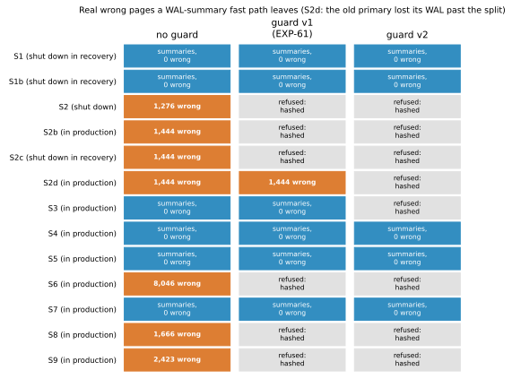

# EXP-62: Can an old primary whose own WAL was lost fool EXP-61's guard, and does a stricter guard close it?

Status: **done October 27, 2026 (one local build per scenario; pre-registered in 3ba32b5 before any run). All three predictions held. The blind spot is real: EXP-61's guard let the fast path run on an old primary that had lost its WAL past the split (S2d), and it left 1,444 real wrong pages, 1,443 of them stale rows. Guard v2, which proves B's end by how B was stopped, refused it and left no real wrong page in any of the 13 scenarios. Its cost: the crash-consistent copy (S3) is hashed instead.** Local only, like EXP-61. No VM, no change to pgdelta.

## Question

EXP-61's guard let a WAL-summary fast path run only when the old copy B provably lies on the source's history. It left no real wrong page on 12 tricky copies. Its write-up named one blind spot:
- the guard finds how far B went from the furthest of three positions: its latest checkpoint, its minimum recovery point, and the last record in its own `pg_wal`;
- so an old primary that crashed after writing past a failover split would look like a clean ancestor if its `pg_wal` past the split were later lost: deleted, recycled or never copied.

Its pages would still hold the diverged rows, and the summaries can't see them. This experiment builds that copy and tests a stricter guard.

## Design

**A new scenario, S2d (old primary, its WAL past the split lost),** built like S2b:
1. the old primary keeps writing after the split, flushes the diverged pages without a checkpoint, and stops with `-m immediate`, so its redo point stays before the split;
2. then every WAL segment of B from the one holding the split on is deleted.

S2d is added beside EXP-03's list (`scenarios.EXTRA_SCENARIOS`), not into it, so EXP-03's and T11's runs are unchanged.

**Guard v2:** EXP-61's guard (v1), but B's end must be *proven by how B was stopped*, not read from whatever WAL B still holds:
- **a data directory shut down cleanly** (`shut down`): its end is its shutdown checkpoint, written after every record it wrote;
- **a standby shut down cleanly** (`shut down in recovery`): the later of its checkpoint and its minimum recovery point, which a standby advances before it writes any page past it;
- **a base backup** (has `backup_label`): the latest end in its `backup_manifest`'s WAL ranges; without a manifest, refused;
- **anything else is refused,** since how far it went can't be proven without all of its WAL. That means a data directory that crashed or was copied while running (`in production`, `in crash recovery`, `in archive recovery`).

The last WAL record in B's `pg_wal` still counts when it lies further (more caution, never less). Everything else is as v1:
- the same system identifier, major version and checksum version;
- B's end on S's history;
- the summaries covering the gap.

**Runs:** EXP-61's 12 scenarios rebuilt, plus S2d, with `--wal-summaries`, into `results/exp62/`. Each `summaryscan.json` now carries both guards' verdicts and both guarded paths' counts. The code in `summaryscan.py` and `analysis/exp62.py` is committed before the run. v1 is unchanged, so EXP-61 still reproduces.

## Predictions

1. **Deciding, the blind spot is real:** guard v1 lets the summary path run on S2d, and it leaves real wrong pages there (stale data from the diverged writes).
2. **Deciding, v2 closes it:** guard v2 refuses S2d, and the v2-guarded path leaves no real wrong page in any of the 13 scenarios.
3. **v2's cost:**
   - it passes exactly S1, S1b, S4, S5 and S7;
   - it also refuses S3, the crash-consistent copy, which v1 let through safely and which then falls back to hashing;
   - it refuses everything v1 refused.

## What follows

- **If 1 and 2 hold:** a fast path, if built, uses v2. The rule is that B's end is proven by a clean stop or a backup manifest, never by the WAL B happens to hold. EXP-61's write-up points here for its blind spot. The cost is that crash-copied old copies (S3) are hashed, as today.
- **If 1 fails** (v1 already refuses S2d): the write-up records what caught it. v2 is then stricter than needed, and its extra cost (S3) is weighed against that.
- **If 2 fails:** the write-up names each real wrong page and why it passed. The fast path stays unsafe until a further guard is pre-registered and tested.

## Results

All 13 scenarios built with every check passing, and no summary dump failed. EXP-61's 12 rebuilt with the same counts: the same verdicts, the same wrong pages and the same read fractions. In S2d, 2 of B's WAL segments were deleted, from the one holding the split on. Data: `docs/experiments/data/exp62-guards.csv`; raw `results/exp62/` (not in git).

| # | Prediction | Outcome |
|---|---|---|
| 1 | Deciding: guard v1 lets the fast path run on S2d, and it leaves real wrong pages | **Held:** v1 passed S2d; 1,444 real wrong pages (1,443 stale rows, 1 visibility-map page), the same as unguarded |
| 2 | Deciding: guard v2 refuses S2d, and leaves no real wrong page in any scenario | **Held:** refused ("B was not stopped cleanly (in production)"); 0 in all 13 |
| 3 | v2 passes exactly S1, S1b, S4, S5 and S7, so it also refuses S3, and refuses everything v1 refused | **Held** |

## What the results show

- **v1 trusted evidence that could go missing.** With its WAL past the split gone, nothing left in S2d's B says it went past the split:
  - its pg_control still shows a checkpoint before the split, since it crashed;
  - it has no minimum recovery point;
  - the last record in its `pg_wal` lies before the split.

  Yet its pages hold the rows it wrote after the split.
- **v2 trusts only what a stop guarantees.** A clean shutdown's checkpoint, a cleanly stopped standby's minimum recovery point, and a base backup's manifest each bound every page the copy holds. A copy that crashed, or was copied while running, has no such bound, so v2 refuses it however its WAL looks.
- **The cost is one safe case.** v2 also refuses S3, a crash-consistent copy with its WAL intact, which v1 had let through without error. S3 is then hashed, as pgdelta does today. Of the 13, v2 lets the fast path run on 5:
  - the two cleanly stopped standbys (S1, S1b);
  - three base backups with manifests (S4, S5, S7).

  Where it runs, it reads 2–35% of the pages hashing reads, as in EXP-61.

## What this does not show

The same limits as EXP-61 apply:
- pages were counted, not timed;
- the copies are small and built once;
- Omni ships with `summarize_wal` off.

v2 rests on PostgreSQL's own guarantees about a clean stop: a shutdown checkpoint written after every record, a standby's minimum recovery point advanced before it writes a page. It doesn't defend against a copy altered by hand after it stopped, such as pages edited in place or a pg_control replaced. Hashing remains the only path that checks every page.
