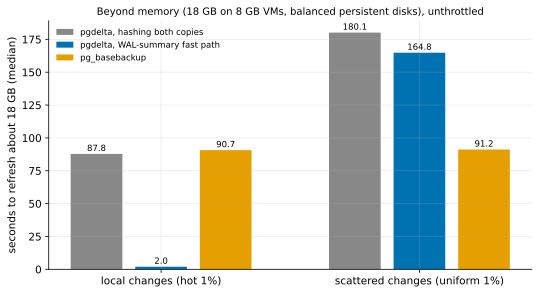
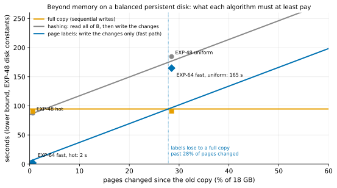

# EXP-64: Beyond memory, how much faster is the fast path than hashing, and than a full copy?

Status: **done October 27, 2026 (one session, 12 runs, all passing; 4 of 5 predictions held, the deciding one among them). Beyond memory, for local changes the fast path refreshed 18 GB in 1.98 s, against 87.8 s by hashing and 90.7 s by a full copy (0.022–0.023). For scattered changes it took 164.8 s, 0.915 of hashing and 1.81 times a full copy. Its own timers place the gap in the sender's one-at-a-time reads of the source (about 99 s), which didn't overlap the receiver's writes (about 107 s): a systems problem.** One VM pair (the `ha` set), about 2 hours with the data load. The owner asked for the fast path to be built and timed beyond memory (K11).

## Question

Beyond memory, pgdelta's hashing path is bound by reading B. EXP-48's model put v1 in place at |B| ÷ read rate + pages written ÷ 6,750 a second:
- 87.5 s for hot changes at 18 GB on 8 GB VMs, against 90.5 s for one `pg_basebackup`: "at best a tie";
- 184.6 s for uniform changes.

The fast path (`--fast-path summaries`, built after EXP-61 to EXP-63) reads neither copy's unchanged pages. If the model is right, the read term disappears and only the changed pages remain. Measured, how much faster is it?

## Design

EXP-48's set-up, run by a lab script (`experiments/network/lab_exp64.sh`) because the fast path needs a live source:
- **The VMs:** the `ha` set, two `n2d-highcpu-8` (8 vCPUs, 8 GB) in two zones, each with a 150 GiB balanced persistent disk, unthrottled. `blake3` is installed on both.
- **The source:** EXP-48's database (`source_cluster.py setup`, scale 600, about 18 GB, its seed), running, with `summarize_wal = on` set before any old copy is taken. PostgreSQL 17 from PGDG; the script fails if it is older than 17.11.
- **Per pattern** (hot, then uniform; 1% of rows, EXP-48's workload and seed):
  1. B0, a `pg_basebackup` of the source with its manifest, is taken before the change;
  2. the change runs;
  3. the timed runs.
- **Each run** starts from a fresh copy of B0, with both VMs' page caches dropped:
  - **hash:** pgdelta live, in place, `--jobs 4 --hash blake3`, hashing both copies;
  - **fast:** the same with `--fast-path summaries`;
  - **full:** one `pg_basebackup -X stream -c fast` into a new directory, as EXP-48's `full`.

  Each arm runs 2 times per pattern, in a shuffled order (seed 640).
- **Correctness:** each fast copy is started (recovering from its backup_label), and its `pgbench_accounts` row count and sum of `abalance` must equal the source's.

**The analysis,** committed before the data: `analysis/exp64.py`, figure `exp64-beyond-memory`. Medians of 2.

## Revision before any registered run (October 27, rule 8)

**The region changes to us-west1 (zones a and b).** No `n2d-highcpu-8` capacity was found in us-central1 (a, b, c and f) or us-east1 (b, c and d); GCP answered `ZONE_RESOURCE_POOL_EXHAUSTED`, and nothing was created there.
- **Unchanged:** the machine type, the 150 GiB balanced persistent disks, the database, the arms and every prediction.
- **Why that's sound:** a balanced disk's limits are set by its size, not its region. The session records its own disk test, which EXP-48's model needs.
- **If prediction 5 (the control against EXP-48) fails,** the region is one more candidate cause.

**The smoke** (scale 20, 300 MB, one run per arm) ran every arm end to end. Every fast copy matched the source. In memory at that size the fast path took 1.15 s against hashing's 4.1 s for hot changes, but 5.4 s against 4.3 s for uniform ones. That decides nothing here.

## Predictions

1. **Deciding: hot changes, the fast path takes at most 0.35 of the hashing path's time.** The model: the hashing path pays about 86 s reading B; the fast path writes the roughly 14,000 changed pages (EXP-48: 13,935) in about 2 s, plus fixed costs of a few seconds.
2. **Hot changes, the fast path takes at most 0.35 of the full copy's time.** This is the HA case where EXP-48 found "at best a tie".
3. **Uniform changes, the fast path takes at most 0.75 of the hashing path's time.** Its write term stays (EXP-48: 619,856 pages, about 92 s at 6,750 a second); only the read of B goes.
4. **Every fast run uses the fast path, and every fast copy is correct:**
   - the guard passed, proved by B0's `backup_manifest`;
   - the copy recovered and matched the source;
   - every run exited 0.
5. **Control:** the hashing path is within 20% of EXP-48's v1 times (87.5 s hot, 184.6 s uniform), so this session is comparable with that one.

The uniform comparison with the full copy is reported, not predicted. **Rule 11:** a deciding ratio within 0.05 of its bar gets a second session.

## What follows

- **If 1 and 2 hold:** beyond memory, for local changes, a refresh with provable lineage is several times faster than both hashing and a full copy. RESULTS' HA row changes from "at best a tie", with its conditions:
  - `summarize_wal` on;
  - a cleanly stopped or base-backup old copy;
  - PostgreSQL 17.11 or later.

  The Omni operator's practice (EXP-44: it deletes the old disk) is unchanged, so the HA case on Omni still needs that disk kept.
- **If 1 fails:** the fast path's own costs (the summaries, the guard, B's facts, the backup's start and stop) are read from its statistics, and the model is restated.
- **If 3 fails:** the uniform case is bound by something besides the read; the write term is re-measured.

## Results (October 27)

The `ha` set in us-west1-a and -b (the revision above), 21:59–23:01 UTC, then deleted. PostgreSQL 17.11 (`server_version_num` 170011), a 17,787 MB database, `summarize_wal` on before B0. Every run exited 0. Every fast run used the fast path, its guard passing on B0's `backup_manifest`, and every fast copy recovered with `pgbench_accounts` equal to the source's. Data: `docs/experiments/data/exp64-cells.csv`; raw `results/exp04/exp64/` (not in git).

| 18 GB on 8 GB VMs | Hashing (v1 live) | Fast path | `pg_basebackup` | Fast ÷ hashing | Fast ÷ full |
|---|---:|---:|---:|---:|---:|
| Local changes (hot 1%): time | 87.8 s | **1.98 s** | 90.7 s | **0.023** | **0.022** |
| pages sent | 13,880 | 14,712 | all | | |
| Scattered changes (uniform 1%): time | 180.1 s | 164.8 s | 91.2 s | 0.915 | 1.81 |
| pages sent | 618,417 | 619,251 | all | | |

| # | Prediction | Outcome |
|---|---|---|
| 1 | Deciding: hot, fast at most 0.35 of hashing | **Held, 0.023** |
| 2 | Hot, fast at most 0.35 of a full copy | **Held, 0.022** |
| 3 | Uniform, fast at most 0.75 of hashing | **Failed, 0.915** |
| 4 | Every fast run used the fast path; every fast copy correct; every run exited 0 | **Held** |
| 5 | Control: hashing within 20% of EXP-48's v1 | **Held:** 87.8 against 87.5 s, and 180.1 against 184.6 s |

On the lower-bound chart (`analysis/bounds.py`), the local point sits on the bound for page labels, and the scattered point about 70 s above it:

## Why the scattered case missed (from the runs' own timers)

| Uniform, median of 2 | Fast path | Hashing |
|---|---:|---:|
| Sender reading the source and hashing (`hash_source`) | 157.1 s, of which 57.8 s blocked sending | 86.7 s (the whole of S, sequential, on 4 workers) |
| Receiver hashing B (`hash_basis`) | none | 102.9 s |
| Receiver writing the pages (`rebuild`) and syncing them (`fsync`) | 57.6 s and 49.4 s | 117.5 s and 113.7 s (overlapping) |
| Receiver waiting for data (`recv_wait`) | **105.2 s** | 61.1 s |
| Guard (summaries, 1,466,330 block rows) | 4.7 s | none |

- **The fast path did save B's read:** about 103 s of hashing B is gone.
- **It replaced that with about 99 s of reading 616,000 scattered pages of the source.** These were read one at a time in the single sending thread, with no read-ahead or parallel reads, while the receiver sat idle for 105 s.
- **The receiver's own writing and syncing took about 107 s** (about 5,800 pages a second).

So the two sides' I/O ran mostly one after the other: about 99 s of reading plus about 58 s blocked on sending. Overlapped, the bound is about max(99, 107) + 5 ≈ 112 s, or 0.62 of hashing. **This is a systems problem:**
- **read parallelism and pipelining on the source** (parallel or read-ahead reads of the chosen pages);
- **the scattered write rate on B,** which the gap-filling writes of research loop 1 (idea 2) would attack.

With both, the fast path could reach a full copy's time on scattered changes. Even overlapped, it stays about 1.2 times a full copy here, near the 28% crossover the bounds predict.

**What this shows:**
- **Beyond memory, for local changes, the fast path ends the "at best a tie" verdict:** about 45 times faster than both hashing and a full copy, with the copy proven correct.
- **For scattered changes that touch about 28% of the pages, it is still slower than a full copy,** and the cause is measured, not guessed. **Conditions:** `summarize_wal` on before the old copy was taken, an old copy whose end is provable (here a base backup with its manifest), and PostgreSQL 17.11.

**Next** (research loop 1, re-ranked):
- **The source-side read pipeline,** pre-registered as EXP-64b, re-running the uniform cell;
- **an `fio` sweep for the gap-filling idea;**
- **the competitor head-to-heads still unmeasured:** `pg_rewind`, and catch-up from a WAL archive.
