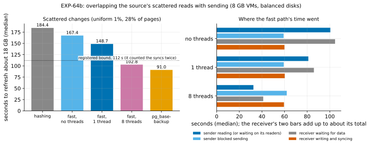

# EXP-64b: Do overlapped source reads close the fast path's gap on scattered changes?

Status: **done October 28, 2026 (one session, 10 runs, all correct; the deciding prediction held, 2 mechanism predictions failed).** Pre-registered October 27, before any run. The owner asked for the overlapped reads to be built and this experiment registered on EXP-64's uniform cell.
- **Eight reader threads cut the fast path's scattered case from 167.4 s to 102.8 s (0.614),** and to 0.557 of hashing. A full copy (91.0 s) still wins, by 1.13 times instead of 1.84.
- **Parallel reads mattered, not just overlap:** one reader thread gave only 148.7 s. A single 8 KiB read on this disk takes 447 µs (EXP-66), so one reader is bound by the disk's latency.
- **The registered bound (112 s) was wrong:** it counted the receiver's syncs twice. The receiver now waits 41 s for data (bar 30 s), because it syncs each file in its main loop and stops receiving meanwhile. EXP-68 (pre-registered next) tests moving the syncs off it.

## Question

Beyond memory, EXP-64's fast path refreshed 18 GB with scattered changes in 164.8 s: 0.915 of hashing's time, and 1.81 times a full copy. The runs' own timers (median of 2, uniform cell) put the cause in the sender:

| EXP-64, fast path, uniform | Seconds |
|---|---:|
| Sender, reading the source and sending (`hash_source`) | 157.1 |
| of which blocked sending (`page_send_s`) | 57.8 |
| so reading the source's 619,251 chosen pages, one run at a time | **about 99** |
| Receiver writing the pages (`rebuild`) | 57.6 |
| Receiver syncing them, before the next file (`fsync`, main loop) | 49.4 |
| Receiver waiting for data (`recv_wait`) | **105.2** |

The two sides' I/O alternated. The sender read a run, then waited on the socket while the receiver wrote and synced; the receiver then waited while the sender read the next run. Overlapped, the time is bounded by the slower side: max(about 99 s of reads, about 107 s of writes and syncs) plus about 5 s of fixed cost (the guard alone took 4.7 s), so **about 112 s**, or 0.68 of 164.8 s.

`--read-ahead THREADS` (built for this) reads the chosen runs on reader threads, in sending order, up to 64 MiB ahead of the sending thread. The source's reads then go on while the sending thread is blocked on the socket. **Does it reach the bound?**

A second question is about mechanism. At 28% of pages, chosen independently, the gaps between chosen pages are short: (1 − 0.28) ÷ 0.28, about 2.5 pages on average, so the 619,251 pages fall in about 440,000 runs.
- **One reader at queue depth 1** read those runs in about 99 s: about 4,450 a second, or 225 µs each. That's faster than a network disk usually answers a single read, and more than the disk's documented 3,900 IOPS (balanced, 150 GiB: 3,000 plus 6 per GiB).
- **The likely reason** is the kernel's read-ahead on a forward-moving reader: it fetched most of each file at the disk's sequential rate (EXP-48: 209.5 MB/s), and 16 GB at that rate is about 80 s (**inferred**).
- **If so,** one reader thread is enough: the gain comes from overlap, not from parallel reads.
- **Eight threads** could do better if reads were latency-bound, or worse if interleaved reads defeat the kernel's read-ahead.

Arms with 1 and 8 threads tell these apart.

## Design

EXP-64's set-up, unchanged: `experiments/network/lab_exp64.sh` now takes `PATTERNS` and `ARMS`, and its defaults reproduce EXP-64's plan exactly (checked).
- **The VMs:** the `ha` set in us-west1 (EXP-64's revision), two `n2d-highcpu-8` (8 vCPUs, 8 GB), each with a 150 GiB balanced persistent disk, unthrottled; `blake3` on both.
- **The source:** EXP-48's database (scale 600, about 18 GB, its seed), PostgreSQL 17.11 or later, `summarize_wal = on` before B0 is taken.
- **The cell:** uniform only (1% of rows, EXP-48's workload and seed, about 28% of pages). B0 is a `pg_basebackup` with its manifest, taken before the change.
- **Each run** starts from a fresh copy of B0, with both VMs' caches dropped. All pgdelta arms are live, in place, with `--jobs 4 --hash blake3`. The arms:
  - **hash:** hashing both copies (EXP-64's `hash`);
  - **fast:** `--fast-path summaries`, reads in the sending thread (EXP-64's `fast`; `--read-ahead 0`);
  - **fast1:** the same with `--read-ahead 1`;
  - **fast8:** the same with `--read-ahead 8`;
  - **full:** one `pg_basebackup -X stream -c fast` into a new directory.
- **The schedule:** 2 runs per arm, in a shuffled order (seed 641): `PATTERNS=uniform ARMS="hash fast fast1 fast8 full"`, `lab_exp64.sh SOURCE 2 641`, results in `exp64b`.
- **Correctness:** each fast copy is started (recovering from its backup_label), and its `pgbench_accounts` row count and sum of `abalance` must equal the source's.
- **Recorded per run:**
  - the sender's `hash_source` and blocked sending (`page_send_s`);
  - the time its sending thread waited on the reader threads (`fast_path.read_ahead.wait_seconds`);
  - the receiver's `recv_wait`, `rebuild` and `fsync`.
- **A smoke first** at scale 20 (one run per arm), which decides nothing.

**The analysis,** committed before the data: `analysis/exp64b.py`, figure `exp64b-read-ahead`, data `docs/experiments/data/exp64b-cells.csv`. Medians of 2.

## Predictions

1. **Deciding: `fast8` takes at most 0.80 of `fast`'s time,** in this session. The bound gives 0.68. A bar at 0.80 still requires the overlap to recover more than half of the roughly 53 s between EXP-64's time and the bound.
2. **`fast8` takes at most 0.75 of hashing's time.** This is EXP-64's failed prediction 3, re-tested; the bound gives 0.62.
3. **The receiver becomes the bottleneck:** in `fast8` it waits for data for at most 30 s in all (EXP-64: 105.2 s).
4. **Mechanism: overlap, not parallel reads.** `fast1` and `fast8` are within 15% of each other.
5. **Every fast run uses the fast path, and every fast copy is correct:**
   - the guard passed on B0's `backup_manifest`;
   - the copy recovered and matched the source;
   - every run exited 0.
6. **Control:** `fast` is within 15% of EXP-64's 164.8 s, and `hash` within 20% of its 180.1 s.

**Reported, not predicted:** each fast arm against the full copy. Even at the bound, the fast path stays about 1.2 times a full copy here, at the 28% crossover the bounds put it on (research loop 1, section 3).

**Rule 11:** a deciding ratio within 0.05 of its bar gets a second session.

## What follows

- **If 1 holds:** the read side is solved, and the fast path's remaining gap to a full copy on scattered changes is the receiver's scattered writes.
  - Read-ahead becomes the fast path's default, at the smaller thread count if 4 holds. Before that, the smoke's in-memory runs and the hot cell (EXP-64: 1.98 s) are re-checked for any loss.
  - The `fio` sweep for gap-filled writes (research loop 1, idea 2) is next, because the writes then bind.
- **If 1 fails while 3 holds:** reads overlapped but something else took their place; the timers say what.
- **If 1 and 3 both fail:** the source's reads are slower than one-at-a-time reads with threads, or are still the bottleneck. The comparison of `fast1` and `fast8` says which, and whether the kernel's read-ahead is the cause.
- **If 4 fails with `fast8` faster:** parallel reads matter beyond overlap, and the thread count is worth a sweep.
- **If 4 fails with `fast8` slower:** interleaved reads defeat the kernel's read-ahead, and one reader thread (or reading whole extents, ROMIO-style data sieving on the read side) is the design.

## Results (October 28)

The `ha` set in us-west1-a and -b, 00:40–01:46 UTC (a smoke at scale 20 first), then EXP-66 on dest, then deleted.
- **The server:** PostgreSQL 17.11, a 17,787 MB database, `summarize_wal` on.
- **The disks' sequential floors** (`dd`, 2 GiB): 207 MB/s read and written.
- **Every run** exited 0, and every pgdelta receiver too.
- **Every fast run** used the fast path, its guard passing on B0's `backup_manifest`. Every fast copy recovered and equalled the source.
- **The fast path's plan was the same in every run:** 617,786 pages chosen in 865 files, 139 of them sent whole. The reader threads read the other 726 files' pages as **249,193 runs.**

Data: `docs/experiments/data/exp64b-cells.csv`; raw `results/exp04/exp64b/` (not in git).

| Uniform 1%, 28% of pages, 18 GB | hash | fast (no threads) | fast1 | fast8 | full |
|---|---:|---:|---:|---:|---:|
| Seconds, median of 2 | 184.4 | 167.4 | 148.7 | **102.8** | **91.0** |
| Repeats | 182.6, 186.2 | 165.2, 169.7 | 148.5, 149.0 | 102.5, 103.0 | 90.9, 91.0 |
| Sender's reading and sending (`hash_source`) | 86.6 | 159.7 | 140.3 | 94.4 | |
| of which blocked sending | 90.7 | 59.2 | 59.3 | 61.9 | |
| of which waiting on its reader threads | | | 74.0 | 22.4 | |
| Receiver waiting for data | 61.3 | 104.7 | 86.0 | **41.1** | |
| Receiver writing and syncing (`rebuild`, syncs included) | 121.2 | 59.9 | 60.2 | 59.5 | |
| of which syncing (`fsync`) | 116.2 | 48.9 | 49.4 | 49.4 | |

| # | Prediction | Outcome |
|---|---|---|
| 1 | Deciding: `fast8` at most 0.80 of `fast` | **Held, 0.614** (0.19 from the bar: no second session under rule 11) |
| 2 | `fast8` at most 0.75 of hashing | **Held, 0.557** |
| 3 | `fast8`'s receiver waits for data at most 30 s | **Failed, 41.1 s** (`fast`: 104.7 s) |
| 4 | Overlap, not parallel reads: `fast1` and `fast8` within 15% | **Failed, `fast1` is 1.447 times `fast8`** |
| 5 | Every fast run used the fast path; every copy correct; every run exited 0 | **Held** |
| 6 | Control: `fast` within 15% of 164.8 s, hash within 20% of 180.1 s | **Held, 167.4 s (+1.6%) and 184.4 s (+2.4%)** |

**Reported:** against the full copy, `fast8` is 1.13 times, `fast1` 1.635 and `fast` 1.84.

**The smoke** (scale 20, in memory, one run each, deciding nothing) showed no loss from the threads: `fast8` 2.69 s, `fast1` 5.01 s, `fast` 5.41 s, hash 4.49 s, full 6.33 s.

### Two corrections to the registration's reasoning, found after the data

Neither changes a score; both change what the scores mean.

1. **The receiver's timers were added up wrongly.** In the default fsync mode, `main`, the receiver syncs each finished file in its main loop, and `rebuild_seconds` counts that sync ([receiver.py](../../pgdelta/receiver.py) `_file_done`). So EXP-64's "57.6 s of rebuild plus 49.4 s of fsync" counted the syncs twice: the receiver wrote and synced in about 58–60 s, not 107 s. Its main loop is just two things, waiting and writing: in `fast8`, 41.1 + 59.5 = 100.6 of 102.8 s. The registered bound of 112 s is therefore not a bound. The figure now labels it as the registered value and shows the receiver's writing and syncing beside its waiting.
2. **The run count came from a model, not the data.** The registration assumed pages were chosen independently, which gives about 440,000 runs, and so a single reader reading "about 4,450 runs a second". The real page set had 249,193 runs (updates cluster on pages). EXP-64's single reader therefore read about 249,193 ÷ 99 s, or **2,500 runs a second**. EXP-66 measured 2,163 single 8 KiB reads a second on the same kind of disk. So the single reader was mostly bound by the disk's latency, with a modest help from the kernel's read-ahead, not mostly carried by it.

## What it means (with a committee's reading)

- **The read side is solved for this disk.** Overlapping alone (`fast1`) recovered 19 s of the 65 s. Reading at a queue depth above 1 recovered the rest: with eight threads, the sending thread waited on its readers for 22.4 s in all, and spent 61.9 s blocked on the receiver. At a depth of 8, EXP-66's disk completes 4,198 reads a second, its cap. 249,193 runs at that rate take 59 s, so the source's reads could now hide entirely under the other side's work.
- **Prediction 4 failed the informative way.** The registration said that if eight threads won, "parallel reads matter beyond overlap, and the thread count is worth a sweep". The corrected run rate gives the reason: at one read at a time, 447 µs each, 249,193 runs take about 115 s. The kernel's read-ahead brought EXP-64's single reader down to about 99 s, and a single reader thread can't do better than that. Only more reads in flight can.
- **The receiver is now the constraint, and not because of its disk's rate.**
  - Its main loop received, wrote and then synced each file in turn. It waited 41 s for data, while the sender spent 62 s blocked sending to it.
  - The two sides take turns (**inferred** from the timers): while the receiver syncs a file (49 s in all), it doesn't read the socket, so the sender blocks. When it reads again, the sender's readers have to catch up.
  - Writing 249,193 runs at the disk's 4,195 writes a second (EXP-66) takes 59 s, about what the receiver spent writing and syncing. **That fits writes bound by the disk's operation rate, one per run (inferred: no disk counters were recorded).**
- **If the syncs moved off the main loop, both sides' roughly 60 s could overlap:** about 60 s plus 5 s of fixed cost, below a full copy's 91 s, at 28% of pages changed. That is the hypothesis for EXP-68. pgdelta already has `--fsync worker` (EXP-10, EXP-14), measured only at 2.1 GB, where it saved 0.3–2.0 s.
- **A committee's reading:** the deciding prediction held by a wide margin, and controls replicated EXP-64 within 2.4%. The two failed predictions were about mechanism. Both trace to errors in the registration's arithmetic, which this write-up states openly rather than re-scores. The claim "the read side is solved" rests on measured timers. The claim "the receiver is op-bound" is inferred, and EXP-68 records the disks' counters to test it.

**Limitations:**
- **One session, one disk type and size, one VM type, one cell.** The hot cell and the in-memory case weren't re-checked at scale, so read-ahead doesn't become the default yet (the registration's condition). EXP-68 re-checks the hot cell.
- **Thread counts 1 and 8 only.** Whether 4 or 16 does better is open; EXP-68 sweeps it.
- **No disk counters:** the per-operation reasoning uses EXP-66's `fio` rates, not counts of the I/O each run issued.
- **The page set:** 249,193 runs is a count from the reader threads, which read only the 726 files not sent whole.

## What follows (applied)

- **Read-ahead stays opt-in** until EXP-68 checks the hot cell and the thread count.
- **EXP-68**, pre-registered next:
  - the fsync worker against the main loop, at 8 and 16 threads;
  - the hot cell;
  - `/proc/diskstats` on both VMs per run;
  - the real page set dumped once, so EXP-66's model can be re-run on it.
