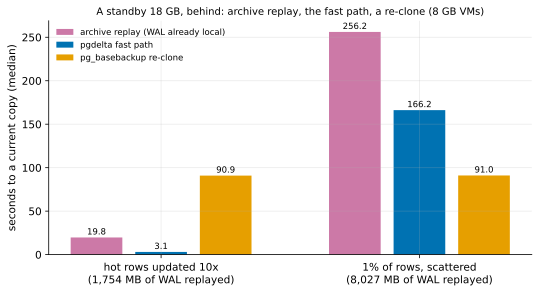

# EXP-65: Against the standard way a lagging standby catches up (archive replay), does the fast path win?

Status: **done October 27, 2026 (one session, 12 runs, all correct; all 4 predictions held, the deciding one far from its bar).**
- **Hot rows updated 10 times:** the fast path brought an 18 GB standby current in 3.1 s, against 19.8 s for replaying the archive (0.156) and 90.9 s for a re-clone (0.034).
- **1% of rows scattered:** 166.2 s, against 256.2 s for replay (0.649). Both lost to a re-clone's 91.0 s.

One VM pair (the `ha` set), about 2 hours. Research loop 1 (rule 12) found this comparison unmeasured; rule 12 asks for it before more optimisation.

## Question

When a streaming standby falls behind and a WAL archive exists, the standard practice is to let it replay the archive through `restore_command` until it is current. CloudNativePG does that automatically, and pgBackRest's `archive-get` serves it (research loop 1). pgdelta's fast path instead sends the blocks that changed.
- **Replay** pays for every WAL record since the standby stopped: each update, each full-page image after each checkpoint.
- **The fast path** pays once for each distinct changed page.

Which is faster to a current copy, and when?

## Design

EXP-64's set-up and VMs: the `ha` set, two `n2d-highcpu-8` with 150 GiB balanced persistent disks, EXP-48's 18 GB database, PostgreSQL 17.11 or later, with `summarize_wal` on. Script: `experiments/network/lab_exp65.sh`.
- **The source** archives its WAL (`archive_mode = on`, `cp` to a local directory).
- **The standby B0** is a `pg_basebackup -R` of the source, caught up by streaming, then stopped cleanly (`shut down in recovery`), so the fast path's guard can prove its end.
- **Two lags,** each with a fresh B0, then a WAL switch, the archive complete, and the source's LSN and `pgbench_accounts` state recorded:
  - **hot10:** the same 1% hot rows updated 10 times (EXP-48's hot workload, ten passes): many WAL records over few pages;
  - **uniform:** 1% of the rows updated once, spread over about 28% of the pages (EXP-64).
- **Fair to the competitor:** before the runs, the whole archive is copied to the destination, untimed. Replay then fetches with a local `cp`: its floor, with no fetch cost at all.
- **Each run** starts from a fresh copy of B0, with both VMs' caches dropped, and is timed until the copy is current:
  - **replay:** B starts as a standby with `restore_command` and no `primary_conninfo`, and is timed until it has replayed past the source's LSN;
  - **fast:** pgdelta live, in place, `--fast-path summaries --hash blake3 --jobs 4`, then the copy started until it accepts connections;
  - **full:** one `pg_basebackup -X stream -c fast` into a new directory, then started the same way.
- **Correctness:** each copy's `pgbench_accounts` row count and sum of `abalance` must equal the source's.
- 2 repeats per arm and lag, shuffled (seed 650). **The analysis,** committed before the data: `analysis/exp65.py`, figure `exp65-archive-catch-up`.

## Predictions

1. **Deciding: for hot10, the fast path reaches a current copy in at most 0.25 of archive replay's time.**
2. **For hot10, the fast path takes at most 0.25 of a full re-clone's time.**
3. **For uniform, the fast path is at least as fast as archive replay** (at most 1.0 of its time). That is uncertain: replay pays about one full-page image per changed page and reads those pages beyond memory, against the fast path's measured 164.8 s (EXP-64).
4. **Every copy is current and correct,** every fast run used the fast path (its guard proved by the clean stop in recovery), and every run exited 0.

**Rule 11:** a deciding ratio within 0.05 of its bar gets a second session.

## What follows

- **If 1 holds:** for standbys whose lag is many updates to few pages, the fast path beats the standard catch-up, even replay's floor with the archive already local. RESULTS says so, with the conditions.
- **If 3 fails:** for scattered lag, archive replay remains the better choice. Research loop 1's write path (EXP-64b, gap-filled writes) is what would change that, and is measured against replay next.
- **Either way,** the comparison table in research loop 1 replaces "not measured" with these numbers.

## Results (October 27)

The `ha` set in us-west1-a and -b, 23:16–00:38 UTC (a smoke at scale 20 first), then deleted.
- **The server:** PostgreSQL 17.11, a 17,788 MB database, `summarize_wal` on.
- **Checkpoints:** PostgreSQL's defaults (`max_wal_size` 1 GB, `checkpoint_timeout` 5 min). The experiment's cluster set-up sets none of them.
- **Every run** exited 0, and every copy's `pgbench_accounts` equalled the source's.
- **Every fast run** used the fast path, its guard proving B's end by the clean stop in recovery.

Data: `docs/experiments/data/exp65-cells.csv`; raw `results/exp04/exp65/` (not in git).

| 18 GB standby, 8 GB VMs | Archive replay (WAL local) | Fast path | `pg_basebackup` re-clone | Fast ÷ replay | Fast ÷ re-clone |
|---|---:|---:|---:|---:|---:|
| Hot rows updated 10 times: time | 19.8 s | **3.1 s** | 90.9 s | **0.156** | **0.034** |
| WAL replayed, pages the fast path sent | 1,754 MB | 14,978 pages | all | | |
| 1% of rows scattered: time | 256.2 s | 166.2 s | **91.0 s** | 0.649 | 1.83 |
| WAL replayed, pages the fast path sent | 8,027 MB | 619,065 pages | all | | |

| # | Prediction | Outcome |
|---|---|---|
| 1 | Deciding: hot10, fast at most 0.25 of replay | **Held, 0.156** (0.094 from the bar: no second session under rule 11) |
| 2 | Hot10, fast at most 0.25 of a re-clone | **Held, 0.034** |
| 3 | Uniform, fast at most 1.0 of replay | **Held, 0.649** |
| 4 | Every copy current and correct; every fast run used the fast path (proof: the clean stop in recovery); every run exited 0 | **Held** |

**Per run,** the two repeats agreed within 3%:
- replay 19.65 and 19.87 s, then 254.6 and 257.7 s;
- fast 3.03 and 3.13 s, then 166.6 and 165.9 s;
- re-clone 90.7–91.1 s.

**A correction to the figure's labels, made after the data.** The registered analysis labelled each cell with the archive's size (1,862 and 11,811 MB). But the archive also held WAL written before B0's redo point, which replay never applied. The labels now show the WAL replay applied, from the copy's own `redo starts at` to the source's LSN: 1,754 and 8,027 MB. The scores don't use the WAL's size.

## What it means (with a committee's reading)

- **Replay pays per WAL record; the fast path pays once per changed page.** In hot10, replay applied about 117 KiB of WAL for each page the fast path sent: ten passes over the same hot rows, so each row's update was logged ten times, plus full-page images after checkpoints. The fast path sent each of the 14,978 pages once. **That ratio, not the database's size, is what the deciding prediction tested,** and it held by a wide margin.
- **Scattered lag is worse for replay per byte, too.** Uniform replay applied 8,027 MB at 31 MB/s, against 89 MB/s for hot10. Most of the uniform WAL's records touch pages that aren't in the standby's 8 GB of memory, so replay waits on reads of the data files (**inferred** from the two rates; this session didn't measure replay's I/O). Its WAL per changed page was only about 13 KiB (about one full-page image each), so the volume of WAL wasn't what made it slow; the rate of applying it was.
- **For scattered lag, a re-clone beats both.** The fast path's 166.2 s matches EXP-64's 164.8 s from a different kind of old copy: a cleanly stopped standby, not a base backup. That makes it a replication of EXP-64's scattered-change cost, still about 1.8 times a full copy. EXP-64b (overlapped reads) and EXP-66 (gap-filled writes) attack that gap.
- **Where the fast path stands against the standard catch-up:** it wins whenever the WAL since the standby stopped is large against the pages it touched, which is the usual shape of a long lag on a busy system. It also beat replay on scattered lag (0.649). There, though, the right tool today is a re-clone.

**Limitations:**
- **Replay's floor, not its practice:** the archive sat on dest's own disk and `restore_command` was a `cp`. Fetching from object storage, even with pgBackRest's asynchronous prefetch (EXP-59b), only adds time, so the comparison favours replay.
- **Default checkpoints:** a larger `max_wal_size` or `checkpoint_timeout` would cut the full-page images and with them replay's WAL. The ratio in hot10 would shrink, though ten updates per page would still be ten records per page. This wasn't measured.
- **Where each copy ends:** replay's copy is a running standby. The fast path's and the re-clone's are started as ordinary servers, to check them, and becoming a standby again is a configuration file, not timed. All three reached the source's LSN with equal `pgbench_accounts`.
- **Conditions:** the fast path needed `summarize_wal` on before B stopped, PostgreSQL 17.11 or later, and a cleanly stopped standby. Replay needs none of these, only an archive that reaches back to B.
- **Scope:** one session, one disk type, two lag shapes and one size. The deciding ratio is far from its bar, so rule 11 asks for no second session.

