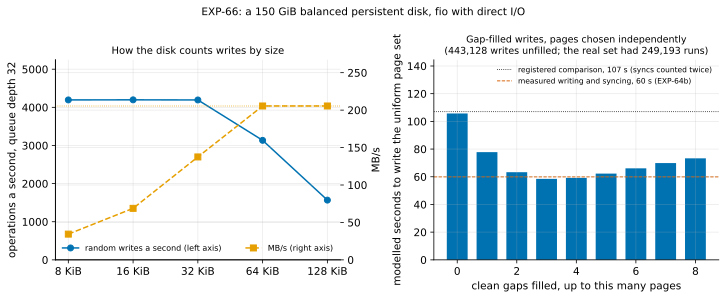

# EXP-66: Does a balanced persistent disk count a 32 KiB write as one operation, so that gap-filled writes would pay?

Status: **done October 28, 2026 (one session; all 3 predictions held as registered, but the control held only because two errors cancelled).** Pre-registered October 27, before any run. Research loop 1 ranked this second: it decides idea 2's premise.
- **Idea 2's premise holds:** the disk completed 4,194 random 32 KiB writes a second, the same as 8 KiB ones (1.000). Up to 32 KiB a write costs one operation; from 64 KiB, the 205.5 MB/s byte limit binds.
- **One 8 KiB read at a time completes 2,163 times a second** (447 µs). That explains why EXP-64b's one reader thread lost to eight.
- **The model's gain (best fill of 3 pages, 44.7% less write time) isn't trusted yet.** Its comparison number counted the receiver's syncs twice (107 s; really about 60 s), and its independent pages gave 443,128 writes where the real set had 249,193 runs. The registration's own rule for a failed control applies instead: the write path is instrumented first (EXP-68), and the decision rule re-applied on the real page set.

## Question

Beyond memory, the fast path's scattered case writes about 620,000 pages spread over 28% of an 18 GB copy. EXP-64 measured about 107 s of the receiver writing and syncing them (rebuild 57.6 s plus fsync 49.4 s). Even with the source's reads overlapped (EXP-64b), that write time binds, and it keeps the fast path above a full copy's 91 s.

**Research loop 1's idea 2:** fill short clean gaps between dirty runs, so that writes become fewer and larger. The idea comes from ROMIO's data sieving (Thakur et al.) and PandaSync's threshold rule. The fill pages would be the source's current pages, which a full copy would write anyway.

**The idea pays only if the disk charges by operation rather than by byte** for writes of a few pages. GCP documents a balanced disk's limits per operation and per byte, but not how it counts an operation's size. Say a 32 KiB write costs the same operation as an 8 KiB one until the byte limit binds. Then filling gaps of up to a few pages turns about 440,000 small writes into far fewer larger ones, at the price of writing the filled pages too. If the disk charges by bytes instead, filling only adds work.

A second, smaller question is for EXP-64b's mechanism. How many random 8 KiB reads does the disk complete one at a time? EXP-64's sender read about 4,450 runs a second at queue depth 1, which EXP-64b attributes to the kernel's read-ahead (**inferred**). A measured single-read rate well below that settles the attribution.

## Design

- **Where:** dest of the `ha` set (an `n2d-highcpu-8` with a 150 GiB balanced persistent disk, us-west1), right after EXP-64b's runs, with nothing else running.
- **How:** `experiments/network/fio_sweep.sh`, fio with direct I/O (`libaio`) on a 20 GiB file laid out first. Each configuration runs 30 s after a 5 s ramp, with caches dropped before it:
  - random writes of 8, 16, 32, 64 and 128 KiB at queue depth 32;
  - random 8 KiB reads at queue depths 1, 8 and 32;
  - 1 MiB sequential writes and reads at queue depth 8 (the byte limit).
- **A smoke first** (2 GiB, 5 s per configuration), deciding nothing.
- **The model, committed before the data** (`analysis/exp66.py`, data `docs/experiments/data/exp66-fio.csv` and `exp66-model.csv`, figure `exp66-write-sizes`):
  1. **The page set:** EXP-48's uniform share of pages (619,856 of 2,175,659), chosen independently (seed 660), with runs cut at 1 GiB segment boundaries.
  2. **Filling:** for each g from 0 to 8, every clean gap of at most g pages is filled.
  3. **The cost:** each write of b bytes costs max(1 ÷ ops(b), b ÷ the sequential write rate). ops(b) is interpolated from the measured random-write rates, and held at the 128 KiB rate beyond that size, where the byte term takes over.
  4. **The result:** the modelled write time at each g.

  Assuming pages are chosen independently is a simplification: real updates cluster slightly by page and by index. Prediction 3 tests whether the model is close enough at g = 0.

## Predictions

1. **Deciding: at queue depth 32, random 32 KiB writes complete at least 0.7 times as many operations a second as 8 KiB ones.** This is idea 2's premise: larger writes cost about one operation each until the byte limit binds.
2. **Random 8 KiB reads at queue depth 1 complete at most 2,500 a second.** EXP-64's 4,450 runs a second then needed the kernel's read-ahead, as EXP-64b assumes.
3. **Control on the model:** at g = 0 (no filling), the modelled write time is within 30% of EXP-64's measured 107 s.

**The decision rule:** idea 2 is prototyped in the fast path's write plan only if 1 and 3 hold and the best g cuts the modelled write time by at least 25%. The prototype is then measured on the uniform cell against EXP-64b's best arm, with its own pre-registration.

**Rule 11:** a deciding ratio within 0.05 of its bar gets a second session.

## What follows

- **If the rule says prototype:** the fast path's write plan fills gaps of up to the best g pages, with the fill pages sent from the source. The source's read-ahead is already reading them, so the cost is network bytes on a 16 Gbit/s link. This could move the crossover with a full copy (research loop 1, section 3) well past 28%.
- **If 1 fails:** the disk charges by bytes, so idea 2 is dropped with its reason recorded. Beyond about 28% of pages changed, a full copy then stays the better choice. That is the case for idea 4, the selector: choose a full copy there.
- **If 3 fails:** the model misses how the receiver's writes reach the disk (the kernel merging dirty pages, or the sync pattern). The write path is instrumented before any prototype.

## Results (October 28)

Dest of EXP-64b's `ha` pair (us-west1-b), 01:47–01:56 UTC, right after EXP-64b's runs with nothing else running; a smoke first (2 GiB, 5 s per configuration). Then the pair was deleted.

Data: `docs/experiments/data/exp66-fio.csv` and `exp66-model.csv`; raw `results/exp04/exp66/` (not in git).

| `fio`, direct I/O, 20 GiB file | Operations a second | MB/s | Mean latency |
|---|---:|---:|---:|
| Random writes, 8 KiB, depth 32 | 4,195 | 34.4 | 7.6 ms |
| 16 KiB | 4,197 | 68.8 | 7.6 ms |
| **32 KiB** | **4,194** | 137.5 | 7.6 ms |
| 64 KiB | 3,135 | **205.5** | 10.2 ms |
| 128 KiB | 1,567 | **205.5** | 20.4 ms |
| Random reads, 8 KiB, **depth 1** | **2,163** | 17.7 | 0.45 ms |
| depth 8 | 4,198 | 34.4 | 1.9 ms |
| depth 32 | 4,194 | 34.4 | 7.6 ms |
| Sequential writes, 1 MiB, depth 8 | 196 | 205.5 | 40.7 ms |
| Sequential reads, 1 MiB, depth 8 | 196 | 205.5 | 40.8 ms |

The disk's limits, as measured: **about 4,195 operations a second** for reads and writes alike (GCP documents 3,900 for a 150 GiB balanced disk), and **205.5 MB/s**. A write or read is one operation up to at least 32 KiB.

| # | Prediction | Outcome |
|---|---|---|
| 1 | Deciding: random 32 KiB writes reach at least 0.7 of 8 KiB's operations a second | **Held, 1.000** (0.30 from the bar) |
| 2 | Random 8 KiB reads at depth 1 at most 2,500 a second | **Held, 2,163** |
| 3 | Control: the model without filling within 30% of EXP-64's measured 107 s | **Held as registered, 105.7 s;** but see the correction below |

**The model** (pages chosen independently, as registered):

| Fill gaps up to | 0 | 1 | 2 | **3** | 4 | 6 | 8 |
|---|---:|---:|---:|---:|---:|---:|---:|
| Writes | 443,128 | 317,146 | 226,959 | 162,310 | 115,975 | 59,298 | 30,211 |
| Extra pages written | 0 | 125,982 | 306,356 | 500,303 | 685,643 | 992,749 | 1,208,599 |
| Mean write | 11.2 KiB | 18.8 | 32.6 | 55.2 | 90.0 | 217.5 | 484.1 |
| Modelled seconds | 105.7 | 77.8 | 63.3 | **58.5** | 59.2 | 66.1 | 73.3 |

The script's verdict on the decision rule: best fill 3 pages, a cut of 44.7%, "prototype idea 2".

### The correction, found after the data

Prediction 3's two sides are each wrong by about the same factor, so they agreed by accident:
- **The measured side:** EXP-64's "rebuild 57.6 s plus fsync 49.4 s" counted the syncs twice. In fsync mode `main`, the receiver's rebuild timer already includes each file's sync (EXP-64b, correction 1). The receiver wrote and synced the uniform page set in **57.6 s** (EXP-64) and **59.9 s** (EXP-64b's `fast` arm).
- **The modelled side:** pages chosen independently fall in 443,128 runs. The real page set fell in **249,193 runs** (EXP-64b's reader threads counted them), since real updates cluster on pages. The registration named this simplification and made prediction 3 its test.

Against the measured 59.9 s, the model at g = 0 is 1.76 times too high: **prediction 3 fails in substance.** The score stays as registered, with this correction beside it. Both figure lines are drawn: the registered 107 s and the measured 60 s.

Run with the real count instead, the same cost model gives 249,193 writes at 4,195 a second, **59.4 s**, close to the receiver's 59.9 s. That fits writes bound by the disk's operation rate, one per run. It's a check made after the data, not a test (**inferred**).

## What it means (with a committee's reading)

- **The premise of gap-filled writes is measured and firm.** Below 64 KiB, this disk charges by operation, not by byte. Filling a short clean gap turns two writes into one. That's free while the merged write stays at most 32 KiB, and cheap until the byte limit binds.
- **Its size on real data is not known.** The real page set has 44% fewer runs than the model, and its gaps are unmeasured: clustering could leave fewer short gaps to fill, or more. The 44.7% cut is a property of independent pages only.
- **So idea 2 isn't prototyped yet.** The registered rule said to prototype only if prediction 3 held. In substance it didn't, and the registration's branch for that case is to instrument the write path first. EXP-68 records each run's disk counters and dumps the real page set once. The model and decision rule (best fill cuts the write time by at least 25%, the model at g = 0 within 30% of the measured writing and syncing) are then re-applied on that set.
- **Prediction 2 settles EXP-64b's mechanism.** One read at a time completes in 447 µs. EXP-64's single reader managed about 2,500 runs a second, so the kernel's read-ahead helped only modestly, and more reads in flight was the remedy (EXP-64b's eight threads).
- **The same counting applies to reads,** so a filled gap would also save the source a read (**inferred**: reads were measured only at 8 KiB).

**Limitations:**
- **One disk type and size, one VM type, one session.** A larger balanced disk has a higher operation limit. SSD and Hyperdisk differ.
- **`fio` writes with direct I/O at depth 32,** while the receiver writes through the page cache and syncs. The kernel's writeback chooses its own depth and may merge adjacent pages. Only EXP-68's disk counters can show what the receiver's writes actually were.
- **Reads were measured only at 8 KiB.**
