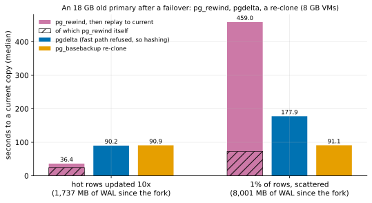

# EXP-67: For an old primary after a failover, does pg_rewind beat pgdelta, and by how much?

Status: **done October 28, 2026 (one session, 12 runs, all correct; all 3 predictions held, the deciding one far from its bar).**
- **Hot rows updated 10 times on the new primary:** `pg_rewind` and its replay brought the 18 GB old primary current in 36.4 s. pgdelta took 90.2 s (0.404): its guard refused the diverged copy, so it hashed both. A re-clone took 90.9 s.
- **1% of rows scattered:** `pg_rewind` took 459.0 s, 84% of it replay. pgdelta took 177.9 s (0.387 of that), and a re-clone 91.1 s, which beat both. It was 5.0 times faster than `pg_rewind`.

Pre-registered October 28, before any run (commit e5590e0). One VM pair (the `ha` set), about 2 hours, after EXP-64b and EXP-66. Research loop 1 ranked this first among the competitors never timed: item 1(a). EXP-65 was 1(b).

## Question

After a failover, the old primary B has written a little that the new primary S never saw, and S has moved on. The standard way back is `pg_rewind`, which Patroni, CloudNativePG, Crunchy PGO and Spilo all use. It does three things:
1. reads B's own WAL since the last common checkpoint for the blocks B changed;
2. copies those blocks, plus every non-relation file and S's WAL, from S;
3. makes B replay S's WAL from that checkpoint as a standby.

**pgdelta can't use its fast path here.** Its guard refuses a B whose history left S's: EXP-61 and EXP-63 showed this is necessary, since summaries alone would miss B's own changes. So pgdelta hashes both copies. Beyond memory, hashing costs about as much as a full copy (EXP-48, EXP-64).

Research loop 1 inferred that `pg_rewind` "probably wins wherever it can run". This measures it, at 18 GB beyond memory, for two shapes of S's lag:
- the same hot rows updated 10 times, where replay pays for many WAL records per page;
- 1% of rows scattered, where replay waits on reads (EXP-65: 31 MB/s of WAL).

The answer decides research loop 1's item 3. If `pg_rewind` beats hashing, idea 1 is worth prototyping: the union of both sides' block sets (B's from its WAL, S's from its summaries), sent once and never replayed.

## Design

The `ha` set as in EXP-64 and EXP-65: two `n2d-highcpu-8` in us-west1 with 150 GiB balanced persistent disks, and EXP-48's database (scale 600, about 18 GB), PostgreSQL 17.11 or later.
- **Data checksums** are on (the clusters' default), so `pg_rewind` can run.
- **`wal_keep_size = 40GB`** on the source, so S keeps its WAL since the fork. In practice a replication slot or an archive serves the same need.

Script: `experiments/network/lab_exp67.sh`.

**The failover, built afresh for each lag, in the real orientation** (B on the old timeline, S on the new one):
1. On the source VM, a standby Q of the current primary P catches up, then stops cleanly.
2. P updates 10,000 rows (every 6,000th account) that Q never sees, then stops cleanly. This is the fenced old primary.
3. P's data directory goes to dest as **B0**.
4. Q, promoted onto a new timeline, takes P's place as **S**.
5. S runs the lag:
   - **hot10:** EXP-48's 1% hot rows updated 10 times;
   - **uniform:** 1% of rows once.
6. S's LSN and `pgbench_accounts` state are recorded.

**Each run** starts from a fresh copy of B0, with both VMs' caches dropped, and is timed until the copy is current:
- **rewind:** `pg_rewind --source-server` S `--write-recovery-conf` on dest, then B started as S's standby until it has replayed to S's LSN. Its own share (`pg_rewind` alone) is timed too.
- **fast:** pgdelta live, in place, `--fast-path summaries --hash blake3 --jobs 4`, then the copy started until it accepts connections. The guard is expected to refuse, so the session hashes both copies. That is what pgdelta would do here.
- **full:** one `pg_basebackup -X stream -c fast` into a new directory, then started the same way.

**Correctness:** each copy's `pgbench_accounts` row count and sum of `abalance` must equal S's. B's own 10,000 changed rows must be gone.

2 repeats per arm and lag, shuffled (seed 670). **A smoke first** at scale 20 (one run per arm), deciding nothing. **The analysis,** committed before the data: `analysis/exp67.py`, figure `exp67-rewind`, data `docs/experiments/data/exp67-cells.csv`.

## Predictions

The model comes from EXP-64 and EXP-65's measurements.
- **pgdelta hashing:** about 88 s for hot10 and about 180 s for uniform (EXP-64's hashing arm).
- **`pg_rewind`:** copies B's 10,000 changed blocks and S's WAL since the fork (about 1.8 and 8 GB), then replays that WAL at EXP-65's rates (89 and 31 MB/s). That gives about 30 s for hot10, and over 280 s for uniform.

1. **Deciding: for hot10, `pg_rewind` reaches a current copy in at most 0.6 of pgdelta's time.** The model gives about 0.35.
2. **For uniform, pgdelta takes at most 0.85 of `pg_rewind`'s time.** Replaying scattered WAL beyond memory is slower than reading B once. The model gives about 0.65.
3. **Every copy is correct and every fast run was refused by the guard:**
   - every copy is current, with B's own changes gone;
   - every pgdelta run was refused for B's history (its reason naming the timeline or history), so it hashed both copies;
   - every run, and every pgdelta receiver, exited 0.

**Reported, not predicted:** the re-clone against both. EXP-65 suggests a re-clone (about 91 s) beats both for uniform.

**Rule 11:** a deciding ratio within 0.05 of its bar gets a second session.

## What follows

- **If 1 holds:** `pg_rewind` beats pgdelta on its home ground, as research loop 1 inferred. Idea 1 is then prototyped and pre-registered against `pg_rewind`: the union of B's blocks since the fork (from B's WAL) and S's blocks since then (from S's summaries), sent once from S and never replayed. Its model is EXP-65's: about 3 s against `pg_rewind`'s replay for hot10.
- **If 1 fails:** hashing is competitive even here, and idea 1's case rests on scattered lags (prediction 2).
- **If 2 holds:** for scattered lags pgdelta's hashing beats `pg_rewind`. A re-clone may still beat both, which is the case for the selector (idea 4).
- **If 3 fails for the guard:** the guard let a diverged B through, or refused for the wrong reason. That's a correctness finding, investigated before anything else.

## Results (October 28)

The `ha` set in us-west1-a and -b. The runs ended at 03:35 UTC, and the VMs were then deleted. A smoke ran first at scale 20; all three methods' copies matched there.
- **The server:** PostgreSQL 17.11, a 17,788 MB database, data checksums and `summarize_wal` on. Checkpoints and `shared_buffers` were PostgreSQL's defaults.
- **Every run** and every pgdelta receiver exited 0, and every copy's `pgbench_accounts` equalled S's. Had any of B's own 10,000 rows survived, the sum of `abalance` would have been off by 7 for each.
- **Every pgdelta run** was refused by its guard for B's history, and so hashed both copies:
  - hot10: "B reaches 6/6B73DE40, past where the server's history leaves timeline 1 (6/62000060)";
  - uniform: the same for timeline 2 at 6/D8000000.

Data: `docs/experiments/data/exp67-cells.csv`; raw `results/exp04/exp67/` (not in git).

**Two changes to the registered analysis, made after the data; no score changed:**
- **The figure's labels:** they said "MB of WAL on S". They now say "since the fork", which is what the number is.
- **Medians to 3 decimals, not 2:** pgdelta's uniform median is 177.8515 s. Stored as 177.85 and labelled to one decimal, it read 177.8.

| 18 GB old primary, 8 GB VMs | `pg_rewind`, then replay | of which `pg_rewind` | pgdelta (hashing) | `pg_basebackup` re-clone | `pg_rewind` ÷ pgdelta | pgdelta ÷ `pg_rewind` |
|---|---:|---:|---:|---:|---:|---:|
| Hot rows updated 10 times: time | **36.4 s** | 24.5 s | 90.2 s | 90.9 s | **0.404** | 2.48 |
| WAL since the fork; `pg_rewind` copied; pgdelta sent | 1,737 MB | 2,090 MB | 33,975 pages | all | | |
| 1% of rows scattered: time | 459.0 s | 72.8 s | 177.9 s | **91.1 s** | 2.58 | **0.387** |
| WAL since the fork; `pg_rewind` copied; pgdelta sent | 8,001 MB | 12,078 MB | 623,827 pages | all | | |

| # | Prediction | Outcome |
|---|---|---|
| 1 | Deciding: hot10, `pg_rewind` at most 0.6 of pgdelta's time | **Held, 0.404** (0.196 from the bar: no second session under rule 11) |
| 2 | Uniform, pgdelta at most 0.85 of `pg_rewind`'s time | **Held, 0.387** |
| 3 | Every copy current, with B's own changes gone; every pgdelta run refused for B's history, so it hashed; every run and receiver exited 0 | **Held** |

**Per run,** the two repeats agreed within 1.1%:
- `pg_rewind`'s path: 36.56 and 36.32 s, then 458.3 and 459.7 s;
- pgdelta: 90.25 and 90.21 s, then 178.8 and 176.9 s;
- re-clone: 90.8–91.2 s.

**Against the registered model:**
- **pgdelta's hashing:** 90.2 and 177.9 s, against the modelled 88 and 180 s (EXP-64's hashing arm).
- **`pg_rewind`'s path:** 36.4 s against about 30 s for hot10, and 459.0 s against "over 280 s" for uniform.
- **Replay's rate:** after `pg_rewind`, from its end to S's LSN (start-up included), compared with EXP-65's archive replay of about the same WAL. The model used EXP-65's rates.

| Lag | WAL since the fork | Replay here | Rate here | EXP-65's rate |
|---|---:|---:|---:|---:|
| hot10 | 1,737 MB | 12.0 s | 145 MB/s | 89 MB/s |
| uniform | 8,001 MB | 386.2 s | 20.7 MB/s | 31 MB/s |

**Two things the registration didn't model, found in the data:**
- **`pg_rewind` copied more than S's WAL since the fork:** 353 MB more for hot10 and 4,077 MB more for uniform.
  - **What it copies:** its documentation says it copies the blocks the old primary changed since the last common checkpoint, then every other file whole, WAL segments included ([docs](https://www.postgresql.org/docs/17/app-pgrewind.html), "How It Works", steps 2–3).
  - **Not old WAL:** S was a fresh base backup of the old primary, taken just before each fork, so it held at most a few segments of WAL from before it (**inferred** from the set-up).
  - **So the extra is the old primary's changed blocks and files copied whole.** Which ones isn't known: the session didn't record `pg_rewind`'s file list.
  - **It changes no verdict.** Suppose `pg_rewind` had copied only S's WAL since the fork, at its own measured rates (85 and 166 MB/s). It would have saved about 4 and 25 s, giving 0.36 for prediction 1 and 0.41 for prediction 2.
- **Replay ran faster than EXP-65's for hot10 and slower for uniform.** Why isn't known: this session recorded no disk counters.
  - **It changes no verdict either:** at EXP-65's rates, `pg_rewind`'s path would have taken about 44 and 331 s, giving 0.49 and 0.54.

## What it means (with a committee's reading)

- **On its home ground, `pg_rewind` beats both pgdelta and a re-clone by 2.5 times.** Hot lags write a lot of WAL about few pages. `pg_rewind` copied 2.1 GB and replayed 1.7 GB of WAL in 12 s; the pages it touches fit in memory (**inferred**: EXP-65 found this lag changed 14,978 pages, 123 MB). pgdelta can't use its fast path on a diverged copy (EXP-61, EXP-63), so it hashes both 18 GB copies, which costs as much as a full copy beyond memory (EXP-48, EXP-64). **pgdelta has no answer for this case today.**
- **On scattered lags, `pg_rewind` is the slowest of the three.** Its replay applied 8,001 MB at 20.7 MB/s: 386 s. Most of those records touch pages not in memory. pgdelta's hashing took 0.387 of `pg_rewind`'s time, but a re-clone took 0.198.
  - **What this means for operators:** the standard tool (research loop 1, section 2) was 5 times slower than a re-clone here. Choosing between them needs an estimate of the WAL since the fork and how it's spread. That is the selector's job (idea 4), and it applies beyond pgdelta.
- **What the hashing sent fits what each side changed.** pgdelta sent 33,975 pages for hot10, against EXP-65's 14,978 for the same lag on a standby with no changes of its own.
  - **The difference, about 19,000 pages,** fits B's 10,000 updated rows: one page each, plus the pages holding their new versions and index entries (**inferred**).
  - **That is idea 1's send set** (research loop 1, section 4): the blocks B changed since the fork, plus those S changed since then, each sent once and none replayed.
  - **Its time, inferred:** EXP-65 sent 14,978 pages in 3.1 s. At that rate, about 34,000 pages plus reading B's WAL since the fork (about 167 MB) would take about 5 s, against `pg_rewind`'s 36.4 s.
  - **The open question for it:** how many blocks B's WAL names. `pg_rewind` copied 4,077 MB beyond S's WAL for uniform, which looks like far more than B's 10,000 rows could have touched. Since idea 1 reads the same WAL, whatever inflated that copy would inflate idea 1's too.

**Limitations:**
- **Keeping S's WAL:** S kept it by `wal_keep_size = 40GB`. A replication slot or an archive does the same job, and `pg_rewind`'s copy would be the same.
- **Defaults:** `shared_buffers` (128 MB) and checkpoints were PostgreSQL's defaults. A larger buffer pool, or fewer checkpoints (so fewer full-page images), would speed replay. How much wasn't measured; the bounds above say how far replay could speed up before a verdict changed.
- **Where each copy ends:**
  - `pg_rewind`'s copy is a standby that has replayed to S's LSN. Its documentation says it isn't consistent before then.
  - pgdelta's copy and the re-clone are started as ordinary servers, to check them; making them standbys is a configuration file, not timed.
  - All three reached S's state.
- **Conditions:** `pg_rewind` needs data checksums or `wal_log_hints`, plus B's WAL back to the last common checkpoint. Idea 1 would need the same. Omni ships with both checksums and `wal_log_hints` off (EXP-40), so neither `pg_rewind` nor idea 1 runs on its defaults.
- **Scope:** one session, one size, one disk type, two lag shapes, and one fork shape (B wrote 10,000 rows). The deciding ratio is far from its bar, so rule 11 asks for no second session.

## What follows (applied)

- **Prediction 1 held, so idea 1 is next for the failover case** (research loop 1, item 3). Before its prototype is registered, a local scale model measures what it rests on:
  - the blocks B's WAL names since the last common checkpoint (`pg_waldump` on B), against `pg_rewind`'s own file map (`--debug`);
  - whether S's summaries cover the fork when S was a standby before its promotion.
- **Prediction 2 held, and a re-clone beat both:** the selector (idea 4) gains `pg_rewind` as a third option. Its inputs would be the WAL since the fork and the share of pages it touches.
- **EXP-68** is running on a fresh pair, launched right after this session's teardown.
