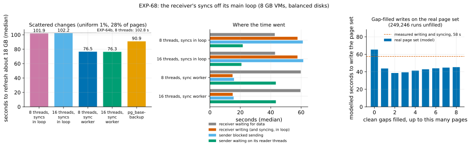

# EXP-68: With the receiver's syncs off its main loop, does the fast path beat a full copy on scattered changes?

Status: **done October 28, 2026 (one session, 14 runs, all correct; all 7 predictions held, the deciding one 0.099 from its bar).**
- **With the receiver's syncs on its worker thread,** the fast path refreshed EXP-64's scattered cell (18 GB, 28% of pages) in **76.5 s**. That is against 101.9 s syncing in the main loop (0.751) and **90.9 s for a full copy (0.842)**: the fast path now beats `pg_basebackup` there with no new algorithm.
- **Now the source's reads bind:** its disk was busy 61.7 s for 254,547 reads, at about the operation rate EXP-66 measured. Idea 2's rule, re-applied on the real page set, says to prototype gap-filled I/O.
- **Applied as registered:** `--read-ahead 8` and the worker are now the fast path's defaults.

Pre-registered October 28, before any run (commit b98effd). One VM pair (the `ha` set), about 2 hours with the data load, after EXP-67. It follows from EXP-64b's and EXP-66's results: their "what follows" sections name each part of it.

## Question

With 8 reader threads, the fast path refreshed EXP-64's scattered cell (18 GB, 1% of rows, 28% of pages) in 102.8 s (EXP-64b), against 91.0 s for a full copy. The runs' timers, read correctly (EXP-64b, correction 1), say why it isn't faster:

| EXP-64b, `fast8`, uniform | Seconds |
|---|---:|
| Receiver waiting for data | 41.1 |
| Receiver writing and syncing, in its main loop | 59.5 |
| of which syncing each file before the next (`--fsync main`, the default) | 49.4 |
| Sender blocked sending to the receiver | 61.9 |
| Sender waiting on its reader threads | 22.4 |

The receiver received, wrote, then synced each file in turn. While it synced, it didn't read the socket, so the sender blocked. When it read again, the sender's readers had to catch up.

Each side's disk work is about 60 s on its own (**inferred**, EXP-66's rates):
- **dest:** about 249,193 scattered writes, one per run of the plan, at the 4,195 operations a second the disk allows: 59 s. The receiver's writing and syncing took 59.5 s.
- **source:** the same runs read at a depth of 8, which EXP-66 measured at the disk's cap of 4,198 a second: 59 s.

**If the two overlapped,** the refresh would take about 60 s plus about 5 s of fixed cost: about 65 s, below a full copy's 91 s at 28% of pages changed.

pgdelta already has `--fsync worker`: it syncs each finished file on a background thread while the main loop goes on, and every sync completes before the commit (EXP-10, EXP-14). It was measured only at 2.1 GB, where it saved 0.3–2.0 s. **Does it let the two sides overlap here?**

Four more things settle open items:
- **16 reader threads:** EXP-64b's failed prediction 4 asks for a thread sweep. At a depth of 8 the disk is already at its cap, so 16 should add nothing.
- **The disks' counters:** EXP-64b's claim that the receiver's writes are one per run, bound by the disk's operation rate, is inferred. `/proc/diskstats` tests it.
- **The real page set:** EXP-66's model assumed independent pages; its decision on idea 2 (gap-filled writes) is re-applied to the real plan.
- **The hot cell:** read-ahead and the worker must not slow the case the fast path is best at (EXP-64: 1.98 s) before either becomes a default.

## Design

EXP-64's and EXP-64b's set-up, unchanged: `experiments/network/lab_exp64.sh`, whose defaults still reproduce EXP-64's plan (checked).
- **The VMs:** the `ha` set in us-west1, two `n2d-highcpu-8` (8 vCPUs, 8 GB), each with a 150 GiB balanced persistent disk, unthrottled; `blake3` on both.
- **The source:** EXP-48's database (scale 600, about 18 GB, its seed), PostgreSQL 17.11 or later, `summarize_wal = on` before any B0 is taken.
- **The cells:**
  - **hot**, then **uniform**, as in EXP-64 (EXP-48's workloads, 1% of rows each);
  - per cell, B0 is a `pg_basebackup` with its manifest, taken before the change.
- **Each run** starts from a fresh copy of B0, with both VMs' caches dropped. Every pgdelta arm is live, in place, `--jobs 4 --hash blake3 --fast-path summaries`. The arms:
  - **fast:** reads in the sending thread (`--read-ahead 0`), syncs in the main loop (hot only);
  - **fast8, fast16:** 8 or 16 reader threads, syncs in the main loop (uniform only);
  - **fast8w, fast16w:** the same with the receiver's `--fsync worker` (fast8w in both cells, fast16w uniform only);
  - **full:** one `pg_basebackup -X stream -c fast` into a new directory (uniform only).
- **The schedule:** 2 runs per arm, in a shuffled order (seed 680): `PATTERNS="hot uniform" ARMS_hot="fast fast8w" ARMS_uniform="fast8 fast16 fast8w fast16w full" PLAN=1`, `lab_exp64.sh SOURCE 2 680`, results in `exp68`.
- **New in the harness:**
  - an arm `fastNw` adds the receiver's `--fsync worker`, and `ARMS_<pattern>` sets a cell's own arms;
  - `/proc/diskstats` for the disk behind `/data` is recorded on both VMs just before t0 and just after t1;
  - every fast run writes its plan (`--plan-out`, new in pgdelta: each listed file's chosen pages as the runs sent), and its digest goes in the run's record; the first plan per cell is kept.
- **Correctness:** each fast copy is started (recovering from its backup_label), and its `pgbench_accounts` row count and sum of `abalance` must equal the source's.
- **A smoke first** at scale 20 (one run per arm), which decides nothing. It must also have recorded both cells' plans and four counter lines per run.

**The analysis,** committed before the data: `analysis/exp68.py`, figure `exp68-syncs`, data `docs/experiments/data/exp68-cells.csv` and `exp68-model.csv`. Medians of 2. It was dry-run on synthetic results shaped like the harness's output.

## Predictions

On the uniform cell unless named.

1. **Deciding: `fast8w` takes at most 0.85 of `fast8`'s time.** The model above gives about 0.63. A bar at 0.85 (87 s) still needs the overlap to recover more than 15 s of the receiver's 41 s of waiting.
2. **`fast8w` takes at most 1.0 of a full copy's time:** the fast path beats `pg_basebackup` at 28% of pages changed. The model gives about 0.72.
3. **More threads add nothing:** `fast16w` within 10% of `fast8w`.
4. **The receiver's writes are one request per run:** in `fast8`, dest's disk completes 0.7 to 1.5 write requests per run of the plan.
5. **No loss in the hot cell:** `fast8w` takes at most max(`fast` + 0.3 s, 1.15 × `fast`).
6. **Every run is correct and as configured:**
   - every run and every pgdelta receiver exited 0;
   - every fast run used the fast path, its guard passing on B0's `backup_manifest`, and its copy matched the source;
   - the `w` arms synced on the worker and the others in the main loop;
   - each cell's plans were identical;
   - every threaded uniform run read as many runs as the plan lists.
7. **Controls:** `fast8` within 10% of EXP-64b's 102.77 s, and the full copy within 5% of its 90.96 s.

**EXP-66's decision rule, re-applied on the real uniform page set** (its model and `fio` rates unchanged, each file a segment): idea 2 is prototyped if both hold:
- the model without filling is within 30% of `fast8`'s receiver writing and syncing (`rebuild_s`, its syncs included);
- the best fill cuts the modelled write time by at least 25%.

**Reported, not predicted:**
- `fast16` against `fast8`;
- the source's read requests, and both disks' busy time;
- the receiver's sync time on the worker, and how long its main loop waited for it.

**Rule 11:** a deciding ratio within 0.05 of its bar gets a second session.

## What follows

- **If 1 and 2 hold:** at 28% of pages, the fast path beats a full copy with no new algorithm. Research loop 1's crossover estimate (section 3) moves, and the selector (idea 4) is re-sized to the new constants.
  - **If 3 and 5 also hold:** `--read-ahead 8` and the worker become the fast path's defaults. The smoke's in-memory runs are reported beside that change.
- **If 1 holds and 2 fails:** the overlap helped, but a full copy still wins at 28%. The disk counters show which side binds, and idea 2's rule says whether gap-filled writes are next.
- **If 1 fails:** the syncs weren't what held the receiver. The counters and timers say what did: the disks' operation rates, or the verifier's re-reads of written pages competing with the writes.
- **If 4 fails:** the receiver's writes don't reach the disk as one request per run. EXP-66's cost model is then wrong for the receiver, and idea 2's rule is reported but not applied.
- **Idea 2:** prototyped (with its own registration) only if the re-applied rule says so. Otherwise it is set aside with its reason recorded.

## Results (October 28)

The `ha` set in us-west1-a and -b; the runs ended at 04:49 UTC, and the VMs were then deleted.
- **The server:** PostgreSQL 17.11, a 17,788 MB database, `summarize_wal` on.
- **Every run** and every pgdelta receiver exited 0, and every fast copy's `pgbench_accounts` equalled the source's.
- **Every fast run** used the fast path, its guard passing on B0's `backup_manifest`. The `w` arms synced on the worker, and the others in the main loop.
- **Plans:** each cell's plans were identical. The uniform cell's plan was 619,251 pages in 249,404 runs, and every threaded uniform run read exactly 249,404 runs.

A smoke at scale 20 ran first (in memory):
- **hot:** `fast` 1.10 s, `fast8w` 0.96 s;
- **uniform:** `fast8` 2.75 s, `fast16` 2.71 s, `fast8w` 2.55 s, `fast16w` 2.78 s, a full copy 6.31 s.

Data: `docs/experiments/data/exp68-cells.csv` and `exp68-model.csv`; raw `results/exp04/exp68/` (not in git).

| Scattered changes, 18 GB (medians of 2) | `fast8` | `fast16` | `fast8w` | `fast16w` | full copy |
|---|---:|---:|---:|---:|---:|
| **Seconds** | 101.9 | 102.2 | **76.5** | 76.3 | 90.9 |
| Receiver waiting for data | 42.6 | 42.8 | 59.8 | 59.6 | |
| Receiver writing (and syncing, in loop) | 57.6 | 57.6 | 14.9 | 15.0 | |
| Its sync worker busy / its loop waiting for it | | | 53.0 / 5.9 | 53.1 / 5.9 | |
| Sender blocked sending | 61.1 | 61.4 | 15.8 | 15.6 | |
| Sender waiting on its reader threads | 21.6 | 20.7 | **43.4** | 43.4 | |
| Source disk: reads; busy seconds | 254,526; 52.0 | 254,225; 49.4 | 254,547; **61.7** | 254,558; 62.0 | 137,680; 83.9 |
| Destination disk: writes; busy seconds | 253,934; 50.5 | 253,933; 50.7 | 255,260; 53.3 | 255,323; 53.4 | 69,566; 84.8 |

The hot cell: `fast` 1.96 s, `fast8w` 1.77 s.

| # | Prediction | Outcome |
|---|---|---|
| 1 | Deciding: `fast8w` at most 0.85 of `fast8` | **Held, 0.751** (0.099 from the bar: no second session under rule 11) |
| 2 | `fast8w` at most 1.0 of a full copy | **Held, 0.842** |
| 3 | `fast16w` within 10% of `fast8w` | **Held, 0.998** |
| 4 | `fast8`'s destination: 0.7–1.5 write requests per run of the plan | **Held, 1.018** |
| 5 | Hot: `fast8w` at most max(`fast` + 0.3 s, 1.15 × `fast`) | **Held,** 1.77 against 1.96 s |
| 6 | Every run correct and as configured | **Held** |
| 7 | Controls: `fast8` within 10% of 102.77 s, the full copy within 5% of 90.96 s | **Held,** 101.88 and 90.90 s |

**EXP-66's rule, re-applied on the real page set** (249,246 runs in the files not sent whole):
- **The model's control:** without filling, the model gives 65.4 s, against `fast8`'s measured writing and syncing of 57.6 s. That is within 30%.
- **The best fill:** filling gaps of up to 2 pages takes 71,647 writes and 38.6 s, a cut of 41.0%.
- **The verdict: prototype idea 2.**

**A change to the figure after the data, no score changed:** the middle panel adds "sender waiting on its reader threads". With the worker, that is the part that binds.

## What it means (with a committee's reading)

- **The overlap worked as modelled, though not all the way.** Syncing in the main loop stopped the receiver reading while each file synced, which blocked the sender for 61 s.
  - **On the worker,** the sender is blocked only 15.8 s and the receiver's own loop works 14.9 s. The worker syncs for 53 s alongside them.
  - **The registration's model** gave about 65 s (0.63); the measured 76.5 s is 0.751.
- **What binds now is the source's operation rate.** With the receiver out of the way:
  - the sender waits 43 s on its reader threads;
  - the source's disk is busy 61.7 s for 254,547 reads, about 4,125 per busy second. EXP-66 measured that disk's cap for random reads at queue depth 8 at about 4,198 a second.
  - 16 threads changed nothing (0.998), as a disk at its cap predicts.
  - The destination's disk was busy 53.3 s for 255,260 writes.

  So both sides now run at about one operation per run of the plan, against the same operation rate, overlapped. The 76.5 s is about 62 s of source reads, plus the guard's 4.7 s, plus the start and the end.
- **Idea 2 attacks exactly that.** One write request per run was confirmed (1.018), and EXP-66 showed the disk counts a write of up to 32 KiB as one operation. So filling clean gaps of 1–2 pages cuts the operations on both sides:
  - from 249,246 runs to 71,647, by the model;
  - at the cost of 238,764 extra pages (+39%), which the bandwidth term starts to charge for.

  The model's writes fall to 38.6 s. The same holds for the source's reads (**inferred**: EXP-66 measured reads' cost by size only at 8 KiB).
- **For research loop 1's crossover:** EXP-64 placed the fast path's break-even against a full copy below 28% of pages. At 28% it now takes 0.842 of a full copy, so the break-even lies above 28%; where exactly isn't measured.
- **The hot cell didn't suffer, and in memory nothing was lost** (the smoke). That met the registered condition for making both the default.

**Limitations:**
- **One disk type:** a balanced persistent disk, whose operation cap is now the binding constant. An SSD persistent disk or a local SSD has other caps; the fast path's margin over a full copy depends on them.
- **One size and one change shape:** one session, one size, and the uniform pattern at 28% of pages.
- **Statistics:** medians of 2, with the two repeats within 0.4% of each other.
- **Idea 2's model** prices writes from EXP-66's `fio` rates on this disk, and reads by assumption.

## What follows (applied)

- **Defaults, as registered for 1, 2, 3 and 5 holding** (with tests). Both apply only to the CLI; the library defaults are unchanged.
  - **`--read-ahead`** now defaults to 8 with `--fast-path` (0 without).
  - **The receiver's `--fsync`** defaults to `auto`: the worker when the fast path is offered and B's lineage facts were read, the main loop otherwise. The statistics give the resolved mode as `fsync` and `fsync_mode`, so a session without the fast path sends the same bytes as before, and `fast_path.fsync_auto` says the mode was chosen automatically.
- **Idea 2 is next for the scattered case:** gap-filled reads and writes in the fast path's plan, prototyped with its own registration. Its model: the operations fall from 249,246 to about 72,000 on each side.
- **The selector (idea 4)** is re-sized to these constants when it is built.
