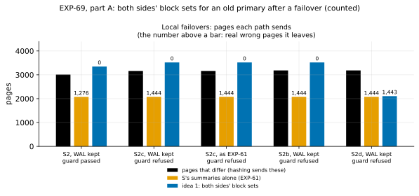

# EXP-69: For an old primary after a failover, is idea 1's send set correct, and what makes `pg_rewind` copy so much?

Status: **done October 28, 2026.**
- **Part B (EXP-67's cells at 18 GB), as registered, 1 of 3 predictions held,** plus the amended 6. The two that failed rested on wrong premises, now explained:
  - **The "4 GB extra" `pg_rewind` copied was S's own WAL,** written after the lab recorded S's LSN by the lab's own state check: a full read right after the lag's checkpoint, whose hint bits each logged a full-page image.
  - **The summaries' coverage was asked of S's current LSN,** past its last summary.
- **At scale, idea 1's block set is about what hashing sends** (0.94 and 0.997), and B's side is about 20,000 blocks.
- **Part A,** below.
- **Part A, as registered: 2 of 5 predictions held** (2 and 5). The deciding one failed: the guard refused S2c, which it should have passed.
- **Post-hoc checks trace all three failures, none to a page the send set missed:**
  - a bug in the guard: it compared the start of B's last WAL record with an end pointer;
  - a hint check too coarse to tell common history from B's own;
  - `pg_rewind` skipping blocks beyond the end of a file.
- **Wherever B's WAL was complete,** idea 1's send set left no real wrong page, in all 4 such builds. Where B's WAL was lost (S2d), it left 1,443, and the guard refused.

Pre-registered October 28, before any run (commit 813ca72). Part A runs locally, in minutes. Part B is one VM pair (the `ha` set), about an hour, after EXP-68. It follows from EXP-67's "what follows": idea 1 is next for the failover case, after a measurement of what it rests on.

## Question

After a failover, the old primary B has written past the fork, so pgdelta's fast path must refuse it (EXP-61, EXP-63) and hash both copies. EXP-67 timed that against `pg_rewind` for an 18 GB database beyond memory:
- for hot rows updated 10 times on the new primary S, `pg_rewind` took 36.4 s against pgdelta's 90.2 s;
- for 1% of rows scattered, it took 459.0 s, 84% of it replay; pgdelta took 177.9 s and a re-clone 91.1 s.

**Idea 1** (research loop 1, section 4) would send S's current copy of every block either side changed since their last common checkpoint C, and replay nothing of S's history:
- **B's blocks:** those its own WAL names from C on, as `pg_rewind` takes them;
- **S's blocks:** those its WAL summaries list from C on, as the fast path takes them.

Its inferred time for hot10 is about 5 s. Three things it rests on are unmeasured:
1. **Correctness:** does the union leave any page wrong? Hint bits matter here. On an ancestor they are harmless (EXP-61), but a diverged B may have set one for a transaction whose fate differs on S. `pg_rewind` requires checksums or `wal_log_hints` for that reason, and so does idea 1.
2. **Its guard:** it must refuse when it can't see all of B's changes, for example when B crashed, or when its WAL doesn't reach back to C or forward to its end. EXP-62 found a blind spot of this kind in the fast path's first guard.
3. **Its size against `pg_rewind`'s copy:** EXP-67's `pg_rewind` copied 353 and 4,077 MB beyond S's WAL since the fork, unexplained. B's own WAL since the fork was 158 MB in uniform. With `full_page_writes` on, B's first change to each page after C carries a full-page image, so that WAL can name at most about 20,000 pages, unless the images are mostly empty space. So most of that copy looks like whole files, not B's blocks (**inferred**). If it is whole files that pgdelta never sends (WAL segments), idea 1 avoids it; if it is relation data, idea 1 pays it too.

## Design

**Part A, local and counted, not timed.** EXP-03's failover scenarios, built by the existing harness with PostgreSQL 17.11, data checksums on, and S's summaries on from its creation (EXP-61's `--wal-summaries`):
- **S2:** B, the old primary, kept writing after the fork, then stopped cleanly.
- **S2b:** the same, but B flushed its pages and crashed (`-m immediate`).
- **S2c:** B is a standby that followed the old primary past the fork, then stopped cleanly.
- **S2d:** S2b, then B's WAL from the fork's segment on deleted (EXP-62).

Each is built twice:
- **kept:** with `wal_keep_size = 1GB` on B's cluster, as an operator who uses `pg_rewind` must keep B's WAL;
- **default:** S2 and S2c only, as EXP-61 built them.

A third case is made from kept S2: **a copy of B with its WAL cut** after the fork's segment.

**Idea 1, scored** by `experiments/tricky_copies/unionscan.py`:
- **C** is the last checkpoint record before S's history leaves B's timeline, found in B's own WAL with `pg_waldump`.
- **The send set** is the blocks B's WAL names from C's redo to its end, plus the blocks S's summaries list from C's redo to S's start, limit blocks included. Pages past B's length, whole free-space-map and init forks, and files B lacks are sent as the fast path sends them.
- **Every page of S is compared** with B's page at the same place, as EXP-61 compared them. Pages that differ and aren't sent are sorted by EXP-03's classifier, and also searched for hint bits B carries that S lacks.
- **The guard** passes only if all of these hold:
  - B and S match (cluster, version, checksums), with checksums or `wal_log_hints` on;
  - B's timeline is on S's history, and B's end is proven by how it was stopped (EXP-62's guard v2);
  - C is in B's WAL, and B's WAL reads on from C's redo to at least B's end;
  - S's summaries cover C's redo to S's start.

**The control** is `pg_rewind --dry-run --debug`, run from each kept source onto a copy of B. Its output lists every block it takes from B's WAL, every file it copies whole, and every chunk it fetches. Its blocks are compared with those `pg_waldump` names from C's record on.

Driver: `experiments/tricky_copies/union_check.py results/exp69`.

**Part B, on the VMs,** reruns EXP-67's two cells with diagnostics, at EXP-67's scale (600, about 18 GB). The lab script is `lab_exp67.sh` with `DIAG=1 ARMS=fast`: one repeat (seed 690), with a scale-20 smoke first (seed 691). After each lag, before its timed run, it records:
- **`pg_rewind --dry-run --debug`** from S onto a fresh copy of B0;
- **S's data directory:** its size per top-level entry, and `pg_wal`'s files;
- **B0's WAL** from C's redo (`pg_waldump`);
- **S's WAL summaries** from C's redo on.

The timed arm is pgdelta's hashing (its fast path refused), which gives the pages that differ.

**The analysis,** committed before the data: `analysis/exp69.py`, figure `exp69-union`, data `docs/experiments/data/exp69-scenarios.csv` and `exp69-rewind-copy.csv`. It splits `pg_rewind`'s fetched bytes into:
- relation blocks;
- free-space-map, visibility-map and init forks;
- WAL summaries;
- other files;
- WAL segments, by where they lie: since the fork, before it (an older timeline), or past S's current LSN (recycled or preallocated).

**Checked before registering:**
- **Unit tests** (`tests/test_tricky_unionscan.py`, 10) cover the parsers, the union, the guard's conditions and the hint check, on lines shaped like `pg_waldump`'s and `pg_rewind`'s own output.
- **The analysis was dry-run on synthetic results.** It caught two bugs before any data: a column collision, and a refusal phrase that didn't match the guard's actual text.
- **The lab script's defaults** still reproduce EXP-67's run plans.

**Disclosed: a format probe before registering, on one S2 build in the scratchpad.** It saw only `pg_rewind`'s side; idea 1's send set was never scored before this registration.
- **Built as EXP-61 built it:** B's WAL began after C (B's shutdown checkpoint had recycled the older segments), and `pg_rewind` failed for want of it.
- **With `wal_keep_size`:**
  - `pg_rewind`'s dry run took 1,681 blocks from B's WAL and needed 97 MB;
  - of that, 80 MiB was whole WAL segments (some past S's LSN), 13 MiB relation blocks, and 4 MiB free-space-map and visibility-map forks.

## Predictions

**Part A:**
1. **Deciding:** wherever idea 1's guard passes, it leaves no real wrong page, and it passes kept S2 and kept S2c. In those two, S's summaries alone left 1,276 and 1,444 (EXP-61).
2. **The guard refuses each of these, for its reason:**
   - kept S2b and S2d: B wasn't stopped cleanly;
   - default S2: no checkpoint before the fork in B's own WAL;
   - kept S2 with its WAL cut: B's WAL ends before B's end.

   Default S2c is reported, not predicted: whether a standby's WAL still reaches back to C depends on its last restartpoint.
3. **No unlogged hints:** wherever the guard passes, no page is left unsent on which B carries a hint bit S lacks.
4. **Control:** wherever the guard passes, `pg_rewind` exits 0 and takes exactly the main-fork blocks `pg_waldump` names from C's record on.
5. **Size:** wherever the guard passes, idea 1 sends at most 1.5 times the pages that differ.

**Part B,** EXP-67's cells at 18 GB:

6. **Control at scale:** in both lags, `pg_rewind`'s blocks equal `pg_waldump`'s.
7. **Idea 1's size:** in both lags, idea 1's blocks number between 0.9 and 1.5 times the pages pgdelta's hashing sends, and S's summaries cover C's redo to S's LSN.
8. **What `pg_rewind` copies beyond S's WAL since the fork:** in uniform, relation blocks are under a quarter of it. What the rest is, by kind, is reported.

**Rule 11** applies to ratios: a deciding ratio within 0.05 of its bar gets a second session. Predictions 1–4 and 6 are counts that must be exact.

## What follows

- **If 1–3 hold:** idea 1's send set is correct on these failovers. Its prototype in pgdelta is registered next and timed against `pg_rewind` on EXP-67's cells:
  - the receiver reads B's WAL from C;
  - the sender adds S's summaries;
  - the guard is as here.
- **If 1 or 3 fails:** the missed pages' source (B's WAL range, S's summaries, or hints in no WAL) is found before anything is built.
- **If 4 or 6 fails:** our reading of B's WAL differs from `pg_rewind`'s, and is reconciled before anything is built.
- **If 7 fails high:** idea 1 would send pages that don't differ. Its model is re-sized before the prototype's predictions are set.
- **8 and the composition:**
  - **If the rest is mostly WAL segments**, idea 1 avoids it (pgdelta sends no `pg_wal`), and `pg_rewind`'s time has a part that doesn't grow with either side's changes.
  - **If it is relation data,** idea 1 pays it too, and its model grows by it.

## Results, part A (October 28)

Local, PostgreSQL 17.11 on macOS (counted, not timed), driver `union_check.py`, all six builds correct by the harness's own checks.

**Two driver bugs, fixed before any page was scored:**
- the results path was relative, while the harness compares absolute paths, so the first build attempt failed;
- the driver read the scenario's facts under the wrong keys.

Both crashed before scoring. The registered run is the first complete one.

Data: `docs/experiments/data/exp69-scenarios.csv` and `exp69-posthoc.json`; raw `results/exp69/` (not in git).

| Build | Guard | Pages that differ | Idea 1 sends | Real wrong left | S's summaries alone: real wrong (EXP-61's path) | `pg_rewind` (dry run) |
|---|---|---:|---:|---:|---:|---|
| S2, B's WAL kept | **passed** | 3,010 | 3,349 | **0** | 1,276 | 1,681 blocks, 97 MB |
| S2c, B's WAL kept | refused: "WAL ends before B's end" | 3,162 | 3,518 | 0 | 1,444 | 1,848 blocks, 114 MB |
| S2c, as EXP-61 built it | refused: the same | 3,162 | 3,518 | 0 | 1,444 | 1,848 blocks, 114 MB |
| S2b, B's WAL kept (B crashed) | refused: B not stopped cleanly | 3,183 | 3,518 | 0 | 1,444 | refused: "must be shut down cleanly" |
| S2d (B crashed, WAL lost) | refused: B not stopped cleanly | 3,183 | 2,107 | **1,443** | 1,444 | refused: the same |
| S2, as EXP-61 built it | refused: no checkpoint before the fork in B's WAL | | | | 1,276 | failed: B's WAL missing |
| S2, B's WAL cut after the fork's segment | refused: "WAL ends before B's end" | | | | | |

| # | Prediction | Outcome, as registered |
|---|---|---|
| 1 | Deciding: no real wrong page wherever the guard passes, and it passes kept S2 and S2c | **Failed:** the guard passed kept S2 (0 real wrong) but refused kept S2c |
| 2 | The guard refuses kept S2b and S2d, default S2 and the cut copy, each for its reason | **Held** |
| 3 | No page left unsent where B carries a hint bit S lacks | **Failed:** 19 pages in kept S2 (82 tuples) |
| 4 | `pg_rewind` takes exactly the main-fork blocks `pg_waldump` names from C's record on | **Failed:** `pg_waldump` names 13 more in kept S2 |
| 5 | Idea 1 sends at most 1.5 times the pages that differ | **Held, 1.113** (kept S2) |

## Post-hoc checks (written after the data; no verdict changes)

`analysis/exp69_posthoc.py`, on the same builds:
1. **The guard's refusal of S2c was a bug in it.**
   - A standby's end is its minimum recovery point: the *end* of its last replayed record, 0/BB7D108.
   - The guard compared that with the *start* of the record, 0/BB7D0E0. `pg_waldump --end 0/BB7D108` reads B's WAL through to the end (exit 0) in both S2c builds.
   - **With the end compared correctly, both S2c builds would pass.** Their scored send sets left no wrong page of any kind.
2. **The 19 pages' hints are common history.**
   - Each of the 82 tuples has `XMIN_COMMITTED` set on B and not on S. Each names transaction 791, which is committed on S too (`pg_xact_status`).
   - Each of the 19 pages has the same page LSN on both sides, before C's redo. So B set these hints before the common checkpoint, about a transaction both sides committed.
   - **They are harmless.** The registered check flagged any hint B carries, but only a hint about a transaction whose fate differs on S is dangerous.
3. **The 13 (S2) and 15 (S2c) extra blocks all lie beyond S's end of file.**
   - B extended those relations after the fork, and `pg_rewind` truncates them away rather than copying them (its file map skips blocks beyond either side's end).
   - Idea 1 does the same: pages past S's length are never sent, since the copy takes S's sizes.

**What it means for idea 1, so far:**
- **The send set itself held everywhere B's WAL was complete,** in 4 builds: 0 real wrong pages. That covers a primary stopped cleanly, a standby that followed it, and a crashed primary with its WAL intact.
- **The guard's refusals are necessary.** Where B's WAL was lost (S2d), the same union left 1,443 real wrong pages. The guard refused it.
- **Idea 1 sent 1.11 times the pages that differ** (kept S2), against `pg_rewind`'s 97 MB. Most of that 97 MB was 84 MB of whole WAL segments.
- **None of this is confirmatory until it is re-run** (done: [EXP-69b](EXP-69b-idea-1-fixed-guard.md), 4 of 5 held as registered; its copies matched S's rows wherever the fixed guard passed). The guard's end check needs fixing, and the hint check needs to test a transaction's fate on S. Both changes, and a scenario that makes the hint danger real (B without checksums or `wal_log_hints`, a transaction open at the fork and committed on B), go in a new registration (EXP-69b) before any run.

## Amendment to part B, made before it ran (October 28, after part A)

Part A showed that `pg_rewind` skips, by design, every block beyond the end of its file on either side. Prediction 6 as registered ("`pg_rewind`'s blocks equal `pg_waldump`'s") would fail for that alone. B0's diverging update appends pages that S lacks. So, before part B runs:
- **Prediction 6 is scored as registered, and also as amended:**
  - no block `pg_rewind` takes is missing from `pg_waldump`'s set;
  - every block `pg_waldump` names that `pg_rewind` doesn't take lies beyond the end of its file on S or on B0, or in a file one side lacks.
- **The diagnostics record more:** each relation file's size on both sides (`find base global`), and B0's latest checkpoint location.
- **Also reported:** whether B0's WAL from C's redo reaches B0's end. That is the guard condition part A's bug got wrong, now compared correctly. For a cleanly stopped B0, the latest checkpoint is its last record.

The registered predictions 6–8 and their bars are unchanged.

## Results, part B (October 28)

The `ha` set in us-west1. The code deployed was the tree at commit 311fcdc, before EXP-68's new defaults. Part B's only timed arm is pgdelta's hashing after its guard refused, which those defaults don't change.
- **Data:** PostgreSQL 17.11, the 17,788 MB database.
- **A smoke first** at scale 20 recorded both lags' diagnostics.
- **The hashing runs** (one per lag) matched S, taking 90.6 and 185.7 s.

Data: `docs/experiments/data/exp69-rewind-copy.csv`; raw `results/exp04/exp69/` (not in git).

| 18 GB old primary, EXP-67's cells | hot10 | uniform |
|---|---:|---:|
| **`pg_rewind`'s copy** (its fetched chunks), MB | **2,040** | **12,027** |
| S's WAL since the fork, to the lag's end | 1,745 | 8,003 |
| S's WAL after it, written by the lab's state check | 84 | **3,775** |
| Relation blocks (B's changed blocks, from S) | 169 | 223 |
| WAL segments from before the fork | 34 | 17 |
| FSM, VM and init forks; summaries; other files | 8 | 10 |
| **Blocks `pg_rewind` takes from B's WAL** | 20,165 | 20,062 |
| Blocks `pg_waldump` names from C's record: the same set | 20,165 | 20,062 |
| **Idea 1:** B's blocks (from C's redo); S's summarized blocks; union | 20,199; 12,091; **31,921** | 20,094; 616,170; **621,770** |
| Pages pgdelta's hashing sent | 33,975 | 623,827 |

The WAL rows are whole 16 MiB segments, split at the segment holding the lag's recorded LSN.

| # | Prediction | Outcome, as registered |
|---|---|---|
| 6 | `pg_rewind`'s blocks equal `pg_waldump`'s | **Held,** both lags, none on one side only |
| 6, amended | The same, past either side's end of file excluded; B0's WAL reaches its end | **Held,** both |
| 7 | Idea 1's blocks 0.9–1.5 of hashing's pages sent, and S's summaries cover C's redo to S's LSN | **Failed:** the sizes held (0.940 and 0.997), the coverage didn't |
| 8 | In uniform, relation blocks under a quarter of `pg_rewind`'s copy beyond S's WAL since the fork | **Failed:** 223 of 265 MB (0.84) |

## Post-hoc checks, part B (written after the data; no verdict changes)

1. **What the 4 GB was.**
   - **The LSN moved after the lag ended:** S's LSN at the diagnostics was 86 MB (hot10) and 3,761 MB (uniform) past the LSN the lab recorded at the lag's end.
   - **One query ran in between:** the lab's state check (`count(*)` and `sum(abalance)` over `pgbench_accounts`), right after the workload's closing `CHECKPOINT`.
   - **Why it writes WAL:** with data checksums on, the first hint bit set on a page after a checkpoint writes a full-page image. The uniform lag left about 620,000 changed pages; 3.76 GB over them is about 6.0 KiB each. Hot10 left about 15,000, about 5.7 KiB each. S's WAL itself wasn't kept, so this is **inferred**.
   - **So counted to S's LSN when `pg_rewind` ran,** its copy beyond S's WAL was only 216 and 265 MB. Most of that was B's blocks; the rest was a few older WAL segments and the forks it copies whole.
   - **Prediction 8 asked the wrong question:** it assumed the extra wasn't WAL.
2. **Why the coverage failed.**
   - **The end of the range:** S's summaries run without a gap from C's redo to its last summarized point (6/C98F47B0 and 9/58407318), which is before S's LSN at the diagnostics. The WAL after that wasn't summarized yet. A real refresh, like the fast path, takes S's backup start (a checkpoint) and waits for the summarizer to reach it. The registered check asked for coverage to S's current LSN instead.
   - **A hole at the fork, in uniform only:** the fork fell on a segment boundary (6/D2000000). S's new timeline's first summary starts after that segment's 40-byte page header (6/D2000028), so the contiguity test sees a hole holding no WAL record.
   - **A finding for pgdelta's own guard:** its fast-path guard uses the same test (`fastpath.covered`). It would refuse a range that crosses a timeline switch landing on a segment boundary. That is safe, since it then hashes, but needless.
3. **Idea 1's size at 18 GB.**
   - **Its block set** is 31,921 and 621,770 blocks, 0.94 and 0.997 of the pages hashing sends.
   - **B's side is about 20,000 blocks** in both lags: B's 10,000 updated rows, each with its page, the page of its new version, and an index page.
   - **`pg_rewind` takes the same 20,000 blocks,** then copies and replays all of S's WAL since the fork: 1.8 and 11.8 GB.

## What part B means for EXP-67 and idea 1

- **EXP-67's uniform `pg_rewind` time included the lab's own WAL.** Its rewound standby replayed up to S's LSN when `pg_rewind` ran: about 11.8 GB, not the 8,001 MB its figure labels.
  - **Replay rates, counted that way:** 30.5 MB/s in uniform, matching EXP-65's 31 MB/s, and 152 MB/s in hot10.
  - **Without the check's WAL:** the uniform `pg_rewind` path would have taken about 313 s, not 459 s (**inferred**: about 24 s less copying and 124 s less replay).
  - **EXP-67's verdicts stand:** pgdelta took 0.57 of that time, and a re-clone 0.29.
  - **The extra WAL isn't unrealistic in kind:** on a real new primary with checksums, every read after a checkpoint can write full-page images too. Its amount depends on what reads the data after the failover.
- **Idea 1 at scale (inferred).** Its block sets are about the size hashing sends, and of the same kind as the fast path's.
  - **hot10:** about 32,000 pages. EXP-68's hot cell sent 14,712 pages in 1.77 s, so this would take a few seconds, against `pg_rewind`'s 36.4 s.
  - **uniform:** about 622,000 pages. EXP-68's scattered cell sent 619,251 pages in 76.5 s, so about 77 s, against `pg_rewind`'s 459 s (313 s without the check's WAL) and a re-clone's 91 s.

**Limitations:** one session, counted not timed. pgdelta's hashing ran once per lag. S's WAL wasn't kept, so the hint-bit cause is inferred from the LSNs, the query between them, and the per-page sizes.

## What follows (applied)

- **Idea 1's prototype is next** for the failover case, registered and timed against `pg_rewind` and a re-clone on EXP-67's cells.
  - **Its lab now also records S's LSN after the state check** (`lab_exp67.sh`, `source_lsn_after_check`), so the WAL the check writes is counted.
  - **Its timing must say whether that WAL is included.**
- **The fast-path guard's needless refusal** at a timeline switch on a segment boundary is to be fixed: a hole holding only a page header is allowed, and a test promotes a standby exactly at a segment boundary.
- **EXP-67's write-up** carries a correction note pointing here.
