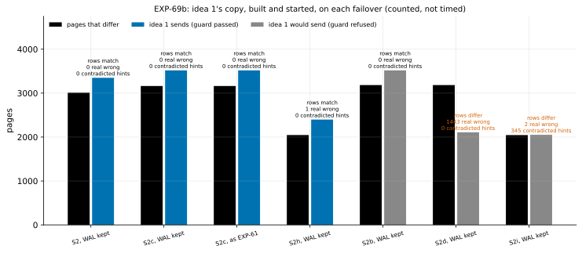

# EXP-69b: With its guard fixed, does idea 1's copy come out right on every failover it accepts, and is the checksum condition necessary?

Status: **done October 28, 2026 (one local session, 8 builds plus a WAL-cut copy; as registered 4 of 5 predictions held).**
- **The deciding one failed by one page:** in S2h, EXP-03's classifier counted 1 real wrong page.
- **A post-hoc check traced it to a gap in that classifier:** a tuple's command ID, which PostgreSQL's own consistency mask ignores.
- **Wherever its fixed guard passed** (4 builds), idea 1's copy started and its rows equalled S's, with no hint S contradicts left unsent.
- **The hazard is real:** without data checksums or `wal_log_hints` (S2i), the same send set left 345 pages of hints that name a transaction S never committed, and the copy showed 20,000 rows S doesn't have. The guard refused S2i.

Pre-registered October 28, before any run (commit e2e92a4). Local, counted, not timed; minutes.

It follows from EXP-69's part A. As registered there, the deciding prediction failed. Post-hoc checks traced the three failures to the guard and the checks, not to idea 1's send set:
- **the guard's end check:** it compared the start of B's last WAL record with a standby's end pointer, and so refused a valid S2c;
- **its hint check:** it flagged hints from common history;
- **its control:** `pg_rewind` skips blocks past either side's end of file by design.

EXP-69 named three things to fix and re-test before any of it counts: the end check, a hint check that tests each transaction's fate on S, and a scenario that makes the hint danger real. This is that test, with one addition: idea 1's copy is built, started, and its rows compared with S's.

## Question

Idea 1 sends S's current copy of every block either side changed since their last common checkpoint C:
- **B's side:** the blocks B's WAL names from C's redo;
- **S's side:** the blocks S's WAL summaries list from C's redo to S's start.

Its guard refuses unless all of these hold:
- B and S match (cluster, version, checksums), with checksums or `wal_log_hints` on;
- B's end is proven by how B was stopped;
- C is in B's WAL, and that WAL reads through B's end;
- S's summaries cover the range.

**With the end check fixed:**
1. Is the copy right wherever the guard passes, judged by its rows once started, not only by its pages?
2. Does the guard refuse every case it must?
3. Is the checksum condition necessary? Without it, can a hint bit B set after the fork, in no WAL, leave the copy's rows wrong?

## Design

The builds use EXP-03's harness as in EXP-69's part A: PostgreSQL 17.11, S's summaries on, fresh builds in `results/exp69b`. Driver: `union_check.py results/exp69b --exp69b`.

**kept,** with `wal_keep_size = 1GB` on B's cluster:
- **S2:** an old primary stopped cleanly;
- **S2b:** the same, crashed;
- **S2c:** a standby that followed the old primary past the fork;
- **S2d:** S2b with its WAL lost;
- **S2h (new):** a transaction on P inserts 20,000 rows into a table of its own and stays open through a checkpoint and the fork (R stops). P then commits it and reads the table, setting `XMIN_COMMITTED` on every row, and stops cleanly. For S, the transaction never committed, so the rows don't exist. P has data checksums, so the hint bits are WAL-logged.
- **S2i (new):** S2h without data checksums or `wal_log_hints`, so the hint bits are in no WAL.

**default,** as EXP-61 built them: S2 and S2c.

**A copy of kept S2's B with its WAL cut** after the fork's segment.

For each build, with C found:
- **The guard:** B's WAL is checked to read from C's redo through B's end with `pg_waldump --end` (the fix).
- **The send set:** scored page by page against S, as in EXP-69.
- **Contradicted hints:** pages left unsent are searched for any hint bit B carries that S lacks and that S's own `pg_xact` contradicts. `XMIN_COMMITTED` or `XMAX_COMMITTED` on a transaction S didn't commit counts, as does `XMIN_INVALID` or `XMAX_INVALID` on one it did. `pg_xact` is read from the cleanly stopped source's files.
- **Idea 1's copy is built** (`unionscan.materialize`):
  - S's non-relation files, including its `backup_label` and its backup's WAL;
  - S's relation files that B lacks;
  - every other relation file, built from B's pages, with S's page wherever the send set takes it, at S's length.

  The copy is then started, recovering from S's backup, and its rows compared with S's (the harness's `restore_and_compare`).
- **The control:** `pg_rewind --dry-run --debug`. Each block `pg_waldump` names that `pg_rewind` doesn't take is placed against both sides' file sizes.

**The analysis,** committed before the data: `analysis/exp69b.py`, data `docs/experiments/data/exp69b-builds.csv`, figure `exp69b-union`.

**Checked before registering:**
- **Unit tests:** 15 in `tests/test_tricky_unionscan.py`. Among them: the fixed guard, reading `pg_xact`, the fate rule, building the copy, and placing a block.
- **The analysis was dry-run on synthetic results.**
- **A build smoke of S2h and S2i** in the scratchpad checked only their build checks, and no send set was scored. Both built:
  - the transaction committed on P, with 20,000 rows there;
  - 0 rows on S;
  - checksums 1 and 0, `wal_log_hints` off.

## Predictions

1. **Deciding:** wherever the guard passes, idea 1's copy starts and its rows equal S's, with no real wrong page and no contradicted hint left unsent. The guard passes kept S2, kept S2c, default S2c and kept S2h.
2. **The guard refuses each of these, for its reason:**
   - kept S2b and S2d: B wasn't stopped cleanly;
   - default S2: no checkpoint before the fork in B's own WAL;
   - kept S2i: neither data checksums nor `wal_log_hints`;
   - kept S2 with its WAL cut: B's WAL ends before B's end.
3. **The hazard is real:** in kept S2i, the union, scored although the guard refused it, leaves at least one page with a contradicted hint unsent, and its copy's rows differ from S's. This is what makes the checksum condition necessary, not merely inherited from `pg_rewind`.
4. **Control:** wherever the guard passes and `pg_rewind` runs, `pg_rewind` takes no block that `pg_waldump` doesn't name. Every block `pg_waldump` names that `pg_rewind` doesn't take lies beyond one side's end of file, or in a file one side lacks.
5. **Size:** wherever the guard passes, idea 1 sends at most 1.5 times the pages that differ.

**Reported:**
- the copies of the refused builds (S2b with its WAL intact; S2d with it lost);
- what S's summaries alone would leave (EXP-61's path);
- `pg_rewind`'s exit and size on each build.

All five predictions are exact counts or bars, so rule 11 doesn't apply.

## What follows

- **If 1–3 hold:** idea 1's send set and guard are correct on these failovers, the hint hazard included, and the checksum condition is shown to be needed. Its prototype in pgdelta is registered next, timed against `pg_rewind` on EXP-67's cells. That prototype's predictions use EXP-69's part B sizes.
- **If 1 fails:** the wrong pages or rows are traced before anything is built.
- **If 3 fails:** S2i didn't make the hazard real. The condition stays, as `pg_rewind`'s own, but the claim that it is needed is withdrawn.

## Results (October 28)

Local, PostgreSQL 17.11 on macOS. Every build passed the harness's own checks:
- **S2h and S2i:** the transaction committed on B (20,000 rows there) and absent on S.
- **S2i:** checksums 0 and `wal_log_hints` off.

The whole run took 76 s. Data: `docs/experiments/data/exp69b-builds.csv` and `exp69b-posthoc.json`; raw `results/exp69b/` (not in git).

| Build | Guard | Pages that differ | Idea 1 sends | Copy's rows | Real wrong left (EXP-03's classifier) | Contradicted hints left | `pg_rewind` (dry run) |
|---|---|---:|---:|---|---:|---:|---|
| S2, B's WAL kept | **passed** | 3,010 | 3,349 | **match** | 0 | 0 | 1,681 blocks; 13 more named, all past S's end of file |
| S2c, B's WAL kept | **passed** | 3,162 | 3,518 | **match** | 0 | 0 | 1,848 blocks; 15 more, all past S's end |
| S2c, as EXP-61 built it | **passed** | 3,162 | 3,518 | **match** | 0 | 0 | the same |
| S2h (with checksums) | **passed** | 2,046 | 2,398 | **match** | 1 | 0 | 345 blocks, the same set |
| S2b (B crashed, WAL intact) | refused: not stopped cleanly | 3,183 | 3,518 | match | 0 | 0 | refused: "must be shut down cleanly" |
| S2d (B crashed, WAL lost) | refused: not stopped cleanly | 3,183 | 2,107 | **differ** | 1,443 | 0 | refused |
| S2i (no checksums, no `wal_log_hints`) | refused: neither | 2,045 | 2,050 | **differ:** hazard has 20,000 rows, S has 0 | 2 | **345 pages (20,000 tuples)** | refused: needs checksums or `wal_log_hints` |
| S2, as EXP-61 built it | refused: no checkpoint before the fork in B's WAL | | | | | | failed: B's WAL missing |
| S2, B's WAL cut after the fork's segment | refused: B's WAL ends before B's end | | | | | | |

| # | Prediction | Outcome, as registered |
|---|---|---|
| 1 | Deciding: wherever the guard passes, the copy's rows equal S's, with no real wrong page and no contradicted hint; it passes kept S2, kept S2c, default S2c and S2h | **Failed by one page:** all 4 passed, all 4 copies' rows matched, 0 contradicted hints; but EXP-03's classifier counted 1 real wrong page in S2h |
| 2 | The guard refuses kept S2b and S2d, default S2, S2i and the cut copy, each for its reason | **Held** |
| 3 | The hazard is real in S2i: a contradicted hint left, and the copy's rows differ | **Held:** 345 pages, 20,000 tuples; the copy shows all 20,000 rows |
| 4 | `pg_rewind` takes no block `pg_waldump` doesn't name; the rest lie past one side's end of file | **Held** in all 4 |
| 5 | Idea 1 sends at most 1.5 times the pages that differ | **Held:** 1.113, 1.113, 1.113, 1.172 |

## Post-hoc check (written after the data; no verdict changes)

**The one page is `pg_depend` block 12, in S2h.** Its two versions have the same page LSN, from before the common checkpoint.

**They differ only in three tuples' command ID (`t_cid`).** Transaction 788 (S2h's `CREATE TABLE hazard`, committed on both sides) inserted these tuples:
- B, the old primary that ran it, keeps their command IDs, 2, 2 and 4;
- S, the promoted standby, has 0, because replay writes the first command ID.

**PostgreSQL's own `heap_mask` masks this field for that reason:** "During replay, we set Command Id to FirstCommandId. Hence, mask it." That is [`heapam.c`](https://github.com/postgres/postgres/blob/REL_17_STABLE/src/backend/access/heap/heapam.c), PostgreSQL 17. A command ID means nothing once its transaction has ended.

**EXP-03's classifier masks hint bits as `heap_mask` does, but not `t_cid`.** `analysis/exp69b_posthoc.py` re-judges the unsent pages under PostgreSQL's own mask (`t_cid`, a speculative tuple's `ctid`, padding). Under it, no page still differs in any build the guard passed:
- S2, S2c (both builds): 0 of 0;
- S2h: 0 of 1.

**Why this showed up only in S2h:** it is the only build whose DDL ran on the old primary after the standby was cloned, so the standby got that DDL's tuples by replay.

**The classifier gap is a finding of its own.** It can only add "content" pages, never hide one, so it can only have over-counted real wrong pages in earlier experiments. None of their verdicts rests on such an over-count:
- the guarded paths' 0s stand;
- the unguarded paths' counts were far above zero for other reasons.

Fixing it in the shared classifier is left for a separate, recorded change.

## What it means (with a committee's reading)

- **Idea 1's send set is correct on every failover its guard accepts here.** Four builds were accepted: a primary stopped cleanly, a standby that followed it past the fork (two ways), and a primary whose hint bits name a transaction S never committed. In each, the copy built from B plus the sent pages started, and its rows equal S's. Its pages equal S's under PostgreSQL's own consistency mask.
- **Each of the guard's conditions refused a case that would otherwise have been wrong:**
  - **S2i, no checksums:** without the checksum condition, the copy shows 20,000 rows of a transaction that S never committed. So the condition is not merely inherited from `pg_rewind`, but necessary.
  - **S2d, WAL lost:** without the end proof and the WAL check, it has 1,443 real wrong pages.
  - **S2b, crashed with its WAL intact:** refused, though its copy would have been right. That is the price of requiring a clean stop. `pg_rewind --dry-run` refuses it too; `pg_rewind` proper would first run crash recovery.
- **Size:** idea 1 sent 1.11–1.17 times the pages that differ. By the same dry runs, `pg_rewind` would copy 87–114 MB, 84–101 MB of it whole WAL segments, and then replay S's WAL. Idea 1's sends here are 19–29 MB of pages.
- **The control:** on B's side, idea 1 and `pg_rewind` agree block for block, except blocks past S's end of file, which both drop. That ties the B-side half of idea 1 to the standard tool's own reading of the same WAL.

**Limitations:**
- **Scale and timing:** small local clusters, about 3,000 pages that differ, counted, not timed. Part B of EXP-69 measures EXP-67's real cells; a timed prototype is still to come.
- **Coverage:** one major version, one platform, and these failover shapes. Not covered:
  - a B that was itself promoted before (several timelines on B's side);
  - tablespaces;
  - unlogged relations;
  - relations created and dropped after the fork.
- **The row check** compares user tables (EXP-03's logical state), not catalogs. The catalog pages were checked page by page above.

## What follows (applied)

- **Idea 1's correctness case is made for these failovers.** Its prototype in pgdelta is next, registered before any run, and timed against `pg_rewind` on EXP-67's cells. Its predictions wait on EXP-69's part B, which sizes both sides' block sets at 18 GB and explains `pg_rewind`'s extra copy.
- **The classifier gap** (`t_cid`, and the padding PostgreSQL masks) is recorded here. Fixing `classify.mask_heap` is a separate change, with a note of which earlier counts it would move.
