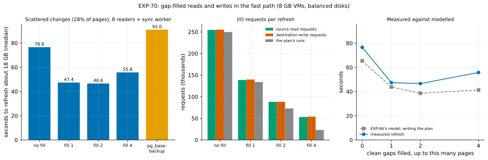
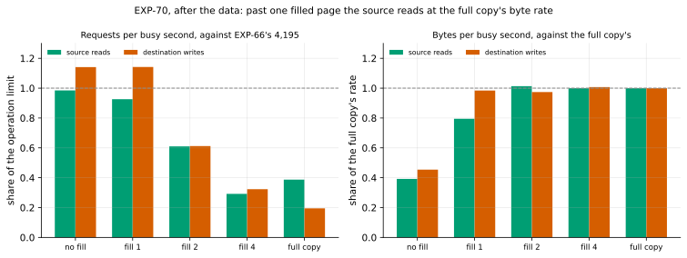

# EXP-70: Do gap-filled reads and writes (idea 2) make the fast path faster on scattered changes?

Status: **done October 29, 2026 (one session, 14 runs, all correct; all 6 predictions held, the deciding one 0.242 from its bar). `--fill-gaps 2` is now the fast path's default.** Pre-registered October 28, before any run. One VM pair (the `ha` set), after EXP-69's part B. It follows EXP-68's result: re-applied on the real page set, EXP-66's rule says to prototype idea 2.

## Question

With 8 reader threads and the receiver's syncs on a worker (the fast path's defaults since EXP-68), the fast path refreshed EXP-64's scattered cell (18 GB, 28% of pages changed) in 76.5 s, against 90.9 s for a full copy. What binds now is the disks' operation rate:
- **the source:** 254,547 reads in 61.7 s of busy time, about the cap EXP-66 measured;
- **the destination:** 255,260 writes;
- **the plan behind them:** 249,404 runs, each read once and written once (1.018 writes per run).

**Idea 2** (research loop 1, section 4) fills each clean gap of a few pages between two chosen runs, so the two become one read and one write. EXP-66 found the disk counts a write of up to 32 KiB as one operation. EXP-68's model, run on the real page set, puts the write side's time at:
- 65.4 s without filling;
- 43.8 s filling gaps of 1 page;
- **38.6 s filling gaps of up to 2 pages** (71,647 writes; 238,764 extra pages, +39%);
- 41.3 s filling gaps of up to 4.

The reads should follow the same curve (**inferred**: EXP-66 measured reads' cost by size only at 8 KiB).

**Does filling make the refresh faster as modelled, and where does it stop paying?**

## Design

**The new option:** `--fill-gaps PAGES` (sender, with `--fast-path`). Each clean gap of at most PAGES pages between two chosen pages of a file is sent too: `fastpath.fill_gaps`, applied before the plan is read or written.
- **The filled pages are S's current copies:** read like the chosen ones, written and verified by the receiver.
- **Statistics:** `fast_path.fill_gaps` gives the pages filled, and `pages_chosen` counts them.
- **Tests:**
  - unit tests for `fill_gaps` and its validation;
  - a refresh against a real server with `--fill-gaps 2`. Its copy recovers to the source's state and passes `pg_amcheck`, it filled more than 0 pages, its plan lists the filled pages, and no two runs of a file are separated by a gap of 2 or fewer.

**The set-up** is EXP-68's, unchanged: the `ha` set in us-west1, two `n2d-highcpu-8` VMs with 150 GiB balanced persistent disks, `blake3` on both.
- **The source:** EXP-48's database (scale 600, about 18 GB), PostgreSQL 17.11 or later, `summarize_wal` on.
- **The cells:** hot, then uniform (1% of rows each); per cell, B0 is a base backup with its manifest, taken before the change.
- **Each run** starts from a fresh copy of B0, with both VMs' caches dropped. The pgdelta arms are live, in place, with `--jobs 4 --hash blake3 --fast-path summaries --read-ahead 8`, and the receiver's `--fsync worker`.

**The arms,** with every setting explicit in the lab script:

| Arm | Cells | `--fill-gaps` |
|---|---|---:|
| `fast8w` | uniform, hot | 0 (EXP-68's arm) |
| `fast8wf1` | uniform | 1 |
| `fast8wf2` | uniform, hot | 2 |
| `fast8wf4` | uniform | 4 |
| `full` | uniform | one `pg_basebackup -X stream -c fast` into a new directory |

**The schedule:** 2 runs per arm, in a shuffled order (seed 700).
- **The command:** `PATTERNS="hot uniform" ARMS_hot="fast8w fast8wf2" ARMS_uniform="fast8w fast8wf1 fast8wf2 fast8wf4 full" PLAN=1 lab_exp64.sh SOURCE 2 700`, with results in `exp70`.
- **Per run:** `/proc/diskstats` on both VMs. Every fast run writes its plan, and the first plan per cell and arm is kept (new in the lab script).
- **Correctness:** each fast copy is started, and its `pgbench_accounts` row count and sum of `abalance` must equal the source's.
- **A smoke first,** at scale 20 (seed 701, one run per arm), deciding nothing. It must have kept every arm's plan and recorded four counter lines per run.

**The analysis,** committed before the data: `analysis/exp70.py` (it reuses EXP-68's parsing), figure `exp70-fill`, data `docs/experiments/data/exp70-cells.csv` and `exp70-model.csv`. Medians of 2. It was dry-run on synthetic results shaped like the harness's output.

**The lab script's arms were made explicit before this registration.** EXP-68 changed the fast path's defaults, so the arms now pass every setting rather than relying on them:
- `fast` passes `--read-ahead 0`;
- every arm without a `w` passes `--fsync main`.

EXP-64's, EXP-64b's and EXP-68's arms mean what they did when registered. EXP-67's lab script was pinned the same way.

## Predictions

On the uniform cell unless named.

1. **Deciding: `fast8wf2` takes at most 0.85 of `fast8w`'s time.**
   - **The model gives about 0.69.** Each side costs about 38 s at 71,647 operations of 96 KiB on average, and both sides overlap, as EXP-68 showed. That leaves the fixed costs EXP-68 measured (about 15 s, the guard's 4.7 s among them).
   - **At the bar (65 s),** filling still recovers 11 s of the source's 62 s of reads.
2. **The operations fall as modelled:** `fast8wf2`'s source read requests and destination write requests are each at most 0.40 of `fast8w`'s. The model gives 0.29.
3. **No material gain past 2 pages:** `fast8wf4` takes at least 0.95 of `fast8wf2`'s time. The model gives 1.07: filling 4 pages writes 20% more pages for fewer operations, and bandwidth starts to charge for them.
4. **No loss in the hot cell:** `fast8wf2` takes at most max(`fast8w` + 0.3 s, 1.15 × `fast8w`).
5. **Every run is correct and as configured:**
   - every run and every pgdelta receiver exited 0;
   - every fast run used the fast path on B0's `backup_manifest`, synced on the worker, and its copy matched the source;
   - each cell and arm's plans were identical, and every fast run read as many runs as its plan lists;
   - **each filled plan is exactly `fill_gaps` of the unfilled one,** file by file, runs included.
6. **Controls:** `fast8w` within 10% of EXP-68's 76.54 s, and the full copy within 5% of its 90.90 s.

**Reported, not predicted:**
- `fast8wf1`;
- the pages and bytes sent;
- both disks' busy time and the sender's waits;
- EXP-66's write model for this session's own unfilled plan, beside the measured times.

**Rule 11:** a deciding ratio within 0.05 of its bar gets a second session.

## What follows

- **If 1, 3 and 4 hold:** `--fill-gaps 2` becomes the fast path's default. Research loop 1's crossover against a full copy moves again, and the selector (idea 4) is re-sized.
- **If 1 fails and 2 holds:** the operations fell, but the time didn't. The counters and timers say what binds instead: bandwidth on either disk, the network, or the sender's hashing of the extra pages.
- **If 2 fails:** the filled runs didn't reach the disks as single requests. The block layer's request size limit or the sender's 1 MiB run cap would be checked first.
- **If 3 fails (`fast8wf4` faster):** the best fill lies beyond 2. The model's bandwidth term overstates the cost of larger I/O here, and the default is set from the measured curve instead.

## Results (October 29)

The `ha` set in us-west1-b and -c; the runs ended at 07:05 UTC, and the VMs were then deleted.
- **The server:** PostgreSQL 17.11, a 17,788 MB database, `summarize_wal` on.
- **Every run** and every pgdelta receiver exited 0, and every fast copy's `pgbench_accounts` equalled the source's.
- **Every fast run** used the fast path, its guard passing on B0's `backup_manifest`, and synced on the worker with 8 reader threads.
- **Plans:** each cell and arm's plans were identical, and every fast run read exactly as many runs as its plan lists. **Each filled plan is exactly `fill_gaps` of the unfilled one**, file by file. The uniform cell's unfilled plan chose 616,363 pages in 249,404 runs.
- **The pages filled match EXP-68's model to the page:** 116,434, 238,764 and 408,309 for fills of 1, 2 and 4.

**The pipeline paused once.** A transient `gcloud` SSL error stopped the smoke's records check after the smoke itself had passed. The script kept the VMs, as designed. I checked the smoke's records by hand (every arm's plan kept, four counter lines per run) and resumed from the registered run on the same VMs. Nothing was re-run or dropped.

A smoke at scale 20 ran first (in memory, deciding nothing):
- **uniform:** `fast8w` 2.56 s, `fast8wf1` 2.68 s, `fast8wf2` 3.14 s, `fast8wf4` 3.66 s, a full copy 6.51 s;
- **hot:** `fast8w` 1.09 s, `fast8wf2` 1.07 s.

Data: `docs/experiments/data/exp70-cells.csv` and `exp70-model.csv`; raw `results/exp04/exp70/` (not in git).

| Scattered changes, 18 GB (medians of 2) | `fast8w` (no fill) | `fast8wf1` | `fast8wf2` | `fast8wf4` | full copy |
|---|---:|---:|---:|---:|---:|
| **Seconds** | 76.6 | 47.4 | **46.6** | 55.8 | 91.0 |
| The two repeats | 76.5, 76.7 | 47.2, 47.6 | 46.6, 46.6 | 55.4, 56.1 | 91.0, 91.0 |
| Pages sent | 619,251 | 735,685 | 858,015 | 1,027,560 | |
| The plan's runs | 249,404 | 134,075 | 72,973 | 23,331 | |
| Source disk: reads; MB; busy seconds | 254,516; 5,085; 61.6 | 138,742; 5,990; 35.7 | 88,163; 7,357; 34.5 | 53,104; 9,130; 43.4 | 137,651; 17,865; 84.8 |
| Destination disk: writes; busy seconds | 255,215; 53.3 | 139,911; 29.2 | 88,311; 34.4 | 54,020; 39.9 | 69,586; 85.3 |
| Sender waiting on its reader threads | 43.4 | 21.2 | 22.3 | 31.7 | |
| Sync worker busy | 52.9 | 26.9 | 32.3 | 28.0 | |
| Guard | 4.7 | 4.7 | 4.7 | 4.7 | |
| EXP-66's model, writing the plan | 65.4 | 43.8 | 38.6 | 41.3 | |

The hot cell: `fast8w` 1.85 s (1.84, 1.87), `fast8wf2` 1.93 s (2.01, 1.85), which filled 7 pages.

| # | Prediction | Outcome |
|---|---|---|
| 1 | Deciding: `fast8wf2` at most 0.85 of `fast8w` | **Held, 0.608** (the model gave 0.69; 0.242 from the bar, so no second session under rule 11) |
| 2 | `fast8wf2`'s source reads and destination writes each at most 0.40 of `fast8w`'s | **Held, 0.346 and 0.346** (the model gave 0.29) |
| 3 | `fast8wf4` at least 0.95 of `fast8wf2` | **Held, 1.197** (the model gave 1.07) |
| 4 | Hot: `fast8wf2` at most max(`fast8w` + 0.3 s, 1.15 × `fast8w`) | **Held,** 1.93 against a bar of 2.15 s |
| 5 | Every run correct and as configured; each filled plan exactly `fill_gaps` of the unfilled one | **Held** |
| 6 | Controls: `fast8w` within 10% of 76.54 s, the full copy within 5% of 90.90 s | **Held,** 76.57 and 91.02 s |

### Post-hoc check (written after the data; no verdict changes)

Fill 1 and fill 2 came out almost equal (47.4 and 46.6 s), where the model put 5 s between them. To see why, `analysis/exp70_posthoc.py` divides each disk's requests and bytes by its busy seconds (from `/proc/diskstats`). It compares them with the disk's two limits: EXP-66's 4,195 requests a second, and the full copy's own byte rate in this session (about 210 MB per busy second on each disk). Data: `docs/experiments/data/exp70-posthoc-rates.csv`.

| Uniform cell | no fill | fill 1 | fill 2 | fill 4 | full copy |
|---|---:|---:|---:|---:|---:|
| Source: share of the operation limit | 0.98 | 0.93 | 0.61 | 0.29 | 0.39 |
| Source: share of the full copy's byte rate | 0.39 | 0.80 | **1.01** | **1.00** | 1.00 |
| Destination: share of the operation limit | 1.14 | 1.14 | 0.61 | 0.32 | 0.19 |
| Destination: share of the full copy's byte rate | 0.45 | **0.98** | **0.97** | **1.01** | 1.00 |
| Either disk busy, share of the run | 0.80 | 0.75 | 0.74 | 0.78 | 0.94 |

- **Past one filled page, both disks run at their byte rate.** At fill 2 and fill 4, each disk moves bytes as fast as a sequential full copy while busy. So every further page filled costs its full transfer time, and the operations saved no longer buy anything. Fill 2's source is busy 34.5 s against fill 1's 35.7 s: fewer operations, more bytes, about the same time.
- **The model was too pessimistic about small writes.** The destination completed about 4,790 writes per busy second at 19 and 42 KiB, above the 4,195 that `fio` measured for random 8 KiB writes. The cause isn't measured. A likely one is that these writes go in file order, unlike `fio`'s random ones. With that, fill 1 already brings the destination to its byte rate, so the model overstated fill 1's time by 15 s and fill 2's by 4 s. At fill 4 it was close (41.3 against 39.9 busy seconds).
- **Fill 4's large runs reached the disks split:** 23,331 runs of 389 KiB on average became about 53,000 requests of about 168 KiB on each disk (the block layer's request size limit, inferred). Its operations therefore fell less than its runs did. That doesn't matter here, since bytes bind.
- **About 12 s of each fast run has neither disk busy.** That is the guard's 4.7 s, the start, the listing and the final syncs. At fill 2 that is a quarter of the run.

## What it means (with a committee's reading)

- **Filling worked, and better than modelled:** 0.608 of no filling, against the model's 0.69. The scattered cell (28% of pages changed) now refreshes in **0.512 of a full copy's time**, against 0.842 after EXP-68, 1.13 after EXP-64b and 1.81 in EXP-64.
- **Nearly all the gain comes from filling 1 page:** 0.619 of no filling. Filling 2 gains a further 1.7%, and the two repeats of each don't overlap (47.15–47.61 against 46.55–46.63 s). The post-hoc check says why: past 1 page, both disks are bound by bytes, not operations.
- **Fill 4 loses** (1.197 of fill 2), as predicted: it sends 20% more pages, which a byte-bound disk charges for in full.
- **The default follows the registration: fill 2.** A committee should know what that buys and what it costs:
  - **What it buys:** on disks bound by their operation rate, as balanced persistent disks are for scattered pages, it is the fastest measured fill. It is 1.7% ahead of fill 1, and unchanged in the hot cell.
  - **What it costs:** it sends 17% more pages than fill 1 (858,015 against 735,685) and 39% more than no fill.
    - **Where bytes are dearer than operations,** less filling is better: a link slower than about 210 MB/s, or pages already in memory. The in-memory smoke shows that direction: 3.14 s at fill 2 against 2.56 s with none. The smoke decides nothing, but it agrees with the disk counters.
    - **Choosing the fill from the measured link and disk rates** is the selector's job (idea 4). The default suits the case measured here: one region, a 16 Gbps network, balanced persistent disks.
- **What binds now is bytes plus fixed costs.** At fill 2, a refresh is about 12 s of fixed costs plus the bytes sent at the disks' byte rate (34.5 s for 7.4 GB). Two kinds of next gain follow:
  - **cutting the fixed costs** (the guard's 4.7 s is a tenth of the run);
  - **sending fewer bytes.**
- **For research loop 1's crossover:** at 28% of pages the fast path now takes half of a full copy's time, so its break-even against a full copy lies well above 28%. Where exactly isn't measured.

**Limitations:**
- **One disk type, size and change shape:** balanced persistent disks, 18 GB, uniform changes at 28% of pages. The hot cell fills almost nothing (7 pages), so it tests only that filling does no harm.
- **Statistics:** medians of 2. The repeats were within 1.1% of each other.
- **Network:** never the bound here. The fast path sent at most 9.1 GB in 56 s, well under the VMs' 16 Gbps.
- **The post-hoc rates** use the disks' busy time, which counts any time a request is in flight. They show which limit a disk sits at, not how deep its queue was.

## What follows (applied)

- **`--fill-gaps` now defaults to 2 with `--fast-path`,** as registered for predictions 1, 3 and 4 holding (`fastpath.DEFAULT_FILL_GAPS`; 0 without `--fast-path`). It applies only to the CLI; the library default stays 0.
  - **Tests:** the default refresh fills with gap 2 and passes `pg_amcheck`, an explicit `--fill-gaps 0` leaves no filling statistics, and a unit test covers how the CLI resolves the option.
- **The lab scripts keep their registered arms:**
  - `lab_exp64.sh`'s arms without `fK` pass `--fill-gaps 0`;
  - `lab_exp67.sh`'s fast arm passes `--fill-gaps 0` too.
  - **Two scripts were missed when EXP-68 changed the defaults:** `lab_exp65.sh` and EXP-63's `fastpath_check.py`. Both now pass their registered settings explicitly: `--read-ahead 0`, `--fill-gaps 0` and `--fsync main`.
- **Next, per research loop 1:**
  - **idea 1's prototype for the failover case,** where `pg_rewind` and a re-clone still beat pgdelta (EXP-67, EXP-69);
  - **the fast path's fixed costs;**
  - **the selector (idea 4),** re-sized to these constants. It should pick the fill from the link's and disks' rates.
