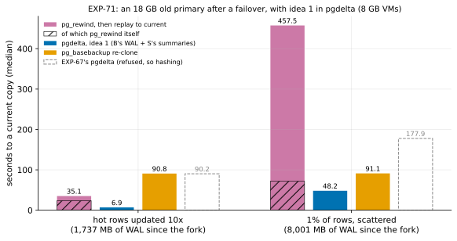

# EXP-71: With idea 1 built in, does pgdelta refresh an old primary after a failover faster than `pg_rewind` and a re-clone?

Status: **done October 28, 2026: all 6 predictions held,** and `--diverged-basis` is now on with `--fast-path`, as registered. Pre-registered the same day, before any run. One VM pair (the `ha` set), about 2.5 hours with the data load. It follows EXP-69 part B and EXP-69b, which showed idea 1's send set is correct wherever its guard passes and about the size of hashing's at 18 GB, and research loop 1, which names this the case pgdelta still loses (EXP-67).

## Question

EXP-67 brought an 18 GB old primary current after a failover three ways:
- **`pg_rewind`, then replay to current:** 36.4 s for hot rows updated 10 times (hot10), and 459.0 s for 1% of rows scattered (uniform; about 313 s without WAL the lab's own state check wrote, inferred in EXP-69).
- **pgdelta:** its fast path refuses an old primary that kept writing past the fork, so it hashed both copies: 90.2 s and 177.9 s.
- **a `pg_basebackup` re-clone:** 90.9 s and 91.1 s.

**Idea 1** sends the server's current copy of every block either side changed since C, their last common checkpoint, and replays none of the server's WAL:
- **B's side:** the blocks B's own WAL names from C's redo point through B's end, as `pg_rewind` reads them;
- **the server's side:** the blocks its WAL summaries list from C's redo point to the backup's start.

EXP-69b found its copies correct wherever its guard passes, and found the guard's checksum condition necessary. At EXP-67's scale, its send set was 0.94 and 0.997 of the pages hashing sends (EXP-69 part B). B's side was about 20,000 blocks in both lags.

**Built now into pgdelta as `--diverged-basis`, does it beat both on EXP-67's cells?**

## What was built (before this registration)

**`--diverged-basis`** (sender, with `--fast-path summaries`), offered in HELLO (`diverged_offer`), so other sessions' bytes are unchanged.
- **The receiver accepts the offer** only when B's end is proven by a clean shutdown, reading B's `wal_log_hints` then.
- **Where the fast path's guard finds B past the point** where the server's history leaves B's timeline, the sender names that fork (`FORK_POINT`). The receiver answers (`BASIS_WAL`) with either C and the blocks B's WAL names since its redo point, or why not. The sender's guard then decides.

**The receiver** (`fastpath.basis_wal_blocks`):
- **finds C,** the last checkpoint record before the fork, reading B's WAL with `pg_waldump --rmgr XLOG` in windows that end at the fork. Each window is twice as long as the last, so the receiver doesn't read all the WAL B keeps (`fastpath.last_checkpoint_before`; `pg_rewind` reads backward record by record);
- **reads B's WAL from C's redo point through B's end** (`pg_waldump --end`) and lists every block a record names, as relation forks and runs;
- **refuses** if that WAL doesn't read through without a gap, or holds a record of a resource manager outside PostgreSQL's built-in ones that name their blocks: an extension's, or a Database or Tablespace record. Such records may change files without naming their blocks; `pg_rewind` refuses unknown ones.

**The guard** (`fastpath.guard` with `common`) passes only where all of these hold:
- the fast path's usual conditions;
- C lies before the fork, and its redo point is on B's timeline in the server's history;
- B has data checksums or `wal_log_hints` (EXP-69b);
- the summaries cover C's redo point to the backup's start.

**What is sent:** B's blocks join the summaries' plan (`fastpath.merge_basis_blocks`), and the fast path then runs as usual, with read-ahead and gap filling. Files B created after the fork are removed, as files the server lacks; every block past B's length is sent; relation forks other than main and VM go whole.

**Tests,** all passing:
- unit tests of the fork test, the guard with C, the window search (with a stand-in `pg_waldump`), the merge and both messages;
- **a real failover:** a standby promoted while its primary kept writing, both sides updating other rows and creating a table of the same name, then the old primary stopped cleanly.
  - **With `--diverged-basis`:** the fast path ran with 4,019 blocks from B's WAL, and the copy matched the server's rows and passed `pg_amcheck --heapallindexed`.
  - **Without it:** refused, and hashed.
  - **With B's WAL since C removed:** refused with the receiver's reason, and hashed.

  Both refused copies matched too.

## Design

**EXP-67's lab, unchanged except one new arm,** with every setting explicit (`experiments/network/lab_exp67.sh`).
- **The `ha` set** in us-west1: two `n2d-highcpu-8` VMs with 150 GiB balanced persistent disks, `blake3` on both.
- **The database:** EXP-48's (scale 600, about 18 GB), PostgreSQL 17.11 or later, data checksums on, `summarize_wal` on, and `wal_keep_size = 40GB` on the source.
- **The failover, per lag, as in EXP-67:** a standby Q catches up and stops cleanly. P updates 10,000 rows Q never sees and stops cleanly; P's data directory goes to dest as **B0**. Q, promoted, becomes **S**, then runs the lag (hot10, or uniform).
- **The state check:** S's `pgbench_accounts` state is recorded, and S's LSN before and after the check (EXP-69).

**Each run** starts from a fresh copy of B0, with both VMs' caches dropped, and is timed until the copy is current:
- **`rewind`:** as in EXP-67 (`pg_rewind`, then B started as S's standby until it has replayed to S's LSN).
- **`union` (new):** pgdelta live, in place, `--jobs 4 --hash blake3 --fast-path summaries --diverged-basis --read-ahead 8 --fill-gaps 2`, and the receiver's `--fsync worker` (the fast path's defaults, pinned). The copy is then started until it accepts connections.
- **`full`:** as in EXP-67 (`pg_basebackup -X stream -c fast` into a new directory, then started).

**Correctness:**
- each copy's `pgbench_accounts` row count and sum of `abalance` must equal S's, which also requires B's own 10,000 changes to be gone;
- **the first `union` run per lag** is checked with `pg_amcheck --all --heapallindexed` while the copy runs, after the timing.

**The schedule:** 2 runs per arm and lag, shuffled (seed 710).
- **The command:** `ARMS="rewind union full" OUT=/data/exp04-results/exp71 lab_exp67.sh SOURCE 2 710`.
- **A smoke first,** at scale 20 (seed 711, one run per arm), deciding nothing. Every run must exit 0 and match, and each union run must have taken the fast path with B's WAL, its `pg_amcheck` exiting 0.

**The analysis,** committed before the data: `analysis/exp71.py` (it reuses EXP-67's parsing), figure `exp71-union`, data `docs/experiments/data/exp71-cells.csv`. Medians of 2. It was dry-run on synthetic results shaped like the lab's output, and the dry run's outputs were removed.

## Predictions

**The model:**
- **hot10:** idea 1 sends about 32,000 pages, twice EXP-70's hot cell (14,719 pages in 1.9 s). Add 1–3 s to read B's WAL and a few seconds to start the copy: **about 7 s**, against `pg_rewind`'s 36 s (0.2).
- **uniform:** about 622,000 chosen pages, like EXP-70's scattered cell (46.6 s with gaps of 2 filled). Add B's WAL and the start: **about 52 s**, against a re-clone's 91 s (0.57) and `pg_rewind`'s 459 s (0.11).

1. **Deciding: for hot10, `union` takes at most 0.5 of `rewind`'s time.** The model gives about 0.2.
2. **For uniform, `union` takes at most 0.75 of `full`'s time.** The model gives about 0.57.
3. **For uniform, `union` takes at most 0.5 of `rewind`'s time.** The model gives about 0.11. The bar also holds against EXP-69's inferred 313 s without the check's WAL.
4. **Every copy is correct, and idea 1 ran in every union run:**
   - every run and every pgdelta receiver exited 0, and every copy's state equals S's;
   - every union run took the fast path with B's WAL, its checkpoint before the fork;
   - both copies checked with `pg_amcheck` pass.
5. **B's side matches EXP-69's count:** the blocks from B's WAL are within 15% of EXP-69's 20,199 (hot10) and 20,094 (uniform).
6. **Controls:**
   - `rewind` within 15% of EXP-67's 36.44 s and 459.0 s;
   - `full` within 5% of its 90.92 s and 91.10 s.

**Reported, not predicted:**
- the time to read B's WAL, and the guard's time;
- the pages chosen and sent;
- `pg_rewind`'s own share;
- the WAL the state check wrote;
- EXP-67's pgdelta (hashing) times beside the new arm.

**Rule 11:** a deciding ratio within 0.05 of its bar gets a second session.

## What follows

- **If 1–4 hold:** `--diverged-basis` becomes the fast path's default, and research loop 1's failover case is closed.
  - pgdelta would be the fastest of the three on both of EXP-67's cells.
  - It would refresh in place without replaying the server's WAL, and without `pg_rewind`'s separate standby step.
- **If 1 fails:** the timers say what costs:
  - reading B's WAL (the receiver's seconds);
  - the summaries' guard;
  - or the pages sent.
- **If 4 fails:** the failing copy is kept and diffed page by page against S (EXP-69b's tools). The option stays opt-in until the cause is fixed and re-tested.
- **If 2 fails and 1 holds:** idea 1 serves the hot case, and the selector (idea 4) weighs a re-clone for scattered ones.

## Results (October 28)

The `ha` set in us-west1-b and -c (us-west1-a had no capacity); the runs ended at 09:11 UTC, and the VMs and disks were then deleted.
- **The server:** PostgreSQL 17.11, a 17,788 MB database, data checksums and `summarize_wal` on.
- **Every run** and every pgdelta receiver exited 0, and every copy's `pgbench_accounts` equalled S's, so B's own 10,000 changes were gone from each.
- **Every union run took the fast path with B's WAL.** C, the last checkpoint before the fork, was found in both lags one segment before it (6/61000080 before 6/62000060, 6/D7000080 before 6/D8000000). B has data checksums, so its `wal_log_hints` (off) didn't matter.
- **Both copies checked with `pg_amcheck --all --heapallindexed` passed,** with no output.
- **The smoke** at scale 20 (in memory, deciding nothing) ran every arm once, all correct: hot10 `rewind` 2.69 s, `union` 1.91 s, `full` 6.54 s; uniform 6.13, 3.81 and 6.61 s. Each union run took B's WAL and passed `pg_amcheck`.

Data: `docs/experiments/data/exp71-cells.csv`; raw `results/exp04/exp71/` (not in git).

| Seconds to a current copy (medians of 2) | hot10 | uniform |
|---|---:|---:|
| WAL S wrote since the fork | 1,737 MB | 8,001 MB |
| **`rewind`:** `pg_rewind`, then replay to S's LSN | 35.1 (35.11, 35.16) | 457.5 (457.31, 457.63) |
| — of which `pg_rewind` itself | 23.5 | 71.8 |
| **`union`:** pgdelta with idea 1, then started | **6.9** (6.97, 6.85) | **48.2** (48.12, 48.27) |
| — of which pgdelta's session | 5.6 | 46.8 |
| **`full`:** `pg_basebackup` re-clone, then started | 90.8 (90.81, 90.80) | 91.1 (91.10, 91.16) |
| EXP-67's pgdelta (the guard refused B, so it hashed both copies) | 90.2 | 177.9 |
| `union` / `rewind` | **0.197** | **0.105** |
| `union` / `full` | 0.076 | **0.529** |

What the union arm did (the same in both repeats of each lag):

| | hot10 | uniform |
|---|---:|---:|
| B's WAL from C's redo point: records; blocks named | 30,013; 20,199 | 29,809; 20,094 |
| Seconds the receiver spent reading it (`pg_waldump`, both passes) | 0.65 | 0.65 |
| Guard seconds (the summaries from C's redo point) | 1.06 (15 summaries) | 5.4 (22 summaries, 1.47 M rows) |
| Pages chosen before filling; filled (gaps of up to 2) | 31,918; 7 | 621,769; 240,285 |
| Pages sent (with the 140 files sent whole) | 34,814 (0.29 GB) | 864,947 (7.09 GB) |
| Of 2,175,904 pages in the copy, sent | 1.6% | 39.8% |

| # | Prediction | Outcome |
|---|---|---|
| 1 | Deciding: hot10, `union` at most 0.5 of `rewind` | **Held, 0.197** (the model gave 0.2; 0.30 from the bar, so no second session under rule 11) |
| 2 | Uniform: `union` at most 0.75 of `full` | **Held, 0.529** (the model gave 0.57) |
| 3 | Uniform: `union` at most 0.5 of `rewind` | **Held, 0.105** (the model gave 0.11). Against EXP-69's inferred 313 s without the check's WAL, 0.154 |
| 4 | Every copy correct; every union run took the fast path with B's WAL, C before the fork; both `pg_amcheck` checks pass | **Held** |
| 5 | B's blocks within 15% of EXP-69's 20,199 and 20,094 | **Held, exactly equal:** 20,199 and 20,094 |
| 6 | Controls: `rewind` within 15% of 36.44 and 459.0 s; `full` within 5% of 90.92 and 91.10 s | **Held:** 35.14 and 457.5 s (0.96, 1.00); 90.81 and 91.13 s (1.00, 1.00) |

**Reported, not predicted:**
- **The state check's WAL** (S's hint bits after the lag's checkpoint, EXP-69): 85.8 MB after hot10 and 3,761 MB after uniform. `rewind` replays it; `union` sends the pages it touched, which the summaries list.
- **B's blocks equal EXP-69's `pg_waldump` count exactly,** in both lags. The lab's seeds make the workload the same, and the receiver lists the same blocks `pg_waldump` names.

## What it means (with a committee's reading)

- **The failover case is no longer one pgdelta loses.** On EXP-67's cells, pgdelta with idea 1 is the fastest of the three:
  - **hot10:** 6.9 s, against `pg_rewind`'s 35.1 s and a re-clone's 90.8 s. EXP-67's pgdelta took 90.2 s, since its guard refused B and it hashed both copies.
  - **uniform:** 48.2 s, against a re-clone's 91.1 s and `pg_rewind`'s 457.5 s. EXP-67's pgdelta took 177.9 s.
- **The model was close in both cells:** 6.9 s against about 7 s, and 48.2 s against about 52 s. The uniform session (46.8 s) matches EXP-70's scattered cell with the same fill (46.6 s), and its pages before filling (621,769, B's side included) are close to that cell's 616,363. B's side costs almost nothing: 20,000 blocks against 600,000, and 0.65 s to read B's WAL.
- **Why it beats `pg_rewind`:** `pg_rewind` sends the same blocks for B's side, but B must then start and replay all the WAL S wrote since the fork: 1.7 GB and 11.6 s after hot10, 8.0 GB plus the check's 3.8 GB and 386 s after uniform. Idea 1 sends S's current copy of each page once, so how much WAL S wrote doesn't matter, only which pages it touched.
- **Why it beats a re-clone:** it sends 1.6% of the pages for hot10 and 40% for uniform (with filled gaps), where the re-clone sends all of them.
- **The two checks a committee would ask for both passed:** every copy's rows equalled S's, B's own changes undone, and `pg_amcheck --heapallindexed` passed on the first union copy per lag. EXP-69b had already compared idea 1's copies page by page against S on EXP-03's tricky copies.

**Limitations:**
- **One failover shape:** a clean shutdown of the old primary, 10,000 of its own changes, and two lags. An old primary that crashed, or whose WAL since C is gone, is refused, and pgdelta hashes as before (the missing WAL is tested locally; neither is timed).
- **One environment:** 18 GB, balanced persistent disks, one region. The cells are EXP-67's, and the times are medians of 2 (the repeats were within 1.8% of each other).
- **Data checksums were on.** Without checksums or `wal_log_hints` the guard refuses, as EXP-69b found it must.
- **What wasn't run:** an old primary with an extension's resource manager in its WAL, or with Database or Tablespace records since C. The receiver refuses those (tested with unit tests only).

## What follows (applied)

- **`--diverged-basis` is now on with `--fast-path`,** as registered for predictions 1–4 holding (`fastpath.DEFAULT_DIVERGED_BASIS`; `--no-diverged-basis` turns it off). It applies only to the CLI; the library default stays off.
  - **Tests:** the real-failover test now takes the fast path with no option, `--no-diverged-basis` is refused and hashed, and a unit test covers how the CLI resolves the option. The receiver still accepts only a clean shutdown, so a session against any other basis is unchanged apart from HELLO's offer.
- **The lab scripts keep their registered arms:** `lab_exp67.sh`'s fast arm, `lab_exp64.sh`'s and `lab_exp65.sh`'s fast arms and EXP-63's `fastpath_check.py` pass `--no-diverged-basis`.
- **Research loop 1's failover case is closed,** as registered.
- **Next, per research loop 1:**
  - **the fast path's fixed costs:** the guard alone took 5.4 s of the uniform session's 46.8 s, reading 1.47 million summary rows;
  - **the selector (idea 4),** which should pick the fill from the link's and disks' rates.
