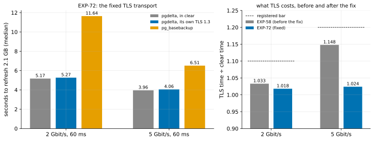

# EXP-72: What does pgdelta's own TLS cost on the fixed transport?

Status: **done October 28, 2026: every prediction held.** With the fix, TLS took 1.018 of clear's time at 2 Gbit/s (bar 1.10) and 1.024 at 5 Gbit/s (bar 1.20), against EXP-58's 1.033 and 1.148 on the old transport. Pre-registered the same day, before any run; one default VM pair. It repeats EXP-58's design on the transport fixed earlier the same day.

## Question

EXP-58 found that pgdelta's own mutual TLS 1.3 cost 1.033 of its in-clear time at 2 Gbit/s and 60 ms, and 1.148 at 5 Gbit/s, with under 1% more bytes. That met O6's goal.

Since then the transport was found to break OpenSSL's rule that one SSL object is never used by two threads at once:
- a session reads on one thread while another writes, and both went through one `ssl.SSLSocket`;
- a full-duplex stress crashed the process (SIGBUS in OpenSSL) within 30 rounds of 64 MiB, three times in three tries;
- CI's TLS session test hung once.

The fix keeps the TLS state in an `ssl.SSLObject` over memory buffers, used only under a lock, and reads and writes the socket outside it (`transport._TlsConnection`; LOG, October 28). Locally it moved one-way bulk data about 2.4 times as fast as before. EXP-58's figures were measured on the old transport, so the docs now call them "likely an upper bound", which is inferred.

**Does the fixed transport still meet EXP-58's bars, and what does TLS cost on it?**

## Design

**EXP-58's design, unchanged except the seed and the transport** (the same harness, arms and command; `pgdelta` at this commit):
- **The default `n2-standard-8` pair in us-central1,** with BBR on v1's data socket, tuned TCP buffers, realistic rows, and `blake3` 1.0.11 on both ends.
- **Arms:**
  - `pgdelta_direct_inplace_bbr_b3`: v1, BBR, BLAKE3, in clear;
  - `pgdelta_direct_inplace_bbr_b3_tls`: the same inside pgdelta's own TLS, with the session's CA and certificates (EC P-256);
  - `full`: for context.
- **Pattern:** `uniform` (scattered), 1%, scale 70 (2.1 GB), about 610 MB sent.
- **Conditions:** 2 and 5 Gbit/s at 60 ms, tuned (`--conditions 2:60:tuned,5:60:tuned`).
- **Repeats:** 2, order seed 720.

The clear arm doesn't touch the changed code: without TLS the transport still uses the socket's own streams. The fast-path changes since EXP-58 apply only with `--fast-path`, which no arm uses.

**The analysis,** committed before the data: `analysis/exp72.py`. It parses the runs as EXP-58's analysis does and reports each cell beside EXP-58's; figure `exp72-tls`, data `docs/experiments/data/exp72-cells.csv`. It was dry-run on EXP-58's own results, where it reproduced EXP-58's cells exactly; the dry run's outputs were removed.

## Predictions

**The model:** encryption itself (AES-256-GCM with AES-NI) is unchanged. The fix removes Python work per TLS record on the reading side: locally, bulk data moved 2.4 times as fast. So TLS should cost no more than in EXP-58, and probably less on the receiver's CPU.

1. **Deciding: at 2 Gbit/s and 60 ms, TLS takes at most 1.10 of clear's time** (EXP-58's bar; it measured 1.033).
2. **At 5 Gbit/s, at most 1.20 of clear's time** (EXP-58's bar; it measured 1.148).
3. **TLS adds at most 2% to the bytes on the wire.**
4. **Every run passes.** Every TLS run negotiated TLS 1.3 with the session's server certificate, and no clear run negotiated TLS.
5. **Controls:** clear and the full copy within 5% of EXP-58's times (5.23 and 4.04 s; 11.38 and 6.52 s).

**Reported beside EXP-58's, not scored:** each ratio, the CPU TLS adds on each VM (EXP-58: +0.69 and +0.57 s at 2 Gbit/s, +0.59 and +0.65 s at 5), and the handshake time. **The expectation,** stated now: both ratios at or below EXP-58's, and less CPU added on the receiver.

**Rule 11:** as in EXP-58, a ratio within 0.05 of its bar gets a second session, for that cell only.

## What follows

- **If 1–4 hold:** the docs give EXP-72's measured cost for the fixed transport, in place of EXP-58's figures and the "likely an upper bound" notes. O6 stays met.
- **If 1 fails:** the fix costs time at DR rates. Its locks and copies get profiled on the VMs (the phase timers and both VMs' CPU), and O6 goes back to "Partly met" until that is fixed.
- **If 2 fails and 1 holds:** TLS stays cheap at DR rates and costs more on fast links than before. Both are stated, and the reading side's per-record work is the first suspect.

## Results

The default pair in us-central1-a (after three tries: every us-central1 zone was out of `n2-standard-8` VMs with local SSDs from 12:55 UTC). The runs took 13:34–13:40 UTC, and the VMs were then deleted. `blake3` 1.0.11 was on both ends, and every pgdelta run hashed with BLAKE3. The links measured 1.75 and 4.29 Gbit/s, as in EXP-58. Data: `docs/experiments/data/exp72-cells.csv`; raw `results/exp04/exp72/` (not in git).

*How to read it:* left, each arm's median time to refresh 2.1 GB at each link speed; right, TLS time over clear time, EXP-58's (old transport) beside EXP-72's (fixed), with each registered bar dashed.

| Link (60 ms) | Clear (s) | TLS (s) | TLS / clear | EXP-58 | Full copy (s) | Wire bytes, TLS / clear |
|---|---|---|---|---|---|---|
| 2 Gbit/s | 5.175 | 5.267 | **1.018** | 1.033 | 11.64 | 1.0028 |
| 5 Gbit/s | 3.960 | 4.056 | **1.024** | 1.148 | 6.51 | 1.0027 |

Medians of 2 runs. The runs: clear 5.149 and 5.200 s, TLS 5.222 and 5.312 s at 2 Gbit/s; clear 3.898 and 4.023 s, TLS 3.977 and 4.135 s at 5 Gbit/s.

| # | Prediction | Result |
|---|---|---|
| 1 | **Deciding:** TLS at most 1.10 of clear's time at 2 Gbit/s | **Held:** 1.018 |
| 2 | At most 1.20 at 5 Gbit/s | **Held:** 1.024 |
| 3 | TLS adds at most 2% to the wire bytes | **Held:** 0.28% and 0.27% |
| 4 | Every run passes; every TLS run negotiated TLS 1.3 with the session's server certificate; no clear run negotiated TLS | **Held:** 12 of 12 passed, `TLS_AES_256_GCM_SHA384` |
| 5 | Controls within 5% of EXP-58's: clear 5.23 and 4.04 s, the full copy 11.38 and 6.52 s | **Held:** 5.175 and 3.960 s (1.0% and 2.0% below), 11.64 and 6.51 s (2.3% above, 0.1% below) |

**Rule 11:** both ratios are far from their bars (0.08 and 0.18 below), so no second session.

**Reported beside EXP-58's:**
- **The CPU TLS adds** (seconds of CPU on each VM, the TLS runs' median minus the clear runs' median):

  | Link | Source (sender) | EXP-58 | Dest (receiver) | EXP-58 |
  |---|---|---|---|---|
  | 2 Gbit/s | +0.25 | +0.69 | +0.60 | +0.57 |
  | 5 Gbit/s | +0.34 | +0.59 | +0.31 | +0.65 |

- **The handshake:** 69 ms in both cells (EXP-58: 67 ms).
- **The expectation stated before the runs** ("both ratios at or below EXP-58's, and less CPU added on the receiver") held for the ratios. The receiver's added CPU fell at 5 Gbit/s (0.31 against 0.65 s) but not at 2 (0.60 against 0.57 s). The sender's fell in both cells.

**Reading.** TLS's cost at 5 Gbit/s fell from 15% to about 2%, so EXP-58's cost there was mostly the old transport, not the encryption. At 2 Gbit/s the cost was small either way. The two cells' differences are within run-to-run spread (the TLS and clear runs overlap at 5 Gbit/s: 3.977–4.135 against 3.898–4.023 s), so this session says TLS costs **at most a few per cent at both speeds**. It does not resolve 1.8% from 2.4%. One session, two repeats per cell.

## What followed

As registered for 1–4 holding:
- The docs give EXP-72's measured cost for the fixed transport, in place of EXP-58's figures and the "likely an upper bound" notes (pgdelta's README, RESULTS). EXP-58's note points here.
- O6 stays met.
