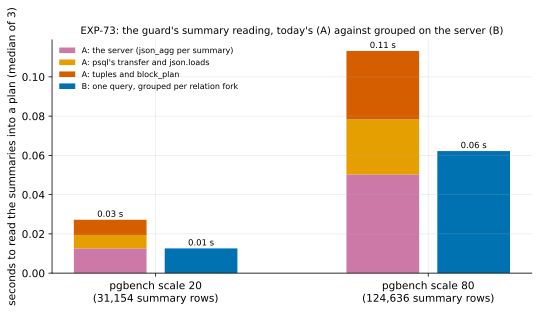

# EXP-73: Where does the fast path's guard spend its time, and does reading the summaries grouped on the server cut it?

Status: **done October 28, 2026: the deciding prediction failed** (B took 0.547 of A's time, against a bar of 0.4), and 2–4 held. B is not built on this evidence. A post-hoc check traces the miss to the scale models' duplication, and EXP-73b tests that prospectively. Pre-registered the same day, before any run. Local, on the Mac (PostgreSQL 17.11), about 20 minutes. Research loop 1 names the fast path's fixed costs next. At EXP-71's scattered cell the guard took 5.4 s of the session's 46.8 s while reading 1.47 million summary rows. At EXP-70's it took 4.7 s, a tenth of the run.

## Question

**Today, per summary the guard overlaps** (`sender._decide_fast_path`):
- it asks `pg_wal_summary_contents()` through the session's psql;
- the server builds one JSON array per row (tablespace, database, relfilenode, fork, block, limit flag) and aggregates them with `json_agg`;
- psql prints the result as one line, and Python parses it and turns each row into a tuple;
- `fastpath.block_plan` then adds every block to a per-relation set.

A block changed in several checkpoint intervals appears once per summary. At EXP-71's scattered cell, 1.47 million rows named about 600,000 distinct pages.

**The alternative (B):** one query over all the chosen summaries, grouped on the server per relation fork. It returns each fork's distinct blocks as one array and its lowest limit block, so the server sorts and deduplicates, and psql prints and Python parses about one integer per distinct block.

**Where does the time go today, and does B cut it with an identical plan?**

## Design

**Scale models,** each a fresh local cluster (`initdb --data-checksums`, `summarize_wal = on`), loaded with `pgbench -i`, then a `CHECKPOINT`; that LSN is the start. The lag is EXP-64's uniform pattern, scaled: 1% of `pgbench_accounts`' rows updated in random order, in 5 batches with a `CHECKPOINT` after each, so a block appears in several summaries as it does on the VMs.
- **Two sizes:** scale 20 and scale 80 (about 0.3 and 1.2 GB), to see how each part scales with rows.
- **Ranges:** the summaries from the start through the WAL summarizer's latest, after `pg_switch_wal()` and waiting for the summarizer.

**Methods, each run 3 times per size, alternated, after one warm-up run each:**
- **A, today's:** `live.Session.value` per summary, the same SQL as `live.summary_rows`, then `fastpath.block_plan`. It is timed in parts:
  - the server alone: the same query with its result discarded (`SELECT length(...)`);
  - psql's transfer and Python's `json.loads`;
  - the tuples and `block_plan`.
- **B:** one query through the same `Session`, grouping per relation fork:
  - `array_agg(DISTINCT relblocknumber ORDER BY relblocknumber) FILTER (WHERE NOT is_limit_block)`;
  - `min(relblocknumber) FILTER (WHERE is_limit_block)`;
  - then the same plan structure built from those arrays.

**Every run checks that B's plan equals A's:** every relation fork's block set and limit, and the same forks. A plan that differs fails the run.

The script is `experiments/fastpath_fixed_costs/guard_reading.py`, which writes `docs/experiments/data/exp73-guard.csv` and the figure `exp73-guard`.

## Predictions

**The model:** about 60 bytes of JSON per row, and a few microseconds per row in each of json_agg, json.loads and the tuples and sets. That gives several seconds per million rows, as the VMs show (5.4 s at 1.47 M). B moves about 8 bytes per distinct block and does one sort on the server.

1. **Deciding: at scale 80, B takes at most 0.4 of A's time** (median of 3), with identical plans. The model gives about 0.2.
2. **B's plan equals A's in every run,** at both sizes.
3. **A's time grows with rows:** its time per summary row at scale 80 is within 30% of scale 20's. A fixed part much larger than the per-row part would show up as a much higher per-row cost at the small size.
4. **No single part is over 70% of A's time** at scale 80. The cost is spread over the server, the transfer and Python, so only removing rows helps, not tuning one step.

**Reported, not predicted:** rows, distinct blocks and relation forks per size; each part's seconds; and the projection to EXP-71's 1.47 M rows, from the per-row costs.

## What follows

- **If 1 and 2 hold:** B replaces A in the sender (`live.summary_blocks`). Tests check that it builds the same plan as A on the tricky copies and the real failover. The next VM session times it on EXP-71's or EXP-70's scattered cell.
- **If 1 fails:** the parts say what to cut next, for example the guard's other steps.
- **If 2 fails:** B is wrong and is not built. The differing forks are reported.

## Results (October 28)

Local, on the Mac: PostgreSQL 17.11, 3 runs per method and scale after a warm-up.

**The smoke** (scale 2 and 4, deciding nothing) found that the script started PostgreSQL without a locale, and macOS's postmaster refuses that. The fix set `LC_ALL=C`, as the repo's tests do, before the registered run; nothing else changed. Its outputs were removed.

Data: `docs/experiments/data/exp73-guard.csv`.

| Medians of 3 | Scale 20 | Scale 80 |
|---|---:|---:|
| Summaries; summary rows; distinct blocks; relation forks | 6; 31,154; 20,645; 7 | 6; 124,636; 82,593; 7 |
| Rows per distinct block (duplication) | 1.51 | 1.51 |
| **A** (today's), seconds | 0.0272 | 0.1138 |
| — the server (json_agg per summary) | 0.013 | 0.050 |
| — psql's transfer and json.loads | 0.007 | 0.028 |
| — tuples and `block_plan` | 0.008 | 0.035 |
| **B** (one grouped query), seconds | 0.0126 | 0.0622 |
| **B ÷ A** | 0.463 | **0.547** |
| A per summary row; B per distinct block | 0.87 µs; 0.61 µs | 0.91 µs; 0.75 µs |

| # | Prediction | Outcome |
|---|---|---|
| 1 | Deciding: at scale 80, B at most 0.4 of A's time, plans identical | **Failed, 0.547** (the model gave 0.2; 0.147 from the bar) |
| 2 | B's plan equals A's in every run | **Held:** 6 of 6 comparisons (3 runs at each scale), every relation fork's block set and limit |
| 3 | A's time per row at scale 80 within 30% of scale 20's | **Held:** 0.91 against 0.87 µs |
| 4 | No part of A over 70% of its time at scale 80 | **Held:** the server 0.44, the transfer 0.25, Python 0.31 |

**Reported:** A projects to 1.3 s for EXP-71's 1.47 M rows at the Mac's per-row cost. The VMs' guard costs about 3.2 µs per row, linear from 22,000 to 1.46 million rows (EXP-70's runs: 0.07 s and 4.7 s). So the Mac is about 3.5 times faster per row, and the guard's time on the VMs is this reading.

### Post-hoc check (written after the data; no verdict changes)

**The model was wrong about duplication, not about the costs.**
- **It assumed** each block appears in about 2.4 summaries, as on the VMs: EXP-70's scattered cell had 1,464,232 rows for 616,363 pages chosen.
- **The scale models had 1.51.** They ran 5 batches with a checkpoint after each, and had no state check after the last one. The lab's state check reads every page after the lag's checkpoint, which logs a hint-bit image of each, in the next summary.
- **A's cost goes with rows, B's with distinct blocks.** So B ÷ A ≈ (B per block) ÷ (A per row × duplication) = 0.825 ÷ 1.51 = 0.546 at scale 80, against 0.547 measured.
- **B's cost per block grew** from 0.61 to 0.75 µs between the two sizes. Its sort grows faster than the rows, so at the VMs' 600,000 blocks it would be higher still.

**Projected to the VMs' duplication,** with that growth: about 0.35–0.45. That is inference, and EXP-73b tests it on a scale model built to match.

## What it means (with a committee's reading)

- **Where the guard's time goes: reading the summaries,** linear in their rows. It is spread over the server's JSON (44%), psql and `json.loads` (25%), and Python's tuples and sets (31%). No single step dominates, so tuning one won't do much. Sending fewer rows will.
- **B is correct** (6 of 6 plans identical) **and faster** (0.46–0.55 of A), but it missed its registered bar. As registered, it isn't built on this evidence.
- **What would change that:** a scale model with the VMs' duplication. EXP-73b is pre-registered for it, with the bar set from the post-hoc model before its data.

**Limitations:**
- **Local, on the Mac.** The VMs are about 3.5 times slower per row, and the ratio is assumed to carry over.
- **One table and one change pattern.**
- **The duplication didn't match the VMs',** as found above.
