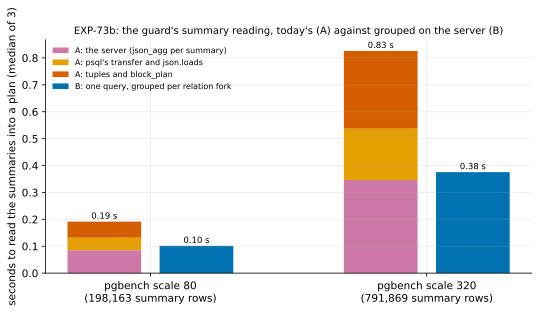

# EXP-73b: With the VMs' duplication, does reading the summaries grouped on the server cut the guard's time?

Status: **done October 28, 2026: the deciding prediction held in both sessions (0.456, then 0.472 under rule 11, against a bar of 0.5),** 2 and 3 held, and 4 failed (EXP-73's post-hoc model was wrong). B is now the sender's summary reading, as registered. Pre-registered the same day, before any run. Local, on the Mac (PostgreSQL 17.11), about 25 minutes. It follows EXP-73, whose deciding prediction failed:
- **B** (one query grouped per relation fork) took 0.547 of today's reading (A), against a bar of 0.4;
- every plan was identical.

EXP-73's post-hoc check traced the miss to its scale models. Each block appeared in 1.51 summaries there, against about 2.4 on the VMs. A's cost goes with summary rows, and B's with distinct blocks.

## Question

**Built so that a block appears in about as many summaries as on the VMs, does B take at most half of A's time, with identical plans?**

## Design

**EXP-73's script and methods, unchanged** (`experiments/fastpath_fixed_costs/guard_reading.py`), with three changes to the scale models:
- **The lag in 20 batches,** each followed by a `CHECKPOINT` (EXP-73: 5). EXP-71's scattered cell spanned 22 summaries.
- **The lab's state check** after the lag's last checkpoint: a read of all of `pgbench_accounts`, as EXP-67's lab does, then a `CHECKPOINT`. With checksums, its hint bits log an image of each changed page, which is what made the VMs' duplication (EXP-69).
- **Scale 80 and 320** (about 1.2 and 4.8 GB): 320 brings the distinct blocks nearer the VMs' 600,000, since B's cost per block grew with size in EXP-73.

The command:

    experiments/fastpath_fixed_costs/guard_reading.py --scales 80,320 --batches 20 --state-check --deciding-bar 0.5 --exp 73b

It runs 3 times per method and scale, alternated, after a warm-up. Its outputs are `docs/experiments/data/exp73b-guard.csv` and the figure `exp73b-guard`.

## Predictions

**The model** (EXP-73's post-hoc check): B ÷ A ≈ (B's cost per distinct block) ÷ (A's cost per row × duplication).
- A costs 0.91 µs per row, and B 0.75 µs per block at 82,593 blocks, growing with size (0.61 µs at 20,645).
- At a duplication of about 2.4 that gives roughly 0.35 at scale 80, and about 0.4 at scale 320 with the growth.

1. **Deciding: at scale 320, B takes at most 0.5 of A's time** (median of 3), with identical plans. The model gives about 0.4.
2. **The design reaches the VMs' duplication:** between 2.0 and 3.0 rows per distinct block at both scales (VMs: about 2.4). If it doesn't, 1 is reported but doesn't decide.
3. **B's plan equals A's in every run,** at both scales.
4. **EXP-73's model holds out of sample:** at scale 80, B ÷ A within 0.1 of 0.825 ÷ the duplication measured.

**The bar,** stated before the data: it is 0.5, not EXP-73's 0.4, because the model now gives about 0.4 at this size. As before, it leaves room above the model's figure. EXP-73's verdict stays failed either way.

## What follows

- **If 1–3 hold:** B replaces A in the sender:
  - `live.summary_blocks`: one query over the chosen summaries, grouped per relation fork, which also returns the row count for the statistics;
  - `fastpath.grouped_plan`.

  Tests check that it builds A's plan on a real cluster and through the real-failover test. The next VM session times the guard at EXP-70's or EXP-71's scattered cell, where the model gives about 4.7 s → 2 s.
- **If 1 fails with 2 holding:** A stays. The guard costs what it costs per row, and the next fixed cost is looked at instead.
- **If 2 fails:** the scale model still doesn't match the VMs. That is reported, and B is decided on the next VM session instead, timing both.

## Results (October 28)

Local, on the Mac: PostgreSQL 17.11, 3 runs per method and scale after a warm-up, the registered command. Building the scale-320 model took 152 s.
- **Rule 11:** the deciding ratio (0.456) came within 0.05 of its bar, so a second session followed: the same command at scale 320 only, on a newly built cluster.
- **No smoke for the new options** (`--batches`, `--state-check`), which were added after EXP-73's smoke. Their effect is checked by prediction 2, and it held.

Data: `docs/experiments/data/exp73b-guard.csv` and `exp73b-guard-session2.csv`.

| Medians of 3 | Scale 80 | Scale 320 | Scale 320, second session |
|---|---:|---:|---:|
| Summaries; summary rows; distinct blocks; relation forks | 22; 198,163; 82,539; 7 | 22; 791,869; 329,719; 14 | 22; 791,839; 329,717; 14 |
| Rows per distinct block (duplication) | **2.40** | **2.40** | 2.40 |
| **A** (today's), seconds | 0.192 | 0.823 | 0.811 |
| — the server; the transfer; Python | 0.085; 0.047; 0.060 | 0.346; 0.191; 0.289 | 0.340; 0.186; 0.286 |
| **B** (one grouped query), seconds | 0.101 | 0.375 | 0.382 |
| **B ÷ A** | 0.530 | **0.456** | **0.472** |
| A per summary row; B per distinct block | 0.97 µs; 1.23 µs | 1.04 µs; 1.14 µs | 1.02 µs; 1.16 µs |

| # | Prediction | Outcome |
|---|---|---|
| 1 | Deciding: at scale 320, B at most 0.5 of A's time, plans identical | **Held, 0.456;** 0.044 from the bar, so a second session (rule 11): **held, 0.472** |
| 2 | Duplication between 2.0 and 3.0 at both scales | **Held: 2.40 at both,** the VMs' figure (EXP-70: 2.38; EXP-71: 2.36) |
| 3 | B's plan equals A's in every run | **Held:** 9 of 9 comparisons, both sessions |
| 4 | At scale 80, B ÷ A within 0.1 of EXP-73's model (0.825 ÷ 2.40 = 0.344) | **Failed: 0.530** |

**Why 4 failed:** EXP-73's post-hoc model assumed that B's cost goes with distinct blocks alone. It goes with rows too: the server reads every summary row and sorts them all before keeping each block once. Only the transfer and Python's part go with distinct blocks. With 2.4 rows per block, B's cost per block rose from 0.75 µs (EXP-73) to 1.14–1.23 µs. B still halves A, because it removes the per-row transfer and Python work and the per-row JSON. It doesn't reach the post-hoc model's third.

## What it means (with a committee's reading)

- **Grouping on the server halves the guard's summary reading** when blocks repeat across summaries as they do on the VMs: 0.456 and 0.472 of today's time at scale 320, with identical plans in all 9 comparisons. It falls short of the post-hoc model's third, because the server still reads and sorts every row.
- **What it buys on the VMs (projected, not measured):** EXP-70's scattered cell spent 4.7 s in the guard, at 3.2 µs per row. At about 0.46, that becomes about 2.2 s, saving about 2.5 s of a 46.6 s refresh (5%). EXP-71's hot cell would save about 0.2 s. A modest gain, from a small change whose plan is tested equal to today's.
- **Both sessions came within 0.05 of the bar** (0.456 and 0.472). So the honest claim is "about half", not "well under half".
- **Applied as registered** (see below). The next VM session should time the guard on a scattered cell to replace the projection.

**Limitations:**
- **Local, on the Mac,** where a summary row costs about 3.5 times less than on the VMs. The ratio is assumed to carry over.
- **One table and one change pattern.**
- **EXP-73's post-hoc model failed out of sample,** so the projection to the VMs rests on the measured ratio, not on that model.

## What follows (applied)

- **The sender now reads the chosen summaries in one query, grouped per relation fork on the server:**
  - `live.summary_blocks` returns the row count, and each fork's distinct blocks and lowest limit block;
  - `fastpath.grouped_plan` turns them into the plan `fastpath.block_plan` built.
  - `fast_path.summary_rows` still counts the summaries' rows (now counted on the server), and `fast_path.summaries` the summaries read.
- **Tests:**
  - a unit test of the grouped plan against `block_plan`'s, with a block in two summaries, two limits, a fork with only a limit, and forks outside the data directory;
  - a real-server test comparing one grouped query with today's reading row by row over every summary, a truncation's limit block among them.

  Every fast-path test passes on the new reading, including the real failover.
- **Next:** the next VM session times the guard on a scattered cell (with EXP-72, once `gcloud` is signed in again). Then the fast path's other fixed costs.
