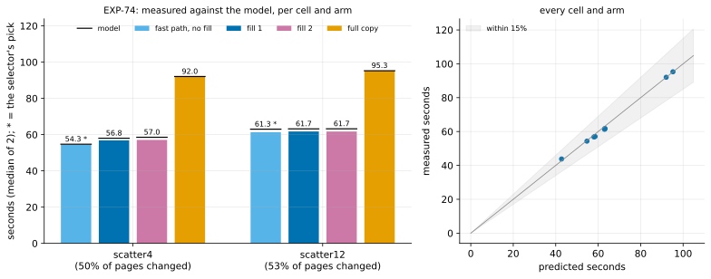

# EXP-74: Does the fast path's time model predict cells it hasn't seen, and does its selector pick a fast option?

Status: **done October 28, 2026: every prediction held.** In both new cells the selector picked the fastest arm measured (fill 0), every fast arm came within 2.6% of the model, and both full copies within 0.1%. The guard's grouped reading took 0.406 of EXP-70's time on the same summary rows. Pre-registered the same day, before any run; one `ha` VM pair. It is research loop 1's idea 4 (the selector), and it also times EXP-73b's grouped summary reading on the VMs.

## Question

Once the guard has run, the sender knows its plan: every page it will read and write. **The model** (`analysis/fastpath_model.py`) predicts the fast path's time from that plan and the disks' limits, each measured in an earlier session:
- **requests:** the sender's runs, split by the block layer into requests of at most 168 KiB (EXP-70);
- **each disk's time:** the larger of its requests at its operation rate and its bytes at 210 MB/s:
  - source reads at 4,100 a second (EXP-68, EXP-70);
  - destination writes at 4,790 a second (EXP-70's post-hoc check);
  - the byte rate from EXP-70's full copy, and EXP-66's 205.5 MB/s;
- **the transfer:** the busier disk;
- **the rest of the session:** the guard (measured, already spent when the selector decides), plus 0.6 s and 0.97 ms per MB sent. This term was fitted on two EXP-70 cells.

**A full copy:** 5.7 s plus every listed file's bytes at 210 MB/s.

**The selector** predicts fills 0, 1, 2 and 4 of the unfilled plan, and a full copy, and picks the fastest.

**In-sample on EXP-70,** where its constants come from (a fit, not a test):
- every scattered arm within 2.5–6%;
- the full copy 90.8 s against 91.0;
- it picks fill 2, the fastest arm measured.

It misses the hot cell by 47% (1.26 s against 1.85 s): at 15,000 pages the destination's fixed write overhead dominates, which the model leaves out. So it is a model of the transfer-dominated regime, which is where a choice between options matters.

**The question:** on cells with more changed pages, where filling and a full copy compete, does the model predict each option within 15%, and does the selector's pick come within 5% of the fastest?

## Design

**EXP-70's lab** (`experiments/network/lab_exp64.sh`) and **EXP-70's set-up:**
- the `ha` set in us-west1: two `n2d-highcpu-8` VMs with 150 GiB balanced persistent disks, `blake3` on both;
- EXP-48's 18 GB database, PostgreSQL 17.11, `summarize_wal` on;
- `PLAN=1`, so every fast arm's plan is kept.

**Three cells,** each with B0 a base backup taken just before its change:
- **`uniform`:** EXP-70's scattered cell (1% of rows in random batches, the same seed), arm `fast8wf2` only. Its guard times EXP-73b's grouped reading against EXP-70's 4.70 s on the same summary rows.
- **`scatter4` (new):** 4% of `pgbench_accounts`' rows, chosen by a hash of each row's key in one statement (`abs(hashint4(aid + 74)) % 10000 < 400`). Locally the same rows came out whatever the table's physical order. With about 27 rows a page, about two-thirds of the pages change. The model expects the fast path to win here (roughly 78 s against a full copy's 94 s, from estimated page counts).
- **`scatter12` (new):** 12% of rows the same way, nearly every page. The model expects a full copy to win (roughly 101 s against 115 s).

**Arms in the scatter cells:**
- `fast8w`: fill 0, explicit;
- `fast8wf1`, `fast8wf2`;
- `full`.

The fast arms pin `--read-ahead 8`, the sync worker and `--no-diverged-basis`, with the current pgdelta (grouped summary reading).

**Runs:** 2 per arm, shuffled per cell (seed 740); 18 runs.

**The command:**

    PATTERNS="uniform scatter4 scatter12" ARMS_uniform=fast8wf2 ARMS_scatter4="fast8w fast8wf1 fast8wf2 full" ARMS_scatter12="fast8w fast8wf1 fast8wf2 full" PLAN=1 OUT=/data/exp04-results/exp74 lab_exp64.sh SOURCE 2 740

**A smoke first,** at scale 20 (one run per arm, deciding nothing). Every run must exit 0, and every fast copy must match.

**The analysis,** committed before the data: `analysis/exp74.py` with `analysis/fastpath_model.py`. Figure `exp74-model`, data `docs/experiments/data/exp74-cells.csv`.
- **What the selector sees:** each scatter cell's unfilled plan, its guard's measured median, and the listed files' sizes.
- **Scoring:** it is scored among the options run (fills 0–2 and full). Whether fill 4 would have been its pick is reported.
- **Dry run:** on EXP-70's results, with EXP-70's uniform cell standing in for a scatter cell. The parsing, the model, the fill check and the figure worked. Prediction 4 failed there, as it must on EXP-70's old reading. The dry run's outputs were removed.

## Predictions

1. **Deciding: in each scatter cell, the selector's pick takes at most 1.05 of the fastest measured arm's time** (medians of 2).
2. **The model predicts every fast arm within 15%:** each arm's time from its own saved plan and its guard, against its measured median. That is 7 cells: the uniform `fast8wf2` and 3 arms in each scatter cell.
3. **Each scatter cell's full copy within 5% of the model** (5.7 s plus the listed bytes at 210 MB/s).
4. **EXP-73b on the VMs:** the uniform cell's guard takes at most 0.6 of EXP-70's 4.70 s. The model gives about 0.46, or 2.2 s. Its summary rows are within 1% of EXP-70's 1,464,232.
5. **Every copy is correct:** every run exits 0, every fast run used the fast path and its copy matched the source, and each filled plan is exactly `fastpath.fill_gaps` of the unfilled one.

**Reported, not predicted:**
- each cell's share of pages changed;
- each disk's requests and busy time against the model's;
- the guard's time per summary row in each cell;
- where a full copy beats the fast path.

**Rule 11:** if a cell's pick isn't the fastest arm and its ratio lies between 1.00 and 1.10, that cell gets a second session.

## What follows

- **If 1–3 hold:** the selector is built into the sender, behind an option and off by default. After the guard, it chooses the fill, or a full copy instead of the fast path. It reads its disk constants from options, and the defaults are this pair's. A later session times it on its own.
- **If 2 or 3 fails:** the cells where it misses say which term is wrong (the requests, a disk's limit, or the overhead per MB). The model is revised and tested on new cells before any selector is built.
- **If 4 holds:** EXP-73b's projection is confirmed on the VMs. **If it fails:** the guard's VM time is reported against the Mac's ratio, and the grouped reading's value is re-weighed.
- **Either way,** the cells place the fast path's break-even against a full copy on this disk, which research loop 1 has left open since EXP-70.

## Results

The `ha` set in us-west1-b and -c, EXP-70's zones (us-west1-a was out of balanced disks). The smoke at scale 20 passed (9 runs, every fast copy matched, every fast run used the fast path). The registered runs took 13:22–14:26 UTC, and the VMs were then deleted. The database: 17,787 MB at the start. Data: `docs/experiments/data/exp74-cells.csv`; raw `results/exp04/exp74/` (not in git).

*How to read it:* left, each scatter cell's arms (median of 2), with the model's prediction as a black line on each bar and the selector's pick starred; right, every cell and arm, measured against predicted, with the band of ±15%.

| Cell | Arm | Measured (s) | Model (s) | Measured / model | Pages sent | Share of listed pages |
|---|---|---|---|---|---|---|
| uniform (1%) | fill 2 | 43.80 | 42.76 | 1.024 | 859,405 | 39% |
| scatter4 | **fill 0** | **54.33** | 54.71 | 0.993 | 1,107,097 | 50% |
| scatter4 | fill 1 | 56.82 | 58.01 | 0.979 | 1,177,678 | 53% |
| scatter4 | fill 2 | 57.05 | 58.54 | 0.975 | 1,189,350 | 54% |
| scatter4 | full copy | 92.05 | 92.04 | 1.000 | | 100% |
| scatter12 | **fill 0** | **61.32** | 62.98 | 0.974 | 1,268,588 | 53% |
| scatter12 | fill 1 | 61.74 | 63.15 | 0.978 | 1,272,384 | 53% |
| scatter12 | fill 2 | 61.69 | 63.19 | 0.976 | 1,272,416 | 53% |
| scatter12 | full copy | 95.29 | 95.21 | 1.001 | | 100% |

Bold: the selector's pick, from the unfilled plan and the guard's time. Its predictions:
- **scatter4:** fill 0 54.71, fill 1 58.02, fill 2 58.57, fill 4 58.65 s, a full copy 92.04 s;
- **scatter12:** fill 0 62.98, fill 1 63.15, fill 2 and fill 4 63.16 s, a full copy 95.21 s.

Fill 4 would not have been its pick in either cell.

| # | Prediction | Result |
|---|---|---|
| 1 | **Deciding:** in each scatter cell, the selector's pick within 1.05 of the fastest measured arm | **Held:** it picked fill 0 in both, the fastest measured: 1.000 and 1.000 |
| 2 | Every fast arm within 15% of the model, from its own plan and guard | **Held:** 0.974–1.024 in all 7 |
| 3 | Each scatter cell's full copy within 5% of the model | **Held:** 1.000 and 1.001 |
| 4 | The uniform cell's guard at most 0.6 of EXP-70's 4.70 s, its summary rows within 1% of EXP-70's 1,464,232 | **Held:** 1.91 s, **0.406** (the model gave about 0.46); 1,469,799 rows (+0.4%) |
| 5 | Every run exits 0, every fast run used the fast path and matched, each filled plan exactly `fastpath.fill_gaps` of the unfilled one | **Held:** 18 of 18; all 4 filled plans exact |

**Rule 11:** the pick was the fastest arm in both cells, so no second session.

**How firm the deciding result is.** In scatter12 the three fills were within 0.7% of each other, so any fill would have held there: that cell tested only the fast path against a full copy. In scatter4 the choice mattered: fill 2 took 1.050 of fill 0's time, at the bar, and the model ranked the fills in the measured order.

**Reported, not predicted:**
- **What changed.** The workload updated 4.0% and 12.0% of `pgbench_accounts`' rows (2,400,589 and 7,203,738 of 60 M). Of that table's pages it changed 92% and 100% (uniform: 70%), and every page of a 1.35 GB relation beside it. The database also holds about 8.4 GB that the workload never touches: a 7.0 GB relation and a 1.35 GB one (by relation file, from the saved plans). So even with every page of the updated table changed, the fast path sent about 53% of the listed pages. The registration's "about two-thirds" and "nearly every page" were the updated table's share, and were reached. But this database caps the fast path's share well below where the model expects a full copy to win.
- **Where a full copy beats the fast path:** in no cell measured here. The fast path took 0.59 of a full copy in scatter4, and 0.64 in scatter12. **The model's extrapolation, not measured:** for byte-bound plans (long runs, as here), a full copy wins once the fast path sends more than about 85% of the listed bytes. That is with this disk's 210 MB/s, the 0.97 ms per MB overhead and a 3 s guard. Scattered single pages, which are bound by requests, reach it sooner.
- **Each disk's requests against the model's.** The model's byte term was right; its request count was not, for long runs.
  - **Busy time:** within 4% of the model's on both disks in every fast arm (for example scatter4 fill 0: source 43.51 s against 43.11).
  - **Requests, short runs:** the model's count was within 2% for scatter4's unfilled source reads (103,680 against 101,691) and the uniform cell (88,071 against 89,249).
  - **Requests, long runs:** it over-counted by 33–41% (scatter4 fill 2: 38,029 reads against 64,901). Long runs reached the disk in larger requests than 168 KiB.
  - **Why it didn't matter here:** those plans were bound by bytes, not requests. In a cell bound by requests with long runs, the model would over-predict. That is untested.
- **The guard's time per summary row:**
  - uniform: 1.30 µs (1.91 s, 1,469,799 rows);
  - scatter4: 1.07 µs (2.21 s, 2,061,659 rows);
  - scatter12: 1.13 µs (2.92 s, 2,585,634 rows);
  - EXP-70's reading: 3.2 µs.
- **The uniform cell against EXP-70:** 43.80 s against 46.6 s, the same cell and zones in a different session. The 2.8 s saved matches the guard's 2.79 s saved (4.70 → 1.91 s).

## What followed

As registered for 1–3 holding:
- **The selector is built into the sender,** behind an option and off by default. After the guard it chooses the fill, or a full copy instead of the fast path. Its disk constants come from options, and the defaults are this pair's. A later session times it on its own.
- **EXP-73b's projection is confirmed on the VMs** (4 held): the grouped reading took 0.406 of the old reading's time, against EXP-73b's 0.456 and 0.472 on the Mac.
- **The break-even** against a full copy lies beyond what this database's changes reach (53% of listed pages). Placing it needs a cell where the changed relations are most of the database, which is a design for a later session.
