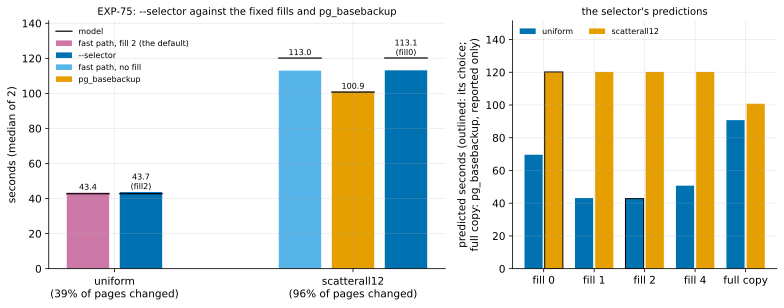

# EXP-75: Does `--selector`, built into the sender, take the fastest fill, and does it say rightly where `pg_basebackup` is faster?

Status: **done October 28, 2026: every prediction held.** The selector took 1.008 of fill 2's time in the cell bound by requests and 1.001 of fill 0's where nearly every page changed, choosing that fill in every run. It flagged `pg_basebackup` as faster exactly where it was: 0.893 of the fast path's time at 96% of the pages changed, the first measured cell past the break-even. Pre-registered the same day, before any run; one `ha` VM pair. It times the selector EXP-74 registered for building ("a later session times it on its own").

## Question

EXP-74 tested the selector's model offline, from the plans the sender saved. It predicted every fast arm within 2.6%, and its pick was the fastest arm measured in both cells. The selector is now in the sender (`--selector`, off by default; `pgdelta/selector.py`). After the guard it predicts each fill's time (0, 1, 2 and 4 pages) and takes the fastest. It also predicts `pg_basebackup`'s time, and the statistics and the log say when that would be faster.

**A change from EXP-74's plan, made before this registration.** EXP-74 said the selector would choose "the fill, or a full copy instead of the fast path", and the first build sent every listed file whole when a full copy was predicted faster. Two findings, both from the code, made that a recommendation instead:
- **The whole-file path reads every file twice.** In fast mode a file sent whole is read and hashed in full (`live.Reader.hash`), then read again to send (`_send_live_pages`), both in the sending thread and outside the read-ahead. That path was built for the few files the summaries don't cover. For a whole 21 GB database on 8 GB VMs, the second read comes from disk, so it would take roughly twice `pg_basebackup`'s time.
- **Within pgdelta a full copy can't win by the model.** pgdelta's own full copy is its pipeline with every page chosen, and fill 0's pages are a subset of those. A full copy wins only by avoiding pgdelta's overhead of about 1 ms per MB, which `pg_basebackup` doesn't pay (its fixed cost is 5.7 s). So whether to run `pg_basebackup` instead is the operator's call, and the selector's job is to say when.

EXP-74 couldn't show three things:
1. **The selector's cost and choice in a live session:** whether it picks a fill that wins where filling matters (bound by requests), and avoids the ones that lose.
2. **A cell where `pg_basebackup` wins.** EXP-74's database has 8.4 GB that its workload never touched, so the fast path never sent more than about half the pages. EXP-70's question, where a full copy starts to win, is still open.
3. **Whether the selector's flag for a faster full copy is right on both sides of that line.**

**The question: in a cell bound by requests and in one where nearly every page changed, does `--selector` come within 5% of the fastest fixed fill, and is its prediction of a faster `pg_basebackup` right?**

## Design

**EXP-74's lab and set-up** (`experiments/network/lab_exp64.sh`):
- the `ha` set in us-west1: two `n2d-highcpu-8` VMs with 150 GiB balanced persistent disks, `blake3` on both;
- EXP-48's 18 GB database (`pgbench_accounts` and its key, and `events` with its key), PostgreSQL 17.11, `summarize_wal` on;
- `PLAN=1`, so every fast arm's plan is kept, the selector's included (written after its choice).

**Two cells,** each with B0 a base backup taken just before its change:
- **`uniform`:** EXP-70's scattered cell (1% of `pgbench_accounts`' rows in random batches; 39% of the listed pages changed in EXP-74). It is bound by requests.
  - **In EXP-70:** fill 2 took 46.6 s, fill 1 47.4 s, fill 4 55.8 s, and no fill 76.6 s.
  - **On EXP-70's unfilled plan the model predicts:** fill 2 (45.45 s) and fill 1 (45.87 s) nearly tied; fill 0 (72.4 s) and fill 4 (53.4 s) clearly slower; `pg_basebackup` 90.8 s.
  - **Arms:** `fast8wf2` (the fast path's default fill, the fastest in EXP-70) and `fast8ws` (`--selector`).
- **`scatterall12` (new):** 12% of the rows of both `pgbench_accounts` and `events`, chosen by a hash of each row's key, in one statement per table. `events`' payload is upper-cased, so its length is unchanged. Nearly every page of both tables and both keys should change (EXP-74: 12% of `pgbench_accounts`' rows changed every page of it and of its key).
  - **The model's arithmetic:** about 21 GB is listed and nearly all of it chosen. The fast path pays 0.97 ms per MB on top of the same bytes, about 20 s, while `pg_basebackup` pays a fixed 5.7 s. So it predicts `pg_basebackup` faster, roughly 106 s against 125 s, and the selector should still choose a fill.
  - **Arms:** `fast8w` (no fill, the fast path's best where bytes bind: EXP-74), `full` (`pg_basebackup`) and `fast8ws`.
- **The lab's change:** the pattern `scatterallN` and the arm `fastNws`. For `scatterallN`, each copy's check also counts the changed `events` rows.
  - **Checked locally (PostgreSQL 17, scale 2, 200,000 events):** both updates and the check ran, with 24,318 rows changed in each table, the number the hash predicts. `hashint8` equals `hashint4` on keys in int4's range, so the same keys are chosen in both tables, whatever their physical order.

**Every fast arm** pins `--read-ahead 8`, the sync worker and `--no-diverged-basis`. The fixed arms pin their fill. `fast8ws` gives `--selector` with its default disk limits (EXP-74's pair) and no fill.

**Runs:** 2 per arm, shuffled per cell (seed 750); 10 runs.

**The command:**

    PATTERNS="uniform scatterall12" ARMS_uniform="fast8wf2 fast8ws" ARMS_scatterall12="fast8w full fast8ws" PLAN=1 OUT=/data/exp04-results/exp75 lab_exp64.sh SOURCE 2 750

**A smoke first,** at scale 20 (one run per arm, seed 751, deciding nothing). Every run must exit 0, every fast copy must match, and every fast run must use the fast path.

**The analysis,** committed before the data: `analysis/exp75.py`. Figure `exp75-selector`, data `docs/experiments/data/exp75-cells.csv`.
- **Dry run:** on stand-in results built from EXP-74's runs, with arms relabelled and a selector block computed by `pgdelta.selector` from the saved plans. The parsing, the scoring, rule 11 and the figure worked.
- **Its choices and flags there say nothing:** the stand-in plans were already filled, and EXP-74's scatter12 is not this cell. The dry run's outputs were removed.

## Predictions

1. **Deciding: in each cell, `fast8ws` takes at most 1.05 of the fixed fill's time** (medians of 2; `fast8wf2` in `uniform`, `fast8w` in `scatterall12`).
2. **Its choice, in every run:** fill 1 or 2 in `uniform`; fill 0, 1 or 2 in `scatterall12`.
3. **Its flag is right, and the break-even is reached:**
   - `pg_basebackup` is predicted faster in every `scatterall12` run and in no `uniform` run;
   - in `scatterall12`, `pg_basebackup` takes at most 0.95 of `fast8w`'s time.
4. **The model:** the fixed fills within 15% of its prediction from their own plans and guards, and `pg_basebackup` within 5% of its prediction from the listed bytes.
5. **The choice's own time is at most 1.0 s in every run** (`fast_path.selector.seconds`; 0.14 s on the Mac for 1.2 M scattered pages).
6. **Every copy is correct:** every run exits 0, and every fast run, the selector's included, used the fast path and passed the copy's check.

**Reported, not predicted:**
- each cell's share of pages changed;
- the selector's predictions for every option, against the arms measured;
- in `scatterall12`, where the fast path's time beyond `pg_basebackup`'s goes (both disks' busy time, the sender's hashing, the time with neither disk busy).

**Rule 11, narrowed before the data:**
- **A deciding ratio between 1.05 and 1.10:** that cell gets a second session.
- **Between 1.00 and 1.05:** a second session only if the selector chose a fill other than the fixed arm's.
- **Why narrowed:** with the same fill, the ratio is the run-to-run spread around 1.00 plus the choice's own cost, not a near miss of the bar.

## What follows

- **If 1–3 hold:** `--selector` takes the fastest fill in both regimes, and says rightly where `pg_basebackup` is faster.
  - **On by default with `--fast-path`?** That needs a second pair of disks, since its constants are this pair's. The next step is to measure the constants at the start of a session.
  - **The fast path's overhead per MB** (where `pg_basebackup` wins) becomes the next target: what it is (the time with neither disk busy, the per-page hashing and framing), and whether it can be overlapped.
- **If 3 fails because `pg_basebackup` doesn't win in `scatterall12`:** the model's overhead per MB (fitted on EXP-70 at 39% of the pages) overstates it at nearly every page. It is refitted, and the break-even is placed again.
- **If 1 fails in `uniform` with fill 1 or 2 chosen:** the choice's own cost or the fills' spread decides it, and the timers say which.

## Results

The `ha` set in us-west1-b and -c, EXP-70's and EXP-74's zones (us-west1-a was out of balanced disks again). The smoke at scale 20 passed:
- 5 runs, every fast copy matched, and every fast run used the fast path;
- the selector chose fill 2 in `uniform` and fill 0 in `scatterall12`, and flagged nothing at 600 MB;
- its choice took 3–6 ms.

The registered runs took 15:33–16:14 UTC, and the VMs were then deleted. The database was 17,787 MB at the start. `scatterall12`'s workload changed 7,203,738 rows in each table in 267 s. Data: `docs/experiments/data/exp75-cells.csv`; raw `results/exp04/exp75/` (not in git).

*How to read it:* left, each cell's arms (median of 2), with the model's prediction as a black line on each bar and the selector's choice under its time; right, the selector's predictions for every option in each cell (outlined: its choice; the full copy is `pg_basebackup`'s, reported only).

| Cell | Arm | Measured (s) | The runs (s) | Model (s) | Share of listed pages sent |
|---|---|---|---|---|---|
| uniform | fill 2 | 43.36 | 43.24, 43.47 | 42.73 | 39% (28% unfilled) |
| uniform | **`--selector`** (fill 2 both runs) | **43.70** | 43.48, 43.92 | 42.77 | 39% |
| scatterall12 | fill 0 | 112.99 | 112.88, 113.11 | 120.15 | 96% |
| scatterall12 | `pg_basebackup` | 100.94 | 100.93, 100.96 | 100.75 | 100% |
| scatterall12 | **`--selector`** (fill 0 both runs) | **113.14** | 112.94, 113.34 | 120.17 | 96% |

**The selector's predictions:**
- **uniform:** fill 0 69.62, fill 1 43.11, **fill 2 42.77**, fill 4 50.72 s; `pg_basebackup` 90.76 s (not faster);
- **scatterall12:** **fill 0 120.17**, fills 1, 2 and 4 120.20 s; `pg_basebackup` **100.75 s (faster)**.

| # | Prediction | Result |
|---|---|---|
| 1 | **Deciding:** in each cell, the selector at most 1.05 of the fixed fill's time | **Held:** 1.008 (uniform), 1.001 (scatterall12) |
| 2 | Its choice in every run: fill 1 or 2 in uniform; fill 0, 1 or 2 in scatterall12 | **Held:** fill 2, fill 2; fill 0, fill 0 |
| 3 | `pg_basebackup` predicted faster in every scatterall12 run and in no uniform run, and in scatterall12 at most 0.95 of the fixed fill's time | **Held:** flagged in 2 of 2 and 0 of 2; **0.893** |
| 4 | The fixed fills within 15% of the model, `pg_basebackup` within 5% | **Held:** 1.015 and 0.940; 1.002 |
| 5 | The choice's own time at most 1.0 s in every run | **Held:** 0.15 s (uniform), 0.07 s (scatterall12) |
| 6 | Every run exits 0; every fast run used the fast path and passed the copy's check (the changed `events` counted in scatterall12) | **Held:** 10 of 10; 8 of 8 matched |

**Rule 11:** the selector chose the fixed arm's fill in every run of both cells, and both ratios are below 1.05, so no second session.

**Reported, not predicted:**
- **What changed:** in `scatterall12` the unfilled plan held 96% of the listed pages (2,435,622 pages of 19,961 MB); in `uniform`, 28%.
- **Where the fast path's extra time goes in scatterall12.** Both disks were busy for the same time in both arms (fill 0: source 95.07 s, destination 93.44 s; `pg_basebackup`: 94.50 and 95.36 s), so the 12.05 s gap is not disk time:
  - **the guard:** 5.28 s, reading 4,598,230 summary rows (1.15 µs per row, as in EXP-74);
  - **time beyond the busier disk's busy time:** 12.6 s for the fast path besides its guard, against 5.6 s for `pg_basebackup`, so about 7 s more.
- **The model at nearly every page** over-predicted the fast path by 6% (120.15 against 112.99 s). Its overhead beyond the guard and the busier disk was 12.6 s, against the 20.0 s the fit gives (0.6 s plus 0.97 ms per MB). So the overhead grows less than linearly with the bytes, which EXP-70's two-cell fit couldn't show.
  - **It decided nothing here:** the flag was right with a 19.4 s predicted margin against 12.05 s measured.
- **The break-even, between cells:** the fast path took 0.64 of `pg_basebackup`'s time at 53% of the pages (EXP-74's scatter12) and 1.12 at 96% (here).
  - **Linear interpolation** puts the crossing at 85% of the listed pages; the model gives 86% for plans bound by bytes. That is an interpolation between one cell each side, from two sessions, not a measurement at the crossing.

*How to read it:* each point is a cell's fastest fast-path arm over the same session's `pg_basebackup`, against the share of listed pages its unfilled plan changed; the dashed line is the model for plans bound by bytes; EXP-70's uniform cell sits above it because it is bound by requests.

## What followed

As registered for 1–3 holding:
- **`--selector`** takes the fastest fill in both regimes, and says rightly where `pg_basebackup` is faster. It stays off by default: its constants are this pair's.
  - **To make it the default,** the next step is measuring the disks' limits at the start of a session instead of taking them from options.
- **The fast path's overhead where `pg_basebackup` wins is the next target.** At 96% of the pages, 5.3 s of the 12.05 s gap is the guard reading 4.6 M summary rows. About 7 s more is time beyond the busier disk's. Both are costs of the fast path that a full copy doesn't pay. Cutting them would move the break-even past 85%.
