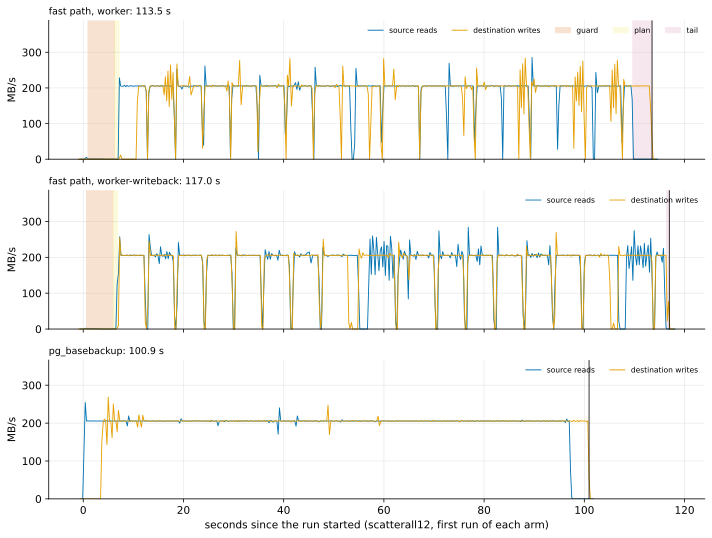

# EXP-76: Does early write-back on the sync worker cut the fast path's tail, and where does the rest of its time beyond the disks go?

Status: **done October 28, 2026: the deciding prediction failed.** Early write-back on the worker cut the tail as predicted (3.7 to 0.4 s), but it stretched the transfer. Net, it saved 1.81 s where requests bind (uniform) and cost 3.75 s where bytes bind (scatterall12). It stays opt-in. The timeline located the rest of the fast path's time beyond `pg_basebackup`: a stall at the end of every file, where the receiver re-reads and hashes each written page in its main loop. Pre-registered the same day, before any run; one `ha` VM pair. It follows EXP-75, where the fast path's fixed costs, not the disks, put `pg_basebackup` ahead at 96% of the pages changed.

## Question

In EXP-75's `scatterall12` cell, the fast path took 112.99 s against `pg_basebackup`'s 100.94 s. Both kept the disks busy for the same 95 s. The fast path's runs (EXP-74 and EXP-75 together, 16 runs in three cells) split very evenly:
- **launch:** 0.52–0.58 s from the run's start to `pg_backup_start`;
- **the guard:** 1.9 s (uniform), 2.9 s (scatter12) and 5.3 s (scatterall12), reading the WAL summaries;
- **the tail:** after `pg_backup_stop`, 3.5–4.1 s, nearly all of it the receiver waiting for its sync worker at COMPLETE (`fsync_wait_seconds`, 3.1–3.8 s).

**The tail's mechanism (from the code and the receiver's statistics).** With `--fsync worker` the receiver writes through the page cache, and a thread fsyncs each finished file. At COMPLETE it waits for the last fsyncs, which must flush whatever dirty data the kernel has not yet written: a few hundred MB on these 8 GB VMs, about 3.5 s at 210 MB/s. `--fsync writeback` starts write-back every 8 MiB written (`sync_file_range`), so little is left dirty, but it fsyncs in the main loop, which EXP-68 found slows the fast path.

**Built for this experiment:** `--fsync worker-writeback`, the worker with early write-back (`pgdelta/flush.py`, `receiver.py`). Where `sync_file_range` is missing or refused it is the worker, and the statistics say so. Tests cover every mode's output and statistics, the calls every 8 MiB and the fallback; the real call is tested on Linux in CI.

**The rest is unlocated.** Within backup mode, besides the guard, about 8 s at `scatterall12` passed without the source disk busy. The statistics can't say where. So this session also records a timeline:
- **both disks:** `/proc/diskstats` every 0.25 s on both VMs (`experiments/network/disk_series.sh`);
- **the sender's phases:** three new wall-clock times in its statistics (`fast_path.guard_started_utc`, `sending_started_utc`, `sending_ended_utc`), beside `pg_backup_start` and `pg_backup_stop`.

**The question: does `worker-writeback` cut the tail by at least 2 s without slowing the transfer, and where on the timeline does the rest of the fast path's time beyond the disks go?**

## Design

**EXP-75's lab and set-up** (`experiments/network/lab_exp64.sh`, `SERIES=1`):
- the `ha` set in us-west1: two `n2d-highcpu-8` VMs with 150 GiB balanced persistent disks, `blake3` on both;
- EXP-48's 18 GB database, PostgreSQL 17.11, `summarize_wal` on.

**Two cells,** as EXP-75's, each with B0 a base backup taken just before its change:
- **`uniform`:** 1% of `pgbench_accounts`' rows in random batches, bound by requests. **Arms:** `fast8wf2` (worker, fill 2) and `fast8bf2` (worker-writeback, fill 2).
- **`scatterall12`:** 12% of both tables' rows, 96% of the pages, bound by bytes. **Arms:** `fast8w` (worker, fill 0), `fast8b` (worker-writeback, fill 0), and `full` (`pg_basebackup`, for its timeline).

**The lab's change:**
- an arm letter `b` in place of `w`, for `--fsync worker-writeback`;
- `SERIES=1`: both VMs sample their disk from 0.5 s before t0 to 0.5 s after t1. The samples are outside the timing.

**Every fast arm** pins `--read-ahead 8` and `--no-diverged-basis`, and its fill.

**Runs:** 2 per arm, shuffled per cell (seed 760); 10 runs.

**The command:**

    PATTERNS="uniform scatterall12" ARMS_uniform="fast8wf2 fast8bf2" ARMS_scatterall12="fast8w fast8b full" SERIES=1 OUT=/data/exp04-results/exp76 lab_exp64.sh SOURCE 2 760

**A smoke first,** at scale 20 (one run per arm, seed 761, deciding nothing). Every run must exit 0, every fast copy must match, every fast run must use the fast path, and every run must have both disk series.

**The analysis,** committed before the data: `analysis/exp76.py`. Figure `exp76-timeline` (`scatterall12`'s first run of each arm: the source's reads and the destination's writes against time, with the guard, the plan and the tail shaded). Data: `docs/experiments/data/exp76-cells.csv` and `exp76-phases.csv` (per fast run and phase: seconds, each disk's busy share and MB/s).
- **Dry run:** on stand-in results built from EXP-75's runs: arms relabelled, the new timestamps estimated from backup mode, and a synthetic series busy at 210 MB/s while sending. The parsing, the phases, the scoring and the figure worked.
- **The stand-in arms were all `worker`,** so predictions 1 and 2 failed there, as they must. The dry run's outputs were removed.

## Predictions

1. **Deciding: in each cell, `worker-writeback`'s median is at least 2.0 s below `worker`'s.** The tail now takes 3.5–4.1 s; the model is that early write-back leaves under 1 s of it, and the transfer, bound by the disks, is unchanged.
2. **The receiver's waits for its worker** (`fsync_wait_seconds`) are below 1.0 s in every `worker-writeback` run (EXP-75's `worker` runs: 3.1–3.8 s), with `worker-writeback` in effect.
3. **The transfer isn't slowed:** backup mode (`pg_backup_start` to `pg_backup_stop`) with `worker-writeback` is within 3% of `worker`'s, in each cell.
4. **The guard uses neither disk:** both disks under 10% busy during the guard, in every fast run.
5. **Every copy is correct:** every run exits 0, and every fast run used the fast path and passed the copy's check.

**Reported, not predicted:**
- each phase's seconds and each disk's busy share and MB/s, per arm;
- `pg_basebackup`'s timeline beside the fast path's: when its reads start and end, and its own tail;
- where in the sending phase the source disk is not busy (the about 8 s EXP-75 left unlocated).

**Rule 11:** a cell whose saving lies within 0.5 s of the 2.0 s bar (1.5–2.5 s) gets a second session.

## What follows

- **If 1–3 hold:** `worker-writeback` becomes the fast path's `--fsync auto` choice where `sync_file_range` exists, as the worker became in EXP-68. The README and the defaults say so.
- **If 1 fails with 2 holding:** the tail isn't the final syncs. The timeline says what it is.
- **If 3 fails:** early write-back stalls the receiver's main loop on these disks (`sync_file_range` can wait for the device's queue). It stays opt-in.
- **Either way,** the timeline places the fast path's remaining fixed costs, so the next change targets the largest. The guard, at 5.3 s of `scatterall12`, is the known one.

## Results

The `ha` set in us-west1-b and -c, as EXP-70, -74 and -75. The smoke at scale 20 passed (5 runs, every fast copy matched, every run with both disk series). The registered runs took 17:05–17:49 UTC, and the VMs were then deleted. Data: `docs/experiments/data/exp76-cells.csv` and `exp76-phases.csv`; raw `results/exp04/exp76/` (not in git).

| Cell | Arm | Seconds (median) | The runs | Backup mode (s) | The receiver's last wait (s) | Source busy (s) | Destination busy (s) |
|---|---|---|---|---|---|---|---|
| uniform | worker, fill 2 | 43.29 | 43.50, 43.07 | 38.95 | 3.36 | 34.69 | 34.37 |
| uniform | **worker-writeback**, fill 2 | **41.48** | 41.69, 41.28 | 40.37 | 0.04 | 33.65 | 32.50 |
| scatterall12 | worker, fill 0 | 113.20 | 113.51, 112.88 | 108.63 | 3.38 | 95.16 | 92.94 |
| scatterall12 | **worker-writeback**, fill 0 | **116.95** | 116.96, 116.94 | 115.86 | 0.05 | 83.56 | 94.67 |
| scatterall12 | `pg_basebackup` | 100.95 | 100.95, 100.95 | | | 93.95 | 95.40 |

**The phases** (medians, seconds):

| Cell | Arm | Launch | Start | Guard | Plan | Sending | Tail |
|---|---|---|---|---|---|---|---|
| uniform | worker | 0.55 | 0.18 | 1.90 | 0.52 | 36.45 | 3.69 |
| uniform | worker-writeback | 0.54 | 0.29 | 1.91 | 0.52 | 37.86 | **0.36** |
| scatterall12 | worker | 0.56 | 0.25 | 5.28 | 0.92 | 102.34 | 3.84 |
| scatterall12 | worker-writeback | 0.53 | 0.12 | 5.26 | 0.92 | **109.60** | **0.53** |

| # | Prediction | Result |
|---|---|---|
| 1 | **Deciding:** worker-writeback at least 2.0 s faster in each cell | **Failed:** 1.81 s faster (uniform), **3.75 s slower** (scatterall12) |
| 2 | The receiver's last wait under 1.0 s in every worker-writeback run, the mode in effect | **Held:** 0.035–0.062 s, `worker-writeback` |
| 3 | Backup mode within 3% of worker's | **Failed:** 1.036 (uniform), 1.067 (scatterall12) |
| 4 | Both disks under 10% busy during the guard | **Held:** 0.0–1.8% in every fast run |
| 5 | Every run exits 0; every fast copy correct | **Held:** 10 of 10; 8 of 8 matched |

**Rule 11:** uniform's saving (1.81 s) lies within 0.5 s of the bar, so the rule calls for a second session of that cell. **It is not run, a deviation recorded here.** The verdict can't change: scatterall12 failed 5.75 s from the bar. And the receiver changes next (EXP-77: its per-file re-reading moves off the main loop), so a second session of this code would firm a reading nothing uses. EXP-77 runs the uniform cell again, with the new receiver.

*How to read it:* each panel is one run of `scatterall12`, the first of each arm: the source disk's reads and the destination disk's writes in MB/s, every 0.25 s, from the run's start; shaded, the fast path's guard, plan and tail; the black line is the run's end.

**Reported, not predicted:**
- **Why early write-back lost where bytes bind.** It moved the flush earlier, but the destination disk was already the bottleneck, so the same bytes still had to be written; and `sync_file_range` stalled the receiver's main loop when the device's queue was full. The source disk was busy 11.6 s less, and the sending phase took 7.3 s longer.
  - Where requests bind (uniform), the disks had slack, and the 3.3 s saved in the tail outweighed 1.4 s more of sending.
- **`pg_basebackup` has a tail too.** Its reads ran from 0.27 s to 97.4 s, and its writes ran on at full rate to the end (100.95 s): about 3.6 s of flushing what the page cache held. So the fast path's tail is no extra cost where the destination disk binds. It is the same last flush.
- **The rest, located: a stall at every file's end.** During the fast path's sending in scatterall12 (worker):
  - the source disk ran under 50 MB/s for 3.8–4.8 s in 14–16 gaps, and the destination for 6.6–7.9 s in 13–18 gaps, about one per 1 GiB segment file;
  - `pg_basebackup`'s source never did.
  - **The cause, from the code:** at each file's FILE_DONE_WRITTEN the receiver re-reads every page it wrote, one 8 KiB `pread` at a time, and hashes it, in its main loop, before it reads the next frame. That is 131,072 reads and hashes per 1 GiB segment, and 2,337,004 in all here, while the sender's 64 MiB read-ahead and the socket's buffers fill.
- **A statistics bug found on the way:** the receiver's `verify_seconds` is overwritten at the end with its verification pool's busy time (0.32 s here), so the fast path's re-reading isn't reported. It is inside `rebuild_seconds`, which went from 32 s (worker) to 101.5 s (worker-writeback, where it also holds the stalls in `sync_file_range`).
- **The fast path's time beyond `pg_basebackup`'s in scatterall12** (12.25 s here):
  - the guard, 5.3 s, with both disks idle (prediction 4);
  - the plan, 0.9 s;
  - the sending, 5.2 s longer than `pg_basebackup`'s reading (102.34 against 97.10 s) although it carried 4% fewer bytes: at `pg_basebackup`'s rate the per-file stalls cost about 9 s;
  - the launch and start, 0.5 s more than `pg_basebackup`'s start (0.27 s);
  - the tail, 0.3 s more than `pg_basebackup`'s last flush (3.58 s).

## What followed

- **As registered for 3 failing:** early write-back stalls the receiver's main loop on these disks, so `--fsync worker-writeback` stays opt-in, and `auto` stays `worker`.
- **Next: the per-file stall.** The written pages' re-reading moves off the receiver's main loop, as the fsyncs did in EXP-68, keeping the check: every written page re-read and its digest compared before anything is published. The statistics report its time. That is EXP-77.
- **Then the guard** (5.3 s at 4.6 M summary rows) and the plan (0.9 s).
