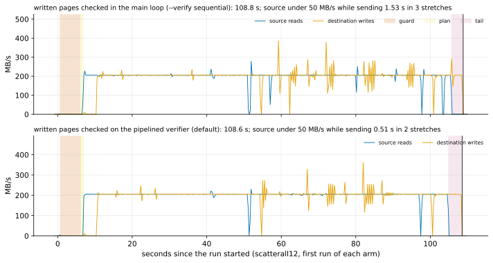

# EXP-77: Does checking the written pages off the receiver's main loop remove the fast path's stall at every file's end?

Status: **done October 28, 2026: the deciding prediction failed, and the stall is gone.** The check on the verifier saved only 0.44 s over the check in the main loop, against a bar of 3.0 s. But both arms now read each written run in one call, and both were about 4.5 s faster than EXP-76's runs. With the verifier, the source disk's idle stretches during sending fell to 0.5–0.8 s (EXP-76: 3.8–4.8 s). The fast path now takes 1.071 of `pg_basebackup`'s time at 96% of the pages (EXP-75: 1.12). Pre-registered the same day, before any run; one `ha` VM pair. It follows EXP-76's timeline, which found the stall.

## Question

In EXP-76's `scatterall12` cell (96% of the pages changed), the fast path's sending took 102.3 s, against `pg_basebackup`'s 97.1 s of reading, although it carried 4% fewer bytes. During it:
- the source disk ran under 50 MB/s for 3.8–4.8 s, in 14–16 stretches;
- the destination's disk did so for 6.6–7.9 s, in 13–18 stretches;
- that is about one stretch per 1 GiB segment file, and `pg_basebackup`'s source never did.

**The cause, from the code:** at each file's FILE_DONE_WRITTEN, the receiver re-read every page it wrote, one 8 KiB `pread` at a time, and hashed it, in its main loop. That is 131,072 reads and hashes per segment, and 2,337,004 in all. Meanwhile the sender's 64 MiB read-ahead and the socket's buffers filled. Its time wasn't reported: `verify_seconds` is overwritten with the verification pool's busy time.

**Built for this experiment:**
- **The check on the verifier:** with the receiver's pipelined verifier (its default, `--verify pipelined`, whenever its pool has workers), the check runs there, on the pool. Each written run is read in one call (`tree.written_records`, `HashPool.written_records`), and the main loop goes straight to the next file. COMPLETE still waits for every check, so nothing is published or committed before it passes. With `--verify sequential` it stays in the main loop, but reads one run at a time.
- **Its time** is reported as `fast_path.reread_seconds`.
- **Tests:**
  - the records' digest equals the page-by-page re-read's, on every pool;
  - on a real server, every page sent is re-read and timed;
  - a page written one page away fails the session under both modes, with exit 4 and B left blocked. That test was missing before.
- **A local prior** (scale 80, 12% of rows, 172,015 pages): re-reading took 0.5–0.65 s either way. The refresh took 2.09–2.16 s with the check on the verifier, against 2.34–2.56 s in the main loop.

**The question: on the VMs, does the check on the verifier remove most of the stall, and so cut the fast path's time where nearly every page changed?**

## Design

**EXP-76's lab and set-up** (`experiments/network/lab_exp64.sh`, `SERIES=1`, both disks sampled every 0.25 s):
- the `ha` set in us-west1: two `n2d-highcpu-8` VMs with 150 GiB balanced persistent disks, `blake3` on both;
- EXP-48's 18 GB database, PostgreSQL 17.11, `summarize_wal` on.

**Two cells,** as EXP-76's, each with B0 a base backup taken just before its change:
- **`uniform`** (bound by requests): **arms** `fast8wf2q` (the check in the main loop: `--verify sequential`) and `fast8wf2` (on the verifier).
- **`scatterall12`** (bound by bytes): **arms** `fast8wq`, `fast8w`, and `full` (`pg_basebackup`).

**The lab's change:** an arm's final letter `q` gives the receiver `--verify sequential`.

**Every fast arm** pins `--read-ahead 8`, `--fsync worker` and `--no-diverged-basis`, and its fill.

**Runs:** 2 per arm, shuffled per cell (seed 770); 10 runs.

**The command:**

    PATTERNS="uniform scatterall12" ARMS_uniform="fast8wf2q fast8wf2" ARMS_scatterall12="fast8wq fast8w full" SERIES=1 OUT=/data/exp04-results/exp77 lab_exp64.sh SOURCE 2 770

**A smoke first,** at scale 20 (one run per arm, seed 771, deciding nothing). Every run must exit 0, every fast copy must match, every fast run must use the fast path, and every run must have both disk series.

**The analysis,** committed before the data: `analysis/exp77.py`. It uses EXP-76's timeline helpers. Figure `exp77-timeline` (scatterall12's first run of each fast arm, both disks against time); data `docs/experiments/data/exp77-cells.csv`.
- **Dry run:** on stand-in results built from EXP-76's worker runs, each used for both arms, with the new statistics added. The parsing, scoring and figure worked.
- **The stand-ins are EXP-76's main-loop runs,** so predictions 1 and 3 failed there, as they must. The dry run's outputs were removed.

## Predictions

1. **Deciding: in `scatterall12`, the check on the verifier takes at least 3.0 s less than in the main loop** (medians of 2). By EXP-76's timeline the stall costs about 5–9 s there.
2. **In `uniform`, the check on the verifier is no slower:** its median at most 0.3 s above the main loop's.
3. **The stall is gone:** in `scatterall12` with the check on the verifier, the source disk is under 50 MB/s for at most 1.5 s of the sending, in every run (EXP-76: 3.8–4.8 s).
4. **Every page is still checked:** in every fast run, the receiver's `pages_reread` equals the pages the sender chose, and `reread_seconds` is reported.
5. **Every copy is correct:** every run exits 0, and every fast run used the fast path and passed the copy's check.

**Reported, not predicted:**
- `reread_seconds` in each arm;
- each phase's seconds, and each disk's idle stretches;
- the fast path against `pg_basebackup` in `scatterall12`, which moves the break-even (EXP-75: 1.12 at 96% of pages).

**Rule 11:** a deciding saving within 0.75 s of the 3.0 s bar (2.25–3.75 s) gets a second session.

## What follows

- **If 1–3 hold:** the check stays on the verifier, as built (the receiver's default since this change). The selector's model, whose overhead per MB was fitted with the stall in it, is refitted on new cells before its constants change.
  - **Then the guard** (5.3 s at 4.6 M summary rows) and the plan (0.9 s), the fast path's other fixed costs.
- **If 1 fails with 3 holding:** the stall was not what bound the transfer, and the timeline says what does.
- **If 2 fails:** the verifier's re-reading competes with the transfer where requests bind. The check moves back to the main loop for such cells, or runs with fewer workers.

## Results

The `ha` set in us-west1-b and -c, as EXP-70 to EXP-76. The smoke at scale 20 passed (5 runs, every fast copy matched, both series in every run). The registered runs took 18:40–19:24 UTC, and the VMs were then deleted. Data: `docs/experiments/data/exp77-cells.csv`; raw `results/exp04/exp77/` (not in git).

| Cell | Arm | Seconds (median) | The runs | Sending (s) | Re-reading (s, `reread_seconds`) | Source under 50 MB/s while sending (s) |
|---|---|---|---|---|---|---|
| uniform | check in the main loop | 42.77 | 42.90, 42.63 | 35.62 | 1.35 | 0.00 |
| uniform | **check on the verifier** | **42.64** | 42.67, 42.61 | 35.79 | 1.48 | 0.00 |
| scatterall12 | check in the main loop | 108.92 | 108.82, 109.02 | 98.88 | 6.97 | 1.66 |
| scatterall12 | **check on the verifier** | **108.48** | 108.57, 108.38 | 97.83 | 7.45 | 0.64 |
| scatterall12 | `pg_basebackup` | 101.25 | 101.48, 101.03 | | | |

| # | Prediction | Result |
|---|---|---|
| 1 | **Deciding:** in scatterall12, the verifier at least 3.0 s faster than the main loop | **Failed:** 0.44 s |
| 2 | In uniform, the verifier at most 0.3 s slower | **Held:** 0.13 s faster |
| 3 | In scatterall12 with the verifier, the source disk under 50 MB/s for at most 1.5 s of the sending, every run | **Held:** 0.51 s (2 stretches) and 0.76 s (2) |
| 4 | Every page sent re-read, and the time reported | **Held:** 856,517 and 2,337,004 pages in every run; 1.3–7.5 s |
| 5 | Every run exits 0; every fast copy correct | **Held:** 10 of 10; 8 of 8 matched |

**Rule 11:** the saving (0.44 s) is 2.56 s from the bar, so no second session.

*How to read it:* as EXP-76's timeline, for one run of each fast arm in scatterall12. Beside EXP-76's figure, the dips at every 1 GiB file's end are gone in both.

**Why the deciding prediction failed (no verdict changes).**
- **What it compared:** the check's place, verifier against main loop. But the fix had two parts, and the main-loop arm got the other too: each written run is now read in one call, not one page at a time.
- **That second part did most of the work.** Against EXP-76's runs, in the same cell, zones and arm settings but another session:
  - **the main-loop arm:** 108.92 s against 113.20 s, sending 98.88 s against 102.34 s, source idle 1.66 s against 3.8–4.8 s;
  - **the check on the verifier:** another 0.44 s, and another 1 s of source idle time removed.
- **The comparison that would have shown it** is the old page-by-page main loop against the new code, in one session. The design left that out, since the old code was gone by then.
- **So the change's measured effect is between sessions:** 4.3–4.7 s in scatterall12 (about 4%) and 0.5–0.65 s in uniform. It is one session each side, with the same set-up. The unchanged arms say sessions agree within about 0.3%: `pg_basebackup` in scatterall12 took 100.94, 100.95 and 101.25 s in EXP-75, -76 and -77, and uniform's worker arm took 43.36 and 43.29 s in EXP-75 and -76.

**Reported, not predicted:**
- **The re-reading** took 3.0–3.2 µs per page on the VMs (7.0–7.5 s for 2.34 M pages), off the critical path on the verifier.
- **Against `pg_basebackup` in scatterall12:** 108.48 against 101.25 s, 1.071 (EXP-75: 1.119). The 7.2 s left is mostly fixed costs: the guard (5.3 s, 4.6 M summary rows) and the plan (0.9 s).
- **The break-even** moves later. With this point in place of EXP-75's, it lies past 85% of the pages changed. It isn't re-measured below 96% with the new code, so the figure marks this point apart rather than moving the line.

## What followed

- **The check stays on the verifier** (the receiver's default since this change): no slower in either cell (prediction 2), and the source's idle stretches cut further (prediction 3). Reading each run in one call is kept in both places.
- **Next, the guard:** at 5.3 s of the 7.2 s left against `pg_basebackup`, it is now the fast path's largest fixed cost where nearly every page changed. The selector's model is refitted after that change, on new cells.
