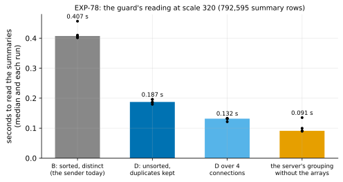

# EXP-78: Does the guard's summary reading get faster without the server's sort?

Status: **done October 28, 2026: both predictions held.** Unsorted with duplicates, the reading took 0.460 of today's time (0.187 against 0.407 s), with identical plans in all 5 runs. Built into the sender. Pre-registered the same day, before any run; local, minutes. It follows EXP-77, after which the guard is the fast path's largest fixed cost where nearly every page changed: 5.3 s of the 7.2 s left against `pg_basebackup`, for 4.6 M summary rows.

## Question

Since EXP-73b the sender reads the chosen WAL summaries in one query, grouped per relation fork on the server (`live.summary_blocks`). Each fork's blocks come back as `array_agg(DISTINCT relblocknumber ORDER BY relblocknumber)`, and the sender turns them into Python sets (`fastpath.grouped_plan`), which neither need order nor keep duplicates.

**A pilot, not scored** (EXP-73b's matched scale model at scale 320: 22 summaries, 791,869 summary rows, 329,719 distinct blocks; 4 runs each), timed the query in parts:
- **the server's grouping without the arrays:** 0.09–0.12 s;
- **with the sorted, distinct arrays:** 0.39–0.51 s;
- **with the JSON as well:** about the same (0.38–0.45 s);
- **psql's transfer and `json.loads`:** 0.01 s.

So the sort and de-duplication is most of B's time, not the JSON or the transfer.
- **The same query with `array_agg(relblocknumber)`, unsorted and with duplicates (D):** 0.22–0.26 s against B's 0.43–0.46 s, with identical plans.
- **Split over 4 connections by summary and merged (D4):** 0.14–0.21 s.
- **The pilot also found a bug in its own first merge:** the server returns OIDs as JSON strings, which `grouped_plan` converts with `int()`.

**The question: on a fresh scale model, does D take at most 0.65 of B's time, with the same plan in every run?**

## Design

- **The scale model:** EXP-73b's (`guard_reading.build`): pgbench at scale 320, 1% of rows updated in 20 checkpointed batches, the lab's state check, then a checkpoint. A new seed (780), so the rows differ from the pilot's.
- **The cluster:** PostgreSQL 17.11, local (macOS, `LC_ALL=C`), data checksums, `summarize_wal` on.
- **Four readings per repeat, over the summaries from the start on:**
  - B (today's);
  - D (unsorted, duplicates kept, one connection);
  - D4 (D split over 4 connections by summary, merged per fork);
  - the server's grouping alone (a count, for scale).
- **Runs:** one warm-up of each, then 5 repeats, each in a rotated order.
- **The script:** `experiments/fastpath_fixed_costs/guard_unsorted.py`, smoke-run at scale 20 (2 repeats, deciding nothing; D/B 0.49, plans equal; its outputs removed). Data `docs/experiments/data/exp78-guard.csv`, figure `exp78-guard`.

## Predictions

1. **Deciding: D's median takes at most 0.65 of B's,** and D's plan equals B's in every run. The pilot gave 0.52–0.57.
2. **D's plan equals B's in every repeat** (also part of 1; scored on its own so a plan mismatch is visible).

**Reported, not predicted:** D4 against B; B's time per summary row against the VMs' 1.15 µs.

**Rule 11:** a ratio within 0.05 of the bar (0.60–0.70) gets a second session, on another seed.

## What follows

- **If 1 holds:** `live.summary_blocks` returns the blocks unsorted with their duplicates, and `grouped_plan` de-duplicates them as it already does. The real-server test that compares the grouped plan with the plan of every summary row stays as the check. The next VM session times the guard. D4's split is weighed then, against its complexity: more connections to the source during backup mode.
- **If 1 fails:** the server's sort isn't where B's time goes on a fresh model, and the pilot's split is re-measured before anything changes.

## Results

PostgreSQL 17.11 on the Mac, `LC_ALL=C`. The model was built in 233 s: 22 summaries, 792,595 summary rows, 330,129 distinct blocks. Data: `docs/experiments/data/exp78-guard.csv`.

*How to read it:* each bar is a reading's median over 5 repeats, and the dots are the runs.

| Reading | Median (s) | The runs (s) | Against B | Plan equal to B's |
|---|---|---|---|---|
| B: sorted, distinct (the sender until now) | 0.407 | 0.402–0.457 | 1 | |
| **D: unsorted, duplicates kept** | **0.187** | 0.180–0.196 | **0.460** | 5 of 5 |
| D over 4 connections | 0.132 | 0.121–0.133 | 0.323 | 5 of 5 |
| The server's grouping without the arrays | 0.091 | 0.090–0.135 | 0.224 | |

| # | Prediction | Result |
|---|---|---|
| 1 | **Deciding:** D at most 0.65 of B, with D's plan equal to B's in every run | **Held:** 0.460, 5 of 5 equal |
| 2 | D's plan equals B's in every repeat | **Held** |

**Rule 11:** 0.460 is 0.19 from the bar, so no second session.

**Reported:**
- **D over 4 connections** took 0.323 of B; that is 0.70 of D's time.
- **B** took 0.51 µs per summary row here, against the VMs' 1.15 µs (EXP-75, scatterall12). If the ratio holds there, the guard's 5.3 s at 4.6 M rows becomes about 2.4 s. That is a projection; the VMs time it.

## What followed

- **Built:** `live.summary_blocks` returns each fork's blocks unsorted, with their duplicates, and `fastpath.grouped_plan` de-duplicates them into sets as it did.
  - The real-server test comparing the grouped plan with the plan of every summary row passes unchanged.
  - The unit test gained unsorted, repeated blocks with OIDs as strings, as the server sends them.
  - 1,649 tests pass.
- **D4's split is not built.** It saves another 0.3 of D's time, but opens 3 more connections to the source during backup mode. It is weighed after the VMs time D.
- **Next:** the next VM session times the guard with D, beside EXP-77's cells.
