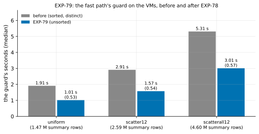

# EXP-79: The guard's unsorted reading on the VMs, and the break-even with the fast path as it now is

Status: **done October 28, 2026: the deciding prediction held, within rule 11's band, so EXP-79b is its second session.** The guard took 0.567 of its time at 96% of the pages, and 0.531 and 0.541 in the other cells: 0.64–0.69 µs per summary row against 1.15–1.30. Predictions 3 and 4 failed, and the break-even is not re-placed. The scatterall12 cell differed from EXP-75–77's, because scatter12 ran before it and changed the same rows. Background writes on the source disrupted its first two runs. Pre-registered the same day, before any run; one `ha` VM pair. It times EXP-78's change on the VMs, and re-places EXP-75's break-even after EXP-77's and EXP-78's changes.

## Question

**EXP-78 (local)** cut the guard's summary reading to 0.460 of its time, by returning each fork's blocks unsorted with their duplicates; it is built into the sender. On the VMs the guard has been steady across sessions (EXP-74 to EXP-77's statistics):
- **uniform:** 1.89–1.93 s for 1.47 M summary rows;
- **scatter12:** 2.91 s for 2.59 M rows;
- **scatterall12:** 5.28–5.35 s for 4.60 M rows.

That is 1.15–1.30 µs per row. At EXP-78's ratio the guard would take about 0.9, 1.3 and 2.4 s. That is a projection: the VMs' source is slower per row than the Mac (0.51 µs), and its share of sorting may differ.

**The break-even:** EXP-75 placed it near 85% of the pages changed, by interpolating between EXP-74's scatter12 (0.64 of `pg_basebackup` at 53% of the pages) and EXP-75's scatterall12 (1.12 at 96%). EXP-77's change brought the 96% point to 1.07. Both points were measured with older code, in different sessions. This session measures both with the current fast path.

**The question: on the VMs, does the guard take at most 0.6 of its time before, and where does `pg_basebackup` now start to win?**

## Design

**EXP-77's lab and set-up** (`experiments/network/lab_exp64.sh`, `SERIES=1`):
- the `ha` set in us-west1: two `n2d-highcpu-8` VMs with 150 GiB balanced persistent disks, `blake3` on both;
- EXP-48's 18 GB database, PostgreSQL 17.11, `summarize_wal` on;
- pgdelta at this commit: the written pages checked on the verifier, a run at a time (EXP-77), and the guard's reading unsorted (EXP-78).

**Three cells,** each with B0 a base backup taken just before its change, in this order:
- **`uniform`:** 1% of `pgbench_accounts`' rows in random batches. **Arm:** `fast8wf2`, for the guard.
- **`scatter12`:** 12% of `pgbench_accounts`' rows by key hash (EXP-74's 53% of the pages). **Arms:** `fast8w` and `full` (`pg_basebackup`).
- **`scatterall12`:** 12% of both tables' rows by key hash (96% of the pages). **Arms:** `fast8w` and `full`.

**Every fast arm** pins `--read-ahead 8`, `--fsync worker` and `--no-diverged-basis`, and its fill.

**Runs:** 2 per arm, shuffled per cell (seed 790); 10 runs.

**The command:**

    PATTERNS="uniform scatter12 scatterall12" ARMS_uniform=fast8wf2 ARMS_scatter12="fast8w full" ARMS_scatterall12="fast8w full" SERIES=1 OUT=/data/exp04-results/exp79 lab_exp64.sh SOURCE 2 790

**A smoke first,** at scale 20 (one run per arm, seed 791, deciding nothing). Every run must exit 0, every fast copy must match, every fast run must use the fast path, and every run must have both disk series.

**The analysis,** committed before the data: `analysis/exp79.py`. Figure `exp79-guard` (each cell's guard before and now); data `docs/experiments/data/exp79-cells.csv`. The break-even figure (`analysis/breakeven_fastpath.py`) gains this session's two points after the data.
- **Dry run:** on earlier sessions' runs of the same cells (EXP-74's uniform and scatter12, EXP-77's scatterall12). The parsing, scoring and crossing worked: it gave EXP-77's 89% from those points.
- **Those runs predate EXP-78,** so predictions 1–3 failed there, as they must. The dry run's outputs were removed.

## Predictions

1. **Deciding: scatterall12's guard takes at most 0.60 of 5.31 s** (median of 2; the model says about 0.46, 2.4 s).
2. **uniform's guard takes at most 0.60 of 1.91 s.**
3. **scatterall12's fast path takes at least 2.0 s less than EXP-77's 108.48 s,** with `pg_basebackup` within 1% of EXP-77's 101.25 s, so the sessions compare.
4. **The guards read the same:** each cell's summary rows within 1% of the earlier sessions' (1.47 M, 2.59 M, 4.60 M).
5. **Every copy is correct:** every run exits 0, and every fast run used the fast path and passed the copy's check.

**Reported, not predicted:**
- the guard's µs per summary row;
- the fast path over `pg_basebackup` at 53% and 96% of the pages, and their interpolated crossing;
- scatter12's guard against its 2.91 s.

**Rule 11:** a deciding ratio within 0.05 of the bar (0.55–0.65) gets a second session.

## What follows

- **If 1–3 hold:** the guard's cost is halved on the VMs. The break-even is stated with the current fast path, in RESULTS and the READMEs.
  - The selector's model, whose overhead per MB and fixed costs predate EXP-77 and EXP-78, is refitted on these cells and tested on new ones before its constants change.
- **If 1 fails:** the VMs' guard isn't bound where the Mac's was. The guard is timed in parts on a VM (EXP-73's script) before anything else changes.

## Results

The `ha` set in us-west1-b and -c. The smoke at scale 20 passed (5 runs, the copies matched, both series in every run). The registered runs took 20:41–21:25 UTC, and the VMs were then deleted. Data: `docs/experiments/data/exp79-cells.csv`; raw `results/exp04/exp79/` (not in git).

*How to read it:* each cell's guard, before (EXP-74 to EXP-77) and in this session, with the ratio. The axis labels give the earlier sessions' summary rows. This session read 1.47 M, 2.45 M and 4.61 M.

| Cell | Arm | Seconds (median) | The runs | Guard (s) | Summary rows | µs per row | Share of pages chosen |
|---|---|---|---|---|---|---|---|
| uniform | fill 2 | 42.04 | 42.00, 42.07 | **1.015** (0.531 of 1.91) | 1,470,205 | 0.69 | 39% (filled) |
| scatter12 | fill 0 | 58.02 | 57.99, 58.05 | **1.575** (0.541 of 2.91) | 2,449,082 | 0.64 | 53% |
| scatter12 | `pg_basebackup` | 96.01 | 96.04, 95.98 | | | | |
| scatterall12 | fill 0 | 129.99 | **148.92**, 111.07 | **3.009** (0.567 of 5.31) | 4,609,832 | 0.65 | 84% |
| scatterall12 | `pg_basebackup` | 109.41 | **113.32**, 105.51 | | | | |

| # | Prediction | Result |
|---|---|---|
| 1 | **Deciding:** scatterall12's guard at most 0.60 of 5.31 s | **Held:** 0.567 (3.01 s), within rule 11's band (0.55–0.65) |
| 2 | uniform's guard at most 0.60 of 1.91 s | **Held:** 0.531 (1.015 s) |
| 3 | scatterall12's fast path at least 2.0 s below EXP-77's 108.48 s, `pg_basebackup` within 1% of 101.25 s | **Failed:** 129.99 s; `pg_basebackup` 109.41 s, outside the band, so the sessions don't compare |
| 4 | Each cell's summary rows within 1% of the earlier sessions' | **Failed:** scatter12 2.45 M against 2.59 M (−5.3%); uniform and scatterall12 within 0.2% |
| 5 | Every run exits 0; every fast copy correct | **Held:** 10 of 10; 6 of 6 matched |

**Rule 11:** the deciding ratio (0.567) lies within 0.05 of the bar, so EXP-79b is its second session.

**What went wrong with scatterall12 (found after the data; no verdicts changed).**
- **The cell order changed the cell.** In EXP-75–77 scatterall12 followed uniform. Here it followed scatter12, which had already updated the same 12% of `pgbench_accounts`' rows (the same key hash). So the table held a round of dead tuples and had grown. The plan chose 84% of the listed pages, not 96%, so the cell is not EXP-77's.
- **Its first two runs were disturbed:** the source disk wrote 5.86 GB and 2.01 GB during them, against 0.03–0.14 GB in every EXP-77 run. That is background work on the source after the big update, most likely autovacuum, and those are the slow runs (148.92 and 113.32 s). The other two runs were clean: the fast path 111.07 s and `pg_basebackup` 105.51 s, 1.053 at 84%. That is one run each, reported only.
- **scatter12's baseline for prediction 4 was ill-chosen:** EXP-74's scatter12 followed scatter4, another history. That makes the row counts differ, not the guard's reading.
- **The design flaw:** cells that change the same rows were run in one session without settling the source between them. EXP-79b keeps EXP-75–77's order (uniform, then scatterall12).

**Reported:**
- **The guard per summary row** was 0.64–0.69 µs in every cell, against 1.15–1.30 µs before: about 0.55 on the VMs, against EXP-78's 0.46 locally.
- **uniform** took 42.04 s against EXP-77's 42.64 s; the guard's 0.9 s saved shows in the total.
- **scatter12 against `pg_basebackup`, the current code, clean runs:** 0.604 at 53% of the pages (EXP-74's older code: 0.644).

## What followed

- **EXP-79b**, rule 11's second session for the deciding prediction, in EXP-75–77's order (uniform, then scatterall12, with `pg_basebackup`), so that prediction 3 can be tested on a comparable cell.
- **The break-even** is re-placed after EXP-79b, from this session's scatter12 (0.604 at 53%) and EXP-79b's scatterall12, both with the current code.
