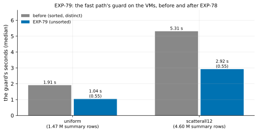
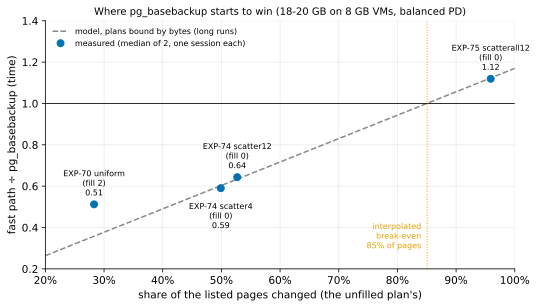

# EXP-79b: The guard on the VMs, rule 11's second session, in EXP-75–77's order

Status: **done October 28, 2026: every prediction held, and with EXP-79 the guard's change is firm on the VMs (rule 11).** The guard took 0.550 of its time at 96% of the pages (EXP-79: 0.567), and the fast path on EXP-77's cell fell from 108.48 to 106.23 s. With the current code, `pg_basebackup` starts to win near 91% of the pages changed (85% before). Pre-registered the same day, before any run; one `ha` VM pair, about an hour with the data load. It is EXP-79's second session under rule 11, and it re-runs the cell EXP-79 changed.

## Question

**EXP-79's deciding prediction held within rule 11's band:** scatterall12's guard took 0.567 of its 5.31 s (bar 0.60). The guard read 0.64–0.69 µs per summary row in every cell, against 1.15–1.30 µs before.

**Its predictions 3 and 4 failed for reasons of design:**
- scatterall12 ran after scatter12, which had already updated the same rows, so the plan chose 84% of the pages, not EXP-77's 96%;
- background writes on the source (5.86 and 2.01 GB, most likely autovacuum) slowed two of its four runs;
- scatter12's baseline row count came from a session with another history.

**This session runs EXP-79's design in EXP-75–77's order:** uniform, then scatterall12. There the source wrote 0.03–0.14 GB per run in EXP-77. It has no scatter12.

**The question: does scatterall12's guard again take at most 0.60 of 5.31 s, and does the fast path on EXP-77's cell gain what the guard saves?**

## Design

**EXP-79's, but with two cells, in this order:**
- **`uniform`:** arm `fast8wf2`.
- **`scatterall12`:** arms `fast8w` and `full`.

The `ha` set in us-west1, EXP-48's 18 GB database, PostgreSQL 17.11 and pgdelta at this commit, the same as EXP-79's; `SERIES=1`.

**Runs:** 2 per arm, shuffled per cell (seed 792); 6 runs. **Smoke** at scale 20 (seed 793), deciding nothing.

**The command:**

    PATTERNS="uniform scatterall12" ARMS_uniform=fast8wf2 ARMS_scatterall12="fast8w full" SERIES=1 OUT=/data/exp04-results/exp79b lab_exp64.sh SOURCE 2 792

**The analysis:** EXP-79's (`analysis/exp79.py`), with `--patterns uniform,scatterall12` and `--below results/exp04/exp79`. The second option takes scatter12's medians from EXP-79, for the crossing only. It was extended before this run, and EXP-79's own scores are unchanged by it.
- **Dry run:** on EXP-77's runs of these two cells, which predate EXP-78, so predictions 1–3 failed there, as they must.
- Data `docs/experiments/data/exp79b-cells.csv`, figure `exp79b-guard`.

## Predictions

EXP-79's, for these cells:

1. **Deciding: scatterall12's guard takes at most 0.60 of 5.31 s.**
2. **uniform's guard takes at most 0.60 of 1.91 s.**
3. **scatterall12's fast path takes at least 2.0 s less than EXP-77's 108.48 s,** with `pg_basebackup` within 1% of EXP-77's 101.25 s.
4. **The summary rows** are within 1% of the earlier sessions' (1.47 M and 4.60 M).
5. **Every copy is correct.**

**Reported:** the guard's µs per row; the fast path over `pg_basebackup` at 96% of the pages, and the crossing with EXP-79's scatter12 point (0.604 at 53%); the source disk's writes during each run.

**Rule 11's verdict:** the two sessions' deciding ratios together. Both at or under 0.60: held. One over: not firm, and stated so.

## What follows

- **If 1 holds here too:** EXP-78's change is firm on the VMs.
- **If 3 holds:** the break-even is re-placed with the current code, and RESULTS, the READMEs and the break-even figure say so.
- **The selector's model** is refitted after this, on these cells, and tested on new ones before its constants change.

## Results

The `ha` set in us-west1-b and -c. The smoke at scale 20 passed (3 runs, the copies matched, the series complete). The registered runs took 21:57–22:23 UTC, and the VMs were then deleted. The source wrote 0.03–0.12 GB per run, as in EXP-77 (EXP-79's disturbed runs: 5.86 and 2.01 GB). Data: `docs/experiments/data/exp79b-cells.csv`; raw `results/exp04/exp79b/` (not in git).

| Cell | Arm | Seconds (median) | The runs | Guard (s) | Summary rows | µs per row | Share of pages chosen |
|---|---|---|---|---|---|---|---|
| uniform | fill 2 | 42.17 | 42.29, 42.04 | **1.041** (0.545 of 1.91) | 1,470,453 | 0.71 | 39% (filled) |
| scatterall12 | fill 0 | **106.23** | 106.46, 106.00 | **2.921** (0.550 of 5.31) | 4,599,183 | 0.64 | 96% |
| scatterall12 | `pg_basebackup` | 101.10 | 101.11, 101.09 | | | | |

| # | Prediction | Result |
|---|---|---|
| 1 | **Deciding:** scatterall12's guard at most 0.60 of 5.31 s | **Held:** 0.550 (2.92 s) |
| 2 | uniform's guard at most 0.60 of 1.91 s | **Held:** 0.545 (1.04 s) |
| 3 | scatterall12's fast path at least 2.0 s below EXP-77's 108.48 s, `pg_basebackup` within 1% of 101.25 s | **Held:** 106.23 s (2.25 s below); `pg_basebackup` 101.10 s (−0.15%) |
| 4 | Summary rows within 1% of the earlier sessions' | **Held:** +0.02% and −0.003% |
| 5 | Every run exits 0; every fast copy correct | **Held:** 6 of 6; 4 of 4 matched |

**Rule 11's verdict:** both sessions' deciding ratios are at or under 0.60 (EXP-79: 0.567; EXP-79b: 0.550), so EXP-78's change holds on the VMs. Prediction 3 held by 0.25 s, one session, which is close; the guard's own saving (2.4 s) accounts for it.

**The break-even with the current code.** EXP-79's scatter12 (0.604 at 53% of the pages, clean runs) and this session's scatterall12 (1.051 at 96%) cross 1 at **91%** of the pages changed, against 85% from the cells before EXP-77 and EXP-78. It is a line through one cell either side, from two sessions, not a measurement at the crossing.

*How to read it:* each point is a cell's fast path over the same session's `pg_basebackup`, against the share of the listed pages its unfilled plan changed; grey, the fast path before EXP-77's receiver change and EXP-78's guard change; blue, as it now is; the dotted lines are each set's crossing.

## What followed

- **EXP-78's change is firm** (two VM sessions), and the docs give the guard's new cost: about 0.65 µs per summary row.
- **The break-even** is stated with the current code (about 91% of the pages) in RESULTS, the READMEs and the break-even figure.
- **What is left at 96% of the pages:** 5.1 s against `pg_basebackup`. Of that, 2.9 s is the guard; the rest is the plan (about 0.9 s) and the time beyond the disks.
- **The selector's model** predates EXP-77 and EXP-78 (its overhead per MB was fitted with the stall in it). It is refitted on these cells and tested on new ones before its constants change.
