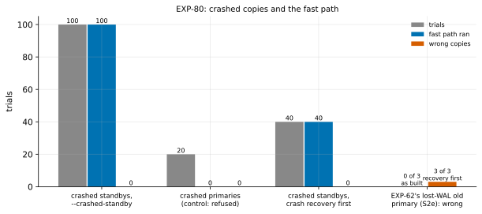

# EXP-80: Can a crashed standby take the fast path soundly, and is crash recovery first unsound for it?

Status: **done October 28, 2026: every prediction held.** 100 of 100 randomized crashed standbys were refreshed by the fast path with `--crashed-standby` and came out correct (failure rate below 2.95% at 95% confidence). 20 of 20 crashed primaries were still refused and hashed correctly. Crash recovery first turned EXP-62's lost-WAL old primary (S2e) into a wrong copy in 3 of 3 fresh builds. Pre-registered the same day, before the registered run (pilots are listed below); local, about an hour. The first experiment scored under rules 13–17. It is research loop 2's pick: the "lineage unprovable" row, where pgdelta loses because it can only hash.

## Question

**Today's guard (v2, EXP-62)** lets the fast path run only where B's end is proven by how B stopped: a clean shutdown, a cleanly stopped standby's minimum recovery point, or a base backup's manifest. A copy that crashed is refused and hashed. Hashing must read all of B, so beyond memory it at best ties a re-clone (EXP-31).

**The plan in research loop 2 was crash recovery first,** as `pg_rewind` does for a target that wasn't shut down cleanly. Three pilots changed it before anything was registered.

1. **A probe (local, PostgreSQL 17.11):** single-user crash recovery (`postgres --single -F`) left both a crashed primary copy and a crashed standby "shut down" on timeline 1.
   - **A standby needs its `standby.signal` moved aside first:** single-user servers refuse standby mode (exit 1).
   - **It moves B's redo point past where B's pages stop matching the server's.** The redo point went to 0/83DCE80, past B's own end-of-recovery checkpoint. So the fast path would read the server's summaries from too late a point. Here that is harmless only because whole summary files are read, and the summarizer cut them at the server's checkpoint before the gap.
2. **S2e, a new scenario in EXP-62's builder:** an old primary that crashed after writing past a failover split, then lost its WAL from the split's segment on. Unlike EXP-62's S2d, its last checkpoint record is in an earlier segment, kept.
   - **As built:** guard v2 refused it and hashed, and the copy was correct.
   - **After crash recovery first:** crash recovery replayed to the end of the WAL left (before the split) and marked B "shut down". Guard v2 then accepted it as a clean shutdown, and **the copy was wrong** (EXP-63's logical comparison). **Crash recovery first reopens EXP-62's blind spot.**
   - **For S2d itself,** crash recovery fails ("could not locate a valid checkpoint record"), so S2d couldn't show this.
3. **What is sound instead, for a standby (from PostgreSQL's design; to be tested here).**
   - **The invariant:** a standby advances its minimum recovery point in `pg_control`, synced, before it writes any page whose LSN lies past it. So after a crash too, that point bounds every page on disk. That is the bound guard v2 already trusts for a cleanly stopped standby.
   - **A standby writes no WAL of its own,** so it can't have diverged from what it replayed.
   - **So the change:** a standby left "in archive recovery" by a crash or a kill can be proven by its minimum recovery point, with no crash recovery, no binary run on B, and no change to B before the refresh.
   - **Crashed primaries stay refused:** S2e's hazard applies to them.

**Built for this experiment:** `--crashed-standby` (receive and local, opt-in). With it, `fastpath.basis_facts` takes a B "in archive recovery" with proof "crashed standby": its end is the larger of its latest checkpoint and its minimum recovery point, and it gets the same timeline test as a cleanly stopped standby. Without the option, the refusal now names it.
- **Tests:** a real-server test kills a standby of the test server. It is refused and hashed without the option, and with it the fast path runs and the copy recovers to the source with `pg_amcheck` clean. The existing crashed-copy test still refuses a crashed primary.
- **Pilot runs of the harness, not scored:** 7 trials (3 crashed standbys, 1 crashed primary, 3 crash-recovery-first), all correct; the crashed primary refused. One S2e build, as above.

**The question: across randomized crashes, does every crashed standby taken by its minimum recovery point come out correct, are crashed primaries still refused, and is crash recovery first shown unsound on S2e?**

## Design

**The trial harness** (`experiments/fastpath_crashed/crashed_standby_trials.py`): one local source S, running for the whole campaign.
- **S:** PostgreSQL 17.11, data checksums, `summarize_wal` on, checkpoints every 30 s and on 64 MB of WAL (so standbys restart-point often), `wal_keep_size` 1 GB, pgbench at scale 4.
- **The load:** pgbench on 4 clients, with side-table DDL in between: `CREATE TABLE AS`, `TRUNCATE` and refill, `DELETE` plus `VACUUM`, and `VACUUM FULL`. So the summaries carry creations, truncations (limit blocks) and new relfilenodes.
- **Arms, in a shuffled order (seed 800):**
  - **crashed-standby (deciding), 100 trials:** a new standby of S (`pg_basebackup -R`) is started. The load runs on S, and the standby is killed after a random 1–8 s, by `pg_ctl -m immediate` or by SIGKILL of its postmaster (each with probability ½). After a SIGKILL its stale `postmaster.pid` is removed once no process is left, as an operator would. Then 1–6 s more load on S, then a fast-path refresh of the standby in place with `--crashed-standby`.
  - **crashed-primary (control), 20 trials:** load, then S stopped with `pg_ctl -m immediate`, its data directory copied, and S restarted and loaded again. The copy is refreshed with `--crashed-standby`, which must refuse the fast path ("in production") and hash.
  - **recovery-first (control), 40 trials:** a crashed standby as above, then crash recovery first: `standby.signal` moved aside, `postgres --single -F`, the signal put back. That leaves it "shut down". Then the fast path, as for a clean stop.
- **Each refreshed copy** is started without its signal file and compared with S: every pgbench table's rows by md5, `pgbench_history`'s count and sum, each side table's row count, and `pg_amcheck --all --heapallindexed`.

**The S2e control** (`experiments/fastpath_crashed/s2e_control.py`): 3 fresh builds of S2e. Each is checked as built and after crash recovery first, with EXP-63's fast-path check (restore and compare logically with the source).

**The command:**

    .venv/bin/python experiments/fastpath_crashed/crashed_standby_trials.py --trials 100 --controls 20 --recovery-first 40 --seed 800
    .venv/bin/python experiments/fastpath_crashed/s2e_control.py --builds 3

**The analysis,** committed before the data: `analysis/exp80.py`. Dry-run on the pilot outputs; the dry run's figure was removed. Data `docs/experiments/data/exp80-trials.csv` and `exp80-s2e.json`, figure `exp80-crashed`.

## Predictions

1. **Deciding: all 100 crashed standbys** are refreshed by the fast path, with the proof "crashed standby", and come out correct (exit 0, rows equal to S's, `pg_amcheck` clean). One failure fails it. With none, the failure rate is below 3.0% at 95% confidence.
2. **All 20 crashed primaries** are refused the fast path ("in production") and hashed, and come out correct.
3. **All 3 S2e builds:** refused and correct as built; after crash recovery first, "shut down", taken by the fast path, and **wrong**. This was observed once in a pilot, and is repeated here on fresh builds.

**Reported, not predicted:**
- the crash-recovery-first trials' wrong copies (their mechanism, the redo point moved past B's own records, is masked whenever a summary file spans the gap);
- the share of pages the fast path sent for crashed standbys, and the refresh's time.

## What follows

- **If 1–3 hold:**
  - **On the VMs:** `--crashed-standby` is timed beyond memory, against hashing (today's path for a crashed standby) and a re-clone (EXP-80b), before it becomes the fast path's default.
  - **The guard's documentation** records why crash recovery first stays out.
  - **The residual risk:** a crashed old primary that lost its WAL past the split and was then crash-recovered by anyone (an operator, or `pg_rewind`, whose divergence test is the same) fools guard v2, and `pg_rewind` too. A possible guard check: crash recovery's end-of-recovery checkpoint, found in B's own WAL.
- **If 1 fails:** the minimum-recovery-point bound doesn't hold for a crashed standby as used here. The failing trials say where, and the option stays off.

## Results

**Setup:** PostgreSQL 17.11 on the Mac (`LC_ALL=C`), 160 trials in a shuffled order, then 3 fresh S2e builds. Data: `docs/experiments/data/exp80-trials.csv` and `exp80-s2e.json`.

**Scorer integrity (rule 16):** `analysis/integrity.py check EXP-80` reports 12 of 12 files unchanged since the registration commit (ca04163): the analysis, both harnesses, the scenario builder and fast-path check, and pgdelta's modules under test.

*How to read it:* per arm, the trials, how many took the fast path, and how many copies came out wrong. On the right, EXP-62's lost-WAL old primary (S2e), wrong as built (0 of 3) and after crash recovery first (3 of 3).

| Arm | Trials | Fast path ran | Wrong copies | Notes |
|---|---|---|---|---|
| **Crashed standbys, `--crashed-standby`** (deciding) | 100 | 100 (proof "crashed standby") | **0** | 45 stopped with `pg_ctl -m immediate`, 55 killed with SIGKILL; every one "in archive recovery" |
| Crashed primaries (control) | 20 | 0 (refused: "in production") | 0 | Hashed, each correct |
| Crashed standbys, crash recovery first (control) | 40 | 40 (proof "clean shutdown") | 0 | Reported, not predicted |
| S2e, as built | 3 builds | 0 (refused) | 0 | |
| **S2e, after crash recovery first** | 3 builds | 3 (accepted as a clean shutdown) | **3** | Crash recovery exited 0 each time and left B "shut down" |

| # | Prediction | Result |
|---|---|---|
| 1 | **Deciding:** all 100 crashed standbys refreshed by the fast path and correct | **Held:** 100 of 100 (exit 0, rows equal to the source's, `pg_amcheck --heapallindexed` clean). Failure rate below 2.95% at 95% |
| 2 | All 20 crashed primaries refused and hashed correctly | **Held:** 20 of 20 |
| 3 | All 3 S2e builds refused and correct as built; after crash recovery first, taken and wrong | **Held:** 3 of 3 each way |

**Reported, not predicted:**
- **Crash recovery first on crashed standbys:** 0 wrong copies in 40. As registered, its redo-point shift is masked whenever a summary file spans the gap, so these trials can't show its unsoundness. S2e does.
- **The crashed standbys' refreshes:** a median 22.1% of the pages sent, in 0.51 s on a 60 MB model. Timing is the VMs' to measure (EXP-80b).
- **Rule 17's noise bar** doesn't apply here: these are correctness counts, not timings.

## What followed

As registered for 1–3 holding:
- **`--crashed-standby` stays opt-in until EXP-80b times it** beyond memory against hashing and a re-clone. After that, rule 15's held-out session comes before it becomes a default.
- **Crash recovery first is rejected,** with S2e as the evidence. The guard's documentation (fastpath.py) says why.
- **The residual risk is recorded in the idea archive:** a crash-recovered old primary that lost its WAL past the split fools guard v2 and `pg_rewind` alike.
