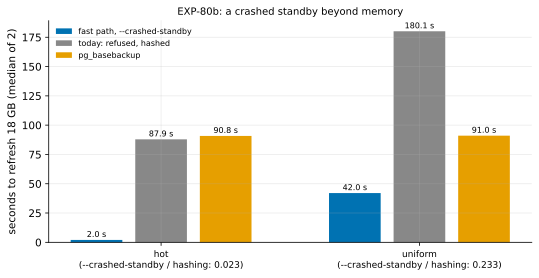

# EXP-80b: A crashed standby beyond memory: the fast path with `--crashed-standby`, against hashing and a re-clone

Status: **done October 28, 2026: every prediction held.** A crashed standby beyond memory was refreshed by the fast path with `--crashed-standby` in **0.233** of today's time for it (hashing) for uniform changes (42.0 s against 180.1 s), and in **0.023** for hot ones (2.0 s against 87.9 s). That is 0.46 and 0.02 of `pg_basebackup`'s time; every copy was correct. Pre-registered before any run (00:07 UTC October 29); one `ha` VM pair, about an hour with the data load. It is EXP-80's VM stage under rule 13.

## Question

**EXP-80 showed `--crashed-standby` is sound:** 100 of 100 randomized crashed standbys came out correct through the fast path, locally, on a 60 MB model. Their end was proven by the minimum recovery point.

**Who needs it:** a standby that crashed, or was killed, and stayed down until the source recycled the WAL it needs (no slot, no archive). It can't catch up by replication. Today its options are:
- **pgdelta:** the fast path refuses it ("in archive recovery"), so pgdelta hashes. Hashing reads all of B, so beyond memory it at best ties a re-clone (EXP-31).
- **A re-clone** with `pg_basebackup`.
- **`pgBackRest --delta`:** it also reads every file (research loop 2).

**The question: on the VMs, beyond memory, how much faster is a crashed standby refreshed with `--crashed-standby` than today's path for it (hashing), and than a re-clone?**

## Design

**The lab:** EXP-70's (`experiments/network/lab_exp64.sh`), with a new mode, `CRASHED=1`, committed with this registration.
- **The setting:** the `ha` set (n2d-highcpu-8, 150 GiB balanced PDs, two zones, us-west1 first), EXP-48's 18 GB database (scale 600), PostgreSQL 17.11, BLAKE3 on both VMs, pgdelta at this commit; `SERIES=1` (both disks sampled every 0.25 s).
- **`CRASHED=1`:** each pattern's B0 is a standby of the source (`pg_basebackup -R`), started on dest before the change. It is killed with `pg_ctl -m immediate` `KILL_AFTER` seconds (30) into the change, while the change goes on to its end on the source. The lab logs B0's state after the kill ("in archive recovery").
- **Each run** starts from a fresh `cp -a` of the crashed B0. Each pgdelta copy is started without its `standby.signal` and its `pgbench_accounts` compared with the source's.

**The cells:** `hot` (its change takes about 64 s on this set) and `uniform` (about 460 s). So the kill falls about midway through hot's change and early in uniform's.

**The arms:**
- **`fast8wf2c`:** the fast path with today's defaults (8 reader threads, the fsync worker, gaps of up to 2 pages filled), plus `--crashed-standby`.
- **`fast8wf2`:** the same without the option. The fast path is refused ("in archive recovery") and pgdelta hashes: today's path for a crashed standby.
- **`full`:** `pg_basebackup`.

**Runs:** 2 per arm, shuffled per cell (seed 800); 12 runs.

**The smoke** (scale 20, `KILL_AFTER=3`, seed 801) decides nothing. It checks the new mode:
- every run exits 0, and every pgdelta copy matches;
- every `fast8wf2c` run used the fast path, and no `fast8wf2` run did;
- the disk series were recorded.

**The command:**

    PATTERNS="hot uniform" ARMS_hot="fast8wf2c fast8wf2 full" ARMS_uniform="fast8wf2c fast8wf2 full" CRASHED=1 SERIES=1 OUT=/data/exp04-results/exp80b lab_exp64.sh SOURCE 2 800

**The analysis,** committed before the data: `analysis/exp80b.py`.
- **Dry run** on EXP-70's runs, where there is no `fast8wf2c` arm and B0 is a base backup: it ran, and predictions 1–4 failed there, as they must.
- **Data** `docs/experiments/data/exp80b-cells.csv`, **figure** `exp80b-crashed`.

## Where the bars come from

From the same set with a cleanly stopped B0, which takes the same fast path:

| Cell | Fast path, fill 2 | Hashing (EXP-64) | `pg_basebackup` | Fast path / hashing | Fast path / `pg_basebackup` |
|---|---|---|---|---|---|
| hot | 1.93 s (EXP-70) | 87.81 s | 90.67 s | 0.022 | 0.021 |
| uniform | 46.59 s (EXP-70); 42.17 s (EXP-79b) | 180.12 s | 91.02 s | 0.23–0.26 | 0.46–0.51 |

**Two things could differ for a crashed standby:**
- **Its redo point** is its last restart point. If the source checkpointed before the kill, the summaries start later and fewer pages are sent.
- **Its pages are partly replayed.** Hashing then finds fewer differing pages; the fast path sends what the summaries name either way.

**Hashing hasn't been timed since EXP-64,** before EXP-68's fsync worker and EXP-77's verifier change.

**So the bars leave room for these, and still decide.** They sit far outside rule 17's noise bar (a 2.27% spread within a session for runs of 10 s or more; 7.7% under 10 s).

## Predictions

1. **Deciding: in `uniform`, `fast8wf2c` takes at most 0.60 of `fast8wf2`'s time** (medians). Expected about 0.25.
2. **In `hot`, at most 0.20.** Expected about 0.02.
3. **`fast8wf2c` takes at most 0.80 of `pg_basebackup`'s time in both cells.** Expected about 0.5 (uniform) and 0.02 (hot).
4. **Correctness, and the guard's decisions (rule 16):**
   - every run exits 0, and every pgdelta copy matches the source;
   - every `fast8wf2c` run took the fast path with the proof "crashed standby";
   - every `fast8wf2` run was refused as "in archive recovery".

**Reported, not predicted:**
- the ratios against the expected values above;
- each run's pages received and re-read. On clean B0s they differ by a fixed amount per cell: 2,888 in EXP-70's and EXP-77's uniform.
- B0's state after each kill, and its redo point against the change's start;
- both disks' I/O time per run.

**Rule 11:** a deciding ratio within 0.05 of 0.60 gets a second session.

## The rules this session runs under

- **Rule 13 (the cascade):** EXP-80 was the local stage, for correctness. This session times the same fast path as the cells above, so its bars come from those VM cells, not from a local ratio. It logs no proxy-fidelity pair.
- **Rule 15 (held out):** not a milestone. If 1–4 hold, a held-out session comes before `--crashed-standby` becomes the fast path's default.
- **Rule 16:** `analysis/integrity.py register EXP-80b` records the analysis, the lab and pgdelta's modules as of this commit; `check` runs at the write-up.
- **Rule 17:** above.

## What follows

- **If 1–4 hold:** `--crashed-standby` is measured beyond memory against hashing and a re-clone. RESULTS and the scorecard say so. The option goes into the next held-out session (rule 15), together with `--selector`, before either becomes a default.
- **If 1 fails:** the fast path on a crashed standby isn't the win the clean cells imply. The runs' disk series and plans show why, and the option stays opt-in.
- **If 4 fails:** the option is withdrawn until the failing run is understood.

## Results

**The session:** the `ha` set in us-west1-b and -c (us-west1-a had no capacity).
- **The smoke** at scale 20 passed: 6 runs, each standby killed mid-change and left "in archive recovery", the copies matched, the guard's decisions as designed, and the series recorded.
- **The registered runs** took 00:28–01:13 UTC October 29, and the VMs were then deleted.
- **Data:** `docs/experiments/data/exp80b-cells.csv`; raw `results/exp04/exp80b/` (not in git).

**Scorer integrity (rule 16):** `analysis/integrity.py check EXP-80b` reports 13 of 13 files unchanged since the registration commit (cf00e5e).

**The crashed standbys:** each was killed 30 s into its change and left "in archive recovery".
- **No restart point happened before the kill.** So each standby's redo point was its base backup's start (6/61000028 and 6/7E000028), and the summaries covered the whole change.
- **The fast path's plans were the clean B0's exactly:** 14,719 and 858,015 pages, as in EXP-70.
- **Their minimum recovery points,** which the guard took as their end, lay 137 MiB (hot) and 417 MiB (uniform) of WAL past the redo point. That is how far each standby had replayed before it was killed.

*How to read it:* per cell, the seconds to refresh the 18 GB crashed standby (median of 2):
- **Blue:** the fast path with `--crashed-standby`.
- **Grey:** today's path. The fast path is refused, so pgdelta hashes.
- **Orange:** `pg_basebackup`.

| Cell | Arm | Seconds (median) | The runs | Pages sent | Source disk busy (s) | Dest disk busy (s) |
|---|---|---|---|---|---|---|
| hot | **fast path, `--crashed-standby`** | **2.03** | 2.03, 2.03 | 14,719 | 0.4 | 1.1 |
| hot | today: refused, hashed | 87.88 | 87.85, 87.90 | 13,881 | 86.8 | 86.9 |
| hot | `pg_basebackup` | 90.82 | 91.00, 90.64 | | 83.4 | 85.0 |
| uniform | **fast path, `--crashed-standby`** | **42.02** | 42.02, 42.01 | 858,015 (39% of the pages, gaps filled) | 35.2 | 33.7 |
| uniform | today: refused, hashed | 180.13 | 181.74, 178.52 | 617,454 | 95.0 | 157.5 |
| uniform | `pg_basebackup` | 91.04 | 91.11, 90.98 | | 83.3 | 85.0 |

| # | Prediction | Result |
|---|---|---|
| 1 | **Deciding:** uniform's fast path at most 0.60 of hashing's time (expected about 0.25) | **Held: 0.233** |
| 2 | hot's at most 0.20 (expected about 0.02) | **Held: 0.023** |
| 3 | At most 0.80 of `pg_basebackup`'s time in both cells (expected about 0.5 and 0.02) | **Held: 0.462 (uniform), 0.022 (hot)** |
| 4 | Every run exits 0 and every pgdelta copy matches; every `--crashed-standby` run proven as "crashed standby"; every run without it refused as "in archive recovery" | **Held:** 12 of 12 exited 0; 8 of 8 pgdelta copies matched; 4 of 4 "crashed standby"; 4 of 4 refused |

**Reported, not predicted:**
- **Every ratio landed on the value the clean cells implied.** Uniform 0.233 (expected 0.23–0.26); hot 0.023 (0.022); against `pg_basebackup`, 0.462 (0.46–0.51) and 0.022 (0.021). A crashed standby costs the fast path nothing beyond a clean one's plan:
  - its guard took 0.02 s (hot) and 1.06–1.09 s (uniform; EXP-79b's clean uniform: 1.04 s);
  - its times match the clean cells': uniform 42.02 s against EXP-79b's 42.17 s, hot 2.03 s against EXP-70's 1.93 s.
- **Hashing hasn't moved since EXP-64:** 87.88 s against 87.81 s, and 180.13 s against 180.12 s. It sends about the pages a clean B0 would (13,881 against 13,880; 617,454 against 618,417), even though the standby had replayed part of the change.
  - In hot, the same rows change again and again, so a page replayed before the kill differs again by the end.
  - In uniform, the kill came early, after 30 s of a 460 s change.
- **Pages received and re-read** differ by 2,886 (hot) and 2,888 (uniform): the fixed amount seen on clean B0s. Every other written page was re-read.
- **Rule 17's noise:**
  - Within this session, two runs of a cell differed by at most 1.8% (uniform hashing). Every other cell's two runs were within 0.4%.
  - `pg_basebackup`'s uniform cell, built the same way since EXP-64, moved 0.28% between sessions.
  - Added to the noise-floor file, this session moves the 95th-percentile spread within a session to 2.08% for runs of 10 s or more (from 2.27%) and 7.54% under 10 s (from 7.7%).
  - Each margin here is over 10 times the noise.

## What followed

- **`--crashed-standby` is measured beyond memory:**
  - against today's path for a crashed standby, 0.023–0.233 of the time;
  - against a re-clone, 0.022–0.46.
  - The research-loop-2 scorecard's "lineage unprovable" loss is now a win for crashed standbys.
- **What is still a loss:**
  - **Crashed primaries:** taking them is unsound by EXP-80's S2e, so they are hashed.
  - **Copies without WAL summaries** (`summarize_wal` off, or PostgreSQL before 17): labels from a scan of S's WAL are unbuilt.
- **The option stays opt-in** until the held-out session (rule 15), which takes it and `--selector` together, before either becomes a default.
- **No second session is owed** (rule 11): the deciding ratio is 0.37 below its bar.
- **Next, per research loop 2:** the VM session against native incremental with `pg_combinebackup`, and against WAL-G catch-up, each in its best mode. These are the scorecard's remaining open rows.
