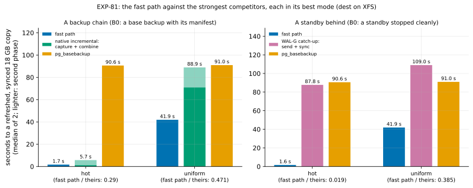

# EXP-81: The fast path against native incremental and WAL-G catch-up, each in its best mode, beyond memory

Status: **done October 28, 2026: every prediction held.** Beyond memory, on XFS:
- **Against native incremental in its best mode:** the fast path took 0.29 of its time for hot rows (1.7 s against 5.7 s) and 0.47 for uniform ones (41.9 s against 88.9 s).
- **Against WAL-G's catch-up:** 0.019 (1.6 s against 87.8 s) and 0.385 (41.9 s against 109.0 s).
- **Correctness:** all 16 copies were correct.

Pre-registered before the registered run (pilots are listed below); one `ha` VM pair, about 1.5 hours. It is research loop 2's next step: the scorecard's open rows against the strongest competitors.

## Question

**Research loop 2's scorecard left two comparisons open:**
- **A backup chain** (an earlier backup with its manifest, WAL summaries on): PostgreSQL 17's own incremental backup, `pg_basebackup --incremental` then `pg_combinebackup`. It beat pgdelta's hashing in all 42 cells of EXP-04b, in memory, and was never timed against the fast path.
- **A standby behind, with no archive:** WAL-G's catch-up updates a stopped standby in place by page LSN. It was never timed at all.

**The question: beyond memory, on the same disks, is the fast path faster than each competitor in its best mode, and by how much?**

## What each competitor does (from its source, PostgreSQL 17 and WAL-G 3.0.9)

**Native incremental:**
- **The capture** (`basebackup.c`, `sendFile`) reads each changed block with its own 8 KiB read, one after another, in one server process. A file with more than 90% of its blocks changed is sent whole.
- **The combine** (`reconstruct.c`) writes a new directory. Every relation file with a changed block is rebuilt block by block. With `--copy-file-range`, each block is copied by `copy_file_range`, which on XFS with reflinks shares the block instead of copying it. Files with no changed block are copied whole the same way.
- **Correction to research loop 2:** it said the copy options apply only to whole unchanged files. That holds for `--clone` and `--link`; `--copy-file-range` shares the rebuilt files' blocks too (EXP-36 saw it as "sharing blocks").

**WAL-G's catch-up** (`catchup_send_recieve_handler.go`, `pagefile.go`):
- **Its start:** the standby sends its control file and its file list. The source takes every page whose LSN is at or after the standby's latest checkpoint location. So the standby must be stopped cleanly. (A base backup's control file can name a checkpoint later than its start.)
- **Its reading:** a file is skipped only if its modification time equals the standby's copy's exactly. A standby made by `pg_basebackup` never matches. So every relation file is read in full on the source, and its new pages sent, compressed with Brotli.
- **Its writing:** the receiver writes pages in place and syncs nothing (`ApplyFileIncrement(..., fsync false)`). Its standby keeps `standby.signal` and its own `postgresql.auto.conf`, and replays from the source when started.

## Pilots, before this registration (scale 20; not scored)

- **Every arm ran and every copy matched** (1 run each, hot and uniform), WAL-G's standby included once it had replayed.
- **Native incremental's best mode was settled by a pilot** on one B0 and a 1% scattered change. From an unsynced capture (`--no-sync`), XFS has to write each changed block out before it can share it, one block at a time:

  | Capture | Combine | Capture (s) | Combine (s) |
  |---|---|---|---|
  | `--no-sync` | `--copy-file-range` | 1.16 | **8.62** |
  | synced (fsync, the default) | `--copy-file-range` | 1.24 | **0.75** |
  | synced (syncfs) | `--copy-file-range` | 1.20, 1.18 | 0.76, 0.77 |
  | synced (fsync) | `--clone` | 1.21 | 3.01 |

  So the capture is synced, as by default, and the combine uses `--copy-file-range`.

## Design

**The lab:** EXP-70's (`experiments/network/lab_exp64.sh`), with new arms and modes committed before this registration.

**The setting:**
- the `ha` set (n2d-highcpu-8, 150 GiB balanced PDs, us-west1-b and -c), EXP-48's 18 GB database (scale 600), PostgreSQL 17.11, WAL-G 3.0.9 (its published SHA-256 checked), pgdelta at this commit, `SERIES=1`;
- **dest's `/data` on XFS with reflinks** (`reformat_dest_xfs.sh`), which native incremental's best mode needs. Every arm runs on it, so the fast path is timed on XFS here; its earlier cells were on ext4.

**Two old copies per cell, both taken before the change:**
- **B0, a base backup with its manifest, never started:** a backup chain's last link.
- **B0s, a standby** (`pg_basebackup -R`), started, caught up and stopped cleanly.

Each run that changes its old copy starts from a real copy of it (`cp --reflink=never`). Native incremental reads B0 itself and writes a new directory.

**The arms:**

| Arm | Old copy | What runs | Time to |
|---|---|---|---|
| `fast8wf2` | B0 | The fast path, today's defaults (8 reader threads, the fsync worker, gaps of up to 2 pages filled) | B refreshed in place and synced |
| `incr` | B0 | `pg_basebackup --incremental=B0/backup_manifest -X stream -c fast`, then `pg_combinebackup B0 inc -o out --copy-file-range --manifest-checksums=NONE --sync-method=syncfs` | A new directory, synced |
| `full` | — | `pg_basebackup -X stream -c fast` | A new copy, synced |
| `sb_fast8wf2` | B0s | The fast path, as above | B refreshed in place and synced |
| `sb_walg` | B0s | `wal-g catchup-receive` on dest, `wal-g catchup-send` on the source, then `sync -f` on dest | B refreshed in place and synced |

**The cells:** `hot` and `uniform` (EXP-64's changes, about 64 s and 460 s of load on the source).

**Runs:** 2 per arm, shuffled per cell (seed 810); 20 runs.

**Every copy is checked:** started, and its `pgbench_accounts` compared with the source's.
- **The fast path's copies and native incremental's output** recover from their `backup_label`.
- **WAL-G's** stays a standby, and is read once it has replayed to the source's current LSN.

**The smoke** at scale 20 (seed 812) decides nothing: every run exits 0, every copy matches, both fast arms used the fast path.

**The command:**

    PATTERNS="hot uniform" ARMS="fast8wf2 incr full sb_fast8wf2 sb_walg" STANDBY_TOO=1 SERIES=1 OUT=/data/exp04-results/exp81 lab_exp64.sh SOURCE 2 810

**The analysis,** committed before the data: `analysis/exp81.py`, dry-run on the pilot's runs. Data `docs/experiments/data/exp81-cells.csv`, figure `exp81-competitors`.
- **The dry run gave** 0.90 (hot) and 0.32 (uniform) for prediction 1, and 0.24 and 0.59 for prediction 2.
- **It predicts little:** at scale 20 the whole database (600 MB) is in memory, and every relation file is small, so the combine rebuilds most of the database. At scale 600 only the changed 1 GB segments are rebuilt, and the reads go to a cold disk.

## Predictions

**What the source code and earlier sessions imply (inferred, not measured at this size):**
- **Native incremental, hot:** a capture of a few seconds, plus a combine that shares about 2–3 GB of rebuilt files block by block (about 20 µs a block in the pilot). About 7–13 s against the fast path's 2 s: a ratio of 0.15–0.3.
- **Native incremental, uniform:** the capture reads about 620,000 blocks one at a time from a cold disk, at roughly 0.3–0.7 ms each; EXP-64's single-reader fast path averaged about 0.67 ms a request. Then it rebuilds about 9 GB of files. About 250–450 s against the fast path's 42 s: 0.1–0.17.
- **WAL-G:** it reads all 18 GB on the source (about 86 s at 210 MB/s). In uniform it then compresses about 5 GB of pages with Brotli on one core and syncs them on dest. About 90 s (hot) and 130–200 s (uniform): ratios of about 0.02 and 0.2–0.33.

**Scored:**
1. **Deciding: the fast path takes at most 0.80 of native incremental's time in both cells** (`fast8wf2` over `incr`, medians).
2. **The fast path takes at most 0.80 of WAL-G catch-up's time in both cells** (`sb_fast8wf2` over `sb_walg`, with WAL-G's sync).
3. **Correctness:**
   - every run exits 0, and every copy matches the source: the fast path's, native incremental's and WAL-G's;
   - `fast8wf2` was proven by B0's backup manifest, and `sb_fast8wf2` by "clean shutdown in recovery".

**Why 0.80:** a clear win, beyond the proxy's error (rule 13) and the noise (rule 17: 2.08% within a session for runs of 10 s or more, 7.54% under). A ratio within 0.05 of 0.80 gets a second session (rule 11).

**Reported, not predicted:**
- each competitor's phases: native incremental's capture and combine and the incremental's size; WAL-G's catch-up and its sync;
- the bytes each arm moved over the network (dest's received bytes), and both disks' reads, writes and busy time;
- every arm over `pg_basebackup`;
- the fast path on XFS against its ext4 cells (EXP-79b: 42.17 s uniform; EXP-80b: 2.03 s hot).

## The rules this session runs under

- **Rule 13:** this measures competitors, not a candidate change, so no local ratio promotes anything. The pilots checked the harness and settled native incremental's best mode. A proxy-fidelity pair is logged where one exists: the fast path's ext4 cells against these.
- **Rule 15:** not a milestone; no held-out cell is used.
- **Rule 16:** `analysis/integrity.py register EXP-81` records the analysis, the lab, the disk sampler and pgdelta's modules as of this commit. The check at the write-up explains any change.
- **Rule 17:** above.

## What follows

- **If 1 and 2 hold:** research loop 2's two open rows become measured wins, against the competitor's best mode. RESULTS and the scorecard say by how much, and where each competitor's time goes.
- **If 1 fails in a cell:** native incremental is the faster refresh of a backup chain there. The claim narrows to copies without one, and the phases show which of its steps won.
- **If 2 fails:** the same for WAL-G and stopped standbys.
- **If 3 fails:** the failing arm's result is not scored until its run is understood. If it is pgdelta's, the fast path's claim is withdrawn.

## Results

**The session:** the pilots' VMs (`ha` set, us-west1-b and -c), dest's `/data` on XFS with reflinks.
- **Two launches stopped before any run,** at the pipeline's own check that dest was XFS with reflinks. `xfs_info` needs root's PATH. The disk was as reformatted (`reflink=1`).
- **The smoke** at scale 20 passed: 10 runs, every copy matched, both fast arms used the fast path, the series recorded.
- **The registered runs** took 02:24–03:25 UTC October 29, and the VMs were then deleted.
- **Data:** `docs/experiments/data/exp81-cells.csv`; raw `results/exp04/exp81/` (not in git).

**Scorer integrity (rule 16):** `analysis/integrity.py check EXP-81` reports 12 of 13 files unchanged since the registration commit (7a2f9c9). The one change is to `analysis/exp81.py`: one line raising the figure's axis to clear its legend, after the data. It changes no score.

*How to read it:* the seconds to a refreshed, synced 18 GB copy (median of 2), per cell. On the left, a backup chain: the fast path, native incremental (dark: its capture; light: its combine) and `pg_basebackup`. On the right, a standby stopped cleanly: the fast path, WAL-G's catch-up (dark: send; light: sync, too thin to see) and `pg_basebackup`.

**A backup chain (B0, a base backup with its manifest):**

| Cell | Arm | Seconds (median) | The runs | Phases | Network in (MB) | Source read (GB) | Dest written (GB) |
|---|---|---|---|---|---|---|---|
| hot | **fast path** | **1.66** | 1.67, 1.65 | | 121 | 0.10 | 0.12 |
| hot | native incremental | 5.73 | 5.69, 5.77 | capture 1.17 s, combine 4.56 s; 121 MB incremental | 106 | 0.10 | 0.12 |
| hot | `pg_basebackup` | 90.59 | 90.61, 90.58 | | 17,861 | 17.8 | 17.8 |
| uniform | **fast path** | **41.89** | 41.90, 41.89 | | 7,047 | 7.36 | 7.05 |
| uniform | native incremental | 88.90 | 90.00, 87.80 | capture 70.92 s, combine 17.98 s; 5.13 GB incremental | 5,133 | 8.43 | 5.14 |
| uniform | `pg_basebackup` | 90.96 | 91.04, 90.88 | | 17,923 | 17.9 | 17.9 |

**A standby behind (B0s, stopped cleanly before the change):**

| Cell | Arm | Seconds (median) | The runs | Phases | Network in (MB) | Source read (GB) | Dest written (GB) |
|---|---|---|---|---|---|---|---|
| hot | **fast path** | **1.63** | 1.67, 1.59 | | 121 | 0.10 | 0.12 |
| hot | WAL-G catch-up | 87.75 | 87.73, 87.78 | send 87.74 s, sync 0.01 s | 17 | 17.8 | 0.11 |
| uniform | **fast path** | **41.92** | 41.93, 41.91 | | 7,047 | 7.36 | 7.05 |
| uniform | WAL-G catch-up | 109.00 | 109.13, 108.88 | send 108.99 s, sync 0.02 s | 750 | 17.9 | 5.06 |

| # | Prediction | Result |
|---|---|---|
| 1 | **Deciding:** the fast path at most 0.80 of native incremental's time in both cells | **Held: 0.290 (hot), 0.471 (uniform)** |
| 2 | At most 0.80 of WAL-G catch-up's time in both cells | **Held: 0.019 (hot), 0.385 (uniform)** |
| 3 | Every run exits 0; every copy matches (the fast path's, native incremental's, WAL-G's); `fast8wf2` proven by B0's manifest, `sb_fast8wf2` by "clean shutdown in recovery" | **Held:** 20 of 20 exited 0; 16 of 16 copies matched; 4 of 4 proofs each |

**Where each competitor's time goes (reported):**
- **Native incremental, uniform:**
  - **The capture took 71 s of its 89 s.** It read 8.4 GB from the source's disk in about 150,000 requests, one at a time, for 5.1 GB of changed blocks. The kernel's readahead merged its 8 KiB reads within each file, so it issued far fewer requests than blocks; my inference had assumed it would not, and put the capture at 250–450 s. The fast path read 7.4 GB in 88,000 requests, on 8 reader threads, in 35 s of source-disk time.
  - **The combine took 18 s,** sharing about 9 GB of rebuilt files block by block on XFS.
  - **In all, 0.977 of `pg_basebackup`'s time.** Beyond memory, at 27% of the pages, native incremental in its best mode is barely faster than a full copy.
- **Native incremental, hot:** a 1.2 s capture and a 4.6 s combine, against the fast path's 1.7 s in all. The combine rebuilt each changed 1 GiB segment in a new directory, even for a few changed pages.
- **WAL-G catch-up:**
  - **It read all of the source** (17.8–17.9 GB, 85 s of disk time) in both cells, since a standby's file times never match the source's.
  - **In hot it sent 17 MB,** Brotli-compressed, in 87.8 s; in uniform, 750 MB in 109.0 s.
  - **Its sync took 0.01–0.02 s:** the kernel had already written its 5 GB back during the send.
  - **Against `pg_basebackup`:** 0.97 (hot) and 1.20 (uniform). In uniform WAL-G is slower than a full copy.
- **The inferred ratios against the measured:**
  - **Native incremental:** hot 0.15–0.3 against 0.29; uniform 0.1–0.17 against 0.47. The capture's readahead was the miss.
  - **WAL-G:** about 0.02 against 0.019; 0.2–0.33 against 0.385, since its uniform run took 109 s against the 130–200 s inferred.
- **The fast path on XFS** took 1.66 s and 41.89 s, against 2.03 s (EXP-80b) and 42.02 s on ext4. `pg_basebackup` took the same on both filesystems (90.6–91.0 s here; 90.8–91.0 s in EXP-80b).
- **Rule 17's noise:** within the session, two runs of a cell differed by at most 2.5% (native incremental's uniform: 90.0 and 87.8 s), and by under 0.6% everywhere else on runs of 10 s or more. Every margin here is many times that.

**The bytes:** native incremental moved the fewest uncompressed bytes in uniform (5.1 GB against the fast path's 7.0 GB, whose gap filling sends more pages for fewer requests). WAL-G moved the fewest bytes of all (0.75 GB, compressed), at the cost of reading the whole source. On these links bytes didn't decide it; on slow ones they would.

## What followed

- **Research loop 2's two open rows are measured wins,** each against the competitor's best mode:
  - **a backup chain:** 0.29 and 0.47 of native incremental's time;
  - **a stopped standby:** 0.019 and 0.385 of WAL-G's.
  - RESULTS, the README and the scorecard say so.
- **No second session is owed** (rule 11): the deciding ratios are 0.33 and 0.51 below the bar.
- **A loss this session shows, across sessions: copies without WAL summaries.**
  - WAL-G's catch-up needs no summaries. It took 109.0 s for uniform here, where pgdelta's hashing took 180.1 s for the same cell in EXP-80b (ext4; a crashed standby, but hashing doesn't depend on that). In hot both read everything: 87.8 s against 87.9 s.
  - So for `summarize_wal` off, the competitor to beat is page-LSN selection on the source. It reads all of S once, and none of B.
  - The idea archive gains that as a structurally different idea for the summaries-off row (rule 14), with its prerequisites: B's end proven, as the guard already does.
