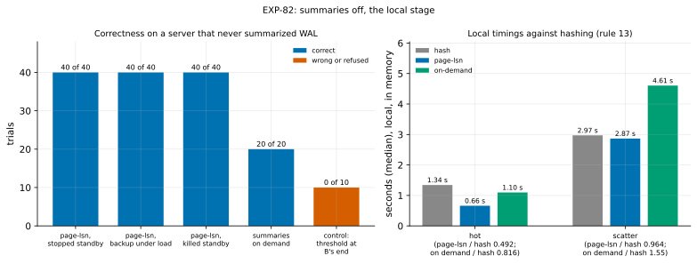

# EXP-82: Summaries off, the local stage: are page-lsn and summaries on demand correct, and do they beat hashing?

Status: **done October 29, 2026: predictions 1–3 held, 4 failed for both candidates.**
- **Correct:** on a server that never summarized WAL, 120 of 120 page-lsn refreshes (failure rate below 2.47% at 95%) and 20 of 20 refreshes with summaries turned on at refresh time.
- **The negative control:** 10 of 10 copies with the threshold at B's end came out wrong.
- **Locally, in memory:** page-lsn took 0.49 of hashing's time for hot changes but 0.96 for scattered ones, and on demand took 0.82 and 1.55. So neither is promoted on local evidence. As registered, both go to the VMs on research loop 3's bound.

Pre-registered before the registered runs (a smoke and the harness's pilots are listed below). Local, about an hour. It is [research loop 3](../research/2026-10-29-research-loop-3.md)'s local stage under rule 13 ([WORKFLOW.md](../WORKFLOW.md)), with EXP-82b on the VMs to follow if it passes.

## Question

**Research loop 3 built two candidates for a server that doesn't summarize WAL:**
- **`--fast-path page-lsn`:** pages chosen by their LSN on the server, at or past B's redo point. It reads all of S and none of B.
- **Summaries on demand:** `summarize_wal` turned on at refresh time; PostgreSQL 17 then summarizes from the oldest WAL still on disk, and the existing fast path runs.

**The question: across randomized old copies, under a load with DDL, are both correct, does a wrong threshold show up as wrong copies, and are both faster than hashing on a local scale model?**

## Design

**The correctness campaign** (`experiments/summaries_off/trials.py`) uses one local source S:
- **The server:** PostgreSQL 17.11, data checksums, **`summarize_wal` off**; checkpoints every 30 s and on 64 MB of WAL, so restart points fall between a copy's redo point and its end; `wal_keep_size` 1 GB; pgbench at scale 4.
- **The load:** EXP-80's (pgbench on 4 clients with side-table DDL: `CREATE TABLE AS`, `TRUNCATE` and refill, `DELETE` plus `VACUUM`, `VACUUM FULL`). Now and then it also creates a database with `STRATEGY FILE_COPY` or `WAL_LOG` and drops the previous one.
- **Arms, in a shuffled order (seed 820):**

| Arm | Trials | The old copy B | Refreshed by |
|---|---|---|---|
| `lsn-standby` | 40 | A standby stopped cleanly mid-load | page-lsn |
| `lsn-backup` | 40 | A base backup taken while the load runs (its pages may be stale or torn past its start) | page-lsn |
| `lsn-crashed` | 40 | A standby killed mid-load (`pg_ctl -m immediate` or SIGKILL) | page-lsn with `--crashed-standby` |
| `on-demand` | 20 | A stopped standby or a base backup, as above | `summarize_wal` turned on, then the summaries' fast path |
| `lsn-backup-end` (negative control) | 10 | A base backup under a heavier load (8 clients), no load after, its `backup_label` start moved to its end | page-lsn |

- **Between B and the refresh:** 1–6 s more load (none for the control).
- **After each on-demand trial,** `summarize_wal` is turned off again and its summaries removed, so every on-demand trial starts from a server that never summarized.
- **The negative control** gives page-lsn the threshold it would take if it used B's end instead of its redo point. Pages changed during the backup, and stale in B, then stay unsent.
- **Each refreshed copy** is started without a signal file and compared with S: every pgbench table's rows by md5, the history's count and sum, each side table's row count. It is also checked with `pg_amcheck --all --heapallindexed`, which covers the created databases too.

**The local timings** (`experiments/summaries_off/timing.py`) use one local source:
- **The server:** PostgreSQL 17.11, checksums, `summarize_wal` off, the VMs' WAL settings (`checkpoint_timeout` 30 min, `max_wal_size` 4 GB, `wal_keep_size` 8 GB), pgbench at **scale 100** (about 1.5 GB).
- **Two cells, in order,** each with its own B0, a base backup taken before the change:
  - **hot:** 1% of the rows, contiguous, updated in batches of 1,000;
  - **scatter:** 0.5% of the rows, chosen by a hash of the key, about a quarter of the heap's pages.
- **Arms:**
  - `hash`, no fast path (today's path);
  - `page-lsn`;
  - `on-demand`, timed from before the setting is turned on until the refresh ends.
- **Runs:** 2 per arm, shuffled per cell (seed 821). Every copy is checked as above.
- **The Mac holds the database in memory** and its caches can't be dropped: this is a scale model's ratio, not the VMs' time.

**Pilots and the smoke (not scored):**
- **The harness's first run** (7 trials, seed 829): every page-lsn and on-demand copy was correct. Both negative-control copies were wrong (rows unequal, `pg_amcheck` failing).
- **The timing script at scale 5** (86 MB): every arm took 0.38–0.43 s, all fixed costs, with ratios 0.96–1.03. So the timed stage uses scale 100.

**The commands:**

    .venv/bin/python experiments/summaries_off/trials.py --per-arm 40 --on-demand 20 --controls 10 --seed 820
    .venv/bin/python experiments/summaries_off/timing.py --scale 100 --repeats 2 --seed 821

**The analysis,** committed before the data: `analysis/exp82.py`, dry-run on the smoke's outputs. Data `docs/experiments/data/exp82-trials.csv` and `exp82-timing.csv`, figure `exp82-local`.

## Predictions

1. **Deciding: all 120 page-lsn trials** (40 of each kind of old copy) are refreshed by page-lsn with the expected proof and come out correct: exit 0, rows equal to S's, `pg_amcheck` clean. The proofs: "clean shutdown in recovery", "backup_manifest" and "crashed standby". One failure fails it. With none, the failure rate is below 2.5% at 95%.
2. **All 20 on-demand trials** take the summaries' fast path (the summaries built back from the oldest WAL cover B's redo point) and come out correct.
3. **The negative control:** at least 8 of its 10 copies come out wrong. That shows the check can see a wrong copy, and that the threshold must be the redo point.
4. **Rule 13's promotion:** page-lsn, and separately on demand, each at most 0.80 of hashing's time in both cells (medians). An arm that holds goes to the VMs (EXP-82b) on local evidence.

**Reported, not predicted:**
- the WAL since each B0, against the database's size;
- the pages each arm sent;
- each arm's time.

**If 4 fails for an arm:**
- **The local model shows only part of the effect.** In memory, hashing's cost is CPU, not the disk reads of B that research loop 3's bound turns on.
- **The arm then goes to the VMs only on that bound,** from the VMs' measured disk rates, with the reason recorded. It is not promoted on local evidence.
- **The local/VM pair** is logged in `proxy-fidelity.csv` either way, after EXP-82b.

## The rules this session runs under

- **Rule 13:** the local stage, as above.
- **Rule 15:** not a milestone.
- **Rule 16:** `analysis/integrity.py register EXP-82` records the analysis, both harnesses, EXP-80's lab they build on, and pgdelta's modules under test. The negative control is prediction 3.
- **Rule 17:** for local runs under 10 s, the noise bar is 7.11% (from the VMs); the bar of 0.80 is far outside it.

## What follows

- **If 1–3 hold:** both candidates are correct across these copies. EXP-82b times them on the VMs beyond memory, against hashing and WAL-G's catch-up, per prediction 4 or the bound.
- **If 1 fails:** the failing trials show where page-lsn's rule breaks, and it goes no further.
- **If 2 fails:** summaries on demand are not a usable route as built; the failing trials show why.
- **If 3 fails:** the campaign can't tell a wrong copy from a right one in this setting, so 1 and 2 decide nothing until it can.

## Workflow check

| | Check | For this experiment |
|---|---|---|
| 1 | Situation, standard, competitor | Summaries off: re-clone or replay as standard; WAL-G and `pg_probackup catchup` as competitors. Hashing loses to WAL-G for scattered changes (research loop 3) |
| 2 | The bottleneck | B's full read (EXP-80b's disk counters) |
| 3 | Systems or algorithm | Algorithm: the bound of \|S\| / R, or the WAL where it is kept |
| 4 | Papers and prior art | Research loop 3's prior-art report: `pg_probackup`'s redo threshold, pg_rewind's checksum condition, PostgreSQL's whole-fork rules, the summarizer's start |
| 5 | Committee-grade evidence | Pre-registered; a negative control; failure-rate bounds |
| 13 | The cascade | This is the local stage; the bar is 0.80 |
| 14 | The idea archive | Both candidates are archived "in test"; mtime skipping rejected for now |
| 15 | Held-out workloads | Not owed |
| 16 | Scorer integrity | Recorded at registration; the negative control |
| 17 | The noise bar | 7.11% under 10 s |

## Results

**Setup:** PostgreSQL 17.11 on the Mac. 130 correctness trials in a shuffled order, then the timings at scale 100 (1,576 MB). Data: `docs/experiments/data/exp82-trials.csv` and `exp82-timing.csv`.

**Scorer integrity (rule 16):** `analysis/integrity.py check EXP-82` reports 11 of 11 files unchanged since the registration commit (4d4ac41).

*How to read it:* on the left, per arm, the trials whose copy came out correct (blue) and wrong (red). The control is meant to be wrong. On the right, each arm's median time in the two local cells, in memory.

| # | Prediction | Result |
|---|---|---|
| 1 | **Deciding:** all 120 page-lsn trials refreshed by page-lsn with the expected proof, and correct | **Held:** 40 of 40 stopped standbys ("clean shutdown in recovery"), 40 of 40 base backups taken under load ("backup_manifest"), 40 of 40 killed standbys ("crashed standby"); failure rate below 2.47% at 95% |
| 2 | All 20 on-demand trials take the summaries' fast path and are correct | **Held:** 20 of 20, from stopped standbys and from base backups |
| 3 | At least 8 of the 10 negative controls wrong | **Held:** 10 of 10 wrong (rows unequal in all 10; `pg_amcheck` failing in 7) |
| 4 | page-lsn, and on demand, each at most 0.80 of hashing's local time in both cells | **Failed for both:** page-lsn 0.492 (hot), 0.964 (scatter); on demand 0.816 (hot), 1.55 (scatter) |

**The local timings** (medians of 2, seconds; every copy correct):

| Cell | WAL since B0 | Hashing | page-lsn | On demand |
|---|---|---|---|---|
| hot | 63 MB | 1.34 (1.44, 1.25) | **0.66** (0.67, 0.65) | 1.10 (1.10, 1.09) |
| scatter | 552 MB | 2.97 (2.13, 3.81) | 2.87 (3.04, 2.69) | 4.61 (4.57, 4.64) |

**Reported:**
- **Why 4 failed:** in memory, hashing's cost is CPU on 4 processes, not the disk reads of B that the VMs' bound turns on.
  - **page-lsn's own costs here:** reading S and re-reading its chosen pages from the cache, then sending them. That nearly equals hashing's for scattered changes. page-lsn sent 94,603 pages to hashing's 69,010: it sends every page changed since B's redo point, while hashing sends only those that differ, and pages carry hint-bit full-page images too.
  - **On demand pays for the summarizer** reading the WAL since B0 (552 MB for scatter) before the fast path starts.
  - **Hashing's two scatter runs differed by 56%** (2.13 and 3.81 s), far beyond rule 17's bar, so that cell's ratios are loose either way.
- **The page-lsn refreshes in the correctness campaign** took a median 0.63 s, at scale 4.

## What followed

As registered for 1–3 holding and 4 failing:
- **Both candidates are correct** across stopped standbys, base backups taken under load and killed standbys, under a load with DDL and created databases. The threshold must be B's redo point: the negative control shows B's end gives wrong copies.
- **Neither is promoted on local evidence.** Both go to the VMs on research loop 3's bound, from the VMs' measured disk rates: there hashing is bound by reading B on the disk that takes the writes (EXP-80b), which the Mac in memory doesn't show. EXP-82b times them on the ha set beyond memory, against hashing and WAL-G's catch-up.
- **The local/VM pairs** go into `proxy-fidelity.csv` after EXP-82b. This is the first case where the proxy is expected to mislead: in memory, it has no disk.
