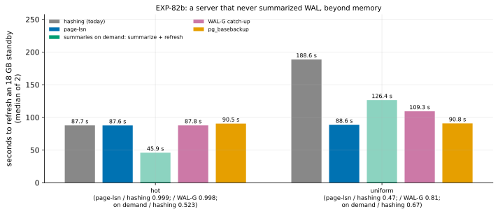

# EXP-82b: Summaries off on the VMs: page-lsn and summaries on demand against hashing and WAL-G

Status: **done October 29, 2026: predictions 1–3 held; 4 and 5 failed, because the on-demand arm didn't measure what it was registered to.**
- **page-lsn, beyond memory:**
  - 0.470 of hashing's time in uniform (88.6 s against 188.6 s) and 0.999 in hot;
  - 0.81 of WAL-G's catch-up in uniform (109.3 s) and 0.998 in hot;
  - every copy correct.
- **The deviation, found after the run:** the source summarized WAL throughout. `run_study.py`'s base configuration sets `summarize_wal = on` for every VM source since EXP-64, which `SUMMARIES=0` did not override. page-lsn, hashing and WAL-G don't read summaries, so their timings stand. The on-demand runs are not summaries on demand, and are re-run in EXP-82c with the lab fixed.

Pre-registered before any run; one `ha` VM pair, about 1.7 hours with the data load. It is [research loop 3](../research/2026-10-29-research-loop-3.md)'s VM stage. EXP-82 found both candidates correct, but not promoted on local evidence (in memory, hashing costs CPU, not B's disk reads). As EXP-82 registered, they come here on the loop's bound.

## Question

**On a server that never summarized WAL,** with the old copy beyond memory:
- does page-lsn beat hashing by reading S and not B, and reach parity with WAL-G's catch-up, as the bound says;
- and where the WAL since B is kept, do summaries on demand beat both?

## The bound, from measured rates (research loop 3)

| Arm | What it reads | Expected, hot | Expected, uniform |
|---|---|---|---|
| Hashing | All of B and all of S; in uniform, B's read and the writes share dest's disk | 87.9 s (EXP-80b) | 180.1 s (EXP-80b) |
| WAL-G catch-up | All of S | 87.8 s (EXP-81, XFS) | 109.0 s (EXP-81, XFS) |
| page-lsn | All of S (\|S\| / R ≈ 85 s), B never | 86–92 s | 88–100 s |
| Summaries on demand | The WAL since B's redo point (0.4–0.55 GB hot; about 12 GB uniform, EXP-81's runs), then the summaries' fast path (1.7 s; 42 s) | 4–12 s | 100–125 s, if the summarizer reads 12 GB in 60–80 s |

## Design

**The lab:** EXP-81's (`experiments/network/lab_exp64.sh`), with modes committed with this registration.
- **The setting:** the `ha` set (n2d-highcpu-8, 150 GiB balanced PDs, ext4, us-west1 first), EXP-48's 18 GB database, PostgreSQL 17.11, data checksums, BLAKE3 and WAL-G 3.0.9 (its published SHA-256 checked) on both VMs, pgdelta at this commit; `SERIES=1`.
- **`SUMMARIES=0`:** the source's `summarize_wal` stays off; it never summarizes.
- **`SLOT=1`:** before each cell's old copies are taken, a physical replication slot is reserved on the source, so the source keeps exactly the WAL since their redo points. The summarizer starts at the oldest WAL on disk, so `wal_keep_size` would make it read older WAL too.
- **`STANDBY_TOO=1`:** B0s, a standby caught up and stopped cleanly before the change. Every arm but the full copy refreshes a real copy of it.

**The arms:**

| Arm | What runs | Timed |
|---|---|---|
| `sb_hash` | pgdelta with no fast path: it hashes both copies (today's path) | The refresh |
| `sb_lsn` | `--fast-path page-lsn`, 2-page gaps filled, the fsync worker | The refresh |
| `sb_od` | `summarize_wal` turned on (`ALTER SYSTEM`, a reload); the summarizer waited for until it has read up to the source's LSN at that moment; then `--fast-path summaries` with its defaults. Afterwards the setting is reset and its summaries removed | From before the setting is turned on |
| `sb_walg` | WAL-G's `catchup-receive` and `catchup-send`, then `sync -f` | Both |
| `full` | `pg_basebackup` | The copy |

- **The cells:** `hot` and `uniform`.
- **Runs:** 2 per arm, shuffled per cell (seed 822); 20 runs.
- **Every copy** but the full one is started and its `pgbench_accounts` compared with the source's. WAL-G's stays a standby and is read once it has replayed.
- **The smoke** at scale 20 (seed 823) decides nothing: every run exits 0, every copy matches, page-lsn and on demand used their fast paths, and the series were recorded.

**The command:**

    PATTERNS="hot uniform" ARMS="sb_hash sb_lsn sb_od sb_walg full" STANDBY_TOO=1 SUMMARIES=0 SLOT=1 SERIES=1 OUT=/data/exp04-results/exp82b lab_exp64.sh SOURCE 2 822

**The analysis,** committed before the data: `analysis/exp82b.py`. A dry run on EXP-81's runs (no such arms) fails 1–5, as it must. Data `docs/experiments/data/exp82b-cells.csv`, figure `exp82b-summaries-off`.

## Predictions

1. **Deciding: in uniform, page-lsn takes at most 0.70 of hashing's time** (medians). Expected 0.49–0.56.
2. **In hot, page-lsn takes at most 1.05 of hashing's.** Both read all of S; expected about 1.0.
3. **page-lsn reaches parity with WAL-G's catch-up:** at most 1.05 of its time in hot and at most 0.95 in uniform. Expected about 1.0 and 0.81–0.92.
4. **In hot, summaries on demand take at most 0.20 of hashing's time.** Expected 0.05–0.14.
5. **Correctness:**
   - every run exits 0, and every copy matches the source;
   - page-lsn was used in every run, proven by "clean shutdown in recovery";
   - on demand used the summaries' fast path, with summaries, in every run.

**Reported, not predicted:**
- on demand in uniform against hashing and page-lsn (expected slower than page-lsn: the WAL since B, about 12 GB, against \|S\|, 18 GB, plus the fast path);
- on demand's two phases, and the WAL it summarized;
- page-lsn's scan time;
- both disks' reads, writes and busy time;
- every arm against `pg_basebackup`;
- the local/VM pairs for `proxy-fidelity.csv` (EXP-82's local ratios against these).

**The noise and rule 11:**
- Rule 17's bar is 2.40% within a session for runs of 10 s or more, and 7.11% under 10 s.
- Bars 2 and 3 are parity bars, set 5% wide, outside the noise.
- A deciding ratio within 0.05 of 0.70 gets a second session.

## The rules this session runs under

- **Rule 13:** EXP-82 was the local stage. Its promotion failed, so this session runs on the bound, as EXP-82 registered. Its pairs are logged.
- **Rule 15:** not a milestone. Neither candidate becomes a default without a held-out session.
- **Rule 16:** `analysis/integrity.py register EXP-82b` records the analysis, the lab, the disk sampler and pgdelta's modules. The correctness gate is prediction 5. EXP-82's negative control showed the check sees a wrong threshold.
- **Rule 17:** above.

## What follows

- **If 1–5 hold:**
  - **Copies without summaries:** pgdelta reads only S (page-lsn) and stops losing to WAL-G. Where the WAL since B is kept, summaries on demand win outright for local changes.
  - **The scorecard's last loss** becomes parity or a win, measured. RESULTS and the scorecard say so.
  - **Choosing between the two:** the WAL since B's redo point against \|S\|. Turning that into a selector is the next step.
- **If 1 fails:** page-lsn doesn't remove hashing's bottleneck as the bound says. The disk series show where its time went.
- **If 3 fails:** the claim is "beats hashing", not "parity with WAL-G".
- **If 5 fails:** the failing arm is withdrawn until its run is understood.

## Workflow check

| | Check | For this session |
|---|---|---|
| 1 | Situation, standard, competitor | Summaries off, WAL kept or gone. Standard: replay or a re-clone; competitor: WAL-G catch-up (`pg_probackup catchup` is inferred to read as WAL-G does, not timed) |
| 2 | The bottleneck | B's full read on dest's disk (EXP-80b) |
| 3 | Systems or algorithm | Algorithm: read S only, or the WAL instead of S |
| 4 | Papers and prior art | Research loop 3's report; the summarizer's start from its source |
| 5 | Committee-grade evidence | Pre-registered; bars from measured rates; correctness per run; EXP-82's negative control |
| 13 | The cascade | The VM stage, run on the bound after a failed local promotion; the pairs are logged |
| 14 | The idea archive | Updated with EXP-82, and with B's own WAL for a slot's gap |
| 15 | Held-out workloads | Not owed: no default changes |
| 16 | Scorer integrity | Recorded at registration |
| 17 | The noise bar | 2.40% and 7.11%; parity bars at 5% |

## Results

**The session:**
- **First launch:** stopped before creating anything (gcloud signed out). After the owner signed in, the pipeline ran in us-west1-b and -c.
- **The smoke** at scale 20 passed (10 runs, every copy matched, page-lsn and on demand used their fast paths).
- **The registered runs** took 06:52–08:15 UTC, and the VMs were then deleted.
- **Data:** `docs/experiments/data/exp82b-cells.csv`; raw `results/exp04/exp82b/` (not in git).

**Scorer integrity (rule 16):** `analysis/integrity.py check EXP-82b` reports 13 of 13 files unchanged since the registration commit (dcfe448).

*How to read it:* per cell, the seconds to refresh the 18 GB standby (median of 2): hashing, page-lsn, the on-demand arm (dark: its wait for the summarizer; light: the refresh), WAL-G's catch-up and `pg_basebackup`. **The on-demand bars don't measure summaries on demand** (see the deviation below).

| Cell | Arm | Seconds (median) | The runs | Source read (GB) | Dest disk busy (s) | Dest written (GB) |
|---|---|---|---|---|---|---|
| hot | hashing (today) | 87.73 | 87.74, 87.72 | 17.8 | 86.7 | 0.12 |
| hot | **page-lsn** | **87.64** | 87.63, 87.64 | 17.8 | **1.2** | 0.13 |
| hot | WAL-G catch-up | 87.78 | 87.79, 87.78 | 17.8 | 0.4 | 0.11 |
| hot | `pg_basebackup` | 90.50 | 90.49, 90.51 | 17.8 | 84.8 | 17.8 |
| uniform | hashing (today) | 188.57 | 187.35, 189.78 | 18.4 | 160.2 | 5.07 |
| uniform | **page-lsn** | **88.56** | 88.57, 88.56 | 17.9 | **34.0** | 7.04 |
| uniform | WAL-G catch-up | 109.31 | 110.36, 108.27 | 17.9 | 59.3 | 5.06 |
| uniform | `pg_basebackup` | 90.83 | 90.83, 90.83 | 17.9 | 84.6 | 17.9 |

| # | Prediction | Result |
|---|---|---|
| 1 | **Deciding:** uniform's page-lsn at most 0.70 of hashing's time | **Held: 0.470** (expected 0.49–0.56) |
| 2 | hot's page-lsn at most 1.05 of hashing's | **Held: 0.999** |
| 3 | page-lsn at most 1.05 of WAL-G's in hot, 0.95 in uniform | **Held: 0.998 and 0.810** |
| 4 | hot's on demand at most 0.20 of hashing's | **Failed: 0.523**, from runs that are not summaries on demand (below) |
| 5 | Every run exits 0, every copy matches; page-lsn used in every run ("clean shutdown in recovery"); on demand used in every run | **Failed:** 20 of 20 exited 0, 16 of 16 copies matched, page-lsn 4 of 4; on demand used its fast path in 2 of 4 |

**The deviation, and why the on-demand runs don't count.**
- **The source summarized all along.** The VM source clusters are built by `source_cluster.py` on `run_study.py`'s base configuration, which has had `summarize_wal = on` since EXP-64. The lab's own line for it was redundant. `SUMMARIES=0` only skipped that line, so the source summarized throughout.
- **The data show it.** The source reported a summarizer position at set-up (6/604584B8); a server that never summarized reports 0/0, as a local probe showed. And every page-lsn run recorded the summarizer's position at its guard.
- **The first on-demand run in each cell** (2.9 s hot, 43.1 s uniform) found the summaries already made: its wait took 1.2 s. It was the summaries' fast path, not summaries on demand.
- **The cleanup's `ALTER SYSTEM RESET`** fell back to the base file's `on`, so the summarizer never stopped. Deleting its summaries left a gap from B's redo point. The second run in each cell was refused ("the WAL summaries do not cover"), and pgdelta hashed (88.9 s, 209.8 s), correctly.
- **page-lsn, hashing and WAL-G read no summaries,** so the deviation doesn't touch them. page-lsn's statistics show it used none (its plan came from page LSNs alone: 0 summaries read).
- **Post-hoc local probes** (two on-demand cycles on one old copy, with `wal_keep_size` and with a reserved slot) show the mechanism itself works on a source that never summarized. After a reset the summarizer starts again from the oldest WAL on disk, and both refreshes ran.

**Reported:**
- **page-lsn never read B.** Dest's disk was busy 1.2 s (hot) and 34.0 s (uniform), against hashing's 86.7 s and 160.2 s. Its scan of S took 86.7–86.9 s, the bound \|S\| / R.
- **Against a re-clone, page-lsn ties:** 0.968 (hot) and 0.975 (uniform) of `pg_basebackup`'s time. Both read all of S. page-lsn writes only what changed (0.13 and 7.0 GB against 17.8 GB) and keeps B in place.
- **WAL-G's catch-up** took 87.8 s and 109.3 s, as in EXP-81 on XFS (87.8 and 109.0 s).
- **Rule 17's noise:** two runs of a cell differed by at most 1.9% (WAL-G's uniform). Hashing's uniform runs differed by 1.3%.
- **Rule 13's proxy-fidelity pairs for page-lsn over hashing:**
  - **hot:** local 0.492, VM 0.999;
  - **scatter/uniform:** local 0.964, VM 0.470.
  - Both lie far outside the band of 0.875–1.185 that rule 13's bar was drawn from. As EXP-82 registered, an in-memory model can't show a disk-bound effect. Logged with that note.

## What followed

- **page-lsn is measured beyond memory.** Where summaries are off and the WAL is gone:
  - it takes 0.47 of hashing's time for scattered changes and ties for local ones;
  - it reaches parity with WAL-G's catch-up (0.998) for local changes and beats it for scattered ones (0.81);
  - it ties a re-clone, while writing only what changed.
  - The scorecard's summaries-off row against WAL-G becomes a win (scattered) and parity (local). Against a re-clone it is a tie: the bound (all of S read) is the algorithm's limit. It stays opt-in until a held-out session.
- **Summaries on demand are not yet measured on the VMs.** The lab now turns `summarize_wal` off with `ALTER SYSTEM`, restarts the source and clears its summaries, checks that the summarizer never ran, and sets the value off rather than resetting it after each on-demand run. EXP-82c re-runs the on-demand arm, with page-lsn and hashing beside it.
- **No second session is owed for page-lsn** (rule 11): the deciding ratio is 0.23 below its bar.
