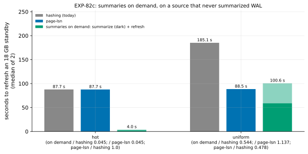

# EXP-82c: Summaries on demand on the VMs, on a source that never summarized

Status: **done October 29, 2026: every prediction held.** On a source that never summarized WAL (checked at set-up), with a slot keeping the WAL since the old copy:
- **Turning `summarize_wal` on and refreshing by the summaries' fast path** took **3.95 s** for hot changes, against hashing's 87.7 s (**0.045**), and 100.6 s for uniform ones, against 185.1 s (0.544).
- **page-lsn, a second session,** repeated EXP-82b: 1.00 (hot) and 0.478 (uniform) of hashing's time.
- **Which is faster depends on the WAL since B against the database:** on demand is 0.045 of page-lsn's time in hot, but 1.14 in uniform, where 12 GB of WAL took 59 s to summarize.

Pre-registered before any run; one `ha` VM pair, about 1.3 hours with the data load. It re-runs [EXP-82b](EXP-82b-summaries-off-vms.md)'s on-demand arm, which was void: that source summarized throughout, because `run_study.py`'s base configuration turns `summarize_wal` on. Page-lsn and hashing run beside it, as a second session for page-lsn.

## Question

**On a source that never summarized,** with a replication slot keeping the WAL since the old copy, how long does it take to turn `summarize_wal` on, wait for PostgreSQL's summarizer to build the summaries from the oldest WAL on disk, and refresh by the summaries' fast path? Against hashing, and against page-lsn?

## Design

**EXP-82b's lab and pipeline**, with its fix committed with this registration:
- **The source as one that never summarized:** in `SUMMARIES=0` mode the lab sets `summarize_wal` off with `ALTER SYSTEM`, restarts the source, removes the summaries made during the data load, and checks that the summarizer reports no position, no process and no summary files. Otherwise the lab stops.
- **After each on-demand run,** the setting is set off (not reset, since a reset falls back to the base file's on), the summarizer waited for until it exits, and its summaries removed.

**The setting:** the `ha` set (ext4), EXP-48's 18 GB database, PostgreSQL 17.11, data checksums, BLAKE3 on both, pgdelta at this commit; `SLOT=1`, `STANDBY_TOO=1`, `SERIES=1`.

**The arms**, on B0s (a standby stopped cleanly before the change):
- `sb_hash`: no fast path;
- `sb_lsn`: page-lsn;
- `sb_od`: on demand, timed from before the setting is turned on until the refresh ends.

**Runs:** 2 per arm, shuffled per cell (seed 824); 12 runs. Every copy is started and checked against the source.

**The smoke** at scale 20 (seed 825) decides nothing. It checks:
- the set-up check passed;
- every run exits 0 and every copy matches;
- on demand and page-lsn used their fast paths.

**The command:**

    PATTERNS="hot uniform" ARMS="sb_hash sb_lsn sb_od" STANDBY_TOO=1 SUMMARIES=0 SLOT=1 SERIES=1 OUT=/data/exp04-results/exp82c lab_exp64.sh SOURCE 2 824

**The analysis,** committed before the data: `analysis/exp82c.py`. Its dry run on EXP-82b's runs flags their source as having summarized (prediction 4 fails there, as it must). Data `docs/experiments/data/exp82c-cells.csv`, figure `exp82c-on-demand`.

## Predictions

**What the bound and the local runs imply (inferred):**
- **The WAL since B's redo point** is about 0.4–0.55 GB (hot) and 12 GB (uniform), from EXP-81's and EXP-82b's runs.
- **The summarizer** read 552 MB in about 1.7 s locally, from memory. Here it reads from disk (about 210 MB/s) and decodes every record.
- **Expected on demand:** hot, 3–8 s (0.03–0.09 of hashing's 87.7 s); uniform, 90–160 s (0.48–0.85 of hashing's 188.6 s), so likely slower than page-lsn's 88.6 s.

**Scored:**
1. **Deciding: in hot, on demand takes at most 0.20 of hashing's time** (medians).
2. **In uniform, on demand takes at most 0.90 of hashing's time.**
3. **page-lsn, a second session:** at most 0.70 of hashing's time in uniform and at most 1.05 in hot (EXP-82b: 0.470 and 0.999).
4. **Correctness and the condition:**
   - the source reported no summarizer position at set-up;
   - every run exits 0, and every copy matches;
   - on demand used the summaries' fast path, with summaries, in every run;
   - page-lsn was used in every run ("clean shutdown in recovery").

**Reported, not predicted:**
- on demand against page-lsn in each cell: the crossing of the WAL since B's redo point against \|S\|, which a selector between them would use;
- on demand's two phases, and its summaries and summary rows.

**Rule 11:** a deciding ratio within 0.05 of 0.20 gets a second session.

## The rules this session runs under

- **Rule 13:** the VM stage for on demand, on the bound, as EXP-82 registered (its local promotion failed).
- **Rule 15:** not a milestone.
- **Rule 16:** `analysis/integrity.py register EXP-82c` records the analysis (and EXP-82b's, whose figure it reuses), the lab, the disk sampler and pgdelta's modules. The set-up check is the guard against EXP-82b's defect.
- **Rule 17:** 2.40% (10 s or more), 7.11% under 10 s; the bars are far outside.

## What follows

- **If 1–4 hold:** summaries on demand are measured. Where the WAL since B is kept, switching summaries on at refresh time refreshes local changes far faster than hashing, page-lsn, WAL-G or a re-clone.
- **Then a selector:** choose between on demand and page-lsn by the WAL since B's redo point against \|S\|, from this session's two cells.
- **If 1 fails:** the summarizer's cost is more than the bound says. Its phase timings show where.

## Workflow check

| | Check | For this session |
|---|---|---|
| 1 | Situation, standard, competitor | Summaries off, WAL kept: replay (standard), WAL-G catch-up (competitor, timed in EXP-81 and EXP-82b) |
| 2 | The bottleneck | Reading S (page-lsn) against reading the WAL (on demand) |
| 3 | Systems or algorithm | Algorithm: which record of change to read |
| 4 | Papers and prior art | Research loop 3: the summarizer's start from its source; Percona's bitmaps, WAL-G's delta maps and `pg_probackup` PAGE as the same mechanism |
| 5 | Committee-grade evidence | Pre-registered; EXP-82b's void arm disclosed; the condition checked at set-up |
| 13 | The cascade | The VM stage, on the bound |
| 14 | The idea archive | On demand "timing in test"; B's own WAL for a slot's gap archived |
| 15 | Held-out workloads | Not owed |
| 16 | Scorer integrity | Recorded at registration; the set-up check |
| 17 | The noise bar | As above |

## Results

**The session:**
- **Where:** the `ha` set in us-west1-b and -c (ext4).
- **The condition held:** the lab's set-up reported "summarizer at 0/0" in the smoke and in the registered run, so the source had never summarized.
- **The smoke** passed (6 runs, every copy matched, on demand and page-lsn used their fast paths).
- **The registered runs** took 08:47–09:43 UTC, and the VMs were then deleted.
- **Data:** `docs/experiments/data/exp82c-cells.csv`; raw `results/exp04/exp82c/` (not in git).

**Scorer integrity (rule 16):** `analysis/integrity.py check EXP-82c` reports 13 of 14 files unchanged since the registration commit (41d53b3). The one change is to `analysis/exp82c.py`, after the data: its own figure function instead of EXP-82b's, whose title and WAL-G label were wrong for this session. No score depends on it.

*How to read it:* per cell, the seconds to refresh the 18 GB standby (median of 2): hashing, page-lsn, and summaries on demand. On demand's bar is split into its two phases: the dark part is the wait for the summarizer, the light part the refresh.

| Cell | Arm | Seconds (median) | The runs | Phases | Source read (GB) | Dest disk busy (s) |
|---|---|---|---|---|---|---|
| hot | hashing (today) | 87.72 | 87.69, 87.75 | | 17.8 | 86.6 |
| hot | page-lsn | 87.68 | 87.65, 87.71 | | 17.8 | 1.2 |
| hot | **summaries on demand** | **3.95** | 4.07, 3.84 | summarize 2.30 and 2.26 s (0.33 and 0.48 GB of WAL), refresh 1.77 and 1.58 s | 0.33 | 3.3 |
| uniform | hashing (today) | 185.11 | 182.46, 187.76 | | 18.3 | 156.8 |
| uniform | **page-lsn** | **88.49** | 88.45, 88.53 | | 17.9 | 34.1 |
| uniform | summaries on demand | 100.64 | 100.68, 100.60 | summarize 58.9 s (11.9 GB of WAL, 203 MB/s), refresh 41.7 s | 19.1 | 52.1 |

| # | Prediction | Result |
|---|---|---|
| 1 | **Deciding:** hot's on demand at most 0.20 of hashing's time | **Held: 0.045** (expected 0.03–0.09) |
| 2 | uniform's on demand at most 0.90 of hashing's | **Held: 0.544** (expected 0.48–0.85) |
| 3 | page-lsn at most 0.70 (uniform) and 1.05 (hot) of hashing's | **Held: 0.478 and 1.000** (EXP-82b: 0.470 and 0.999) |
| 4 | No summarizer at set-up; every run exits 0 and every copy matches; on demand used its summaries and page-lsn its fast path in every run | **Held:** "0/0"; 12 of 12 exited 0 and matched; on demand 4 of 4 (2–25 summaries, 22,010 and 1,466,322 summary rows); page-lsn 4 of 4 |

**Reported:**
- **The summarizer read the WAL at the disk's rate:** 203 MB/s over 11.9 GB in uniform. In hot, 142–213 MB/s over 0.33–0.48 GB, with about a second of fixed cost (the reload, the process starting, the lab's polling over ssh).
- **On demand against page-lsn:** 0.045 in hot, 1.137 in uniform. Each reads from the same disk at about the same rate, so the choice is a sum of bytes:
  - on demand reads the WAL since B's redo point, W, then its fast path's pages;
  - page-lsn reads all of S.
  - **On demand is faster where W / R + its fast path's time is below \|S\| / R.**
    - **Uniform:** 11.9 GB / 203 MB/s = 59 s, plus 42 s, against about 88 s: page-lsn wins.
    - **Hot:** 0.5 GB in 2.3 s, plus 1.7 s: on demand wins by 22x.
  - W is known before any page is read: S's current LSN minus B's redo point.
- **Page-lsn's second session** repeated the first within 0.2 s per cell. Rule 11 needed none, but both sessions now agree.
- **Rule 17's noise:** hashing's two uniform runs differed by 2.9%, slightly over the 2.40% bar; no deciding margin is near it. Every other cell's runs differed by under 0.3% (runs of 10 s or more) or 6% (hot's on demand, under 10 s).
- **Rule 13's proxy-fidelity pairs for on demand over hashing:** local 0.816 (hot) and 1.55 (scatter), against the VMs' 0.045 and 0.544. The in-memory model again misses a disk-bound effect. Logged.

## What followed

- **Summaries on demand are measured:**
  - Where the WAL since B is kept (a slot, `wal_keep_size`, an archive), switching `summarize_wal` on at refresh time took 0.045 of hashing's time for local changes.
  - That is 0.045 of WAL-G's catch-up (87.8 s, EXP-82b) and 0.044 of a re-clone (90.5 s, EXP-82b), both across sessions on the same set.
  - It needs no change to pgdelta, only a setting the operator turns on.
- **Research loop 3's two candidates split the summaries-off row by what S kept,** and pgdelta now has a route with no loss in either:
  - **the WAL since B kept:** on demand for local changes; page-lsn where W approaches \|S\|;
  - **the WAL gone:** page-lsn (parity with or better than WAL-G, a tie with a re-clone).
- **Next:**
  - choosing between them by W against \|S\|;
  - what `summarize_wal` costs a busy server. If it costs little, the advice is to leave it on, where pgdelta's summaries path already wins (EXP-81).
