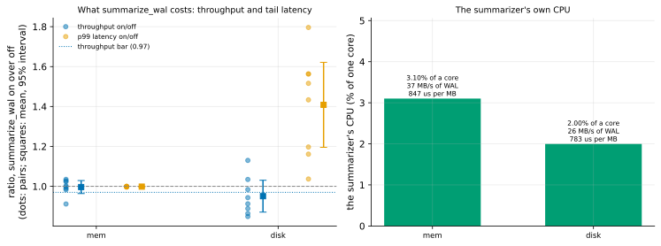

# EXP-83b: What does summarize_wal cost a busy server? (the VMs)

Status: **done October 29, 2026: 1 failed in both cells, 2 held in memory and failed beyond it, 3 held in both.**
- **In memory:** no measurable cost. Throughput was 0.996 of its value with summaries off (interval [0.964, 1.029]), missing the bar of 0.97 by 0.006, a rule 11 case. p99 was 0.999.
- **Beyond memory:** throughput 0.951 [0.871, 1.030] and p99 1.41x. A post-hoc look puts the p99 rise in the "on" runs that followed an "off" run: turning summaries on made the summarizer first read the previous run's WAL from disk, which likely also evicted cached pages before the run. That is a design confound, not the steady state.
- **The summarizer itself took 2–3% of one core,** 0.78–0.85 ms per MB of WAL.
- **The source was only 19–34% busy,** its clients bound by round trips across zones.

EXP-83c re-runs it with the confound removed and a saturated cell added. Pre-registered before any run; one `ha` VM pair, about an hour.

## Question

**On the VMs, with the client on another machine as a busy server's clients are:** how much throughput and tail latency does `summarize_wal = on` cost, with the database in memory and beyond it? How much CPU does the summarizer take?

## Design

**The harness:** EXP-83's `bench.py`, run on dest by `experiments/summarize_cost/vm.sh`.
- **The source:** built by `source_cluster.py` at each cell's scale. That is EXP-48's database and set-up: PostgreSQL 17.11, data checksums, `checkpoint_timeout` 30 min, `max_wal_size` 16 GB, `shared_buffers` 128 MB.
- **The load:** pgbench's TPC-B-like script (prepared statements, no vacuum) from dest over the internal network, **32 clients on 8 threads**, 60 s a run.
- **Pairs:** **8 pairs** per cell, on and off in random order, after a 60 s warm-up (off).
- **Before each run:** the setting set, the summarizer caught up (on) or gone (off), and a `CHECKPOINT`, as in EXP-83.
- **Measured over ssh:**
  - the summarizer's CPU from `/proc` on the source (`summarizer_cpu.sh`, 10 ms resolution);
  - the source's CPU busy fraction (`/proc/stat`).

**The cells,** in this order on the `ha` set (n2d-highcpu-8, 150 GiB balanced PDs):

| Cell | Scale | Database | Seed |
|---|---|---|---|
| `mem` | 100 | About 1.5 GB, in the 8 GB VM's memory | 831 |
| `disk` | 600 | About 18 GB, beyond memory | 832 |

**The smoke** (scale 10, 1 pair of 10 s, 5 s warm-up, seed 839) decides nothing. It checks that the client connects, that the setting toggles, and that the CPU readings arrive over ssh.

**The command,** on dest:

    bash experiments/summarize_cost/vm.sh SOURCE 100 32 8 60 8 60 831 mem OUT.csv
    bash experiments/summarize_cost/vm.sh SOURCE 600 32 8 60 8 60 832 disk OUT.csv

**The analysis:** EXP-83's `analysis/exp83.py`, unchanged, on `docs/experiments/data/exp83b-runs.csv`, with the figure `exp83b-cost`.

## Predictions

**From EXP-83's measured cost per MB (inferred):**
- **The summarizer's cost:** about 0.6 ms of CPU per MB of WAL on the Mac's cores. On the VMs' slower cores, about 1 ms.
- **The WAL rate:** a TPC-B-like load from a remote client, bound by round trips at a few thousand to ten thousand transactions a second, writes about 10–40 MB/s.
- **So the summarizer takes 1–4% of one core,** under 0.5% of the source's 8 vCPUs, and throughput should move by under 1%.

**Scored, in each cell:**
1. **Deciding: the throughput ratio (on/off, mean over pairs) has a lower 95% bound of at least 0.97.** `summarize_wal` costs at most 3% of throughput, at 95%.
2. **The mean p99 latency ratio is at most 1.10.**
3. **The summarizer takes at most 5% of one core.**

**Reported:**
- throughput and the source's CPU busy fraction, on and off;
- the WAL rate;
- the summarizer's CPU per MB of WAL;
- mean and median latency ratios.

**Rule 11:** a deciding lower bound within 0.01 of 0.97 gets a second session, with more pairs.

## The rules this session runs under

- **Rule 13:** EXP-83 was the local stage. Its throughput couldn't bound the cost, so this session runs on the arithmetic above. Its cost per MB is carried over.
- **Rule 16:** `analysis/integrity.py register EXP-83b` records the analysis, `bench.py`, `vm.sh` and `summarizer_cpu.sh`.
- **Rule 17:** the paired, randomized design and the interval are the noise bar.

## What follows

- **If 1–3 hold in both cells:** `summarize_wal` costs a busy server under 3% of throughput.
  - **The advice:** turn it on, and pgdelta's summaries path applies to every copy taken after that (EXP-79b, -80b, -81). Copies taken before it are covered by summaries on demand where the WAL is kept (EXP-82c), and by page-lsn where it isn't (EXP-82b).
  - **Where the advice goes:** RESULTS and the README.
- **If 1 fails in a cell:** the cost is stated as measured, with its share of the source's CPU. The advice becomes a trade-off, not a default.

## Workflow check

| | Check | For this session |
|---|---|---|
| 1 | Situation, standard, competitor | PostgreSQL's default is off; pgdelta's fastest routes need it on |
| 2 | The bottleneck | The source's cost of the setting |
| 3 | Systems or algorithm | Neither: a deployment cost |
| 4 | Papers and prior art | None measured it (EXP-83's search) |
| 5 | Committee-grade evidence | Pre-registered; paired, randomized; the client remote |
| 13 | The cascade | The VM stage, after a noise-bound local stage |
| 14 | The idea archive | "Advise summarize_wal on", to be archived with the result |
| 15 | Held-out workloads | Not owed |
| 16 | Scorer integrity | Recorded at registration |
| 17 | The noise bar | The paired design and its interval |

## Results

**The session:**
- **Where:** the `ha` set in us-west1-b and -c.
- **The smoke** passed: the client connected, the setting toggled, and the CPU readings arrived.
- **The cells** ran 14:12–15:02 UTC, and the VMs were then deleted.
- **Data:** `docs/experiments/data/exp83b-runs.csv`; raw `results/exp83b/` (not in git).

**Scorer integrity (rule 16):** `analysis/integrity.py check EXP-83b` reports 4 of 4 files unchanged since the registration commit (a2a36bc).

*How to read it:*
- **Left:** each pair's ratio, summaries on over off, of throughput (blue) and p99 latency (orange), with the mean and 95% interval (squares).
- **Right:** the summarizer's CPU, as a share of one core.

| Cell | Throughput, off and on | Throughput ratio (95%) | p99 ratio (95%) | Mean latency ratio | Summarizer | WAL | Source CPU busy |
|---|---|---|---|---|---|---|---|
| `mem` (scale 100, 2.8 GB) | 4,976 and 4,957 tps | 0.996 [0.964, 1.029] | 0.999 [0.997, 1.000] | 1.005 | 3.1% of a core, 847 µs/MB | 36.6 MB/s | 34% |
| `disk` (scale 600, 17 GB) | 2,518 and 2,369 tps | 0.951 [0.871, 1.030] | **1.408** [1.195, 1.621] | 1.061 | 2.0% of a core, 783 µs/MB | 25.6 MB/s | 19% |

| # | Prediction | `mem` | `disk` |
|---|---|---|---|
| 1 | **Deciding:** the throughput ratio's lower 95% bound at least 0.97 | **Failed: 0.964**, within 0.01 of the bar (rule 11: a second session) | **Failed: 0.871** |
| 2 | Mean p99 latency ratio at most 1.10 | **Held: 0.999** | **Failed: 1.408** |
| 3 | The summarizer at most 5% of one core | **Held: 3.1%** | **Held: 2.0%** |

**A post-hoc look at `disk`** (not registered; it changes no verdict):
- **The confound:** each pair's order was random, so an "on" run sometimes followed an "off" run. Then, before it started, the summarizer had first to read the "off" run's 1.4–1.8 GB of WAL, from disk when it had been evicted. Beyond memory, that likely also pushed cached data pages out.
- **The split:**

  | "On" runs | n | p99 ratio | Throughput ratio |
  |---|---|---|---|
  | After an "off" run | 6 | 1.20–1.80 | 0.86–1.13 |
  | After an "on" run | 2 | 1.04 and 1.16 | 0.85 and 0.98 |

- **A second confound:** `disk`'s throughput rose through the session as its 17 GB warmed into memory (the "off" runs went from 1,869 to 2,802 tps). The 60 s warm-up didn't settle it, and the drift widens the interval.
- **In `mem`** no such pattern appears: the WAL to catch up on was cached, and nothing was evicted.

**What the session shows, firmly:**
- **The summarizer's CPU is in proportion to the WAL:** 0.78–0.85 ms per MB here, against 0.62 on the Mac's faster cores. At these loads that is 2–3% of one core, 0.25–0.4% of the source's 8 vCPUs.
- **In memory, throughput and p99 didn't move** beyond 0.4% and 0.1% (point estimates).
- **Both cells' source was far from busy** (19–34% CPU). 32 clients across zones are bound by round trips, so this session says nothing yet about a saturated server.

## What followed

**EXP-83c** re-runs it with the design fixed:
- **a settle run** (unscored, in the same mode) after every switch, so a scored run never pays for the catch-up or the cache it disturbs;
- **a five-minute warm-up** before the beyond-memory cell;
- **a third cell with 90 clients,** to load the source's CPU;
- **the summarizer's cost bar** stated per MB of WAL (it scales with the rate), from this session's 0.78–0.85 ms.

The proxy pair (EXP-83's throughput ratio, noise-bound) is not logged: the local stage couldn't measure a ratio.
