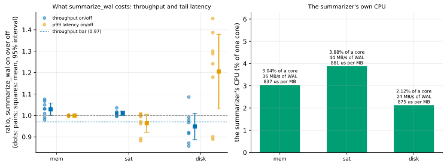

# EXP-83c: What does summarize_wal cost a busy server? (the VMs, settled, with a saturated cell)

Status: **done October 29, 2026: every prediction held in both in-memory cells; 1 and 2 failed beyond memory.**
- **In memory, `summarize_wal = on` cost nothing measurable.** Throughput 1.029 [0.9999, 1.058] with 32 clients and 1.010 [0.9991, 1.020] with 90; p99 0.999 and 0.964. With EXP-83b's 0.996, that is two sessions.
- **Beyond memory (17 GB on 8 GB), a cost again:** throughput 0.948 [0.887, 1.010] and p99 1.205 [1.030, 1.379]. Post-hoc, it no longer follows a switch, so it may be the summarizer's own steady-state WAL reads competing for the disk. That is not measured yet.
- **The summarizer:** 0.84–0.88 ms of CPU per MB of WAL in every cell.
- **The source's CPU was at most 44% busy:** the 90-client cell was bound by TPC-B's branch-row contention at scale 100, not CPU.

Pre-registered before any run; one `ha` VM pair, about 1.9 hours. It is EXP-83b's second session (rule 11: its in-memory bound missed by 0.006), with EXP-83b's two design faults fixed, and a cell that loads the source's CPU.

## Question

**EXP-83b found no measurable cost in memory, but two faults in its design:**
- **The catch-up confound:** an "on" run that followed an "off" run paid for the summarizer catching up on the previous run's WAL, and beyond memory for the cached pages that read pushed out. Post-hoc, the p99 rise sat in those runs.
- **The cache drift:** the beyond-memory cell's throughput rose through the session as its cache warmed.
- **And it never loaded the server:** 32 clients across zones left the source 19–34% busy.

**The question, as before: what do throughput and tail latency lose with `summarize_wal` on?** This time it is measured in steady state, and on a source whose CPU is loaded too.

## Design

EXP-83b's, with these changes (committed with this registration):
- **`--settle`:** before every scored run, an unscored run in the same mode (after the switch and the summarizer's catch-up). So no scored run pays for a catch-up or the cache it disturbs. Settle runs are written with the label "settle", and the analysis scores only "scored" runs.
- **Warm-up:** five minutes before the beyond-memory cell (one minute before the others).
- **A third cell, `sat`:** 90 clients, to load the source's CPU. It runs on the in-memory cell's source (`SKIP_SETUP=1`). The source's `max_connections` is 100.

| Cell | Scale | Clients (threads) | Warm-up | Settle | Seed |
|---|---|---|---|---|---|
| `mem` | 100 (about 2.8 GB on disk, in memory) | 32 (8) | 60 s | 30 s | 833 |
| `sat` | 100, the same source | 90 (8) | 60 s | 30 s | 834 |
| `disk` | 600 (about 17 GB, beyond memory) | 32 (8) | 300 s | 60 s | 835 |

**Everything else is EXP-83b's:**
- the `ha` set, the client on dest;
- pgbench's TPC-B-like script, prepared, 60 s scored runs, 8 pairs per cell in random order;
- a `CHECKPOINT` before each run;
- the summarizer's CPU from `/proc`, the source's from `/proc/stat`.

**The smoke** (scale 10, 1 pair of 10 s, a 3 s settle, seed 839) decides nothing. It checks the settle runs and the readings.

**The analysis:** `analysis/exp83.py` with `--us-bar 1000`, which scores the summarizer per MB of WAL, since its share of a core scales with the WAL rate. This option was added with this registration; EXP-83 and EXP-83b's scoring is unchanged without it. Data `docs/experiments/data/exp83c-runs.csv`, figure `exp83c-cost`.

## Predictions

**What EXP-83b implies:**
- **In steady state:** no measurable cost in memory or beyond it.
- **In `sat`:** the WAL rate roughly doubles or triples, so the summarizer takes 5–10% of one core. That is about 1% of the source's 8 vCPUs, so throughput should move by about 1% or less.

**Scored, in each cell:**
1. **Deciding: the throughput ratio (on/off) has a lower 95% bound of at least 0.97.**
2. **The mean p99 latency ratio is at most 1.10.**
3. **The summarizer takes at most 1.0 ms of CPU per MB of WAL** (EXP-83b: 0.78–0.85).

**Reported:**
- each cell's source CPU busy fraction, on and off (the claim for a busy server is scoped by it: `sat` is expected to be well above EXP-83b's 34%);
- throughput and the WAL rate;
- mean and median latency ratios.

**Rule 11:** a lower bound within 0.01 of 0.97 is reported as not firm, with the pairs needed to settle it.

## The rules this session runs under

- **Rule 13:** the VM stage's second session.
- **Rule 16:** `analysis/integrity.py register EXP-83c` records the analysis, `bench.py`, `vm.sh` and `summarizer_cpu.sh`.
- **Rule 17:** the paired, randomized design, now with settle runs.

## What follows

- **If 1–3 hold in all three cells:** `summarize_wal` costs a busy server at most 3% of throughput at 95%, and nothing in p99, at a CPU cost of about 1 ms per MB of WAL. RESULTS and the README advise turning it on.
- **If 1 or 2 fails in a cell:** the cost is stated for that cell, with the source's busy fraction, and the advice becomes a trade-off for that kind of load.

## Workflow check

| | Check | For this session |
|---|---|---|
| 1 | Situation, standard, competitor | PostgreSQL's default is off; pgdelta's fastest routes need it on |
| 2 | The bottleneck | The setting's cost to the source |
| 3 | Systems or algorithm | Neither: a deployment cost |
| 4 | Papers and prior art | None measured it (EXP-83) |
| 5 | Committee-grade evidence | Pre-registered; EXP-83b's confound found post-hoc and designed out, verdicts unchanged |
| 13 | The cascade | The VM stage, second session |
| 14 | The idea archive | "Advise summarize_wal on" pending this result |
| 15 | Held-out workloads | Not owed |
| 16 | Scorer integrity | Recorded at registration |
| 17 | The noise bar | Pairs, intervals and settle runs |

## Results

**The session:**
- **Where:** the `ha` set in us-west1-b and -c.
- **The smoke** passed, settle runs included.
- **The cells** ran 15:09–17:00 UTC (mem, then sat on the same source, then disk), and the VMs were then deleted.
- **Data:** `docs/experiments/data/exp83c-runs.csv`, settle runs labelled; raw `results/exp83c/` (not in git).

**Scorer integrity (rule 16):** `analysis/integrity.py check EXP-83c` reports 4 of 4 files unchanged since the registration commit (0793d03).

*How to read it:* as EXP-83b's figure.
- **Left:** each pair's ratio, on over off, of throughput (blue) and p99 latency (orange), with the mean and 95% interval (squares); the dotted line is the throughput bar.
- **Right:** the summarizer's CPU as a share of one core, with the WAL rate and its cost per MB.

| Cell | Throughput, off and on | Throughput ratio (95%) | p99 ratio (95%) | Mean latency ratio | Summarizer | WAL | Source CPU busy |
|---|---|---|---|---|---|---|---|
| `mem` (32 clients) | 4,758 and 4,891 tps | 1.029 [0.9999, 1.058] | 0.999 [0.997, 1.001] | 0.971 | 837 µs/MB (3.0% of a core) | 36.3 MB/s | 37% |
| `sat` (90 clients) | 5,926 and 5,984 tps | 1.010 [0.9991, 1.020] | 0.964 [0.922, 1.006] | 0.990 | 881 µs/MB (3.9%) | 44.1 MB/s | 44% |
| `disk` (17 GB) | 2,784 and 2,634 tps | 0.948 [0.887, 1.010] | **1.205** [1.030, 1.379] | 1.060 | 875 µs/MB (2.1%) | 24.4 MB/s | 24% |

| # | Prediction | `mem` | `sat` | `disk` |
|---|---|---|---|---|
| 1 | **Deciding:** throughput ratio's lower 95% bound at least 0.97 | **Held: 0.9999** | **Held: 0.9991** | **Failed: 0.887** |
| 2 | Mean p99 ratio at most 1.10 | **Held: 0.999** | **Held: 0.964** | **Failed: 1.205** |
| 3 | The summarizer at most 1.0 ms per MB of WAL | **Held: 837 µs** | **Held: 881 µs** | **Held: 875 µs** |

**Reported:**
- **`sat` didn't load the CPU.** 90 clients raised throughput only from 4,900 to 5,950 tps and the source to 44% busy, with p99 near 190 ms. TPC-B updates one of only 100 branch rows per transaction at scale 100, so clients wait on each other's row locks. The claim for a busy server is therefore scoped to a source up to 44% CPU busy.
- **Beyond memory, post-hoc (not registered):**
  - With settle runs, the effect no longer sits only in "on" runs that followed an "off" run. The two "on" runs that followed an "on" run still had p99 1.30 and 1.18 (throughput 0.97 and 0.99), against 0.89–1.45 for the six others.
  - So, unlike EXP-83b, the switch alone doesn't explain it.
  - The off runs' throughput still rose through the session (2,531 to 2,951 tps), so the five-minute warm-up didn't settle the 17 GB cache.
  - **The candidate mechanism, unmeasured:** the summarizer reading WAL that the page cache, under a working set twice memory, has already dropped, on the disk the workload's random reads already saturate. Its CPU is no larger here (875 µs/MB). Its disk reads were never recorded.
- **Across both VM sessions beyond memory:**
  - throughput 0.951 and 0.948, both intervals reaching 1.0;
  - p99 1.41 and 1.21, both intervals excluding 1.0.

## What followed

- **Where the database fits in memory,** `summarize_wal = on` costs nothing measurable: throughput within 0.1% at the lower 95% bound, p99 unchanged, at 0.84–0.88 ms of the summarizer's CPU per MB of WAL. That holds across two sessions and three cells, on a source up to 44% busy. There the advice is to turn it on, and pgdelta's summaries path then applies to every later copy.
- **Where the working set is twice memory and the disk is the bottleneck,** two sessions measured p99 up 20–40% and throughput down about 5% (not significant). The mechanism isn't separated, so the advice there is a trade-off, stated with these numbers.
- **What would settle it (EXP-83d, not yet registered):**
  - the summarizer's disk reads from `/proc/<pid>/io`;
  - long blocks with the setting held on or off for many minutes, so no switch or warm-up is in the data;
  - a CPU-bound cell (pgbench `-N`, without the branch-row contention) to load the source's CPU.
