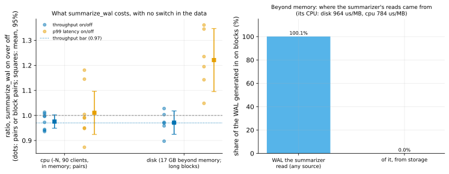

# EXP-83d: Why did summarize_wal cost beyond memory, and what does it cost a CPU-bound server?

Status: **done October 29, 2026. The registered decision is unresolved: H2 refuted, H1 refuted.**
- **1 (deciding) held:** the summarizer read **0.0%** of its WAL from storage; all of it came from the page cache.
- **2 failed:** beyond memory, with no switch in the data, p99 was still **1.22x** [1.10, 1.35] and throughput 0.971 [0.925, 1.018]. So the cost is real in steady state, and not the switches'.
- **3 failed on its condition:** `-N` left the source only 35% CPU busy. These cells are bound by commit fsyncs on the persistent disk, not CPU.
- **4 held:** 0.78–0.96 ms of CPU per MB of WAL.
- **Post-hoc:** with summaries on, the data disk wrote 24% more besides WAL (33.9 against 27.4 MB/s) and read about 3.5% more, pointing to the summarizer displacing cached data pages.

*Amended before any scored data:* the first launch stopped at the CPU cell's first settle run. `summarizer_cpu.sh` had printed the summarizer's large read counter in `awk`'s scientific notation (2.52364e+09), which `bench.py` couldn't parse. The script now passes the counters through as text, and its files are recorded again at the fixed commit. The VMs were kept, and the sessions run from the set-up again. One `ha` VM pair, about 2.6 hours (the stated reason: long blocks with no switch in the data, as the owner asked). It follows EXP-83b and EXP-83c.

## Question

**In two sessions, with the database beyond memory** (17 GB on 8 GB VMs), `summarize_wal = on` came with p99 up 20–40% and throughput about 5% lower. Two explanations remain:
- **H1, the switches:**
  - Turning the setting on made the summarizer first read the WAL written while it was off, from disk, pushing cached pages out before the next runs. EXP-83c's settle runs (60 s) may not have been long enough for a 17 GB working set.
  - The cache was also still warming through each session.
  - In steady state there would be no cost.
- **H2, steady-state competition:**
  - Even when it keeps pace, the summarizer reads WAL that the page cache, under a working set twice memory, has already dropped. It does so on the disk the workload's random reads already saturate.

**Neither earlier session recorded the summarizer's own disk reads, and in neither was any source loaded past 44% CPU.**

## Design

**The harness:** EXP-83c's, extended with this registration.
- **The summarizer's reads,** from `/proc/<pid>/io` on the source, over each run: `read_bytes` (from storage) and `rchar` (from any source, the page cache included), against the WAL generated (`summarizer_cpu.sh`).
- **The source's data disk:** its reads, writes and busy fraction, from `/proc/diskstats` (`data_disk.sh`).
- **Long blocks** (`bench.py --design blocks`) for the beyond-memory cell:
  - the setting is held for a whole block;
  - each block is the switch and the summarizer's catch-up, one unscored run of 180 s, then 3 scored runs back to back in that mode, so no scored run follows a switch;
  - 12 blocks in the order ABBA BAAB ABBA, the first mode drawn by the seed, which cancels a linear drift;
  - 15 minutes of warm-up first (EXP-83c's 5 minutes weren't enough).
- **pgbench `-N`** for the CPU-bound cell: it skips the branch and teller updates, so 90 clients no longer wait on 100 branch rows, as they did in EXP-83c.

**The cells:**

| Cell | Scale | Load | Design | Warm-up | Seed |
|---|---|---|---|---|---|
| `cpu` | 100 (in memory) | `-N`, 90 clients, 8 threads | 8 pairs, a 30 s settle run before each scored run | 60 s | 836 |
| `disk` | 600 (17 GB, beyond memory) | TPC-B-like, 32 clients, 8 threads | 12 blocks, 3 scored runs each, 180 s settle | 900 s | 837 |

**Everything else is EXP-83c's:**
- the `ha` set, the client on dest;
- prepared statements, 60 s scored runs;
- a `CHECKPOINT` before each run, and the summarizer caught up before each "on" run.

**The smoke** (scale 10; blocks, `-N`, 2 blocks of 2 runs; seed 849) decides nothing. It checks that the summarizer's I/O, the disk statistics and both designs are recorded.

**The analysis,** committed before the data: `analysis/exp83d.py`, dry-run on a local smoke (no `/proc` there, so it fails, as it must). Data `docs/experiments/data/exp83d-runs.csv`, figure `exp83d-cost`.

## Predictions

**My expectation, and why (inferred):** the summarizer reads WAL within seconds of its being written, while those pages are the newest in the page cache. So it should read almost none of it from storage. Then nothing remains to compete with the workload but its CPU, about 0.85 ms per MB, or 0.25% of the source here. That predicts H1.

1. **Deciding (the mechanism): in `disk`, the summarizer reads at most 10% of the WAL it summarizes from storage.**
2. **In `disk`, with no switch in the data:** the throughput ratio (block pairs, on/off) has a lower 95% bound of at least 0.97, and the mean p99 ratio is at most 1.10.
3. **In `cpu`:**
   - the source is CPU-bound (busy at least 0.80, on and off);
   - the throughput ratio's lower 95% bound is at least 0.97;
   - the mean p99 ratio is at most 1.10.
4. **In both cells, the summarizer takes at most 1.0 ms of CPU per MB of WAL.**

**The decision on the mechanism,** registered here and stated by the analysis:
- **H1 (the cost was the switches'):** 2 holds.
- **H2 (a steady-state cost from the summarizer reading its WAL from storage):** 2 fails, and the summarizer read at least 50% of its WAL from storage.
- **Unresolved:** anything else, such as a cost while the summarizer reads from the cache. Then the data disk's busy fraction and reads, on against off, are the next clues.

**Reported:**
- the block means;
- the data disk's busy fraction and reads, on and off;
- the summarizer's reads from any source (`rchar`), against the WAL;
- throughput and the WAL rate per cell.

**Rule 11:** a deciding share within 0.05 of 0.10, or a cell's throughput bound within 0.01 of 0.97, gets a second session.

## The rules this session runs under

- **Rule 13:** the VM stage, third session. EXP-83's local stage showed the summarizer's CPU per MB, not throughput.
- **Rule 16:** `analysis/integrity.py register EXP-83d` records `analysis/exp83d.py` and the `analysis/exp83.py` it uses, `bench.py`, `vm.sh`, `summarizer_cpu.sh` and `data_disk.sh`.
- **Rule 17:** pairs and block pairs, with intervals.

## What follows

- **H1:** the advice to turn `summarize_wal` on extends to working sets beyond memory, with a note to give the cache time after turning it on.
- **H2:** the advice for disk-bound servers states the cost and its cause. A fix to weigh: a larger page cache, or WAL on a separate disk.
- **3 holding:** extends the in-memory advice to a CPU-bound server.

## Workflow check

| | Check | For this session |
|---|---|---|
| 1 | Situation, standard, competitor | PostgreSQL's default is off; pgdelta's fastest routes need it on |
| 2 | The bottleneck | Here, the bottleneck being found is the cost's: the summarizer's reads, measured directly |
| 3 | Systems or algorithm | Neither: a deployment cost |
| 4 | Papers and prior art | None measured it (EXP-83) |
| 5 | Committee-grade evidence | Two hypotheses and a decision rule registered before the data; the switch confound designed out |
| 13 | The cascade | The VM stage, third session |
| 14 | The idea archive | "Advise summarize_wal on" pending this result |
| 15 | Held-out workloads | Not owed |
| 16 | Scorer integrity | Recorded at registration |
| 17 | The noise bar | Pairs, block pairs and intervals |

## Results

**The session:**
- **Where:** the `ha` set in us-west1-b and -c.
- **The first launch** stopped before any scored data (the amendment above).
- **The resumed smoke** passed.
- **The cells** ran 17:27–19:41 UTC: `cpu`, then `disk` after a 15-minute warm-up and 12 blocks.
- **Teardown:** the pipeline's teardown failed on a gcloud error after the fetch, leaving `pgd-ha-dest`. It was deleted by hand at once, and nothing of the set is left.
- **Data:** `docs/experiments/data/exp83d-runs.csv` (settle runs labelled); raw `results/exp83d/` (not in git).

**Scorer integrity (rule 16):** `analysis/integrity.py check EXP-83d` reports 6 of 6 files unchanged since the amended registration commit (c3c0731).

*How to read it:*
- **Left:** the ratio, summaries on over off, of throughput (blue) and p99 latency (orange):
  - for `cpu`, one dot per pair of runs;
  - for `disk`, one dot per pair of adjacent long blocks;
  - with the mean and 95% interval (squares).
- **Right:** of the WAL generated in "on" blocks beyond memory, the share the summarizer read at all, and the share it read from storage.

| Cell | Throughput, off and on | Throughput ratio (95%) | p99 ratio (95%) | Summarizer | Source CPU busy | Data disk busy |
|---|---|---|---|---|---|---|
| `cpu` (`-N`, 90 clients, in memory) | 6,752 and 6,586 tps | 0.976 [0.949, 1.003] | 1.010 [0.924, 1.097] | 784 µs/MB | 35% | 88% |
| `disk` (17 GB, 12 long blocks) | 2,807 and 2,724 tps | 0.971 [0.925, 1.018] | **1.221** [1.095, 1.347] | 964 µs/MB; **0.0%** of its WAL from storage | 23% | 99–100% |

| # | Prediction | Result |
|---|---|---|
| 1 | **Deciding:** in `disk`, the summarizer reads at most 10% of its WAL from storage | **Held: 0.0%** (it read 100.1% of the WAL generated, all from the page cache) |
| 2 | In `disk`, with no switch in the data: throughput lower bound at least 0.97, p99 ratio at most 1.10 | **Failed:** 0.925 and **1.221** |
| 3 | In `cpu`: CPU-bound (busy at least 0.80), throughput lower bound at least 0.97, p99 at most 1.10 | **Failed:** busy 0.35, so not CPU-bound; throughput lower bound 0.949 (mean 0.976); p99 1.010 |
| 4 | The summarizer at most 1.0 ms of CPU per MB of WAL | **Held:** 964 (`disk`) and 784 (`cpu`) |

**The registered decision on the mechanism: unresolved.**
- **H1 is refuted:** the p99 cost persists in long blocks with no switch, after a 15-minute warm-up.
- **H2, as registered, is refuted too:** the summarizer reads none of its WAL from storage.
- **The cost beyond memory is therefore real and steady, from something other than the summarizer's own disk reads.**

**Post-hoc, by block pair (not registered; it changes no verdict):**

| The data disk, summaries on over off | Mean | 95% |
|---|---|---|
| Write rate | **1.109** | [1.036, 1.183] |
| Read rate | 1.035 | [0.979, 1.091] |

- **The extra writes aren't WAL:** besides WAL, the data disk wrote 33.9 MB/s with summaries on against 27.4 MB/s off (+24%), while throughput, and so WAL, was 3% lower.
- **Nor are they the summarizer's files:** summary files are a few MB per checkpoint.
- **The likeliest mechanism is cache displacement.** The summarizer reads every WAL page a second time, which promotes it to the kernel's active list, or its own memory grows. Either way, cached data pages make way. Under a working set twice memory, that means more dirty-page write-back and more re-reads, on a disk already 100% busy. Hence the tail latency.
- **Not measured:** the summarizer's resident memory, and whether a plain WAL reader with summaries off does the same.

**`cpu` didn't load the CPU.** Its data disk was 88% busy, with WAL flushes at every commit (`synchronous_commit` on, the VMs' base configuration). On these persistent disks the in-memory cells are bound by commit fsyncs, so no cell in EXP-83b to -83d reached a CPU-bound source.

## What followed

**What the four sessions establish, together:**
- **The summarizer's CPU** is 0.78–0.96 ms per MB of WAL (EXP-83 to -83d).
- **It reads its WAL from the page cache,** none from storage (EXP-83d).
- **Where the database fits in memory, no measurable cost:**
  - throughput 0.996, 1.029 and 1.010 (lower bounds 0.964, 0.9999, 0.9991) in EXP-83b and EXP-83c;
  - p99 unchanged;
  - EXP-83d's `-N` cell came out 0.976 [0.949, 1.003], at 35% CPU.
- **Where the working set is twice memory and the data disk saturated:**
  - p99 rises about 20% in steady state (1.22 here; 1.21 and 1.41 in sessions with switches);
  - throughput falls about 3% (not significant);
  - the data disk writes more.

**The advice:**
- **Where the database fits in memory, turn `summarize_wal` on:** no measurable cost.
- **Where a disk-bound server already has a working set far beyond memory,** expect about 20% on p99 tail latency. That is the price of pgdelta's fastest refresh routes there. WAL on its own disk, or more memory, are the usual remedies, not measured here.

**Still open:** a CPU-bound source (needs `synchronous_commit` off or a faster WAL device), and the displacement mechanism (the summarizer's memory; a plain WAL reader). Neither changes the advice above.
