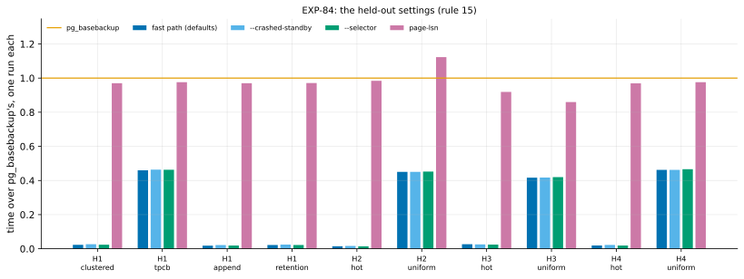
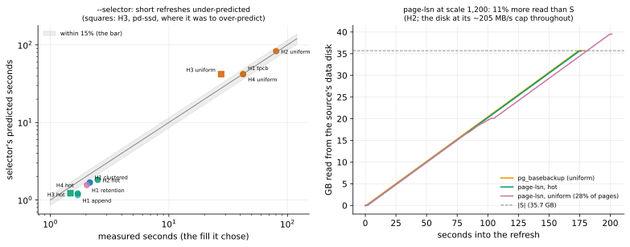

# EXP-84: The held-out session (rule 15): --crashed-standby, --selector and page-lsn on the sealed settings

Status: **done October 30, 2026 (UTC). `--crashed-standby` held in 10 of 10 held-out cells. `--selector` missed in 6 of 10: every refresh of a few seconds was under-predicted by 18–33%, though its call on `pg_basebackup` was right in all 10. page-lsn held in 9 of 10, missing at scale 1,200 with 28% of the pages changed (1.12x `pg_basebackup`).** Pre-registered October 29, before any run. *Amended before any scored data:* the first launch stopped at set-up on two faults:
- `infra/gcp/vmset.sh` still allowed only local-nvme and pd-balanced, so `hs` couldn't be created. It now takes pd-ssd, counted toward the same SSD quota.
- The pipeline's helper called `timeout` on a shell function, so `ha` was created but never prepared.

Then a second stop, also before any scored data: set `ha`'s smoke found that the lab's `CRASHED=1` and `STANDBY_TOO=1`, never combined before, started both standbys on port 5434. B0s now starts on 5435. Set `hs` met a stockout or a full regional quota in its first four zone pairs (set `ha` holds us-west1's 16 N2D CPUs), so it tries more regions. All of this is fixed, `vmset.sh` is added to the recorded files, and the files are recorded again at the fixed commit. The `ha` VMs were kept and are prepared afresh. Two VM sets at once (32 vCPUs, the quota), about 3.5 hours. It is the first held-out session. [held-out-workloads.md](../research/held-out-workloads.md) says one is owed before `--crashed-standby`, `--selector` or page-lsn becomes a default.

## Question

**Do the three candidates' claims, made on the tuned setting, hold on settings never used to tune or decide?** The tuned setting was EXP-48's 18 GB database, PostgreSQL 17.11, pd-balanced, and the hot, uniform and scatter cells.

| Candidate | Its claim on the tuned setting | Evidence |
|---|---|---|
| `--crashed-standby` | A crashed standby is refreshed correctly by the fast path, at the clean standby's cost | EXP-80, EXP-80b |
| `--selector` | Its time model predicts the chosen fill's time, and says when `pg_basebackup` is faster | EXP-74, EXP-75 |
| page-lsn | Correct, and as fast as a re-clone (both read all of S) | EXP-82, EXP-82b, EXP-82c |
| (the fast path's defaults) | Faster than `pg_basebackup` below about 91% of the pages | EXP-79b |

## The sealed settings, as [held-out-workloads.md](../research/held-out-workloads.md) defined them

| Setting | What differs | Cells | Built at first use (this registration) |
|---|---|---|---|
| **H1** | The workloads: `clustered`, `tpcb`, `append` and `retention` (`source_cluster.py`'s patterns), at scale 600 on the ha set | 4 | The lab's `FULL_CHECK=1`: each copy's check also compares `events` (its count and the sum of its ids) and pgbench's branches, tellers and history, which these patterns change |
| **H2** | Scale 1,200 (about 36 GB, 4.5x the VMs' memory), hot and uniform | 2 | — |
| **H3** | A pd-ssd data disk instead of pd-balanced, hot and uniform at scale 600 | 2 | `create.sh` takes `DATA_DISK=pd-ssd`; the `hs` set |
| **H4** | PostgreSQL 18 (18.6, PGDG's build), hot and uniform at scale 600 | 2 | The lab's `PG_MAJOR=18` (installed beside 17 on the `hc` set) |

## Design

**One lab run per setting** (`experiments/network/lab_exp64.sh`, as EXP-80b to -82c):
- **`CRASHED=1`:** B0 is a standby killed 30 s into the change.
- **`STANDBY_TOO=1`:** B0s is a standby stopped cleanly before the change.
- **`SERIES=1`**, and summaries on, as the tuned setting had them.

**The arms, one run each per cell,** in a shuffled order:

| Arm | Old copy | What runs |
|---|---|---|
| `fast8wf2c` | B0 (crashed) | The fast path's defaults with `--crashed-standby` |
| `sb_fast8wf2` | B0s (clean) | The fast path's defaults |
| `sb_fast8ws` | B0s | `--selector`: it chooses the fill, and predicts each option's time and `pg_basebackup`'s, with its pd-balanced disk limits (no others passed) |
| `sb_lsn` | B0s | `--fast-path page-lsn` |
| `full` | — | `pg_basebackup` |

**One run per arm, not two.** A held-out session asks whether large effects transfer. The bars below sit far outside rule 17's spread (2.40% for runs of 10 s or more), and a miss narrows a claim rather than deciding a close race.

**The schedule:**
- **Set `ha`** (pd-balanced, n2d-highcpu-8, us-west1 first): H1 (seed 840), then H2 (`SCALE=1200`, seed 841).
- **Set `hs`** (pd-ssd), at the same time: H3 (seed 842), then torn down.
- **Set `hc`** (pd-balanced), with PostgreSQL 18 installed: H4 (`PG_MAJOR=18`, seed 843).
- **Each set** first runs a smoke at scale 20 (seed 849), deciding nothing: every run exits 0, every copy matches, and the fast-path arms used it.

**The analysis,** committed before the data: `analysis/exp84.py`, dry-run on EXP-80b's runs, where it scores nothing because none of these arms exists there. Data `docs/experiments/data/exp84-cells.csv`, figure `exp84-held-out`.

## Predictions

Per cell, from the tuned results. **A miss narrows that candidate's claim to the cells where it held, and is never tuned away** (rule 15).

1. **`--crashed-standby`:** in every cell it takes the fast path (proof "crashed standby"), the copy is correct, and it takes at most the larger of 1.10x and +1.0 s of the clean standby's time.
2. **`--selector`:**
   - **H1, H2 and H4:** its prediction for the fill it chose is within 15% of the measured time.
   - **H3 (pd-ssd):** its pd-balanced limits make it overestimate by at least 15%, an expected miss of transfer. It is predicted, so it counts as held when it happens.
   - **In every cell,** its call on `pg_basebackup` (whether a full copy is predicted faster) matches the measured order of the two.
3. **page-lsn:** in every cell it takes the fast path ("clean shutdown in recovery"), the copy is correct, and it takes at most 1.05x `pg_basebackup`'s time.
4. **The fast path's defaults:** in every cell, faster than `pg_basebackup` exactly where its unfilled plan sends under 91% of the listed pages.
5. **Every copy matches the source:** all four pgdelta arms, in every cell.

**Reported:** every arm's time over `pg_basebackup`'s; each cell's share of pages chosen; the selector's choice and predictions.

## What follows

- **A candidate whose predictions hold in every cell** becomes eligible to be a default, and RESULTS says so; the change itself is a separate, owner-visible decision.
- **A miss** narrows its claim and is written into RESULTS and the candidate's README row.
- **H3's selector result** decides whether its default must measure the disk's limits at the session's start (the idea archive's revisit trigger).
- **Each held-out cell used here is spent** (rule 15) and is replaced by a new one for the next milestone.

## The rules this session runs under

- **Rule 15:** this is the milestone session. Nothing here is tuned on these settings.
- **Rule 16:** `analysis/integrity.py register EXP-84` records the analysis and its helpers, the lab and disk sampler, `create.sh`, and pgdelta's modules.
- **Rule 17:** one run per arm, with bars far outside the noise.

## Workflow check

| | Check | For this session |
|---|---|---|
| 1 | Situation, standard, competitor | Each candidate's claim against its standard: a re-clone, hashing, the fast path itself |
| 2 | The bottleneck | Not the question: transfer of measured effects |
| 3 | Systems or algorithm | Not the question |
| 4 | Papers and prior art | RRSI's and ADRS's held-out lesson (the RSI review) |
| 5 | Committee-grade evidence | Pre-registered; settings sealed since October 28 |
| 13 | The cascade | VMs only: the settings are VM settings |
| 14 | The idea archive | Each candidate's row updated with the result |
| 15 | Held-out workloads | This is it |
| 16 | Scorer integrity | Recorded at registration |
| 17 | The noise bar | Bars far outside the 2.40% spread |

## Results

**The session:**
- **`ha`** (pd-balanced) in us-west1-b and -c: H1 from 21:44 to 23:33 UTC on October 29, then H2 to 02:10 on October 30.
- **`hs`** (pd-ssd) in us-central1-c and -f, after stockouts or a full regional quota in five other zone pairs: H3 to 22:25.
- **`hc`** (pd-balanced, PostgreSQL 18.6) in us-central1-c: H4 from 00:13 to 01:14.
  - The gcloud sign-in expired while `hc` was being prepared, before its smoke. The owner signed in again and its preparation resumed, so no scored run was affected.
- **Each set's smoke passed**, and every scored run exited 0.
- **Teardown:** no VM or disk of any set is left (`gcloud compute instances list` shows no pgd VM).
- **Data:** `docs/experiments/data/exp84-cells.csv`; the raw runs in `results/exp04/exp84-h1` to `-h4` (not in git).

**Scorer integrity (rule 16):** `analysis/integrity.py check EXP-84` reports 16 of 16 files unchanged since the amended registration commit (ef44bb4).

*How to read it:* each group is one held-out cell. Each bar is one arm's time over `pg_basebackup`'s in that cell (one run each), and the orange line is `pg_basebackup`. Bars below the line are faster.

| # | Prediction | Result |
|---|---|---|
| 1 | `--crashed-standby`: proven ("crashed standby"), correct, and at most the larger of 1.10x and +1.0 s of the clean standby's time | **Held in 10 of 10.** Where the refresh took about 2 s, it took 0.23–0.36 s longer (−0.08 s on pd-ssd). Where it took 27–80 s, it took at most 0.9% longer |
| 2 | `--selector`: within 15% (on pd-ssd, at least 1.15x over), and its call on `pg_basebackup` right | **Failed in 6 of 10.** Its call was right in 10 of 10: a full copy was never predicted faster and never was. Its time held in the four cells taking 28–80 s: 0.990–1.033x, and 1.518x over on pd-ssd, as predicted. It missed in all six cells taking 1.5–2.5 s, all fill 0: 0.67–0.82x of the measured time, 0.26–0.69 s short. H3's hot cell was among them, under-predicted where the prediction was an over-prediction |
| 3 | page-lsn: proven ("clean shutdown in recovery"), correct, at most 1.05x `pg_basebackup` | **Failed in 1 of 10:** 0.86–0.98x in nine cells; **1.123x at H2 uniform** (199.3 s against 177.6 s) |
| 4 | The fast path's defaults faster than `pg_basebackup` exactly below 91% of the pages | **Held in 10 of 10:** 0.015–0.46x at 0.5–28.3% of the pages. No cell came near 91%, so the break-even itself wasn't tested |
| 5 | Every copy matches the source | **Held:** 40 of 40 pgdelta copies matched, with H1's wider check (`events` and pgbench's other tables) |

| Setting | Cell | Pages chosen | Fast path (defaults) | `--crashed-standby` | `--selector` (its fill; predicted) | page-lsn | `pg_basebackup` |
|---|---|---|---|---|---|---|---|
| H1 workloads | clustered | 1.0% | 2.10 s (0.023) | 2.40 s | 2.16 s (fill 0; 1.68) | 88.1 s (0.970) | 90.8 s |
| | tpcb | 28.3% | 41.97 s (0.460) | 42.33 s | 42.25 s (fill 2; 42.06) | 89.1 s (0.976) | 91.3 s |
| | append | 0.5% | 1.67 s (0.018) | 1.99 s | 1.71 s (fill 0; 1.15) | 89.0 s (0.970) | 91.7 s |
| | retention | 0.9% | 2.01 s (0.022) | 2.24 s | 2.04 s (fill 0; 1.56) | 89.4 s (0.971) | 92.1 s |
| H2 scale 1,200 | hot | 0.5% | 2.57 s (0.015) | 2.88 s | 2.51 s (fill 0; 1.82) | 174.2 s (0.984) | 177.0 s |
| | uniform | 28.3% | 79.96 s (0.450) | 79.97 s | 80.32 s (fill 2; 82.99) | **199.3 s (1.123)** | 177.6 s |
| H3 pd-ssd | hot | 0.5% | 1.61 s (0.027) | 1.53 s | 1.48 s (fill 0; 1.22) | 55.6 s (0.919) | 60.5 s |
| | uniform | 28.2% | 27.39 s (0.416) | 27.44 s | 27.60 s (fill 2; 41.89) | 56.5 s (0.860) | 65.8 s |
| H4 PostgreSQL 18.6 | hot | 0.5% | 1.72 s (0.019) | 2.01 s | 1.71 s (fill 0; 1.21) | 87.6 s (0.969) | 90.4 s |
| | uniform | 28.2% | 41.93 s (0.462) | 41.93 s | 42.29 s (fill 2; 41.88) | 88.6 s (0.976) | 90.7 s |

*In brackets after a time: over `pg_basebackup`'s. Pages chosen: the fast path's unfilled plan, over the listed pages.*

**Reported, not predicted:**
- **The fast path's defaults transferred:** the same ratios at twice the size (0.015 and 0.450, against 0.018–0.022 and 0.46 on the tuned setting: 1.66–2.03 s and 41.9–42.0 s against 90.6–91.0 s in EXP-80b and EXP-81), on PostgreSQL 18.6 (0.019, 0.462), and on four workloads never used to tune it. TPC-B's mix of four tables chose 28% of the pages, as uniform does.
- **On pd-ssd** `pg_basebackup` was 1.4x faster than on pd-balanced (60.5 and 65.8 s). The fast path's uniform cell was 1.5x faster (27.4 s against 41.9 s on H4), since that disk allows more operations a second.
- **The selector's prediction of `pg_basebackup`** was within 1% in all eight pd-balanced cells (0.990–1.001x), and 1.38–1.50x over on pd-ssd. Its byte model transferred where its disk limits were right.
- **The selector's choices cost nothing measurable:** 0.92–1.025 of the defaults' time (fill 2), one run each, within the 7.11% spread of runs under 10 s.

## Looked at after the scoring (post-hoc; decides nothing)

*How to read it:*
- **Left:** each held-out cell's selector prediction against the time measured, on log axes. The grey band is within 15%. The six short cells sit below it; the long ones sit on the line, except H3 uniform, on pd-ssd, above it.
- **Right:** the GB read from the source's data disk during H2's refreshes (scale 1,200), from the lab's 0.25 s disk counters. The dashed line is the size of S.

**page-lsn's miss** (`analysis/exp84_posthoc.py`):
- **At H2 uniform it read 39.5 GB from the source disk, 1.108x S's 35.7 GB.** In every other cell it read S once (0.996–1.000x), including H2 hot and the uniform cells at scale 600.
- **The source disk ran at its cap, about 205 MB/s, throughout,** as it did for `pg_basebackup`. At that rate, 3.9 GB of extra reads is about 19 s of the 21.8 s gap.
- **The scan itself took 179.3 s** (173.2 s in hot). Sending what was left after it took 20 s more, against 1.6–2.0 s at scale 600.
- **The likely mechanism, untested:** the sender re-reads each chosen page after the scanner has read it, LSN_LOOKAHEAD (2) files later. At 4.5x memory, with 28% of the pages chosen, some of those pages had already left the source's page cache. Their second read then competed with the scan for the disk's cap.
- **The fix it suggests is structural, not a tuning:** send each chosen page from the scanner's own buffer. Then page-lsn reads each page of S exactly once and can't read more than `pg_basebackup`. It is a new candidate, judged first on tuning settings and then on new held-out cells.

**The selector's miss:**
- **Its tuned cells were all long refreshes.** EXP-74 and EXP-75 ran 28–113 s; the fixed part of its overhead (0.6 s plus 0.97 ms per MB, EXP-70's fit) was never fit on a refresh of a few seconds.
- **Here every short refresh took 0.26–0.69 s more than it predicted.** That points to a constant cost the model under-counts: connecting, the guard's queries, the receiver's checks and the final syncs.
- **Its decisions didn't suffer.** Fill 0 and fill 2 differ little at 0.5–1% of the pages, and its full-copy call had margins of 1.3x to 60x.

**`--crashed-standby`'s +0.23–0.36 s** in the short cells is reported only. B0 ran 30 s further into the change than B0s, and the crashed path's own extra checks add a step, so the two can't be told apart with one run each.

## What followed

- **`--crashed-standby` held in every held-out cell,** so by this registration it is eligible to become a default with the fast path. Making it one is the owner's decision; RESULTS and its README row say it is eligible.
- **`--selector` is not eligible.** Its claim narrows to refreshes of tens of seconds on a disk whose limits it was given. H3 also met the archive's revisit trigger: its default must measure the disks' limits at the session's start. It needs a refit with a fixed cost measured on short refreshes, judged on tuning cells and then on new held-out ones.
- **page-lsn's claim narrows:** it ties a re-clone up to about twice memory, and for local changes at 4.5x. At 4.5x memory with 28% of the pages changed, it took 1.12x. Single-read page-lsn, which sends from the scan's buffer, is added to the idea archive.
- **The fast path's defaults transferred** to twice the size, pd-ssd, PostgreSQL 18.6 and four new workloads.
- **All ten cells (H1–H4) are spent** (rule 15). They may now be used to diagnose and tune. [held-out-workloads.md](../research/held-out-workloads.md) seals H5–H8 to replace them before any of that work starts.
