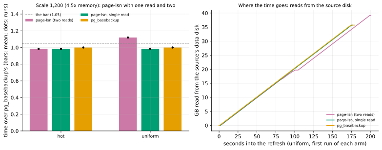

# EXP-85: Single-read page-lsn: does sending each chosen page from the scan's own read restore the tie with a re-clone at 4.5x memory?

Status: **done October 30, 2026. Every VM prediction held: at scale 1,200, uniform, single read took 0.984x `pg_basebackup`'s time against two reads' 1.119x, and read S exactly once.** Stage 1: L1 held (120 of 120), L2 failed as registered (9 of 10 controls wrong). The VM stage ran on the owner's decision after [EXP-85b](EXP-85b-control-retest.md) showed single read doesn't change the control's rate. Pre-registered October 30, before any scored run.

## Question

**EXP-84's one page-lsn miss:** in H2's uniform cell (scale 1,200, about 36 GB on 8 GB VMs, 28% of the pages changed), `--fast-path page-lsn` took **1.123x `pg_basebackup`'s time** (199.3 s against 177.6 s). In its other nine held-out cells it took 0.86–0.98x.

**The mechanism found after the scoring** (post-hoc, `analysis/exp84_posthoc.py`):
- In that cell it read **1.108x S** from the source's data disk: 3.9 GB more than the 35.7 GB of S. In every other cell it read S once (0.996–1.000x).
- That disk ran at its cap, about 205 MB/s, so the extra reads cost about 19 s of the 21.8 s gap.
- page-lsn reads each main-fork page twice. Its scanner reads every page to choose it by its LSN. The sending thread then reads each chosen page again, up to two files later, expecting it still in the page cache. At 4.5x memory, some weren't.

**The change, structural rather than tuned** (the idea archive's "single-read page-lsn"): send each chosen page from the bytes the scan read, so each page of S is read exactly once. A page-lsn refresh then never reads more than `pg_basebackup` does.

**Rule 15:** H2's cells were spent by EXP-84, so they may be used to diagnose and tune. Single-read page-lsn can become page-lsn's default only after a held-out session on H5–H8.

## What was built (before this registration)

- **`fastpath.lsn_held_runs`:** one read of a file, in 8 MiB chunks, yielding the runs to send with their bytes:
  - the pages page-lsn chooses;
  - every page past B's length;
  - each clean gap of up to `--fill-gaps` pages between two chosen pages, taken from the previous chunk when a gap crosses a chunk boundary;
  - the runs cut at 1 MiB, as `matching.runs` cuts them.

  A randomized test (400 files, every chunk size, gap and run length) checks that its runs and bytes equal what page-lsn sends after `lsn_pages`, `fill_gaps` and `matching.runs`, and that each page is read once. Two deliberate mutations of its chunk-boundary logic each failed that test.
- **`--lsn-single-read`** (opt-in, with `--fast-path page-lsn` only):
  - the scanner thread hands each chunk's runs to the sending thread through a queue of at most `LSN_HELD_BYTES // LSN_SCAN_BYTES` items (about 256 MiB);
  - the sending thread hashes and sends them, then ends each file with `FILE_DONE_WRITTEN`, as before.
- **New statistics:**
  - `fast_path.reread_bytes`: what the two-read path reads again; 0 with single read;
  - `fast_path.held_bytes_peak`: the most the scanner held ahead of sending;
  - `fast_path.lsn_single_read`.
- **Tests:**
  - the property test, and a test that a run is held only while a later page can join it;
  - the mode check;
  - real-server refreshes with single read of a cleanly stopped copy (against two reads), a base backup and a killed standby: each copy correct, nothing read again.
- **Harnesses:**
  - `trials.py --single-read`;
  - `timing.py --arms ... page-lsn-1`;
  - the lab's arm `lsn1` (`lsn` with `--lsn-single-read`).

## Design

### Stage 1: local (rule 13), PostgreSQL 17.11 on the Mac

- **Correctness:** EXP-82's campaign, with every page-lsn refresh single read.
  - 40 trials each of a stopped standby, a base backup taken under load, and a killed standby, plus 10 negative controls (a base backup whose start was moved to its end): 130 trials, seed 850.
  - `experiments/summaries_off/trials.py --per-arm 40 --on-demand 0 --controls 10 --seed 850 --single-read --out docs/experiments/data/exp85-trials.csv`.
- **Timing scale model:** `experiments/summaries_off/timing.py --scale 100 --repeats 3 --seed 851 --arms page-lsn page-lsn-1 --out docs/experiments/data/exp85-timing.csv`, in the hot and scatter cells.
  - The Mac holds the 1.6 GB database in memory, so the two arms should take about the same time.
  - The ratio is logged as rule 13's proxy pair, to show what the local stage can't see.
- **The smoke** (seed 859; decides nothing) passed: 3 of 3 single-read trials correct, the control wrong, and nothing read again.

### Stage 2: the VMs, H2's spent cells

- **The `ha` set:** n2d-highcpu-8, pd-balanced 150 GB data disks, us-west1 first, as in EXP-84.
- **One lab run:** `experiments/network/lab_exp64.sh` with `SCALE=1200 STANDBY_TOO=1 FULL_CHECK=1 SERIES=1 PATTERNS="hot uniform" ARMS="sb_lsn sb_lsn1 full"`, 2 runs per arm (12 runs), shuffled, seed 850.
  - **B0s** is a standby stopped cleanly, as in EXP-84's H2 cells.
  - **`sb_lsn`:** page-lsn with two reads.
  - **`sb_lsn1`:** page-lsn, single read.
  - **`full`:** `pg_basebackup`.
- **Smoke first:** scale 20, seed 859; every run exits 0 and every copy matches.
- **The analysis,** committed before the data: `analysis/exp85.py`, dry-run on the smoke's local files and on EXP-84's H2 runs. Data `docs/experiments/data/exp85-trials.csv`, `exp85-timing.csv` and `exp85-runs.csv`; figure `exp85-single-read`.

## Predictions

Times are each arm's mean over its runs.

**L1. Local, deciding for stage 2:** all 120 single-read page-lsn trials come out correct:
- exit 0, the fast path used, with its expected proof;
- rows equal to S's and `pg_amcheck` clean;
- no byte read again.

**L2. The negative control** is wrong in all 10 trials, so the check can see a wrong copy.

**1. Deciding:** in uniform, single read takes **at most 1.05x `pg_basebackup`'s time**, EXP-84's bar, which two reads missed there at 1.123x.

**2.** In uniform, if two reads miss again (at least 1.05x `pg_basebackup`), single read takes at most 0.95x of their time. If two reads don't miss again, 2 is not testable, and that is reported.

**3. The mechanism:** in each cell, single read's source-disk reads are at most 1.01x `pg_basebackup`'s.

**4. No cost where nothing changed much:** in hot, single read takes at most 1.024x two reads' time (rule 17's spread), and at most 1.05x `pg_basebackup`'s.

**5.** Every copy matches the source. Single read holds at most `LSN_HELD_BYTES` plus two 8 MiB chunks in every run.

**Reported, not predicted:**
- the scan's seconds;
- the time after the scan;
- `reread_bytes`;
- `held_bytes_peak`;
- a timeline of the source disk's reads per arm;
- the local time ratio beside the VM ratio, for rule 13's proxy log.

## What follows

- **If L1 or L2 fails,** stage 2 doesn't run, and the failing trials show why.
- **If 1 and 3 hold,** single read restores page-lsn's tie with a re-clone at 4.5x memory. It becomes the candidate for page-lsn's default, which needs a held-out session on H5–H8 (rule 15).
- **If 3 holds and 1 fails,** the extra reads were not the whole loss. The disk timelines locate the rest.
- **If 3 fails,** single read does not read each page once as built, and it goes no further.

## The rules this session runs under

- **Rule 13:** local correctness gates the VMs. The local time ratio is logged against the VM ratio.
- **Rule 15:** H2's cells are spent, so this is a tuning cell, not a held-out one.
- **Rule 16:** `analysis/integrity.py register EXP-85` records the analysis and its helpers, the harnesses, the lab and the disk sampler, and pgdelta's modules.
- **Rule 17:** every bar is far outside the 2.40% spread for runs of 10 s or more, except 4, which is the spread itself. EXP-84's gap was 12.3%.

## Workflow check

| | Check | For this experiment |
|---|---|---|
| 1 | Situation, standard, competitor | Summaries off at 4.5x memory: page-lsn lost to a re-clone (`pg_basebackup`), 1.123x (EXP-84) |
| 2 | The bottleneck | 11% extra source-disk reads at the disk's cap, measured from EXP-84's disk counters (post-hoc) |
| 3 | Systems or algorithm | Systems: the algorithm needs one read of each page, and the build read the chosen ones twice |
| 4 | Papers and prior art | WAL-G's catch-up and `pg_probackup`'s DELTA mode decide and send from one read of each page |
| 5 | Committee-grade | Pre-registered; analysis committed before the data; the negative control kept; a randomized property test against the two-read path |
| 13 | The cascade | Tests, then the local campaign and scale model, then the VMs; the local/VM ratio pair logged |
| 14 | The idea archive | Single-read page-lsn, added after EXP-84 |
| 15 | Held-out workloads | H2 is spent; a default needs H5–H8 |
| 16 | Scorer integrity | Recorded at registration; correctness gate on every copy; the control kept |
| 17 | The noise bar | 2.40% spread; deciding bar 1.05x against a 12.3% effect |

## Results, stage 1 (local)

**Scorer integrity (rule 16):** `analysis/integrity.py check EXP-85` reports 15 of 15 files unchanged since the registration commit (e86ddce).

**The correctness campaign** (130 trials, seed 850, PostgreSQL 17.11 on the Mac; `docs/experiments/data/exp85-trials.csv`):

| # | Prediction | Result |
|---|---|---|
| L1 | All 120 single-read page-lsn trials correct, with the expected proof, nothing read again | **Held: 120 of 120.** Each kind of old copy (stopped standby, base backup under load, killed standby) 40 of 40; `reread_bytes` 0 in all |
| L2 | The negative control wrong in all 10 trials | **Failed: 9 of 10 wrong** (rows unequal in all 9; `pg_amcheck` failing in 8). Trial 6 came out correct |

**About trial 6 (looked at after the scoring; decides nothing):**
- **The control is random by design.** It moves a base backup's start to its end, so a page changed during the backup and stale in B stays unsent. Whether any page of the tables compared is both changed during the backup and stale in B depends on the timing of the copy and the load.
- **EXP-82 registered this control as "at least 8 of 10 wrong"** for that reason. There, 3 of its 10 wrong copies differed only in a few rows of `pgbench_history`. This registration asked for all 10, which was stricter than that precedent. The result stands as registered: **L2 failed**.
- **Single read can't change a control's outcome.** No load runs after the control's backup, so the source is idle during the refresh. Single read then chooses the same pages as two reads, and sends the same bytes: the property test checks that on any file at rest. That is an argument from the code, not a measurement.
- **What the control is for still shows:** the check found 9 wrong copies of 10.

**The scale model** (scale 100, 1.6 GB, in the Mac's memory; 3 runs each; `docs/experiments/data/exp85-timing.csv`; reported, not predicted):

| Cell | Two reads, mean | Single read, mean | Ratio | Bytes read again (two reads; single read) | Held at most (single read) |
|---|---|---|---|---|---|
| hot | 0.643 s | 0.555 s | **0.863** | 31 MB; 0 | 8 MB |
| scatter (about half the pages) | 2.656 s | 2.965 s | **1.116** | 754 MB; 0 | 216 MB |

- **In memory, the second reads cost little,** since they come from the page cache. Single read's own cost then shows: in scatter it was 12% slower (median 1.09x).
  - That cost is most likely the scanner copying each chosen page into its run in Python (`lsn_held_runs` adds one page at a time). It is post-hoc and untested; a profile would decide it.
  - On the VMs the scanner waits on the disk, which may hide that cost or not: stage 2 would show it.
- **Rule 13's proxy:** these local ratios go into `proxy-fidelity.csv` beside the VM ratios, if stage 2 runs.
- **The held bytes** stayed within the bound: 216 MB at most, against 272 MiB.

## What follows stage 1

**By the registered rule, stage 2 does not run.** The owner decides between:
- **running stage 2 as registered,** with L2 recorded as failed and the reason above;
- **first measuring whether single read changes the control's rate:** a new pre-registered local run of controls with one read and with two, at EXP-82's bar (at least 80% wrong in each), then stage 2;
- **or stopping here.**

**The owner chose the second (October 30): [EXP-85b](EXP-85b-control-retest.md) held.** 28 of 30 single-read controls were wrong and 25 of 30 two-read ones (Fisher p = 0.42). So single read doesn't change the control's rate, about 88% wrong, and trial 6 was the control's own randomness. L2 stays failed as registered, and stage 2 runs as registered.

**Separately, a structural fix for the CPU cost in memory:** add each run of contiguous chosen pages to its run as one slice, not page by page. It would be a new build, timed in its own registration, not a change to this one.

## Results, stage 2 (the VMs)

**The session:**
- **Where:** the `ha` set in us-west1-b and -c, the zones of EXP-84's H2 cells.
- **The smoke** passed at scale 20.
- **The cells** ran 04:57 to 06:56 UTC: the database at 35.6 GB, then hot, then uniform, two runs per arm.
- **Every run** exited 0. The set was torn down after the fetch, and no VM or disk of it is left.
- **Data:** `docs/experiments/data/exp85-runs.csv`; the raw runs in `results/exp04/exp85-h2` (not in git).

**Scorer integrity (rule 16):** `analysis/integrity.py check EXP-85` lists one file changed since registration, `analysis/exp85.py`. After the scoring, its figure's legend was moved off the bars (`loc` and `ylim`), and nothing else changed. Its printed scores were identical before and after.

*How to read it:*
- **Left:** each arm's time over `pg_basebackup`'s in each cell. The bars are means, the dots the two runs. Bars below the dashed line meet the bar of 1.05.
- **Right:** the GB read from the source's data disk during the first uniform run of each arm, from the 0.25 s disk counters. Two reads go on past S's 35.7 GB; single read stops with `pg_basebackup`.

| # | Prediction | Result |
|---|---|---|
| 1 | **Deciding:** uniform, single read at most 1.05x `pg_basebackup` | **Held: 0.984x** (174.70 s against 177.62 s) |
| 2 | Uniform, if two reads miss again: single read at most 0.95x of them | **Held: 0.879x.** Two reads missed again, at 1.119x `pg_basebackup` (198.78 s) |
| 3 | Single read's source-disk reads at most 1.01x `pg_basebackup`'s, each cell | **Held:** 1.000 (uniform) and 1.0007 (hot). Two reads read 1.102x in uniform |
| 4 | Hot: single read at most 1.024x two reads, and at most 1.05x `pg_basebackup` | **Held:** 1.000x (174.13 s against 174.18 s), and 0.983x |
| 5 | Every copy correct; single read held at most `LSN_HELD_BYTES` plus two chunks | **Held:** 8 of 8 pgdelta copies matched. It held at most 16 MiB, against the 272 MiB bound |

| Cell | Arm | Runs (s) | Scan (s) | After the scan (s) | Read again | Source disk read |
|---|---|---|---|---|---|---|
| uniform | two reads | 198.81, 198.76 | 179.0, 179.3 | 19.8, 19.5 | 13.99 GB | 39.2, 39.5 GB |
| uniform | single read | 174.68, 174.72 | 173.8, 173.8 | 0.86, 0.88 | 0 | 35.7 GB |
| uniform | `pg_basebackup` | 177.62, 177.63 | | | | 35.7 GB |
| hot | two reads | 174.16, 174.20 | 173.2, 173.2 | 0.93, 0.95 | 0.19 GB | 35.6 GB |
| hot | single read | 174.15, 174.11 | 173.3, 173.2 | 0.85, 0.87 | 0 | 35.6 GB |
| hot | `pg_basebackup` | 177.21, 177.04 | | | | 35.5–35.6 GB |

**Reported, not predicted:**
- **EXP-84's miss reproduced:** two reads took 198.78 s against EXP-84's 199.35 s, and read 1.102x S against 1.108x.
  - `pg_basebackup` moved 0.03% (uniform) and 0.09% (hot) between the two sessions, inside rule 17's 1% for a control arm.
  - Of two reads' 13.99 GB read again, about 3.6 GB came from the disk. At the disk's cap (about 205 MB/s) that is about 18 s of the 24 s two reads lost against single read: 5.3 s more scanning, and 18.8 s more after the scan. The rest is not accounted for by these counters.
- **Single read's scan ran at the disk's cap and ended 0.9 s before the refresh did.** It held at most 16 MiB ahead of sending: the sending thread kept up, so the 256 MiB bound was never near.
- **The in-memory CPU cost** stage 1 found (1.116x in scatter) did not show here: the scan waits on the disk.
- **The noise:** each arm's two runs differed by at most 0.1%. With this session, rule 17's 95th percentile for runs of 10 s or more is 2.23% (it was 2.40%).

**Rule 13's proxy log** (`docs/research/proxy-fidelity.csv`, figure `proxy-fidelity`):

| Cell (local; VM) | Local ratio, in memory | VM ratio, scale 1,200 | VM over local |
|---|---|---|---|
| hot; hot | 0.863 | 1.000 | 1.159 |
| scatter; uniform | **1.116** | **0.879** | 0.788 |

- **In the second pair the sign flipped:** the local scale model called single read slower, and the VMs found it 12% faster.
- **The pattern across the summaries-off work:** all six local/VM pairs of EXP-82 and EXP-85 lie outside rule 13's band (0.875–1.185 of the local ratio). Those mechanisms turn on reads beyond memory, which a scale model held in memory can't show. So, for them, the local stage is a correctness gate and not a timing proxy, and the VMs decide.

## What followed

- **Single read restores page-lsn's tie with a re-clone at 4.5x memory:** 0.984x `pg_basebackup`, against two reads' 1.119x. It reads each page of S once, as `pg_basebackup` does.
  - It cost nothing measurable where few pages changed.
  - It was correct in 120 of 120 local trials and 8 of 8 VM copies.
- **It stays opt-in (`--lsn-single-read`) for now** *(since then: EXP-87 held in 7 of 7 held-out cells, and it has been page-lsn's default since K16, October 30)*. Making it page-lsn's default is a default change, so rule 15 needs a held-out session on H5–H8 first.
- **The claim in RESULTS:** with single read, page-lsn ties or beats a re-clone on every setting measured: 0.86–0.98x in EXP-84's nine cells, and 0.98x in both H2 cells here. That claim still has to pass H5–H8.
- **Rule 13, for mechanisms that turn on reads beyond memory:** local timings don't predict the VMs, so the local stage gates correctness only.
- **Still open:** single read's CPU cost in memory (1.116x in scatter), which a faster run builder could remove (one slice per run of contiguous pages). It doesn't show on the VMs measured.
