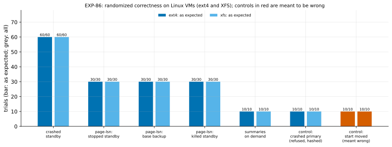

# EXP-86: Randomized correctness on Linux VMs, on ext4 and XFS

Status: **done October 30, 2026: every prediction held.** 320 of 320 deciding trials correct by the fast path (160 on ext4, 160 on XFS): wrong copies below 0.93% per refresh at 95%. All 20 crashed primaries refused and hashed correctly, all 20 negative controls wrong, all 360 trials run as asked (Linux's `sync_file_range` path among them). Pre-registered October 30, before any scored run.

## Question

**Do the fast path's correctness results, measured on the Mac, hold on the Linux VMs where every timing is measured?**
- **What was measured where:**
  - the randomized campaigns ran on the Mac (macOS, APFS): EXP-80's 100 crashed standbys, EXP-82's 120 page-lsn trials, EXP-85's 120 single-read trials;
  - on the VMs, each timed copy was checked, but those were dozens of scripted copies, not randomized ones.
- **What differs on Linux:**
  - the filesystems: ext4 on the VMs' data disks, and XFS with reflinks, which EXP-81 used;
  - the receiver's sync path: `--fsync worker-writeback` starts write-back with `sync_file_range`, which exists only on Linux (elsewhere it falls back to the plain worker);
  - the page cache and the scheduling of a live source's reads and writes.

## Design

**Where:**
- **The `ha` set:** n2d-highcpu-8, Debian 12, PostgreSQL 17.11 (PGDG), pd-balanced data disks, us-west1 first.
- **Its two VMs each run the campaigns on their own `/data`,** at the same time:
  - **ext4:** the source VM's `/data`, as `startup.sh` makes it;
  - **XFS:** the destination VM's `/data`, reformatted by `infra/gcp/reformat_dest_xfs.sh` (reflink=1).
- The VMs' roles as source and destination don't matter here: each runs a whole campaign alone, its clusters under `TMPDIR=/data/exp86`.

**The driver:** `experiments/linux_campaign/campaign.py`. It runs EXP-80's and EXP-82's labs and trials, unchanged except for a hook that passes the receiver's `--fsync` per trial and records its `fsync_mode`. On each filesystem:
- **The summaries campaign** (EXP-80's lab, `summarize_wal` on), 70 trials, seed 860 (ext4) or 861 (XFS):
  - **`crashed-standby`, 60 (deciding):** a standby killed mid-load by `pg_ctl -m immediate` or by SIGKILL, then more load, then the summaries' fast path. Proof "crashed standby", by K15's default.
  - **`crashed-primary`, 10 (control):** the source killed and its directory copied. The fast path must be refused ("in production") and the copy hashed.
- **The page-lsn campaign** (EXP-82's lab, `summarize_wal` off), 110 trials, seed 862 (ext4) or 863 (XFS):
  - **`lsn-standby`, `lsn-backup` and `lsn-crashed`, 30 each (deciding):** a stopped standby, a base backup taken under load, and a killed standby, then page-lsn. **Half of each arm's trials use `--lsn-single-read`.**
  - **`on-demand`, 10 (deciding):** `summarize_wal` turned on at refresh time, then the summaries' fast path.
  - **`lsn-backup-end`, 10 (negative control):** a base backup with its start moved to its end, half with single read. Expected wrong.
- **Each trial's receiver** uses `--fsync auto` (the sync worker with the fast path, the main loop without) or `--fsync worker-writeback`, half each. Arms and modes are shuffled together.
- **Every copy** is started and compared with S: each pgbench table's rows by md5, the history's count and sum, and each side table's rows. Each is also checked with `pg_amcheck --heapallindexed`.

**The smoke** runs first on both VMs (seed 869, a few trials per arm; decides nothing). It is scored by the registered analysis, and the campaigns start only if 1, 2 and 4 hold on both filesystems.

**The analysis,** committed before the data: `analysis/exp86.py`, dry-run on a local run of the driver (macOS: there 4 fails as it should, since `worker-writeback` falls back to `worker`). Data `docs/experiments/data/exp86-{ext4,xfs}-{summaries,page-lsn}.csv`; figure `exp86-linux`.

## Predictions

Per filesystem:

1. **Deciding: every deciding trial takes the fast path with its expected proof and comes out correct.** That is exit 0, rows equal to S's and `pg_amcheck` clean, for 130 trials per filesystem:
   - `crashed-standby` (60): "crashed standby";
   - `lsn-standby`, `lsn-backup` and `lsn-crashed` (30 each): "clean shutdown in recovery", "backup_manifest" and "crashed standby";
   - `on-demand` (10): the summaries' fast path.

   With no failure, wrong copies stay below 2.3% per refresh at 95% on each filesystem, and below 1.2% over both.
2. **Every crashed primary is refused** the fast path ("in production"), hashed, and correct.
3. **At least 80% of the negative controls are wrong** (EXP-82's bar; EXP-85b measured about 88%).
4. **Every trial runs as asked:**
   - the receiver's `fsync_mode` is "worker" (fast path) or "main" (hashed) for `auto`, and "worker-writeback" for `worker-writeback`, Linux's own path;
   - single-read trials report `lsn_single_read` and re-read nothing;
   - two-read trials re-read what they sent.

**Reported:** the 95% upper bounds, per filesystem and over both.

## What follows

- **If 1 to 4 hold,** RESULTS states the correctness claims for Linux on ext4 and XFS, beside the Mac's. Those claims cover the summaries' fast path with crashed standbys, page-lsn with one read or two, summaries on demand, and both sync paths. Then the H5–H8 held-out session (the owner's decision, October 30).
- **If 1 fails,** the failing trials are compared with their filesystem and modes. No claim is made for that setting until the cause is found and fixed, and a fix is re-tested in a new registration.
- **If 2 or 3 fails,** the controls' failing trials show what the check missed.
- **If 4 fails,** the trials ran other than asked, and the campaign doesn't speak for the paths it missed.

## The rules this session runs under

- **Rule 13:** the correctness gate, on the platform where timings are measured.
- **Rule 15:** no held-out cell is used.
- **Rule 16:** `analysis/integrity.py register EXP-86` records the driver, both labs, the analysis, the XFS script, and pgdelta's modules.
- **Rule 17:** counts against registered bars, not timings.

## Workflow check

| | Check | For this experiment |
|---|---|---|
| 1 | Situation, standard, competitor | Correctness, the precondition of every speed claim, on the sponsor's platform |
| 2 | The bottleneck | Not the question |
| 3 | Systems or algorithm | Not the question |
| 4 | Papers and prior art | EXP-80's and EXP-82's designs, from PostgreSQL's recovery rules (minimum recovery point; full-page writes after a backup's start) |
| 5 | Committee-grade | Pre-registered; randomized; negative controls; per-trial checks that each path ran as asked |
| 13 | The cascade | The VMs, as the gate for the platform the timings use |
| 14 | The idea archive | No new idea; it tests the built ones on Linux |
| 15 | Held-out workloads | Not used |
| 16 | Scorer integrity | Recorded at registration; the controls kept |
| 17 | The noise bar | Not a timing |

## Results

**The session:**
- **Where:** the `ha` set in us-west1-b and -c.
  - The destination's `/data` was reformatted XFS (reflink=1); the source's stayed ext4.
  - Both ran PostgreSQL 17.11 (PGDG, Debian 12).
- **The smoke** passed on both filesystems, scored by the registered analysis. It showed `worker-writeback` in effect on Linux.
- **The campaigns** ran 12:51–13:28 UTC: 180 trials on each VM at once.
- **Teardown:** the set was torn down after the fetch, and no VM or disk of it is left.
- **Data:** `docs/experiments/data/exp86-{ext4,xfs}-{summaries,page-lsn}.csv`.

**Scorer integrity (rule 16):** `analysis/integrity.py check EXP-86` reports 14 of 14 files unchanged since the registration commit (fd7edc8).

**A correction to the registration's text, not its design:** it said 130 deciding trials per filesystem, with bounds of 2.3% and 1.2%. Its own design adds up to 160 (60 + 3 x 30 + 10), and those 160 ran. The analysis counts what ran, and the bounds below are for 160 and 320.

*How to read it:* for each arm and filesystem, the bar is the trials that came out as expected, out of the number run (the label). In blue, the copies came out correct. In red, the negative control's copies came out wrong, as they should.

| # | Prediction | ext4 | XFS |
|---|---|---|---|
| 1 | **Deciding:** every deciding trial by the fast path, with its proof, correct | **Held: 160 of 160** (crashed standby 60, page-lsn's stopped standby 30, base backup 30 and killed standby 30, on demand 10) | **Held: 160 of 160**, the same |
| 2 | Every crashed primary refused and hashed, correct | **Held: 10 of 10** | **Held: 10 of 10** |
| 3 | At least 80% of the negative controls wrong | **Held: 10 of 10** | **Held: 10 of 10** |
| 4 | Every trial as asked: its sync path, one read or two | **Held: 180 of 180** | **Held: 180 of 180** |

**The bounds:** with no wrong copy, wrong copies stay below **1.85% per refresh at 95% on each filesystem, and 0.93% over both** (320 deciding trials).

**What ran, per filesystem:**
- **Read modes:** 45 deciding page-lsn trials with single read, and 45 with two reads.
- **Sync paths:** the receivers used the sync worker ("worker") or the main loop for hashed refreshes ("main") under `auto`, and "worker-writeback" (`sync_file_range`) when asked, about half each.
- **Kills:** every crashed standby was killed mid-load by `pg_ctl -m immediate` or SIGKILL.

## What followed

- **The correctness claims now hold on the platform where every timing is measured,** on both filesystems. They cover the summaries' fast path with crashed standbys (K15's default), page-lsn with one read or two, summaries on demand, and both of Linux's sync paths. RESULTS says so, beside the Mac's campaigns.
- **The controls behaved:** every crashed primary was refused, and every moved-start control came out wrong. So the check could see a wrong copy on Linux too.
- **Next, by the owner's order:** the H5–H8 held-out session ([EXP-87](EXP-87-held-out-h5-h8.md)).
