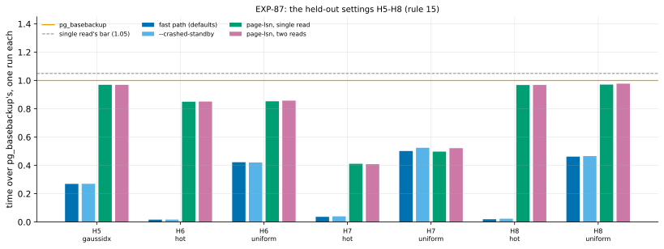

# EXP-87: The second held-out session (rule 15): single read, crashed standbys and the fast path on H5–H8

Status: **done October 30, 2026: every prediction held in all 7 held-out cells.** Single read took 0.41–0.97x `pg_basebackup`'s time and 0.95–1.007x two reads'; `--crashed-standby` and the fast path's defaults held; 28 of 28 copies matched. Single read is eligible to become page-lsn's default (the owner's decision). Pre-registered October 30, before any run. It follows [EXP-86](EXP-86-linux-correctness.md), the owner's order of October 30: the Linux correctness campaign first, then this.

## Question

**Do the claims made on tuned settings hold on settings sealed on October 30, before any of this tuning?**

| Candidate | Its claim on tuned settings | Evidence | What a pass allows |
|---|---|---|---|
| `--lsn-single-read` | page-lsn with one read of S: at most 1.05x `pg_basebackup`, and no slower than two reads | EXP-85 (0.984x at scale 1,200, uniform; 1.000x two reads in hot) | **page-lsn's default** (the owner's decision) |
| `--crashed-standby` (the default since K15) | A crashed standby refreshed correctly at the clean standby's cost | EXP-80, EXP-80b, EXP-84 | Keeps K15's default |
| The fast path's defaults | Faster than `pg_basebackup` below about 91% of the pages | EXP-79b, EXP-84 | Keeps the claim |

## The sealed settings, as [held-out-workloads.md](../research/held-out-workloads.md) defined them on October 30

| Setting | What differs | Cells | Built at first use (this registration) |
|---|---|---|---|
| **H5** | pgbench's update on `pgbench_accounts`, rows drawn from a Gaussian over `aid` (5.0), with a secondary index on `abalance`, so no update is HOT; scale 600 on the ha set | 1 (`gaussidx`) | The lab's pattern `gaussidx`: the index made before B0; 1% of the rows' worth of single-row updates (scale x 1,000) on 8 clients. Each copy's check also reads through the index (sequential scans off) |
| **H6** | Source and destination with 32 GB of memory (n2d-standard-8), scale 600, hot and uniform | 2 | `infra/gcp/sets/hm.sh` |
| **H7** | Local NVMe SSD data disks, two striped (RAID 0), scale 600, hot and uniform | 2 | `infra/gcp/sets/hn.sh` (`DATA_DISK=local-nvme`, `LOCAL_SSDS=2`) |
| **H8** | PostgreSQL 17.11 with data checksums off and `wal_log_hints = on`, scale 600, hot and uniform | 2 | The lab's `CHECKSUMS=0` (`source_cluster.py --no-checksums`) and `WAL_LOG_HINTS=1` (a restart, checked) |

## Design

**One lab run per setting** (`experiments/network/lab_exp64.sh`, as in EXP-84):
- **`CRASHED=1`:** B0 is a standby killed 30 s into the change.
- **`STANDBY_TOO=1`:** B0s is a standby stopped cleanly before the change.
- **`FULL_CHECK=1`** and **`SERIES=1`**, with summaries on.

**The arms, one run each per cell,** shuffled:

| Arm | Old copy | What runs |
|---|---|---|
| `fast8wf2c` | B0 (crashed) | The fast path's defaults, with `--crashed-standby` |
| `sb_fast8wf2` | B0s (clean) | The fast path's defaults |
| `sb_lsn1` | B0s | `--fast-path page-lsn --lsn-single-read` |
| `sb_lsn` | B0s | `--fast-path page-lsn` (two reads) |
| `full` | — | `pg_basebackup` |

**One run per arm:** as in EXP-84, a held-out session asks whether effects transfer, and every bar but 5 sits far outside rule 17's spread.

**The schedule:**
- **Set `ha`** (n2d-highcpu-8, pd-balanced, us-west1 first): a smoke of `gaussidx` and of H8's configuration at scale 20 (seed 879), then H5 (seed 870), then H8 (seed 873).
- **At the same time, set `hm`** (us-central1 first): a smoke, then H6 (seed 871), then torn down.
- **Then set `hn`:** a smoke, then H7 (seed 872).
- Every set is torn down after its fetch.

**The analysis,** committed before the data: `analysis/exp87.py`, dry-run on EXP-84's and EXP-85's runs. Data `docs/experiments/data/exp87-cells.csv`, figure `exp87-held-out`.

## Predictions

Per cell, from the tuned results. **A miss narrows that candidate's claim to the cells where it held, and is never tuned away** (rule 15).

1. **Single read:** it takes the fast path ("clean shutdown in recovery"), reads nothing twice, its copy is correct, and it takes **at most 1.05x `pg_basebackup`'s time**.
2. **`--crashed-standby`:** it takes the fast path ("crashed standby"), its copy is correct, and it takes at most the larger of 1.10x and +1.0 s of the clean standby's time.
3. **The fast path's defaults:** faster than `pg_basebackup` exactly where the unfilled plan sends under 91% of the listed pages.
4. **Every copy matches the source:** all four pgdelta arms, in every cell.
5. **Single read takes at most 1.024x two reads' time** (rule 17's spread; EXP-85: 1.000 in hot, 0.879 in uniform). EXP-85's scale model found single read 1.116x slower in memory, so H6 (memory) and H7 (fast disks) are where this could miss.

**Reported:** every arm over `pg_basebackup`; each cell's pages chosen; two reads' and single read's bytes read again, and single read's held bytes; H5's change (transactions, seconds, pages chosen).

## What follows

- **If 1 and 5 hold in every cell,** single read is eligible to become page-lsn's default, and RESULTS says so. The change is the owner's decision.
- **A miss** narrows that candidate's claim in RESULTS and its README row.
  - For single read, a miss of 5 alone (slower than two reads, but within 1.05x `pg_basebackup`) points to the in-memory cost EXP-85 found. The archive's faster run builder would be the next build, and it would be tested on spent cells.
- **K15's default stands if 2 holds.** A miss goes to the owner with the cells.
- **Every cell used here is spent** (rule 15). Before any tuning uses them, new held-out settings are sealed.

## The rules this session runs under

- **Rule 15:** the milestone session for single read. Nothing here is tuned on these settings.
- **Rule 16:** `analysis/integrity.py register EXP-87` records the analysis and its helpers, the lab, `source_cluster.py` and its study, the disk sampler, the infra scripts and set files, and pgdelta's modules.
- **Rule 17:** one run per arm. The bars sit far outside the 2.23% spread, except 5, which is that spread.

## Workflow check

| | Check | For this session |
|---|---|---|
| 1 | Situation, standard, competitor | Each candidate against its standard: a re-clone (`pg_basebackup`), the clean standby, two reads |
| 2 | The bottleneck | Not the question: transfer of measured effects |
| 3 | Systems or algorithm | Not the question |
| 4 | Papers and prior art | RRSI's and ADRS's held-out lesson (the RSI review) |
| 5 | Committee-grade | Pre-registered; settings sealed before the tuning they now judge; analysis committed before the data |
| 13 | The cascade | VMs only: these are VM settings |
| 14 | The idea archive | Each candidate's row updated with the result |
| 15 | Held-out workloads | This is it |
| 16 | Scorer integrity | Recorded at registration |
| 17 | The noise bar | 2.23% spread; 5's bar is the spread itself |

## Results

**The session:**
- **ha** (us-west1-b and -c): H5 from 14:43 to 15:17 UTC, then H8 to 16:18.
- **hm** (us-central1-c and -f; the first zone pair failed the quota check): H6.
- **hn** (us-east4-a and -b): H7, to 16:11.
- **Every smoke passed.** The sets checked out as specified:
  - H8's source reported `data_checksums off` and `wal_log_hints on`;
  - hm's VMs had 31 GB of memory;
  - H5's copy check also read through the `abalance` index.
- **Every run** exited 0.
- **The gcloud sign-in expired during the session,** after every cell had finished on its VMs. The fetch and teardown waited until the owner signed in again at about 18:30 UTC, so the sets stood idle for about two hours. The data were already on the VMs, and nothing was re-run.
- **Every set is torn down;** no VM or disk of ha, hm or hn is left.
- **Data:** `docs/experiments/data/exp87-cells.csv`; the raw runs in `results/exp04/exp87-h5` to `-h8` (not in git).

**Scorer integrity (rule 16):** `analysis/integrity.py check EXP-87` reports 23 of 23 files unchanged since the registration commit (e728abc).

*How to read it:* each group is one held-out cell. Each bar is one arm's time over `pg_basebackup`'s in that cell (one run each). The orange line is `pg_basebackup`, and the dashed line is single read's bar of 1.05.

| # | Prediction | Result |
|---|---|---|
| 1 | Single read: the fast path, nothing read twice, correct, at most 1.05x `pg_basebackup` | **Held in 7 of 7:** 0.850–0.971x on H5, H6 and H8; 0.411x and 0.497x on H7 (local NVMe) |
| 2 | `--crashed-standby`: proven, correct, at most max(1.10x, +1.0 s) of the clean standby | **Held in 7 of 7:** at most +0.36 s where the refresh takes about 2 s, and 1.046x at most where it takes 16–43 s |
| 3 | The fast path faster than `pg_basebackup` exactly below 91% of the pages | **Held in 7 of 7:** 0.017–0.50x at 0.5–28.2% of the pages |
| 4 | Every copy matches the source | **Held:** 28 of 28 pgdelta copies |
| 5 | Single read at most 1.024x two reads | **Held in 7 of 7:** 0.953–1.007x |

| Setting | Cell | Pages chosen | Fast path (defaults) | Crashed standby | Single read | Two reads | `pg_basebackup` |
|---|---|---|---|---|---|---|---|
| H5 skewed, non-HOT | gaussidx | 17.5% | 25.0 s (0.269) | 25.0 s | 90.0 s (0.970) | 89.9 s | 92.8 s |
| H6 32 GB of memory | hot | 0.5% | 1.73 s (0.017) | 1.76 s | 87.6 s (0.850) | 87.7 s | 103.1 s |
| | uniform | 28.2% | 43.5 s (0.422) | 43.3 s | 87.9 s (0.853) | 88.4 s | 103.0 s |
| H7 local NVMe | hot | 0.5% | 1.16 s (0.036) | 1.28 s | 13.1 s (0.411) | 13.1 s | 31.9 s |
| | uniform | 28.2% | 16.4 s (0.501) | 17.1 s | 16.2 s (0.497) | 17.0 s | 32.6 s |
| H8 checksums off | hot | 0.5% | 1.74 s (0.019) | 2.11 s | 87.6 s (0.968) | 87.7 s | 90.5 s |
| | uniform | 28.2% | 42.0 s (0.462) | 42.3 s | 88.2 s (0.971) | 88.8 s | 90.8 s |

*In brackets: over `pg_basebackup`'s time.*

**Reported, not predicted:**
- **H5's change:** 600,000 single-row updates in 266 s. With the index on `abalance`, none was HOT, and 17.5% of the pages were chosen. The fast path took 0.269x `pg_basebackup`.
- **On local NVMe (H7), page-lsn beats a re-clone outright** (0.41–0.50x).
  - With reads that fast, `pg_basebackup`'s 32 s is set by writing a whole new copy. page-lsn writes only the pages that changed.
  - In the uniform cell, page-lsn with single read (16.2 s) matched the summaries' fast path (16.4 s).
- **On H6, `pg_basebackup` took 103 s,** against 90–91 s on the 8 GB VMs, while page-lsn took the same 88 s. So single read came out at 0.85x there. Why the re-clone was slower with more memory was not measured.
- **Single read's in-memory cost** (EXP-85's scale model, 1.116x) showed nowhere, not even on 32 GB of memory or on NVMe. It held at most 265 MiB ahead of sending (H7 uniform), within its bound.

## What followed

- **Single read held in every held-out cell, so by this registration it is eligible to become page-lsn's default.** The change is the owner's decision. RESULTS and its README row say it is eligible.
- **K15's default stands:** `--crashed-standby` held on every held-out setting so far (17 cells over EXP-84 and EXP-87).
- **The fast path's defaults held** on a skewed, index-heavy workload, with 32 GB of memory, on local NVMe, and without checksums.
- **H5–H8 are spent** (rule 15) and may be used to tune. [held-out-workloads.md](../research/held-out-workloads.md) seals **H9–H12** in their place, before any of that work starts.
