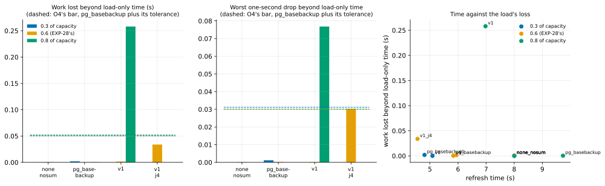
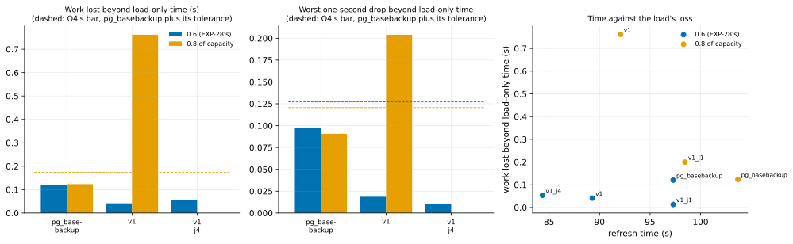
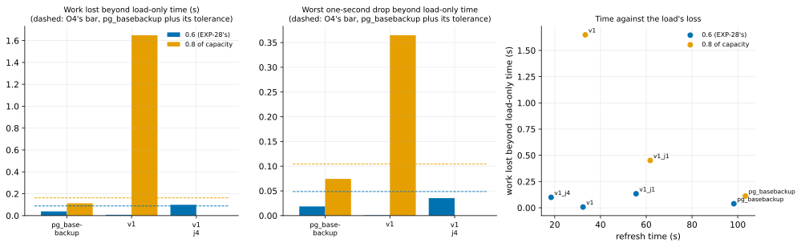

# EXP-88: On a loaded primary, at three load levels and beyond memory, does pgdelta still cost the load no more than `pg_basebackup` — and what does the WAL-summary fast path cost?

Status: **done November 6, 2026 — 77 runs over three stages, scored. The deciding prediction failed in every
shape.** `v1` at the shipped two-worker default meets O4 at 0.3 and 0.6 of the source's measured capacity, and
**misses it at 0.8** in all three cluster shapes, by 5× to 31× the registered tolerance. The worst cell is the
one that looks easiest — 18 GB comfortably in page cache — where the refresh runs fastest and costs the load
most. The registered consequence, a load-aware worker cap, is a product change and is the owner's. `v1_fast`
never ran (amendment 1), so the fast path's cost to a live load is still unpriced, and prediction 7 turned out
unrunnable as written. Full numbers in [Results](#results).

Originally **pre-registered October 30, 2026, before any run and before any VM for it existed.** Three VMs per
session (source, dest, client), three cluster shapes, about 9–12 hours of VM time in all. It serves the three
slowdown gaps [RESULTS](../RESULTS.md) lists as open — a moderate load, a large dirty set, a source near
saturation — and prices two things that have never been measured: the fast path's cost to a live load, and the
cost of the prerequisite it needs.

Where this document and the [decision ledger](../DECISIONS.md) disagree, the ledger wins. Departures from it
are listed under [Changes from the ledger](#changes-from-the-ledger-rule-8).

---

## Question

O4 is the owner's bar: **a refresh must cost the source's load no more than one `pg_basebackup` stream under
the same load.** [EXP-28](EXP-28-live-slowdown.md) met that bar — but at **one** load level, on **one** cluster
of about 1 GB that fits easily in RAM, on local NVMe, with the hashing path only. Its own limitations say so:

> One load (EXP-12's bank load at 0.6 of capacity), one cluster size (about 1 GB, mostly static), one machine
> shape. EXP-12's moderate level and its large-dirty-set cluster are not run.

Four things follow, and none is measured:

1. **Does the verdict hold at other load levels?** A source at a third of capacity has spare CPU; one at four
   fifths does not. O4's answer could differ at both ends.
2. **Does it hold beyond memory?** [EXP-48](EXP-48-disk-term.md) showed that past RAM, v1's verification
   re-read stops coming from the page cache and becomes a disk pass. On a capped disk that is the floor, and it
   is the condition Omni's DR actually has. Every slowdown number so far is from data that fit in RAM.
3. **What does the WAL-summary fast path cost the load?** [EXP-64](EXP-64-fast-path-beyond-memory.md) measured
   its *speed* (18 GB of local changes in 1.98 s, 0.022 of a full copy). Its cost to a workload has never been
   measured at all — the fast path has never been run against a live loaded source.
4. **What does its prerequisite cost *while a backup runs*?** The fast path needs `summarize_wal = on`.
   Its standing cost is **already measured and largely settled** by the EXP-83 series — this experiment does
   **not** claim to measure it first. What EXP-83 did not have is a backup running on top, which is the only
   thing added here. See [What EXP-83 already settled](#what-exp-83-already-settled-do-not-re-claim-it).

---

## What EXP-83 already settled (do not re-claim it)

A four-part series (EXP-83, -83b, -83c, -83d, the last two done October 29, 2026) measured what
`summarize_wal = on` costs a busy server **with no backup running**. Its findings stand, and this experiment
cites them rather than repeating them:

| Condition | Throughput ratio (on ÷ off) | p99 ratio | Sessions |
|---|---|---|---|
| **In memory**, 32 clients | 1.029 [0.9999, 1.058] | 0.999 | two (with EXP-83b's 0.996) |
| **In memory**, 90 clients | 1.010 [0.9991, 1.020] | 0.964 | two |
| **Beyond memory** (17 GB on 8 GB), EXP-83c | 0.948 [0.887, 1.010] | **1.205** [1.030, 1.379] | |
| **Beyond memory**, EXP-83d, no switch in the data | 0.971 [0.925, 1.018] | **1.22** [1.10, 1.35] | two |

So: **in memory it costs nothing measurable; beyond memory p99 rises about 20%.** The summarizer's own CPU is
0.78–0.96 ms per MB of WAL in every cell.

**The mechanism is unresolved, and EXP-83d says so plainly:** its two registered hypotheses were both refuted.
The summarizer read **0.0%** of its WAL from storage — all of it from the page cache — so the cost is not its
own disk reads. Post-hoc, with summaries on the data disk wrote **24% more besides WAL** (33.9 against
27.4 MB/s) and read about 3.5% more, which points at the summarizer **displacing cached data pages**. Those
cells were bound by commit fsyncs on the persistent disk, not by CPU.

**What this experiment adds, and only this:** every EXP-83 cell was idle of backups. Here a backup runs on top
of the summarizer, at three load levels. If the cost is cache displacement, then a concurrent backup — which
reads B in bulk and evicts cache itself — is exactly the condition under which the two could compound. So the
`none` vs `none_nosum` pair here is a **control for the backup arms, and a possible contribution to EXP-83d's
open mechanism question**, not a first measurement of anything.

Because of that, this experiment records disk read and write bytes besides WAL on both ends in every arm, which
is the measurement EXP-83d had to reach for post-hoc. If the 24% write amplification appears again and grows
with a backup running, that is evidence for displacement; if it does not, that is evidence against.

**Prediction 7 is rewritten accordingly** (see Predictions): it no longer asks whether the prerequisite is
cheap — EXP-83 answered that — but whether EXP-83's beyond-memory penalty **survives, vanishes or compounds**
once a backup is running.

## Design

### Staged, so the core question is answered first and cheaply

Revised October 30, 2026, before any run, to put the cheapest decisive stage first. **Each stage gates the
next**: if stage 1 cannot reproduce EXP-28's cell, nothing else runs; if stage 1 shows O4 met at every level,
stage 2 asks whether that survives beyond memory; stage 3 runs only if stage 2 finds a difference to explain.

| Stage | Source and dest | RAM | Data disk | Cluster | Runs | Wall time | Answers |
|---|---|---|---|---|---:|---:|---|
| **1 pilot** | `n2-standard-8` ×2 | 32 GB | local NVMe | ~2 GB (EXP-28's) | 45 | ~1.2 h | **Does O4 hold at 0.3 and 0.8 of capacity?** Plus: what `summarize_wal` costs; is the fast path's window even measurable at 2 GB |
| **2 beyond memory** | `n2-highcpu-8` ×2 | **8 GB** | balanced PD | **18 GB** | 16 | ~2 h | **Does O4 survive beyond memory, and what does the fast path cost once its window is long enough to measure?** |
| **3 page cache** | `n2-standard-8` ×2 | 32 GB | balanced PD, **matched to stage 2** | 18 GB | 16 | ~2 h | *Only if stage 2 differs:* does the effect survive when B fits in cache? |

A `n2-standard-4` client VM runs the load in every stage.

**Why 18 GB on 8 GB of RAM, not 50 GB on 32 GB.** "Beyond memory" is a ratio, not a size: what matters is that
B no longer fits in page cache, so v1's verification re-read becomes a disk pass (EXP-48). 18 GB on an 8 GB
machine is beyond memory by 2.25×, and it is **the exact shape EXP-48 modelled and EXP-64 ran** — so stage 2's
numbers sit directly beside theirs instead of beginning a new size nobody else has measured. It also copies
2.8× less data, and copying B was the dominant cost of the earlier 50 GB plan.

`n2-highcpu-8` keeps 8 vCPUs, so the load still has the CPU EXP-28's load needs, and it is in the **N2** family
— the pool with 200 vCPUs free, not the N2D pool that is full.

### What stage 3 actually isolates (corrected)

An earlier draft said stage 3 "isolates the disk effect". **That was wrong, and the error mattered.** Stages 2
and 3 use the **same** storage (balanced persistent disk) and the **same** data (18 GB); the only thing that
changes is **RAM, 8 GB → 32 GB**. So the contrast is a **page-cache contrast**, not a disk one: it asks whether
the effect survives once B fits in cache, which is a different question from what the disk does.

That distinction is not pedantic here. EXP-83d's unresolved mechanism is **cache displacement** — the
summarizer appearing to evict data pages, with 24% more non-WAL writes to show for it. A page-cache contrast is
exactly the right instrument for that hypothesis, and calling it a disk contrast would have pointed the
analysis at the wrong cause.

**To keep the comparison interpretable, everything but RAM is held matched between stages 2 and 3:**

| Held constant | Value |
|---|---|
| Storage | balanced persistent disk, same size and type |
| Cluster | 18 GB, built by the same script and seed |
| vCPUs | 8 |
| CPU platform | pinned to the same minimum on both (`--min-cpu-platform`), so a different host generation cannot be mistaken for the cache effect |
| Machine family | N2 (`n2-highcpu-8` and `n2-standard-8` are both N2) |
| Zone, image, load, arms, levels, seeds | identical |
| **Varied** | **RAM only: 8 GB → 32 GB** |

Pinning the CPU platform is new in this revision and is the reason the stages are comparable at all: without
it, `n2-highcpu-8` and `n2-standard-8` could land on different host generations and the difference would be
unattributable.

**Known cost of the smaller shape, stated:** with 8 GB of RAM the load's own working set is more disk-bound, so
stage 2's `none` baseline is slower and noisier than stage 1's. Every verdict is a within-session ratio against
`full` under the same load, so this does not bias the comparison — but it widens the intervals, which is why
stage 2 takes two extra runs at any cell landing near its bar.

### The load

EXP-28's, unchanged, so its cell is reproducible: the bank scripts (`commit.sql` at 99, `abort.sql` at 1),
open loop, `pgbench -n -M prepared -c 128 -j 4 -R R`, driven **from the client VM over the network**, every
transaction logged to the client's tmpfs. The client is on its own VM because a client sharing the source's CPU
charges CPU-heavy arms more than an application on another host would feel — the flaw that made EXP-12's
verdict fragile.

**Capacity is measured, not assumed.** C is the median of three 30-second closed-loop runs at 128 clients
after a 30-second warm-up, taken at set-up **in every session**. EXP-12 recorded a trial whose capacity was
10.9% below its own smoke run's, so C is a per-session quantity and the levels are computed from it:

| Level | Rate |
|---|---|
| `L30` | R = 0.30 × C |
| `L60` | R = 0.60 × C (**EXP-28's level**, the reproduction) |
| `L80` | R = 0.80 × C |

Absolute rates will differ between sessions. That is accepted: every number this experiment decides is a
**within-session ratio**, which is what both of the registered formulas are.

### Arms

| Arm | What it is | Why |
|---|---|---|
| `none` | load only, `summarize_wal = on` | the null that W and D are net of |
| `none_nosum` | load only, `summarize_wal = **off**` | **new:** prices the fast path's prerequisite |
| `full` | `pg_basebackup -Fp -X stream -c fast`, one stream, `--sync-method=fsync` | **O4's bar** |
| `v1` | pgdelta live, in place, hashing path, at the shipped default (`--source-kind live`, `--jobs` from the default rule: at most CPUs ÷ 4, so 2 on 8 vCPUs) | the product as it ships |
| `v1_fast` | the same plus `--fast-path summaries` |
| `v1_j4` | **diagnostic:** v1 with `--jobs 4` on the source, at the 0.6 level only — the cell EXP-28's spike came from | **new:** the fast path against a live load |

`v1` and `v1_fast` refresh an old copy B taken at set-up; each run starts from a fresh copy of it. `full`
copies into a new directory, deleted after the run's tail. Both take a fast start checkpoint
(`--checkpoint fast`, pgdelta's default).

The fast path's guard v2 takes B's end only from a clean shutdown's checkpoint, a cleanly stopped standby's
minimum recovery point, or a base backup's manifest. B here is a `pg_basebackup`, so the manifest route
applies and the guard should pass. **An arm whose guard refuses is recorded as refused, not as a failure** —
refusing is the guard's job, and EXP-62 exists because it once failed to.

### What the pilot does and does not replicate (added before running)

EXP-28's headline was a **cliff between 2 and 4 source workers**: at 4 workers p95 went 6.4 → 74.3 ms and p99
9.3 → 114.6 ms, failing its deciding prediction and moving the shipped default to at most 2 workers on
8 vCPUs.

The `v1` arm here runs the **shipped default**, which on an 8-vCPU source is **2 workers**. So on its own this
experiment would reproduce only EXP-28's *two-worker* result and would say nothing about the four-worker spike
that motivated the cap. Claiming otherwise would be the kind of overreach rule 12 asks to be checked for.

Two ways to be honest about that, and this experiment takes the second:

1. narrow the claim to "reproduces EXP-28's two-worker cell"; or
2. **add a `v1_j4` diagnostic cell at the 0.6 level** — EXP-28's own level — so the spike is either reproduced
   or shown absent.

**This is a change to the design, recorded here before any run (rule 8).** It adds 3 runs to stage 1 (48
instead of 45) and nothing to stages 2 or 3. It is a **diagnostic, not a decision**: `v1_j4` is not the
shipped default, so whether it meets O4 changes no product behaviour. Its purpose is to tell a failure of the
replication gate from a change in conditions.

**The gate, stated precisely.** Stage 1 passes, and stages 2 and 3 may run, when both hold at the 0.6 level:

- **`v1` at the shipped default meets O4** — as EXP-28 found for 2 workers; and
- **`v1_j4` misses O4, or meets it only at twice the tolerances** — as EXP-28 found for 4 workers unthrottled
  (0.073 s of work against a 0.05 s floor, 0.047 of a worst drop against 0.03).

If `v1_j4` comes out clean at 0.6, the instrument is not reproducing EXP-28 and nothing downstream is
trustworthy until that is explained. EXP-28 itself flags this risk: the 4-worker miss "did not repeat
identically in the next session", so a second reading here is worth having either way.

### Cells and runs

Each run is a 15 s settle (load only, receiver already listening), the timed arm from t0 to t1 on dest's
clock, then a 10 s tail. Order is shuffled by a recorded seed. **3 repeats per cell.**

| Stage | Arms | Levels | Repeats | Runs |
|---|---|---:|---:|---:|
| 1 | 5 (`none`, `none_nosum`, `full`, `v1`, `v1_fast`) + `v1_j4` at 0.6 only | 3 (0.3, 0.6, 0.8) | 3 | **48** |
| 2 | 4 (`none`, `full`, `v1`, `v1_fast`) | 2 (0.6, 0.8) | 2 | 16 |
| 3 | 4 (as stage 2) | 2 (0.6, 0.8) | 2 | 16 |

*Stage 3 holds storage, cluster, vCPUs, CPU platform, zone, image, load, arms, levels and seeds matched to stage 2, and varies RAM alone.*

**What the later stages drop, and why.** `none_nosum` runs only in stage 1: pricing `summarize_wal` needs a
loaded source, not a large one, and the answer carries. The 0.3 level runs only in stage 1: the load-level
sweep is the pilot's question, while beyond memory the interesting cells are the reference (0.6) and the stress
(0.8). Repeats fall from 3 to 2 in stages 2 and 3, with **two extra runs at any cell whose excess over `full`
lands within 20% of its δ** — EXP-28's own rule, which spends repeats where they change a verdict instead of
spreading them evenly.

80 runs in all, against 135 in the first draft. No link shaping: **no artificial delay is added**. Network
latency is EXP-13's question, not this one.

### What is measured

**Deciding — O4's two numbers,** as EXP-12's change 3 defines them and EXP-28 applied them, from the client's
log over `[t0, t1 + 10 s]` in 1-second buckets, mapped to dest's clock by chrony's offsets:

- the worst drop **D** = max(1 − X_b/S_b);
- the work lost **W** = Σ max(0, S_b − X_b)/R,

where S_b counts the transactions scheduled in a bucket and X_b those completed in it. Net values subtract the
same cell's median over the `none` runs; below 0 counts as 0.

**"Meets O4"** (EXP-12's floors, EXP-28's wording):

> W_net(arm) − W_net(full) ≤ δ_W = max(0.05 s, 0.15 × W_net(full)), **and**
> D_net(arm) − D_net(full) ≤ δ_D = 0.03.

Verdicts are also given at half and twice the floors (K7). An arm whose excess over `full` lies within 20% of
its δ on either number gets two more runs at that cell.

**Reported, not deciding:**

- **p50, p95 and p99** over the window, and the registered increase against the matched `none` cell:

  > p95 increase (%) = (p95 during backup ÷ p95 without backup − 1) × 100

  and the same for p50 and p99.
- **Throughput loss:** TPS loss (%) = (1 − TPS during backup ÷ TPS baseline) × 100.
- **Failed transactions** per arm, from pgbench's own log (a latency field of `failed` or `skipped`). **New:**
  `analysis/exp28.py`'s "failed" counts failed *runs*, not failed transactions.
- backup duration; the source's VM-wide CPU-seconds (`/proc/stat`); disk read and write bytes on both ends.

**Why the percentile ratios do not decide.** A ratio of two p95s compounds the tail noise of both, and at 3
repeats its interval is wide. W and D are an integral and a maximum over 1-second buckets, far more stable, and
they are what O4 is already written in. Inventing a latency pass/fail threshold here would create a second,
weaker bar beside the owner's — so the percentiles are reported beside the verdict and never instead of it.

**Why the null is a matched cell, not a paired window.** A no-backup window of the same duration taken
elsewhere in the run is not matched if the load drifts, and EXP-12 recorded its load's database growing during
the session. So each arm's null is the median of that cell's own `none` runs, with run order shuffled — EXP-28's
method, kept.

### Committed before the data, and recorded under rule 16

`experiments/network/lab_exp88.sh` (the driver, on dest) and `analysis/exp88.py` (the analysis and the figure
`exp88-slowdown-by-load`). Neither may be written after a run.

**Rule 16 (scorer integrity).** Before the first run, `analysis/integrity.py register EXP-88 --commit <sha>`
records the SHA-256 of every file that scores this experiment, runs it, or is under test:

- `analysis/exp88.py` and any helper it imports;
- `experiments/network/lab_exp88.sh`, `source_cluster.py`, `measure.py`, `agent.py`;
- the load scripts `experiments/network/load/commit.sql` and `abort.sql`;
- `infra/gcp/create.sh`, `teardown.sh` and this experiment's set file;
- the pgdelta modules under test: `live.py`, `inplace.py`, `fastpath.py`, `hashing.py`, `cli.py`.

When the results are written, `analysis/integrity.py check EXP-88` must be run and its output quoted in this
document. Any file that changed after registration is listed with the reason it changes no score — the check
exits non-zero on a change, so a silent edit cannot pass unremarked.

Registering `fastpath.py` matters here specifically: `v1_fast` is the first arm to exercise the fast path
against a live loaded source, and a mid-session change to it would invalidate every `v1_fast` cell before it.

---

## Predictions

Written before any run. Each says what would prove it wrong.

1. **`full` costs the load little at `L30` and `L60`** (W_net under 0.1 s, as EXP-28 measured 0.000), **and
   measurably more at `L80`.** *Wrong if `full` costs nothing measurable even at 0.8 of capacity* — in which
   case O4's bar is "nothing measurable" at every level and every arm is judged against that.
2. **`v1` at the shipped two-worker default meets O4 at `L30` and `L60` in shape P**, reproducing EXP-28's
   *two-worker* cell — and only that cell. *Wrong if it misses at `L60`*, which would contradict EXP-28 and
   stop the experiment until the disagreement is explained.
2b. **The diagnostic `v1_j4` at `L60` misses O4, or meets it only at twice the tolerances**, reproducing
   EXP-28's four-worker cell. *Wrong if it meets O4 cleanly* — then the instrument is not reproducing EXP-28,
   and the gate fails even though prediction 2 held. EXP-28 records that this miss "did not repeat identically
   in the next session", so this is the prediction most likely to come out ambiguous; an ambiguous result is
   reported as such and not read as a pass.
3. **Deciding: `v1` meets O4 at `L80` in every shape.** *Wrong if it misses at `L80`* — then the shipped
   default is not safe on a source near saturation, and live mode needs a load-aware worker cap (D50, D81).
4. **With B beyond cache (stage 2), `v1`'s work lost is at least twice its value with B cached (stage 3)** at
   the same level, because the verification re-read must then reach the disk rather than the page cache.
   *Wrong if the two differ by less than 1.5×*, which would mean the re-read is not what costs the load beyond
   memory and EXP-48's model does not carry over to slowdown. Note this is a **page-cache** contrast: the disk
   is the same in both stages, so a difference is attributable to what fits in cache, not to the device.
5. **`v1_fast` costs the load less than `v1` at 50 GB** (both shapes), since it reads only the blocks the
   summaries list instead of all of B. *Wrong if it costs the same or more* — then the fast path buys speed at
   no saving in load, and its 1.98 s win comes with an unchanged bill.
6. **In shape P the fast path's window is under 1 second,** so its W and D are **not judged** there: fewer than
   two 1-second buckets cannot support either number, and a p99 over under a second of transactions is
   meaningless. This is recorded as "too fast to measure", not as a pass. *Wrong if the window exceeds 2 s*,
   in which case P's fast-path cell is judged like the others.
7. **EXP-83's beyond-memory penalty reproduces with no backup, and does not grow when one runs.** Concretely:
   in stage 2's `none` vs `none_nosum` pair, p99(on) ÷ p99(off) falls inside EXP-83d's interval
   [1.10, 1.35]; and the same ratio computed inside the backup window of the `v1`/`v1_fast` arms is **no
   larger** than it is in `none`. *Wrong if the in-window ratio exceeds the no-backup one by more than its own
   interval* — which would mean the summarizer and a concurrent backup compound, supporting EXP-83d's
   displacement reading and making `summarize_wal` a cost that must be reported beside the fast path's speed.
   In stage 1 (in memory) the expectation is EXP-83's: **no measurable difference**, so a difference there
   contradicts two prior sessions and is a reason to stop and explain rather than to publish.
8. **No failed transactions in any arm,** and every copy correct: `pg_verifybackup`, recovery, the load's
   balance invariant, row counts and `pg_amcheck`. *Any wrong output stops the speed work* (rule: correctness
   first).

---

## What follows

- **If 3 holds:** O4 is met across 0.3–0.8 of capacity and at 50 GB, and RESULTS' "within `pg_basebackup`'s"
  row widens from one load level to three and from 1 GB to 50 GB, with its conditions.
- **If 3 fails:** the default worker count becomes load-aware, and the cap is reported with the time it costs.
  That is a product change, so it is the owner's.
- **If 4 holds:** slowdown beyond memory is a disk effect, and the HA/DR guidance must say that v1's cost to a
  loaded source rises once B stops fitting in cache.
- **If 5 fails:** the fast path's pitch changes from "faster and cheaper" to "faster, same cost", which matters
  for whether it should ever be the default.
- **If 7 fails:** every slowdown number in EXP-12, EXP-28, EXP-30 and EXP-39 contains an unpriced `summarize_wal`
  overhead, and each needs a note.
- **Rule 11:** a deciding ratio within 0.05 of its bar gets a second session on a fresh pair, on another day.

---

## Limitations, known before running

- **One load shape.** EXP-12's bank scripts. TPROC-C is a follow-up (below), not this.
- **B is minutes old, not hours.** Each `v1` run refreshes the previous run's output, so it is the
  frequent-refresh case. A refresh after hours of churn reads and sends more (EXP-38's axis).
- **No added latency.** Source and dest are in one region at the zone's own rate. DR's round trips are
  EXP-13's.
- **One zone, one image, one session per shape.** Rule 11 gives a second session only where a deciding ratio
  lands near its bar.
- **50 GB is not TB scale.** No ratio is projected past the sizes measured (rule 10).
- **The fast path needs `summarize_wal` on;** Omni ships with it off (EXP-44). So `v1_fast` measures a
  configuration an operator must opt into, and prediction 7 prices that opt-in.
- **`pg_amcheck` on a 50 GB cluster is slow,** so it runs once per cell rather than once per run, after the
  cell's last repeat.

---

## Amendments after the harness was built, before any run (rule 8)

Writing the driver surfaced three things the registration got wrong or left open. All three are recorded here
before any VM exists, and none is resolved by quietly changing what runs.

### 1. `v1_fast` has two *structural* blockers, not just a timing one

The registration deferred `v1_fast` because `--fast-path` now has two modes and page-lsn's default read strategy
is being settled by EXP-87. Building the driver found two further reasons it cannot simply be switched on here,
both in `pgdelta/fastpath.py`:

- **An in-place refresh destroys the lineage proof.** Guard v2 takes B's end only from a clean shutdown's
  checkpoint, a cleanly stopped standby's minimum recovery point, or a base backup's `backup_manifest`
  (`fastpath.py:10-12`). This experiment, like EXP-28, refreshes **one B in place**, so after the first run B is
  the previous run's output rather than the `pg_basebackup` whose manifest the guard reads.
- **The `none_nosum` blocks create a summary gap.** With `summarize_wal` off, no summaries cover that interval,
  so a fast-path run scheduled after an off-block has no coverage from B's end and the guard refuses. The
  driver records `summary_gap` per run so this is visible rather than mysterious.

**Consequence, stated:** `v1_fast` does not run in stage 1, and enabling it without fixing these would produce
a column of refusals that says nothing about the fast path's cost. When it does run it needs **a freshly taken
base backup as B before each fast-path run**, and must not follow a `none_nosum` block. Whether that belongs in
this experiment or in its own is the owner's call; at 2 GB re-taking B is cheap, at 18 GB it is not.

A refusal remains a *recorded pass*, not a failure — the guard refusing is the guard working (EXP-62).

### 2. Prediction 8's correctness checks are not in this driver

Prediction 8 asks for `pg_verifybackup`, recovery, the load's balance invariant, row counts and `pg_amcheck`.
**The driver does not run them, and EXP-28's did not either.** What it does record is per-transaction
`failed`/`skipped` counts and both ends' exit codes.

So prediction 8 is split, honestly:

- **8a, judged here:** no failed or skipped transactions attributable to an arm, and every run exits 0.
- **8b, NOT judged here:** copy correctness. It is a separate pass, and **no speed or slowdown claim from this
  experiment may be published before 8b has run** — the project's rule is correctness first, and a slowdown
  number from a run that produced a wrong copy is meaningless. EXP-86 established correctness for the hashing
  and page-lsn paths on Linux (320 of 320), which is the standing evidence 8b leans on; this experiment adds
  no new correctness evidence and must not be read as if it did.

### 3. Which hash `v1` runs, and why it is the conservative choice

The registration said `v1` runs "the shipped default". pgdelta's shipped default is `--hash auto`, which picks
BLAKE3 where both ends have the package. The driver instead pins **BLAKE2b**, to match EXP-28's cell so the
replication gate compares like with like.

That choice is deliberate and it cuts **against** pgdelta, which is why it is acceptable: EXP-60 measured BLAKE3
at 0.872 of BLAKE2b's time, with each hashing phase about 0.58 of BLAKE2b's, so BLAKE2b spends **more** source
CPU per page. O4 measures what the refresh costs the load, so a BLAKE2b `v1` is the pessimistic arm. If it meets
O4, the shipped configuration with BLAKE3 meets it too.

**What this does not license:** quoting these absolute latencies as the shipped product's. They are the
BLAKE2b configuration's, and the write-up must say so wherever a number is given.

### 4. The scorer was re-registered after the smoke run, and why

Rule 16 first recorded the scorer at `d132fda`. The smoke run (stage 1, 5 runs at L60, **not counted data**)
then showed `analysis/exp88.py` reporting "the fast path did not activate (the guard refused)" for the `v1` and
`v1_j4` arms — which never pass `--fast-path`, so no guard was ever consulted. Two causes: the note did not
separate "refused" from "never requested", and `fast_path_reasons` was never carried from `run.json` into the
run row, so the distinction could not be made. Both fixed at `c663e68`, and rule 16 re-registered there:
**16 of 16 files unchanged**.

This is legitimate precisely because it happened **before any counted run existed**. A smoke run is not scored
data — the project's convention throughout (EXP-28's smoke is recorded "not counted"), and the whole purpose of
rule 16 is that the scorer is fixed before the results it scores. The same change made after the grid would
have had to be declared as a post-hoc change to the scorer, with every number re-read.

Worth recording for its own sake: **the synthetic fixture could not have caught this.** It never wrote a run
that asked for the fast path and was refused, so the two cases were indistinguishable in the tests while being
distinguishable in life. The test that asserted the old wording was itself encoding the bug.

### 5. A `v1_j1` arm near saturation, added because prediction 3 failed (rule 8)

Stage 1 found the shipped two-worker default **missing O4 at 0.8 of capacity** by 5.2 times the work-lost
tolerance, while meeting it cleanly at 0.3 and 0.6. The registered consequence is a load-aware worker cap. But
stage 1 cannot say what that cap should be, or whether one exists: it ran **one** worker count near saturation.

So the live question is now narrower and sharper than the registration anticipated: **is any worker count safe
at 0.8?** EXP-28 found one worker meeting O4 at 0.6 on this machine shape, in twice the time of two. Whether it
still does at 0.8 is the difference between "cap the workers" and "pgdelta cannot meet O4 near saturation at
all", and those imply very different products.

**Added, before the runs:** a `v1_j1` arm, and `v1_j4` extended to L80 (stage 1 ran it at L60 only). The driver
needs no change — it derives `--jobs N` from any arm named `v1_jN`. Cells: `none`, `full`, `v1`, `v1_j1`,
`v1_j4` at L60 and L80, 3 repeats, on stage 1's machine shape so the comparison is direct. 30 runs, about
1 hour, about 2 USD.

`v1` runs again rather than being carried over from stage 1: W and D are net of **that session's own** `none`
runs, so each session must be self-contained, and it doubles as a replication of stage 1's L80 miss.

**Predictions, before any run:**

1. `v1_j1` meets O4 at L60, as EXP-28 found one worker doing at 0.6.
2. **Deciding: `v1_j1` meets O4 at L80.** *Wrong if it misses* — then no worker count tested meets O4 near
   saturation on this shape, a worker cap is not a sufficient remedy, and the live path needs something else
   (throttling its reads, or backing off on observed latency). That is a materially worse finding than stage 1's
   and would be reported as such.
3. `v1_j4`'s excess over `full` at L80 is larger than at L60: the cost grows with load.
4. `v1` reproduces stage 1's L80 miss (W excess above 0.05 and D excess above 0.03). *Wrong if it meets O4* —
   then stage 1's headline does not replicate within the same shape and nothing downstream stands until that is
   explained.

**What follows:** if 2 holds, the cap's floor is one worker near saturation and the write-up reports the time
that costs (EXP-28: about twice two workers'). If 2 fails, the finding is that pgdelta's live path misses O4
near saturation at every worker count measured, and the remedy is an owner-level design question rather than a
default change.

### 6. Two harness changes after stage 1, and one optimisation rejected (rule 16)

**Declared, and the scorer re-registered:**

- **`lab_exp88.sh`: a `RUNS=` invocation no longer writes into the grid's directory.** The registered
  near-the-line rule's documented mechanism (`RUNS="arm:level" SKIP_SETUP=1`) restarted the run index at 0 and
  wrote into the grid's own output directory, so `run-000` onwards were overwritten. On 2 November that happened:
  the grid's `full`/L30/rep0 and `none`/L30/rep0 were replaced by the two extra `v1_j4` runs. **Nothing was lost
  only because the grid had already been fetched** — luck, not design. A `RUNS=` invocation now gets its own
  session directory, and a run directory that already holds a run makes the driver **stop rather than replace
  it**. The guard is there as well as the fix because the convention had already failed once.
- **`infra/gcp/create.sh`: `MIN_CPU_PLATFORM` and `IMAGE` are read.** Stages 2 and 3 separate a page-cache
  effect by varying RAM alone, so an unpinned host generation would be unattributable. Both are no-ops when
  unset, checked against an unpinned set's dry run.

Neither changes a score: stage 1's data was collected and analysed before both, and neither file scores
anything — one provisions machines, the other orchestrates runs.

**Rejected: a per-level parse cache.** The analysis parses each level's log once per run, so L60's 120 MB log was
inflated and parsed 15 times; stage 1 took over an hour to score. A cache keyed on the path set was written and
then **withdrawn before use**: stage 1's three logs hold **27.3 million transactions**, and holding them as
parsed Python tuples cost about **4.4 GB** — measured at 5.09 GiB resident against the container's 7.6 GiB, on
the edge of being killed. It traded a tolerable time cost for an intolerable memory one. The analysis therefore
stays as registered, and the slow path is accepted: scoring runs detached and blocks nothing.

If it is worth optimising later, the shape is NumPy `int64` arrays (8 bytes a field rather than ~160) and
windowing before materialising — a larger change that would need its own verification that no number moves.

### 7. Stage 2 takes `v1_j1` in place of the deferred `v1_fast` (rule 8, before the runs)

Stage 2's registered arms were `none`, `full`, `v1`, `v1_fast`. `v1_fast` is deferred for the structural
reasons in amendment 1 (an in-place refresh destroys the manifest lineage proof; the `none_nosum` blocks open a
summary gap), so its slot is free.

Amendment 5 made **the worker floor** the live question: stage 1 showed the shipped two workers missing O4 at
0.8 of capacity, and what matters next is whether any count is safe there. Beyond memory is where that question
bites hardest, because past cache v1's verification re-read becomes a real disk pass (EXP-48) — the arm already
paying 5.2 times the tolerance in memory has more to lose, and one worker has half the reads in flight.

So stage 2 runs **`none`, `full`, `v1`, `v1_j1`** at L60 and L80, 2 repeats: the same arm count as registered,
with `v1_j1` in the deferred slot. The cell is informative whichever way amendment 5 falls — if one worker meets
O4 in memory, the question is whether it survives the disk pass; if it misses in memory, beyond memory can only
be worse and the cell says how much. Keeping it out would have meant a whole extra session later to ask it.

`SCALE=600` gives about 18 GB, the size `lab_exp64.sh` uses for the `ha` set, so stage 2's cluster is EXP-48's
and EXP-64's rather than a new one.

### 8. Stage 3's extra `v1_j4` cell, and the registered files that changed after the runs (rule 8, rule 16)

Recorded after stage 3's runs and before its cells were read.

**Stage 3 ran 18 runs, not the registered 16, and the extra two are additive.** The session was launched with
`ARMS='none full v1 v1_j1' LEVELS='L60 L80' SCALE=600` and no `L60_ONLY`, and the driver's default for that
variable is `${L60_ONLY:-v1_j4}`, which substitutes on *unset as well as empty*. So the plan gained a
`v1_j4`/L60 cell nobody asked for. Counted from the session log, every registered cell has its 2 repeats -
`none`, `full`, `v1`, `v1_j1` at both L60 and L80, 16 runs - plus `v1_j4`/L60 twice. **Nothing was displaced
and nothing was lost.**

This is the same deviation stage 2 had, from the same cause, which is the one piece of luck in it: both
beyond-memory and in-memory sessions carry the same unplanned cell, so the two stages remain comparable
including in the extra. The `v1_j4`/L60 cells are reported as an unregistered extra in both, and no verdict
rests on them.

The cause is worth naming because it is a general trap rather than a typo: `${VAR:-default}` substitutes the
default when `VAR` is empty *or* unset, while `${VAR-default}` substitutes only when unset. A driver that wants
"no diagnostic arm" to be expressible needs the second form. Not changed here - changing the driver between
stage 3's runs and its analysis is exactly the kind of edit rule 16 exists to prevent - and left as the next
driver change to make, before any further session uses `L60_ONLY`.

**Three registered files have changed since EXP-88 was registered at `6d97eaa`.** `integrity.py check EXP-88`
reports 13 of 16 unchanged, and the three are:

| File | Change | When, relative to EXP-88's runs |
|---|---|---|
| `infra/gcp/config.sh` | `MAX_RUN_HOURS` default (+5 lines) | declared in `944e1bb`, after stage 2 |
| `infra/gcp/create.sh` | self-termination flags (+11 lines) | declared in `944e1bb`, after stage 2 |
| `experiments/network/lab_exp88.sh` | EXP-93's arm names (+27/-7) | **after all three stages had run** |

**EXP-88's registration is deliberately left at `6d97eaa` rather than refreshed at the current commit.**
Re-registering now would record EXP-88's data as having been produced by code that did not exist when it ran,
which is the opposite of what rule 16 is for. The honest record is the one above: the check reports three
changed files, and each is accounted for.

What produced each stage, for the record: stage 3 was deployed at commit `8287300` (tree `05dc3b9d8a03`), which
is before the `lab_exp88.sh` edit. The `config.sh` and `create.sh` changes govern how long a VM lives and
nothing a run measures; they were made after a stage-2 set billed for about 57 hours because teardown needs a
live credential and the credential expired, and stage 3's VMs carried `maxRunDuration` 28800 s with
`DELETE` - verified on the live instances before the session started, not just in the set file.

The `lab_exp88.sh` change is additive: it adds `HASH_AHEAD`/`READ_AHEAD` and two arm names, and moves the
per-arm flag derivation above the receiver launch. Every EXP-88 arm derives byte-identical flags across the
change, which is now asserted by test rather than by inspection (`tests/test_exp88_lab.py`, five tests over
`none`, `none_nosum`, `full`, `v1`, `v1_j1`, `v1_j4`, `v1_fast` and the two new arms). EXP-93 is registered
separately at `051d681` with 18 files - EXP-88's 16 plus `pgdelta/sender.py` and `pgdelta/receiver.py`, which
EXP-88 should have registered and did not: `sender.py` performs the source-side reads W and D measure.

## Rules this experiment is run under

| Rule | What it requires here |
|---|---|
| 8 | Departures from the ledger are listed below, recorded before running |
| 11 | A deciding ratio within 0.05 of its bar gets a second session on a fresh pair, another day |
| 12 | Novelty checked: the `summarize_wal` arm is explicitly **not** novel (EXP-83), and the replication gate is narrowed to what the pilot actually tests |
| 16 | Scorer integrity: the analysis, harness and modules under test are registered before the first run and checked unchanged when results are written |

## Changes from the ledger (rule 8)

- **Three load levels instead of one.** The ledger's T10b asks "how many source workers each load level
  allows"; EXP-28 answered it at one level for lack of time. This widens the level, not the question.
- **A `summarize_wal` control arm,** not in the ledger. It is added because the fast path, built after T10b was
  written, makes the prerequisite a standing cost rather than a detail.
- **Balanced persistent disk for the 50 GB shapes,** where EXP-28 used local NVMe. The reason is realism:
  Omni's Kubernetes operator gives a node persistent disk, and EXP-57 found the checkpoint stall only once the
  disk was capped.
- **A `v1_j4` diagnostic cell at the 0.6 level,** not in the ledger, added so the EXP-28 replication gate
  tests the four-worker cell the cap came from rather than only the two-worker default. Diagnostic, not
  deciding: `v1_j4` is not the shipped default.
- **Stage 3 varies RAM alone,** with storage, cluster, vCPUs and CPU platform held matched to stage 2, and is
  described as a page-cache contrast rather than a disk one.
- **`us-east1` instead of `us-central1`,** where EXP-12 and EXP-28 ran. The reason is quota, not preference:
  `SSD_TOTAL_GB` has 100 GB free in `us-central1` against this experiment's 450 GB peak, and 500 GB free in
  `us-east1`. The consequence is recorded under "Zone, and why it is `us-east1`": verdicts rest on
  within-session ratios and are unaffected; absolute times are not compared with EXP-28's.

## HammerDB, and why pgbench goes first

The sponsor's brief discusses HammerDB TPROC-C, NOPM and latency percentiles, and this experiment does not use
it. The reason is measurement scope, not preference. `benchmarks/hammerdb_experiment.py` records the limitation
in its own words:

> Latency limitation: `JOBTIMING` percentiles cover a virtual user's whole elapsed time, including ramp-up.
> HammerDB records no time dimension for latency, so a window-aligned percentile cannot be derived from its
> instrumentation. Latency comparisons are therefore labelled whole-run and are not matched to the backup
> window the way throughput is.

O4's two numbers and every percentile here are defined **inside** `[t0, t1 + 10 s]`, so a whole-run percentile
cannot answer them. HammerDB's *throughput* is window-matched already, which is why it keeps NOPM below.

pgbench's `-l` log carries a completion timestamp and a latency for every transaction, which is exactly what a
windowed percentile needs. So:

1. **this experiment** — pgbench, windowed percentiles, O4's verdict;
2. **then HammerDB TPROC-C** — NOPM and throughput impact, with percentiles reported only at their correct
   scope, or after the runner learns to window them;
3. **then a real cross-region DR run** — actual RTT and refresh time, with no injected delay.

## Budget

Staged, so each stage can be stopped on its result. **Stage 1 alone answers the core question.**

| Stage | VMs | Wall time | Cost (approximate) |
|---|---|---:|---:|
| 1 pilot, 2 GB | `n2-standard-8` ×2 + `n2-standard-4`, local NVMe | ~1.2 h | **~$2** |
| 2 beyond memory, 18 GB | `n2-highcpu-8` ×2 + `n2-standard-4`, balanced PD | ~2 h | **~$2** |
| 3 page cache, 18 GB in RAM *(conditional)* | `n2-standard-8` ×2 + `n2-standard-4`, balanced PD, platform pinned | ~2 h | **~$2** |
| | | **~5 h** | **~$6** |

Against the first draft's three 50 GB shapes at ~9–12 h and ~$25–35. The saving is almost entirely the data
size: at 18 GB each copy of B takes about a third as long as at 50 GB, and B is re-copied before every `v1`
run.

These are approximate on-demand list prices for `us-east1` (roughly $0.39/h for an `n2-standard-8`, less for an
`n2-highcpu-8`, about $0.19/h for the `n2-standard-4` client, plus disks); they are not queried from the
billing API, and the real posted figure should be read from the console afterwards as the project does
elsewhere. Treat them as the right order of magnitude, not a quotation.

**Quota: nothing to raise.** In `us-east1`, checked October 30, 2026: `N2_CPUS` 200 free (every stage uses 20),
`SSD_TOTAL_GB` 500 free (peak need now about 250 GB at 18 GB clusters, down from 450),
`LOCAL_SSD_TOTAL_GB` unlimited (stage 1's data disk), `INSTANCES` 24 free, `IN_USE_ADDRESSES` 8 free.

---

## Results

**The session, in three parts.** Every timestamp below is the union of the scored runs' own `[t0, t1]` windows,
read from each run's `run.json`; the VM create and teardown times are not carried in the fetched results and are
not reconstructed here.

| Stage | Shape | Zone | Cluster | C (tps), measured | Runs | Scored window (UTC) |
|---|---|---|---|---:|---:|---|
| **1 pilot** | `n2-standard-8` ×2, 32 GB RAM, local NVMe ×4 | `us-east1-b` | ~2 GB, in cache | 31,152.5 | 39 | 2026-10-30 19:17 → 19:42 |
| **1 extra** | the same pair, `RUNS=` re-invocation | `us-east1-b` | ~2 GB | 31,152.5 | 2 | 2026-11-02 15:15 |
| **2 beyond memory** | `n2-highcpu-8` ×2, **8 GB** RAM, pd-balanced 150 GB | `us-east1-b` | 18 GB = 2.25× RAM | 32,933.2 | 18 | 2026-11-02 20:38 → 21:10 |
| **3 page cache** | `n2-standard-8` ×2, **32 GB** RAM, pd-balanced 150 GB | `us-east1-b` | 18 GB, in cache | 32,164.7 | 18 | 2026-11-05 06:09 → 06:33 |

**77 runs, 31 cells, every one judged.** Against the registration's 80: stage 1 lost `v1_fast`'s 9 runs to
amendment 1 and gained 2 near-the-line runs (41 of 48), and stages 2 and 3 each ran 18 of 16 — the unplanned
`v1_j4`/L60 cell of amendment 8, additive in both.

- **Capacity** was measured before each stage's runs, three 30 s runs at 128 clients after a 30 s warm-up
  (`rates.json`): stage 1 31,152.5 tps (runs 31,152.5 / 31,383.1 / 30,271.8), stage 2 32,933.2
  (33,290.3 / 32,933.2 / 32,549.3), stage 3 32,164.7 (32,399.2 / 32,164.7 / 31,413.9). `L30`/`L60`/`L80` are
  0.3/0.6/0.8 of that stage's own C, so each stage's levels are relative to its own saturation point.
- **No link shaping in any stage,** as registered. Round-trip time 0.169 ms (stage 1), 0.212 ms (stage 2),
  0.220 ms (stage 3). **These are same-zone numbers and no DR latency is present** — EXP-13's question, not
  this one.
- **Clock mapping:** chrony offsets at the start of each stage were under 9 µs on all three hosts
  (largest: stage 2's client, 8.46 µs), so the client-to-dest mapping contributes nothing at 1-second buckets.
- **Every run exited 0** on the sender, and every receiver that existed exited 0 (`none` and `none_nosum` have
  no receiver).
- **`v1` ran BLAKE2b in all 77 runs,** per amendment 3 — the pessimistic choice, matched to EXP-28. **No latency
  below is the shipped `--hash auto` configuration's.**
- **The data:** [data/exp88-cells-stage1.csv](data/exp88-cells-stage1.csv),
  [stage 2](data/exp88-cells-stage2.csv), [stage 3](data/exp88-cells-stage3.csv); the raw logs and per-run
  counters in `results/exp88/` (1.2 GB, not in git).
  [data/exp88-cells.csv](data/exp88-cells.csv) is the scorer's **pooled** output across all three stages and is
  published only for completeness: pooling mixes 2 GB with 18 GB and 8 GB of RAM with 32 GB, which moves the
  `summarize_wal` ratio at `L60` from 1.241 to 1.497 for that reason alone. **No verdict here uses it.**

### Rule 16: six registered files have changed, and none of them scored this data

`analysis/integrity.py check EXP-88`, run against this document's commit, exits 1 and reports:

```
CHANGED since 6d97eaab9519: experiments/network/lab_exp88.sh (1 file changed, 27 insertions(+), 7 deletions(-))
CHANGED since 6d97eaab9519: experiments/network/measure.py (1 file changed, 25 insertions(+), 4 deletions(-))
CHANGED since 6d97eaab9519: infra/gcp/config.sh (1 file changed, 5 insertions(+))
CHANGED since 6d97eaab9519: infra/gcp/create.sh (1 file changed, 21 insertions(+))
CHANGED since 6d97eaab9519: pgdelta/cli.py (1 file changed, 49 insertions(+), 8 deletions(-))
CHANGED since 6d97eaab9519: pgdelta/fastpath.py (1 file changed, 159 insertions(+), 6 deletions(-))
EXP-88: 10 of 16 files unchanged since 6d97eaab9519
```

Amendment 8 reported three. Three more have appeared since it was written, and the reason is branch topology
rather than any edit to the code that ran:

| File | Arrived at | Relative to the runs | Why it changes no score |
|---|---|---|---|
| `pgdelta/cli.py` | `438d08a`, `bb38430` (Oct 30–31, on `main`) | **reached this branch at the merge `c77c203`, 5 November — after all three stages** | `8287300`, the commit stage 3 was deployed from, does **not** contain either; `git merge-base --is-ancestor` confirms it. All 77 runs used the `cli.py` recorded at `6d97eaa` |
| `pgdelta/fastpath.py` | `438d08a`, `ed3c04b`, `91beef7`, `bb38430` (Oct 30–31, on `main`) | same — after all three stages | same; and `v1_fast` never ran (amendment 1), so no EXP-88 cell touched the fast path at all |
| `experiments/network/measure.py` | `918c58e` (5 November, EXP-94's pre-registration) | after all three stages | the sender-side change EXP-21 proposed, made for EXP-94; EXP-88's measurement was already scored |
| `experiments/network/lab_exp88.sh` | `051d681` (5 November) | after all three stages | as amendment 8: additive arm names, with byte-identical flags for every EXP-88 arm asserted by `tests/test_exp88_lab.py` |
| `infra/gcp/config.sh` | `944e1bb` (5 November) | **before stage 3, after stage 2** | `MAX_RUN_HOURS`; governs how long a VM lives, nothing a run measures |
| `infra/gcp/create.sh` | `944e1bb`, then `6965d97` (5 November) | `944e1bb` before stage 3; `6965d97` after every stage | self-termination flags, then the local-SSD fix. Provisioning only |

**The registration stays at `6d97eaa` and is deliberately not refreshed.** Re-registering now would record this
data as produced by code that did not exist when it ran. The check exiting 1 with six files accounted for is the
honest record; a clean exit here would be the dishonest one.

**One registered column is empty in all 31 cells, and it is a scorer defect.** `source_cpu_s` — "the source's
VM-wide CPU-seconds (`/proc/stat`)" — is blank everywhere, because `analysis/exp88.py:389` reads `meta['cpu0']`
and `meta['cpu1']` while the driver writes `source_cpu_before` and `source_cpu_after`. The raw `/proc/stat`
snapshots are present in every run directory and in every `run.json`, so the number is recoverable; it is
recovered **post hoc and outside the registered scorer** below, and labelled as such. The scorer is not patched
here, because patching it after the data would be exactly the edit rule 16 exists to prevent.

### Stage 1 — 2 GB, in cache, local NVMe

`full` is the reference in every row; `×δ` is the excess over `full` as a multiple of that cell's own tolerance,
so **any value above +1.00 is a miss at the registered floor**.

| Level | Arm | Runs | Refresh (s) | W_net (s) | W over `full` | ×δ_W | D_net | D over `full` | ×δ_D | Meets O4 (½ / 1 / 2) |
|---|---|---:|---:|---:|---:|---:|---:|---:|---:|---|
| L30 | `full` | 3 | 4.81 | 0.0019 | — | — | 0.0012 | — | — | *reference* |
| L30 | `v1` | 3 | 5.09 | 0.0000 | −0.0019 | −0.04 | 0.0000 | −0.0012 | −0.04 | ✓ ✓ ✓ |
| L60 | `full` | 3 | 5.83 | 0.0003 | — | — | 0.0003 | — | — | *reference* |
| L60 | `v1` | 3 | 5.94 | 0.0015 | +0.0012 | +0.02 | 0.0002 | −0.0001 | −0.00 | ✓ ✓ ✓ |
| L60 | `v1_j4` | **5** | 4.56 | 0.0339 | +0.0336 | +0.67 | 0.0303 | +0.0300 | **+1.00** | ✗ ✓ ✓ **near** |
| L80 | `full` | 3 | 9.74 | 0.0004 | — | — | 0.0000 | — | — | *reference* |
| L80 | `v1` | 3 | 6.98 | **0.2580** | +0.2576 | **+5.15** | **0.0768** | +0.0768 | **+2.56** | ✗ ✗ ✗ |

`none_nosum` ran at all three levels (3 runs each) and is reported under prediction 7, not here: it is a control
against `none`, never against `full`.

### Stage 2 — 18 GB beyond memory (8 GB RAM)

| Level | Arm | Runs | Refresh (s) | W_net (s) | W over `full` | ×δ_W | D_net | D over `full` | ×δ_D | Meets O4 (½ / 1 / 2) |
|---|---|---:|---:|---:|---:|---:|---:|---:|---:|---|
| L60 | `full` | 2 | 97.29 | 0.1204 | — | — | 0.0972 | — | — | *reference* |
| L60 | `v1` | 2 | 89.28 | 0.0412 | −0.0792 | −1.58 | 0.0186 | −0.0785 | −2.62 | ✓ ✓ ✓ |
| L60 | `v1_j1` | 2 | 97.29 | 0.0132 | −0.1072 | −2.14 | 0.0000 | −0.0972 | −3.24 | ✓ ✓ ✓ |
| L60 | `v1_j4` \* | 2 | 84.34 | 0.0537 | −0.0667 | −1.33 | 0.0103 | −0.0869 | −2.90 | ✓ ✓ ✓ |
| L80 | `full` | 2 | 103.70 | 0.1235 | — | — | 0.0907 | — | — | *reference* |
| L80 | `v1` | 2 | 92.08 | **0.7615** | +0.6380 | **+12.76** | **0.2040** | +0.1133 | **+3.78** | ✗ ✗ ✗ |
| L80 | `v1_j1` | 2 | 98.45 | 0.1996 | +0.0760 | +1.52 | 0.0887 | −0.0020 | −0.07 | ✗ ✗ ✓ |

\* the unregistered extra cell of amendment 8. No verdict rests on it.

**Beyond memory at L60, `v1` costs the load less than `pg_basebackup` does** — W_net 0.0412 s against 0.1204 s,
a third of it, and the worst one-second drop a fifth. `v1_j1` is better still. That is the clearest pass in the
experiment, and it is in the hardest shape.

### Stage 3 — the same 18 GB, in cache (32 GB RAM)

Everything but RAM is held to stage 2: same zone, same image, same pinned CPU platform, same 8 vCPUs, same
pd-balanced at 150 GB, same cluster, same arms, levels and seeds. `n2-highcpu-8` and `n2-standard-8` are both
N2 at 8 vCPUs; GCP expresses the RAM difference through the machine-type name, and RAM is the only thing that
differs.

| Level | Arm | Runs | Refresh (s) | W_net (s) | W over `full` | ×δ_W | D_net | D over `full` | ×δ_D | Meets O4 (½ / 1 / 2) |
|---|---|---:|---:|---:|---:|---:|---:|---:|---:|---|
| L60 | `full` | 2 | 98.29 | 0.0385 | — | — | 0.0186 | — | — | *reference* |
| L60 | `v1` | 2 | **32.38** | 0.0071 | −0.0314 | −0.63 | 0.0008 | −0.0179 | −0.60 | ✓ ✓ ✓ |
| L60 | `v1_j1` | 2 | 55.55 | 0.1334 | +0.0949 | +1.90 | 0.1202 | +0.1016 | +3.39 | ✗ ✗ ✗ |
| L60 | `v1_j4` \* | 2 | 18.42 | 0.0993 | +0.0608 | +1.22 | 0.0354 | +0.0167 | +0.56 | ✗ ✗ ✓ |
| L80 | `full` | 2 | 103.32 | 0.1122 | — | — | 0.0743 | — | — | *reference* |
| L80 | `v1` | 2 | **33.36** | **1.6486** | +1.5364 | **+30.73** | **0.3648** | +0.2905 | **+9.68** | ✗ ✗ ✗ |
| L80 | `v1_j1` | 2 | 61.74 | 0.4508 | +0.3387 | +6.77 | 0.2079 | +0.1336 | +4.45 | ✗ ✗ ✗ |

\* the unregistered extra cell of amendment 8.

**The worst cell in the experiment is here:** `v1` at `L80` with the database comfortably in cache. It is also
the **fastest** `v1` cell at 18 GB — 33.4 s against stage 2's 92.1 s, and against `pg_basebackup`'s 103.3 s in
the same stage. It finished in a third of the time and cost the load thirty times its tolerance.







The third panel of each figure — refresh time against work lost — is where the inversion is visible: in stage 3
the leftmost points (fastest) are the highest (most costly).

### The latency the load saw

Reported, not deciding. The percentage is the registered increase against the same cell's `none`. **BLAKE2b,
not the shipped default.**

| Stage | Level | Arm | p50 (ms) | p95 (ms) | p99 (ms) | p50 inc | p95 inc | p99 inc | TPS loss |
|---|---|---|---:|---:|---:|---:|---:|---:|---:|
| 1 | L80 | `none` | 1.27 | 3.50 | 5.58 | — | — | — | — |
| 1 | L80 | `full` | 1.41 | 4.78 | 10.97 | +10.6% | +36.5% | +96.5% | −0.07% |
| 1 | L80 | `v1` | 2.06 | 303.2 | 439.0 | +61.9% | +8,559% | +7,762% | +0.08% |
| 2 | L80 | `none` | 1.85 | 9.34 | 16.68 | — | — | — | — |
| 2 | L80 | `full` | 1.98 | 5.30 | 51.71 | +6.9% | −43.3% | +210% | +0.17% |
| 2 | L80 | `v1` | 2.83 | 249.1 | 466.3 | +53.1% | +2,567% | +2,695% | +0.20% |
| 2 | L80 | `v1_j1` | 2.43 | 13.80 | 62.28 | +31.4% | +47.8% | +273% | +0.17% |
| 3 | L80 | `none` | 1.68 | 3.11 | 4.82 | — | — | — | — |
| 3 | L80 | `full` | 1.80 | 4.46 | 42.37 | +7.4% | +43.4% | +779% | −0.13% |
| 3 | L80 | `v1` | **470.5** | **1,660.1** | **2,086.4** | +27,945% | +53,297% | +43,191% | −0.02% |
| 3 | L80 | `v1_j1` | 2.56 | 190.9 | 263.7 | +52.8% | +6,041% | +5,372% | −0.11% |

**Throughput is not where this shows up.** TPS loss stays inside ±0.25% in every cell, including the one where
the median transaction took 470 ms. pgbench was running at a fixed rate, so the transactions were not lost —
they were queued. This is precisely why O4 is written in W and D rather than in throughput, and why a
throughput-only dashboard would have shown stage 3's `L80` cell as healthy.

The split of `v1`'s stage 3 `L80` latency confirms the queueing: of the 470 ms median, **465.7 ms is `lag`**
(the transaction waiting its turn) and **3.2 ms is `exec`**. The server was not slow per statement; the load
could not get in.

### The predictions

| # | Prediction | Measured | Verdict |
|---|---|---|---|
| 1 | `full` costs little at L30/L60 (W_net < 0.1 s) **and measurably more at L80** | W_net 0.0019 / 0.0003 / 0.0004 s. L80 is not larger — it is below L30 | **Failed**, on its second half. `pg_basebackup` costs **nothing measurable at any of the three levels**, so the registered consequence applies: the bar every arm is judged against is "nothing measurable" |
| 2 | `v1` at the two-worker default meets O4 at L30 and L60 in shape P | L30 −0.04×δ_W, L60 +0.02×δ_W; both inside at half the floors | **Held.** EXP-28's two-worker cell reproduces, and the gate opens |
| 2b | `v1_j4` at L60 misses O4, or meets it only at twice the tolerances | Meets at ×1 and ×2, **misses at ×0.5**; D excess **+0.0300 against δ_D = 0.03**, exactly on the bar, which triggered the two extra runs (5 in all) | **Ambiguous, and reported as ambiguous — not a pass.** EXP-28 recorded that this miss "did not repeat identically"; landing on the bar to four decimal places is a third variant, not a resolution. The instrument is neither confirmed nor refuted |
| **3** | **Deciding: `v1` meets O4 at L80 in every shape** | Misses in **all three**: 5.15×δ_W (2 GB cached), 12.76×δ_W (18 GB beyond memory), **30.73×δ_W** (18 GB cached). Misses on D too: 2.56× / 3.78× / 9.68× | **Failed, decisively and in every shape tested.** Not near any bar, at any multiple. The registered consequence follows: the shipped default is not safe on a source near saturation |
| 4 | Beyond cache, `v1`'s work lost is ≥ 2× its cached value at the same level | **L60: 5.773×** (0.0412 / 0.0071). **L80: 0.462×** (0.7615 / 1.6486) | **Held at L60, failed at L80 — and failed inverted.** At 0.8 of capacity the cached configuration cost **2.16× more** than the beyond-memory one. Its own falsifier is "differ by less than 1.5×"; 0.462 is past that in the opposite direction |
| 5 | `v1_fast` costs the load less than `v1` at 50 GB | **Never ran** | **Not run.** Deferred before any VM existed by amendment 1, for two structural blockers in `fastpath.py`. No fast-path cell exists in any stage |
| 6 | In shape P the fast path's window is under 1 s, so W and D are not judged there | **Never ran** | **Not run**, same cause |
| 7 | `summarize_wal`'s penalty reproduces with no backup and does not grow when one runs | **Unrunnable as registered.** The prediction names "stage 2's `none` vs `none_nosum` pair", and the design's own *Cells and runs* section drops `none_nosum` from stages 2 and 3. No beyond-memory pair was ever planned. In stage 1 (in memory), where EXP-83's expectation is **no measurable difference**, p99(on)÷p99(off) = **1.004 (L30), 1.241 (L60), 1.170 (L80)** | **Not judged, and what can be read contradicts the expectation.** Two of three in-memory levels show a difference, and both land inside EXP-83d's *beyond-memory* interval [1.10, 1.35]. The registration's own instruction for that outcome is to stop and explain rather than publish, and that is what happens here: **no `summarize_wal` claim leaves this experiment** |
| 8a | No failed or skipped transactions attributable to an arm; every run exits 0 | **0 failed and 0 skipped across all 77 runs** and all 31 cells; sender exit 0 in 77 of 77, receiver exit 0 in every run that had one | **Held** |
| 8b | Copy correctness | Not in this driver, as amendment 2 recorded before any run | **Not judged here.** It leans on EXP-86 (320 of 320 on Linux) and adds nothing to it. Under amendment 2's own rule, **no slowdown claim from this experiment may be published until 8b has run** |

**Scorecard: 2 held (2, 8a), 3 failed (1, 3, and 4 at L80), 1 ambiguous (2b), 3 not judged (5, 6, 7), 1 deferred
(8b).**

## Where the cost went (post hoc, not registered)

Everything in this section was computed after the data existed. None of it is a verdict, and the registered
scorer was not changed to produce it.

**The counters say what stage 3 stopped doing.** Disk bytes besides WAL, per cell, median over runs:

| Stage | Level | Arm | Refresh (s) | Source read | Source write | Dest read | Dest write |
|---|---|---|---:|---:|---:|---:|---:|
| 2 (8 GB RAM) | L80 | `full` | 103.70 | 16.52 GB | 2.89 GB | 0.00 GB | 20.08 GB |
| 2 | L80 | `v1` | 92.08 | **17.23 GB** | 2.61 GB | 14.37 GB | 1.16 GB |
| 3 (32 GB RAM) | L80 | `full` | 103.32 | 0.00 GB | 2.97 GB | 0.00 GB | 19.78 GB |
| 3 | L80 | `v1` | 33.36 | **0.00 GB** | 1.02 GB | 0.00 GB | 0.56 GB |

Beyond memory, `v1` pulls 17.2 GB off the source's disk. With 32 GB of RAM it pulls **zero** — the whole 18 GB
is served from page cache — and the refresh finishes in 36% of the time. The page-cache contrast stage 3 was
built to make did work: the re-read moved entirely into memory, exactly as EXP-48's model says it should.

**And the source's CPU-seconds, recovered from the `/proc/stat` snapshots the empty `source_cpu_s` column should
have held** (median per cell, net of the same cell's `none`; the snapshots bracket the whole run rather than
`[t0, t1]`, so these are run-scope totals and **not** a utilisation rate):

| Stage | Level | Arm | Refresh (s) | Source CPU-s, net of `none` |
|---|---|---|---:|---:|
| 2 | L80 | `full` | 103.70 | +670.2 |
| 2 | L80 | `v1` | 92.08 | +618.9 |
| 3 | L80 | `full` | 103.32 | +659.4 |
| 3 | L80 | `v1` | 33.36 | **+204.2** |

So cached `v1` spends **a third of the CPU** and **zero disk reads**, finishes in **a third of the time**, and
costs the load **2.16× more work lost** and **1.79× the worst-second drop**. It is not doing more work. It is
doing the same work faster, into a source that has 20% of its measured capacity left by construction.

**What this does not establish.** The experiment does not identify which resource is contended in the cached
case, and this write-up declines to pick one. Three candidates survive the data:

1. **Concentration.** W is an integral of per-second shortfall. The same interference compressed from 92 s into
   33 s raises the per-second peak even at constant total cost — and D, a maximum, is raised directly.
2. **Memory bandwidth and cache displacement.** The cached refresh reads 18 GB through the page cache in 33 s,
   competing for bandwidth and for the cache the load's own working set occupies. This is EXP-83d's unresolved
   displacement mechanism, which stage 3 was chosen as the right instrument for.
3. **Scheduling.** 465.7 ms of the 470 ms median is `lag`, not `exec`. Something is keeping the load's work off
   the CPU rather than slowing each statement.

These are separable, and not by this data: (1) predicts the damage scales with intensity, so **throttling `v1`
to stage 2's pace in the cached shape should reproduce stage 2's cost** — a one-cell test; (2) predicts it
tracks bytes-through-cache and should show in the load's own read counters; (3) predicts it tracks runnable
threads and should show in `/proc/schedstat` or run-queue depth, which this driver does not sample.

**Two corroborations worth recording, and one anomaly.**

- **The pattern is not unique to `v1`.** `v1_j1` inverts as well — stage 2 ÷ stage 3 ratios of 0.099 at L60 and
  0.443 at L80. Whatever stage 3 does, it does to one worker as well as two.
- **Size and cache residency both matter, in opposite directions.** `v1`'s W_net at L80 orders
  2 GB-cached 0.258 < 18 GB-beyond-memory 0.762 < 18 GB-cached 1.649. More data is worse; more cache for the
  same data is worse still.
- **The anomaly: `v1_j1` at L60 in stage 3 misses O4 (1.90×δ_W) where `v1` passes (−0.63×).** One worker
  costing more than two, in the one cell where two is comfortable, has no mechanism offered here. It rests on
  **2 runs**, and it is reported rather than explained.

**The honest limit on all of it: stages 2 and 3 have 2 runs per cell.** Rule 11's second-session trigger is a
deciding ratio within 0.05 of its bar, and nothing here is close to a bar — prediction 3 misses by 5× to 31×,
and prediction 4's inversion is 0.462 against a 1.5 floor. The *direction* of both is not in doubt at 2 runs.
The *magnitudes* are, and the 30.73× in particular should be read as "far past the bar", not as a calibrated
number.

## What follows (from these results)

- **Prediction 3 failed, so its registered consequence is live: the default worker count becomes load-aware,
  and the cap is reported with the time it costs. That is a product change, and it is the owner's.** This
  write-up stops at the finding. What the data supports, if it helps the decision: at 0.6 of capacity the
  shipped two workers are safe in all three shapes; at 0.8 they are not, in any. One worker is a partial
  mitigation beyond memory (meets O4 at twice the tolerances, 1.52×δ_W at the floor) and **not** a mitigation
  in cache (6.77×δ_W). **No worker count tested is safe at 0.8 of capacity with the data in cache.**
- **RESULTS' "within `pg_basebackup`'s" row does not widen.** It cannot: the condition it would have gained is
  0.3–0.8 of capacity, and 0.8 fails. What this session does support adding is the opposite — a stated ceiling:
  **at or below 0.6 of the source's measured capacity**, `v1` met O4 in 2 GB cached, 18 GB beyond memory and
  18 GB cached, and beyond memory cost the load **a third of what `pg_basebackup` cost**.
- **Nothing is published until 8b runs.** Amendment 2's rule, not a new one.
- **Prediction 4 held at L60 and inverted at L80, so EXP-48's model carries only below saturation.** The HA/DR
  guidance cannot say "v1's cost to a loaded source rises once B stops fitting in cache" — at 0.8 of capacity
  it falls. What is supported is a statement about load, not size: the cost is governed by the source's
  remaining headroom first, and by cache residency second and with the opposite sign.
- **Prediction 7 is a registration defect to fix, not a result.** The prediction and the design contradicted
  each other before any VM existed: one asks for a stage-2 `none_nosum`, the other drops the arm. Pricing
  `summarize_wal` beyond memory is still unanswered, and the in-memory numbers (1.241 and 1.170 at L60 and L80)
  now disagree with EXP-83's in-memory finding. That needs its own session, with the pair actually planned,
  before any `summarize_wal` number from this project is quoted beyond EXP-83's own.
- **`v1_fast` is unmeasured under load.** Predictions 5 and 6 are open, and amendment 1 says what it costs to
  close them: a freshly taken base backup as B before each fast-path run, never following a `none_nosum` block.
- **Proposed next, in order:** (1) the one-cell throttle test — cached `v1` held to stage 2's pace — which
  separates concentration from bandwidth for about a dollar; (2) the load-aware cap, if the owner takes it,
  with its time cost measured; (3) `summarize_wal` beyond memory, with `none_nosum` in the plan.

## Workflow check

| | Check | For this experiment, done |
|---|---|---|
| 1 | Situation, standard, competitor | `v1` against `pg_basebackup` on a live primary at 0.3/0.6/0.8 of its own measured capacity, at 2 GB and 18 GB, in cache and beyond it. Measured: meets O4 at 0.6 everywhere, **misses at 0.8 in all three shapes** |
| 2 | The bottleneck | Beyond memory, named and measured: 17.2 GB of source disk reads. In cache, **not identified** — three candidates listed, each with a separating test. What is measured is where it is *not*: throughput (±0.25%) and execution time (3.2 ms of a 470 ms median) |
| 3 | Systems or algorithm | Systems. Same algorithm, same bytes; the cost moves by a factor of 30 with RAM and load level alone |
| 4 | Papers and prior art | EXP-48's beyond-memory model (held at L60, inverted at L80); EXP-83d's displacement mechanism (stage 3 chosen as its instrument; the in-memory control now disagrees with EXP-83); EXP-28's W/D method and δ floors, reused unchanged |
| 5 | Committee-grade | Pre-registered with the scorer committed first; 8 predictions with falsifiers, 3 failed and reported as failed; the deciding one failed in 3 of 3 shapes; an ambiguous result reported as ambiguous; a registration self-contradiction (P7) reported rather than resolved after the fact |
| 8 | Amendments | 8, each dated against the runs: 1–4 before any VM, 5 and 7 before the runs they affect, 6 and 8 declared with their position relative to the data |
| 11 | Second session | Not triggered: no deciding ratio is within 0.05 of its bar. The 2-runs-per-cell limit on stages 2 and 3 is stated instead of being spent |
| 13 | The cascade | Tests, then the 2 GB pilot, then 18 GB beyond memory, then the page-cache control. Each stage gated the next, and stage 1's failure of prediction 3 is what made stages 2 and 3 worth running |
| 16 | Scorer integrity | **Exits 1: 10 of 16 unchanged, 6 accounted for** — 4 arrived after every stage (2 of them only via a branch merge), 2 govern provisioning. Registration deliberately left at `6d97eaa`. One registered column (`source_cpu_s`) empty through a key-name defect, recovered post hoc outside the scorer and labelled |
| 17 | The noise bar | Stage 1 ran 3 repeats; stages 2 and 3 ran 2, with the near-the-line rule firing once (`v1_j4`/L60, exactly on δ_D, 2 extra runs) |
