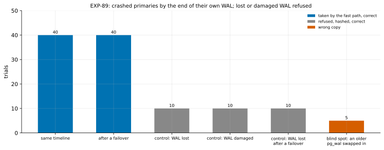

# EXP-89: A primary that crashed, refreshed by the fast path with its end proven by its own WAL

Status: **done October 30, 2026: every prediction held.** 80 of 80 crashed primaries were refreshed by the fast path and came out correct: 40 on the server's timeline, 40 after a failover, each failover finding its own blocks. All 30 controls with lost or damaged WAL were refused and hashed correctly. The blind spot (an older pg_wal swapped in) passed in 5 of 5 and gave 5 wrong copies, as stated. **pre-registered October 30, 2026, before any scored run.** *Amended before any scored data:* the first launch stopped at trial 11, a blind-spot (`stale-wal`) copy so broken that the check's own query failed on it. A system catalog index file was a block short, and that raised an error instead of a result. No data file was written. Its 11 printed trials all went as predicted:
- 3 `same` and 2 `failover` taken and correct;
- 3 `lost`, 1 `damaged` and 1 `lost-failover` refused and hashed correctly.

Two changes were made:
- the harness now records a copy too broken to query as a wrong copy;
- the proof's details and seconds are added to the receiver's facts (`crashed_wal`), for reporting.

No arm, check or prediction changed. The files are recorded again at the fixed commit, and the campaign restarts from its first trial, seed 890. (Numbered 89 because a VM set named `exp88`, not from this work, is running in the project.)

## Question

**Is a primary that crashed refreshed correctly by the fast path, with its end proven by its own WAL? And is lost or damaged WAL refused?** The flag is `--crashed-primary` ([research loop 4](../research/2026-10-30-research-loop-4.md)).

## What was built (before this registration)

- **`pgdelta.fastpath.crashed_wal_end`:**
  - **Where B's WAL stops:** it reads B's WAL from its redo point with `pg_waldump`, to where reading stops.
  - **Where the last record ends:** it computes that end exactly (`wal_record_end`, PostgreSQL's own arithmetic).
  - **What it refuses:**
    - a stop at a segment file B lacks;
    - a segment shorter than 16 MB;
    - any WAL page of the same generation past the stop;
    - fsync off in B's configuration.
- **`basis_facts(..., crashed_primary=True)`** takes a B "in production" with the proof "crashed primary" and that end.
  - After a failover, `--diverged-basis` (on with the fast path) lists B's own blocks past the fork, as for a cleanly stopped old primary.
  - The receiver's option is `--crashed-primary` (`receive`, `local`; opt-in).
- **Tests** (`tests/test_pgdelta_fastpath.py`, classes `CrashedPrimary` and `CrashedFailedOver`):
  - the record-end arithmetic against every record of real WAL;
  - taken with the option, refused without it;
  - a crashed old primary after a failover taken, its own blocks found;
  - a lost tail, a short segment, a damaged record, and fsync off all refused.
- **The harness:** `experiments/crashed_primary/trials.py`, on EXP-80's lab.

## Design

**One local source S** (PostgreSQL 17.11 on the Mac):
- data checksums and `summarize_wal` on;
- checkpoints every 30 s or on 64 MB of WAL; `wal_keep_size` 1 GB;
- pgbench on 4 clients with side-table DDL;
- a `cold` table of 20,000 rows that the load never touches.

**Each trial,** in a shuffled order (seed 890):

| Arm | Trials | What B is |
|---|---|---|
| `same` (deciding) | 40 | S killed mid-load (`pg_ctl -m immediate` or SIGKILL), its directory copied, S restarted and loaded again: a crashed primary on S's own timeline |
| `failover` (deciding) | 40 | A standby Q stopped mid-load (the fork). S then updates every 97th row of `cold`, loads on, and is killed mid-load. Q is promoted and becomes the source, then loaded. B, S's crashed directory, wrote past the fork, partly on pages no summary of the new source lists |
| `lost` (control) | 10 | `same`, then B's WAL deleted from a random segment after its redo point's on |
| `damaged` (control) | 10 | `same`, then one byte flipped in a random record at least a page before B's end |
| `lost-failover` (control) | 10 | `failover`, then B's WAL deleted from its end's segment on (EXP-80's S2e, on random loads) |
| `stale-wal` (blind spot, reported) | 5 | `failover`, with B's pg_wal replaced by a copy taken before the fork |

**Flushing before the kill.** Right before each kill, every dirty buffer is written to disk without a checkpoint (`pg_buffercache_evict`), in the failover arms always and in the others half the time. Without it, a small database's writes since the checkpoint stay in memory and die with the server. Then the copy's disk would hide the case: the smoke's first stale-WAL copies came out right by luck. With the flush and the cold table, the smoke's 3 stale-WAL copies were wrong.

**The refresh:** `pgdelta local --fast-path summaries --crashed-primary`. Each copy is started and compared with S:
- every pgbench table and `cold` by md5;
- the history's count and sum, and each side table's rows;
- `pg_amcheck --heapallindexed`.

**The smoke** (seeds 897–899; decides nothing):
- all 6 deciding trials taken and correct;
- 3 of 3 controls refused and hashed correctly;
- all 3 stale-WAL copies passed and came out wrong.

**The analysis,** committed before the data: `analysis/exp89.py`, dry-run on the smoke. Data `docs/experiments/data/exp89-trials.csv`, figure `exp89-crashed-primary`.

## Predictions

1. **Deciding: all 80 `same` and `failover` trials** take the fast path with the proof "crashed primary" and come out correct: exit 0, rows equal to S's, `pg_amcheck` clean. With none wrong, wrong copies stay below 3.7% per refresh at 95%.
2. **All 40 `failover` trials find B's own blocks past the fork** (`diverged_blocks` > 0), so that path is exercised.
3. **All 30 controls are refused as unproven, and their hashed copies come out correct.**

**Reported, not predicted:**
- the blind-spot arm: how many pass, and how many of those come out wrong (expected: most pass, and those are wrong);
- the refusal reasons per control;
- the time per refresh.

## What follows

- **If 1 to 3 hold:** EXP-89b times it on the VMs against hashing, a re-clone and `pg_rewind` (18 GB, a crashed old primary after a failover), with real power loss (hard resets) for torn WAL tails. After that, a held-out session before any default.
- **If 1 fails:** the failing trials show where the proof breaks, and it goes no further until fixed and re-tested.
- **If 3 fails:** a control the proof took shows a kind of loss or damage it misses.

## The rules this session runs under

- **Rule 13:** tests, then this local campaign, then the VMs.
- **Rule 16:** `analysis/integrity.py register EXP-89` records the harness, EXP-80's lab under it, the analysis, and pgdelta's modules.
- **Rule 17:** counts against bars, not timings.

## Workflow check

| | Check | For this experiment |
|---|---|---|
| 1 | Situation, standard, competitor | Crashed primary: `pg_rewind` (crash recovery first) and re-clone; pgdelta ties today |
| 2 | The bottleneck | The proof of B's end |
| 3 | Systems or algorithm | Algorithm (research loop 4) |
| 4 | Papers and prior art | PostgreSQL's WAL reader and recovery, `pg_rewind`, from source |
| 5 | Committee-grade | Pre-registered; randomized; three controls; a blind-spot arm |
| 13 | The cascade | The local stage |
| 14 | The idea archive | New row |
| 15 | Held-out workloads | Not used |
| 16 | Scorer integrity | Recorded at registration |
| 17 | The noise bar | Counts, not timings |

## Results

**Scorer integrity (rule 16):** `analysis/integrity.py check EXP-89` reports 11 of 11 files unchanged since the amended registration commit (ed3c04b).

**The session:** PostgreSQL 17.11 on the Mac, 115 trials (seed 890), about 40 minutes. Every refresh exited 0. Data: `docs/experiments/data/exp89-trials.csv`.

*How to read it:* each bar is one arm's trials.
- **Blue:** taken by the fast path, and the copy came out correct.
- **Grey:** refused, hashed, and correct.
- **Red:** a wrong copy.

The controls are meant to be grey, and the blind spot is the stated limit.

| # | Prediction | Result |
|---|---|---|
| 1 | **Deciding:** all 80 `same` and `failover` trials taken with the proof "crashed primary", and correct | **Held: 80 of 80** (40 and 40). Wrong copies below 3.7% per refresh at 95% |
| 2 | All 40 `failover` trials find B's own blocks past the fork | **Held: 40 of 40,** a median of 1,244 blocks, including the cold table's pages, which no summary of the source lists |
| 3 | All 30 controls refused as unproven, their hashed copies correct | **Held: 30 of 30:** - every `lost` and `lost-failover` copy: "B's WAL from its redo point runs into a segment B lacks"; - every `damaged` copy: "B's pg_wal holds WAL written past where reading stops" |

**Reported:**
- **The blind spot:** all 5 `stale-wal` copies (B's pg_wal swapped for a copy taken before the fork) passed the proof, and all 5 came out wrong, as research loop 4 states. In the first launch, one was so broken that a system catalog index read failed (the amendment above).
- **Time per refresh at this small scale:** the proof adds no visible time (median 0.48 s on the same timeline, 0.58 s after a failover). The `lost` refusals take 5.6 s: `pg_waldump` retries a missing file ten times before giving up.
- **Kills:** half `pg_ctl -m immediate` and half SIGKILL of the postmaster. Before each kill, the dirty buffers were written out in every failover trial and in half of the others.

**What this campaign can't see:**
- **Torn WAL tails:** a process kill leaves the operating system's cache intact, so the WAL on disk ends cleanly. Real power loss tears the last WAL page, and EXP-89b's follow-up on the VMs needs hard resets for it.
- **Timing at scale:** EXP-89b.

## What followed

- **The proof is correct on every crashed primary tried, and refuses every kind of lost or damaged WAL tried.** That covers 80 randomized crashes, a third of them with the old primary's writes past the fork on pages only its own WAL names.
- **Its stated blind spot is real,** and the same holds for crash recovery and `pg_rewind`: a pg_wal replaced by an older copy of itself passes. RESULTS states it beside the claim.
- **Next:** [EXP-89b](EXP-89b-crashed-primary-vms.md) times it at 18 GB against `pg_rewind`, hashing and a re-clone. Then come real power loss (hard resets) for torn WAL tails, and a held-out session before any default.
