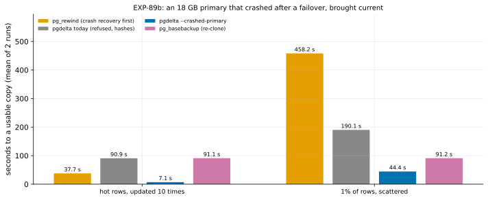

# EXP-89b: An 18 GB primary that crashed after a failover, on the VMs: --crashed-primary against pg_rewind, hashing and a re-clone

Status: **done October 30, 2026: every prediction held.** An 18 GB primary that crashed after a failover was brought current in 7.1 s for hot rows, against `pg_rewind`'s 37.7 s and hashing's 90.9 s, and in 44.4 s for scattered rows, against a re-clone's 91.2 s. All 4 `--crashed-primary` copies were proven by their own WAL in 0.8 s, matched the new primary and passed `pg_amcheck`; 16 of 16 copies matched. **Pre-registered October 30, 2026, before any scored run.** *Amended before any scored data:* the smoke's `crashed` runs exited 3. The lab passed the receiver a `--stats-json` it doesn't take; the receiver's statistics come back in the sender's. The option is removed, the files are recorded again at the fixed commit, and the smoke runs again on the same VMs. It follows [EXP-89](EXP-89-crashed-primary.md), the local correctness campaign.

## Question

**How fast does `--crashed-primary` bring an 18 GB old primary current after it crashed in a failover?** It is compared with the three things done today:
- `pg_rewind`, which runs crash recovery on the old primary first;
- pgdelta's hashing, today's path for a crashed primary;
- a re-clone (`pg_basebackup`).

## Design

**The `ha` set:** n2d-highcpu-8, pd-balanced 150 GB data disks, PostgreSQL 17.11, scale 600 (18 GB on 8 GB VMs), us-west1 first.

**The lab:** `experiments/network/lab_exp67.sh` (EXP-67's and EXP-71's failover lab) with `CRASHED_P=1`.
- **The fork, at each lag:** a standby Q of the primary P catches up and stops cleanly. P then updates 10,000 rows Q never sees (every 6,000th account).
- **Then P crashes, its writes on disk:** P's dirty buffers are written out without a checkpoint (`pg_buffercache_evict`), so its pages past the fork are on disk. P is then stopped with `-m immediate`.
- **The old copy and the source:** P's directory goes to the destination as B0, a primary left "in production". Q is promoted and becomes the source S.
- **Two lags,** as EXP-67: `hot10` (the same 1% of rows updated 10 times) and `uniform` (1% of rows once).
- **The arms,** two runs each, shuffled. Each run starts from a fresh copy of B0, with both VMs' caches dropped:

| Arm | What runs | Timed until |
|---|---|---|
| `rewind` | `pg_rewind` (crash recovery on B first, then the rewind), then B started as S's standby | It has replayed to S's LSN |
| `fast` | pgdelta's fast path without `--crashed-primary`: refused, so it hashes both copies | The copy accepts connections |
| `crashed` | pgdelta with `--crashed-primary`, `--diverged-basis`, 8 reader threads, 2-page fills, the sync worker | The copy accepts connections |
| `full` | `pg_basebackup` into a new directory | The copy accepts connections |

**Every copy's** `pgbench_accounts` (count and sum) must equal S's, so B's 10,000 rows must be undone. Every `crashed` copy is also checked with `pg_amcheck --heapallindexed` after the timing.

**The smoke runs first** (scale 20, seed 899; decides nothing).

**The analysis,** committed before the data: `analysis/exp89b.py`. Raw data `results/exp04/exp89b`, figure `exp89b-crashed-primary`.

## Predictions

From EXP-71, where a cleanly stopped old primary was refreshed by idea 1 in 0.20x `pg_rewind`'s time (hot) and 0.53x a re-clone's (scattered). The crashed case adds the reading of B's own WAL, and `pg_rewind` adds crash recovery.

1. **Deciding: every `crashed` run** takes the fast path with the proof "crashed primary", lists blocks of B's own past the fork, matches S, and passes `pg_amcheck`.
2. **`hot10`:** `crashed` takes at most 0.5x `pg_rewind`'s time and at most 0.5x hashing's. **`uniform`:** it is faster than the re-clone.
3. **Every `fast` run is refused** (it hashes), and every copy of every arm matches S.

**Reported:**
- each arm's time over the re-clone's;
- the crashed arm's own blocks and pages sent;
- the seconds the WAL-end proof took;
- `pg_rewind`'s time to rewound and to replayed.

## What follows

- **If 1 and 2 hold,** the scorecard's last loss becomes a win wherever the old primary's WAL is intact. RESULTS and the README say so, as opt-in.
  - Real power loss comes next: a hard reset of a primary's VM, which tears WAL tails as a process kill can't.
  - Then a held-out session before any default.
- **If 1 fails,** the failing runs show where the proof breaks at scale.
- **If 2 fails,** the timings say where the time goes.

## The rules this session runs under

- **Rule 13:** the VM stage after EXP-89's local campaign.
- **Rule 16:** `analysis/integrity.py register EXP-89b` records the analysis, the lab and pgdelta's modules.
- **Rule 17:** two runs each; the bars are far outside the 2.23% spread.

## Workflow check

| | Check | For this experiment |
|---|---|---|
| 1 | Situation, standard, competitor | Crashed old primary: `pg_rewind` (crash recovery first), a re-clone, pgdelta's hashing |
| 2 | The bottleneck | The proof (research loop 4); here, its cost at scale |
| 3 | Systems or algorithm | Algorithm, timed |
| 4 | Papers and prior art | Research loop 4 |
| 5 | Committee-grade | Pre-registered; every crashed copy checked by `pg_amcheck`; predictions from EXP-71 |
| 13 | The cascade | The VMs, after EXP-89 |
| 14 | The idea archive | The crashed-primary row |
| 15 | Held-out workloads | Before a default: H9–H12 |
| 16 | Scorer integrity | Recorded at registration |
| 17 | The noise bar | 2.23%; bars of 0.5x |

## Results

**Scorer integrity (rule 16):** `analysis/integrity.py check EXP-89b` reports 17 of 17 files unchanged since the amended registration commit (86e8fa4).

**The session:** the `ha` set in us-west1-b and us-west1-c, October 30–31 (UTC), 16 runs (seed 891), with every run exiting 0. The smoke at scale 20 passed first. Data: `results/exp04/exp89b`.

*How to read it:* each bar is one arm's mean over its two runs, in seconds to a copy that accepts connections (`pg_rewind`'s: to replayed to the new primary's LSN). Shorter is better. Blue is `--crashed-primary`.

| # | Prediction | Result |
|---|---|---|
| 1 | **Deciding:** every `crashed` run takes the fast path with the proof "crashed primary", lists B's own blocks, matches S and passes `pg_amcheck` | **Held: 4 of 4.** B's own blocks: 20,207 (hot10) and 20,099 (uniform); the WAL-end proof took 0.81–0.84 s |
| 2 | `hot10`: at most 0.5x `pg_rewind` and 0.5x hashing; `uniform`: faster than the re-clone | **Held:** 0.188x `pg_rewind` and 0.078x hashing (hot10); 0.487x the re-clone (uniform) |
| 3 | Every `fast` run refused; every copy matches S | **Held:** 4 of 4 refused ("B was not stopped cleanly (in production)"), and 16 of 16 copies matched |

**Times (seconds; each run, then the mean over the re-clone's):**

| Lag | `crashed` | `rewind` | `fast` (hashing) | `full` (re-clone) |
|---|---|---|---|---|
| hot10 | 7.05, 7.14: **0.078x** | 37.43, 38.00: 0.414x | 90.92, 90.89: 0.998x | 91.28, 90.92 |
| uniform | 44.52, 44.28: **0.487x** | 459.87, 456.53: 5.02x | 187.66, 192.58: 2.08x | 91.21, 91.21 |

**Reported:**
- **`pg_rewind`'s two steps:** crash recovery and the rewind took 24.2–24.3 s (hot10) and 71.1–74.1 s (uniform); replaying the new primary's WAL took the rest.
- **The crashed arm's work:** 34,822 pages sent for hot10 and 864,952 for uniform, with B's own blocks read from its WAL in each.
- **Against EXP-71's cleanly stopped old primary,** in another session (inferred, not compared under rule 17): 7.1 s against 6.9 s (hot10) and 44.4 s against 48.2 s (uniform). Proving a crashed primary's end costs about 0.8 s here.
- **The spread of each arm's two runs:** 0.0–2.6%, far inside every bar.

**What this session can't see:**
- **Torn WAL tails:** the old primary was stopped by `pg_ctl -m immediate`, a process kill. The operating system's cache kept its WAL whole. Real power loss comes next.
- **Held-out settings:** none was used (rule 15). A default needs a held-out session first.

## What followed

- **The scorecard's last loss is a win, opt-in, wherever the old primary's WAL is intact.** A crashed old primary after a failover was the one situation where pgdelta lost (it hashed, at best a tie with a re-clone). With `--crashed-primary` it took 0.19x `pg_rewind`'s time for hot rows and 0.49x a re-clone's for scattered ones, as fast as a cleanly stopped one.
- **Next:**
  1. real power loss: hard resets of a primary's VM, for torn WAL tails;
  2. a held-out session (H9–H12) before any default.

