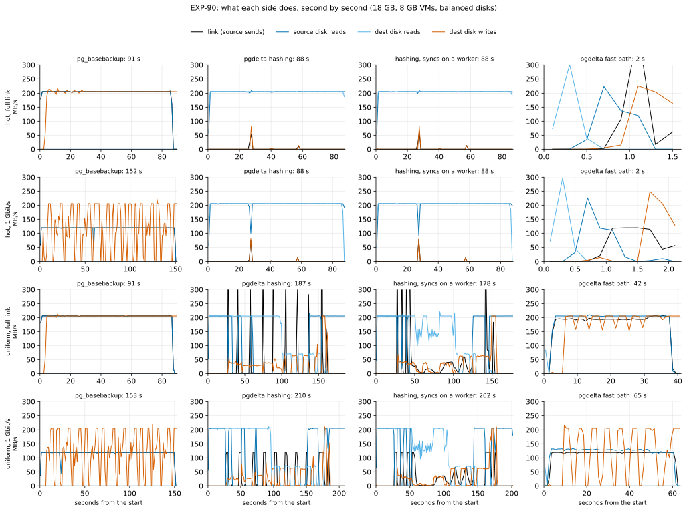
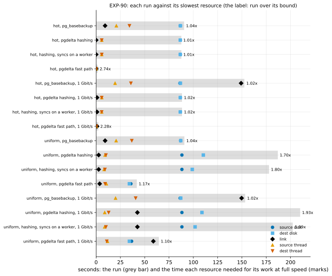
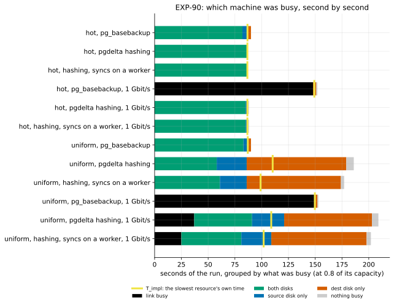

# EXP-90: Where the hashing path's time goes, on both VMs, second by second

Status: **done October 31, 2026 (UTC).**
- **D1 failed.** Hashing is at its bound where few pages change (1.01–1.02x its slowest resource) and 1.70–1.93x it where many do: a pipelining gap, as the mentor expected.
- **D2, D3 and D4 held.** At 1 Gbit/s hashing wins where few pages change (0.58x a re-clone). SHA-256 is 0.47x BLAKE3's speed on the VMs' CPU, and no hashing run is bound by CPU. `pg_basebackup` runs within 4.3% of its bound, so the bound arithmetic works.
- **12 of 12 pgdelta copies matched.**
- **Where the gap is (post hoc):**
  - the source stops reading while a send blocks;
  - dest's random reads and writes share one operations budget;
  - 96% of the verification's reads went to the disk.
- **What pipelining can win:** at full link at best a tie with a re-clone, since reading all of B is the algorithm's floor. At 1 Gbit/s, a win the implementation leaves on the table (now 1.37x a re-clone; its floor is 0.71–0.83x).

It was pre-registered October 31, before any scored run; the design below is as registered.

## Why

At the October 30 weekly meeting, the project's industry mentor reviewed the hashing approach. He asked for four things:
1. **Measure each side's link use over time before optimizing.** He expected one side busy and the other in peaks and troughs, from blocking.
2. **Batch and pipeline the hash exchange,** so both sides hash at once and something is always on the wire.
3. **Try a faster hash:** SHA-256 with the CPU's instructions, or a native (Rust or Go) path, in place of BLAKE3 from Python.
4. **A baseline the team can run.**

**What the project already knew:**
- **Item 2 is how the protocol works.** The receiver hashes B and sends each file's node digests in one frame. The sender, hashing S at the same time on its workers, asks once per file for the leaf digests of the nodes that differ, and it keeps 4 files ahead (`--window`), so those round trips overlap hashing.
- **In EXP-89b's hashing run with scattered changes** (186 s), the sender waited on the receiver for 0.15 s in all. It spent 93 s blocked in `send()`. The receiver's phases took:
  - 101 s hashing B;
  - 121 s syncing files in its main loop (`--fsync main`, hashing's default);
  - 81 s verifying.
- **Research loop 1:** the hash path runs at 85% of its ceiling in memory. Beyond memory, reading B is the floor: hashing can at best tie a re-clone.
- **What was never measured:** a picture of each resource over time. Also unmeasured: whether the disk's reads and writes share one budget, which decides if hashing's scattered case is at its bound (an algorithm problem) or leaves room for overlapping work (a systems problem).

## Question

1. **Where does each run's time go,** second by second, on both VMs? This covers the link, each disk's reads and writes, the CPUs, and the busiest thread.
2. **Is pgdelta's hashing at the bound of its slowest resource,** or is there room for the pipelining the mentor describes?
3. **Is the hash function ever the bottleneck,** and is SHA-256 faster than BLAKE3 on these VMs' CPU?
4. **At 1 Gbit/s,** where the mentor expects the network to bind, which side wins and why?

## Design

**The session is the team's baseline,** `experiments/baseline/run.sh`, with `NAME=exp90 RESULTS=results/exp04/exp90 PAIR=ha` and its defaults:
- **The VMs:** two `n2d-highcpu-8` VMs in two zones of one region, each with a 150 GB balanced persistent disk.
- **The data:** PostgreSQL 17.11, scale 600 (18 GB on 8 GB VMs).
- **The lab:** `experiments/network/lab_exp64.sh` (EXP-64's), with `UTIL=1`.

**The profile, before the lab:**
- **Hash rates:** `hashbench.py` on each VM: BLAKE2b, BLAKE3 and SHA-256, keyed as pgdelta keys a leaf, per 8 KiB page, in 1 and 4 processes, 5 repeats of 3 s.
- **Disk limits:** `fio_mixed.sh` on each VM at once, with direct I/O on a 20 GiB file, 30 s per configuration:
  - 1 MiB sequential reads (queue depth 8) and 8 KiB random writes (queue depth 32), each alone and then both at once;
  - 1 MiB sequential writes and 8 KiB random reads, alone.
- **The link:** `link_probe.py` runs one `iperf3` stream from the source for 10 s, unshaped and at 1 Gbit/s, and counts the bytes the source sent.

**The arms,** in the `hot` and `uniform` patterns (EXP-64's), one run each, shuffled (seed 900):

| Arm | What runs |
|---|---|
| `full` | `pg_basebackup` into a new directory |
| `hash` | pgdelta hashing both copies (no fast path; `--fsync main`) |
| `hashw` | `hash` with the receiver's syncs on its worker (`--fsync worker`) |
| `fast8wf2` | the WAL-summary fast path with its defaults (8 readers, 2-page fills, the sync worker) |
| `X_1g` | arm X on a link shaped to 1 Gbit/s: `throttle.sh` on both VMs, from just before the clock to just after it |

Each run starts from a fresh copy of B0 with both VMs' caches dropped. Every pgdelta copy is started and compared with the source.

**The sampler:** `util_series.py` on both VMs, every 0.1 s, from 1 s before the clock to 1 s after it. It records:
- bytes received and sent;
- the `/data` disk's reads, writes, sectors and busy time;
- CPU busy and total jiffies, per CPU;
- every 0.5 s, the CPU time of each thread of pgdelta, its hashing workers, `pg_basebackup` and walsenders.

**The smoke** runs first, at scale 20 with the same arms (seed 909); it decides nothing.

**The bound arithmetic** (`analysis/exp90.py`, committed before the data):
- **Capacities, measured in this session:**
  - each disk's read and write limits in bytes and in operations;
  - its mixed point: reads at a fraction r_mix of their rate alone and writes at w_mix, when both run at once;
  - the link's rate in the sampler's bytes;
  - each VM's CPUs, and one core per thread.
- **A disk's use,** in a second or over a run: max(u_r, u_w, (u_r + u_w) / (r_mix + w_mix)). Here u_r and u_w are the larger of bytes and operations against their limits. That is the sum where reads and writes share one budget (r_mix + w_mix near 1), and the larger of the two where they don't (near 2).
- **T_impl** is the largest time any one resource needed for the run's own measured work: either disk, the link either way, either VM's CPUs, or the busiest thread. A run can't be shorter. Its time over T_impl is the room left for overlapping work.
- **T_alg,** for the hashing arms, is the same with one read of the database in place of the disks' measured reads: the work hashing can't avoid.
- **Slack** is the share of a run's seconds in which no resource is at 0.8 of its capacity.

## Predictions

**From earlier sessions (inferred):**
- **Hashing, hot:** one read of each copy, 17.8 GB at about 205 MB/s, is about 87 s, against about 88–91 s measured (EXP-80b, EXP-89b).
- **Hashing, uniform:** the 624,000 pages written at EXP-48's 6,750 a second take about 92 s. With B's read, about 179 s, against 180–190 s measured. That fits a disk whose reads and writes share one budget.
- **At 1 Gbit/s,** a re-clone needs about 150 s for 18 GB.

| # | Prediction | Bar |
|---|---|---|
| D1 (deciding) | **Hashing is at its bound:** every `hash` run (hot and uniform, full link and 1 Gbit/s) has measured / T_impl ≤ 1.15 | ≥ 1.30 in any run is a pipelining gap, a systems problem the mentor's direction could take; between is partial |
| D2 | **At 1 Gbit/s:** `pg_basebackup` keeps the link busy (mean use ≥ 0.85 in both patterns). Hashing wins where few pages change (`hash_1g` ≤ 0.70x `full_1g`, hot) and loses where many do (≥ 1.0x, uniform), since it is bound by the disk, not the link | As stated |
| D3 | **CPU is never the bottleneck of hashing:** no `hash` or `hashw` run's T_impl is set by a VM's CPUs or a thread. **On these VMs' CPU, SHA-256 is not faster than BLAKE3** per 8 KiB page (one process, median ratio ≤ 1.0), though on the Mac it was 1.33x | As stated |
| D4 (the bound's control) | **`pg_basebackup` is at its bound** in all four cells: measured / T_impl ≤ 1.10. It streams one way and is the mentor's "most optimized path". If it misses, the bound arithmetic or the capacities are wrong, not pgdelta | 1.10 |

**Reported:**
- **`hashw` over `hash`** (exploratory; predicted 0.90–1.05 where the disk's budget is shared);
- **the disk model:** r_mix and w_mix (predicted shared, r_mix + w_mix ≤ 1.2);
- **per run:**
  - the mean use of each resource, the binding resource and the slack;
  - pgdelta's waits on the receiver and its time in `send()`;
  - the phases' timers;
- **the hash rates on each VM;**
- **the cross-session control:** `full` against EXP-89b's 91.2 s;
- **the figures:**
  - `exp90-timelines`: each run second by second;
  - `exp90-bounds`: each run against each resource's time.

## What follows

- **If D1 holds:** hashing beyond memory is at its bound on this disk, and its loss in the scattered case is the algorithm's (reading all of B), not blocking. No pipelining can recover it. RESULTS and the mentor's answer say so with the timelines.
  - **A structurally different idea is the next step:** keep B's digests from the refresh that wrote B, so B needn't be read again where it is proven unchanged since. It goes into the idea archive.
- **If D1 fails,** the timelines show where each side waits. The candidates are the main-loop syncs (`hashw` measures that one), the verification reads and the order of B's reads and writes. Each would go through the cascade (tests, then a pre-registered VM session).
- **If D3's SHA-256 part fails** (SHA-256 is faster on the VMs' CPU), SHA-256 becomes a hash option only if some run is bound by CPU, since the hash function's share of every run's time decides its effect.

## The rules this session runs under

- **Rule 13:**
  - the tests (`tests/test_exp90_analysis.py`) and a dry run of the analysis on synthetic data come first;
  - the Mac's hash rates are the local stage (`docs/experiments/data/exp90-hashbench-mac.json`): SHA-256 at 1.33x BLAKE3 per page;
  - the VM ratio makes the proxy pair.
  - No local scale model stands in for the disks: rule 13's proxy log puts local timing outside its band beyond memory.
- **Rule 15:** no default changes and no claim leaves the project from this session, so no held-out session is owed. A default change from `hashw` would need one.
- **Rule 16:**
  - `analysis/integrity.py register EXP-90` records the analysis, the baseline script, the lab, the sampler, the probes, the throttle, the Mac's rates and pgdelta's modules;
  - every pgdelta copy is compared with the source;
  - D4 is the bound's control.
- **Rule 17:** one run per arm. Within a session, two runs differ by up to 2.23% (10 s or more) and 7.11% (under 10 s). D1's and D4's bars are about 15 points from the predictions. A deciding ratio within 0.03 of its bar gets a second session.

## Results

**The session:**
- **Where and when:** us-west1 (zones b and c), October 31: the profile 15:42–15:51 UTC, the smoke (scale 20, every arm passed), the scored runs 16:12–17:17.
- **Afterwards:** the results were fetched and both VMs deleted.
- **Rule 16:** `analysis/integrity.py check EXP-90` found 42 of 42 registered files unchanged since 098ffcc when the data were scored. Two changed afterwards, neither altering a score: one word of `analysis/exp90.py`'s docstring (a person's name for "the mentor's"), and a test added to `tests/test_exp90_analysis.py` for the post-hoc view.
- **The data:** each run's scores in [data/exp90-scored.json](data/exp90-scored.json) and the VMs' hash rates in `data/exp90-hashbench-vm-*.json`. The raw samples are in `results/exp04/exp90` (not in git), with the baseline's own `summary.txt`.

**The capacities, measured before the runs (identical on both VMs):**

| | Alone | Both at once |
|---|---|---|
| Sequential reads (1 MiB) | 205.5 MB/s | 205.6 MB/s (1.000 of alone) |
| Random 8 KiB writes | 4,197 ops/s | 3,408–3,414 ops/s (0.81) |
| Sequential writes / random 8 KiB reads | 205.5 MB/s / 4,197 ops/s | — |
| The link | 15.46 Gbit/s unshaped, 0.956 shaped | — |

- **CPU:** AMD EPYC 7B13, 8 vCPUs, with AVX2 and SHA-NI.

**Each run against its slowest resource:**

| Pattern | Arm | Seconds | Over `pg_basebackup` | T_impl, set by | Measured / T_impl |
|---|---|---|---|---|---|
| hot | `full` | 90.51 | 1 | 86.74 s, dest's disk | 1.043 |
| hot | `hash` | 87.66 | 0.969 | 86.64 s, dest's disk | 1.012 |
| hot | `hashw` | 87.71 | 0.969 | 86.64 s, dest's disk | 1.012 |
| hot | `fast8wf2` | 1.65 | 0.018 | 0.60 s, dest's disk | 2.74 |
| hot | `full_1g` | 152.50 | 1 | 149.16 s, the link | 1.022 |
| hot | `hash_1g` | 88.36 | **0.579** | 86.64 s, dest's disk | 1.020 |
| hot | `hashw_1g` | 88.38 | 0.580 | 86.64 s, the source's disk | 1.020 |
| hot | `fast8wf2_1g` | 2.30 | 0.015 | 1.01 s, the link | 2.28 |
| uniform | `full` | 90.80 | 1 | 87.04 s, dest's disk | 1.043 |
| uniform | `hash` | 186.93 | 2.059 | 110.27 s, dest's disk | **1.695** |
| uniform | `hashw` | 177.86 | 1.959 | 98.93 s, dest's disk | 1.798 |
| uniform | `fast8wf2` | 41.84 | 0.461 | 35.79 s, the source's disk | 1.169 |
| uniform | `full_1g` | 153.35 | 1 | 149.67 s, the link | 1.025 |
| uniform | `hash_1g` | 209.92 | 1.369 | 108.92 s, dest's disk | **1.927** |
| uniform | `hashw_1g` | 202.31 | 1.319 | 101.85 s, dest's disk | 1.986 |
| uniform | `fast8wf2_1g` | 64.53 | 0.421 | 58.87 s, the link | 1.096 |

The fast path's hot runs last 2 s, so fixed costs (connecting, the WAL-end proof) dominate their ratios.

**The predictions:**

| # | Prediction | Measured | Verdict |
|---|---|---|---|
| D1 (deciding) | Every `hash` run ≤ 1.15x T_impl | hot 1.012 and 1.020; uniform **1.695** and **1.927** | **Failed.** Hot is at its bound; uniform is past the 1.30 bar: a pipelining gap, a systems problem |
| D2 | `pg_basebackup`'s link use ≥ 0.85 at 1 Gbit/s; `hash_1g` ≤ 0.70x `full_1g` (hot), ≥ 1.0x (uniform) | 0.981 and 0.978; 0.579; 1.369 | Held |
| D3 | No hashing run bound by CPU; SHA-256 ≤ 1.0x BLAKE3's speed on the VMs' CPU | None bound by CPU: the VMs' CPUs needed at most 10 s of any run, the busiest thread 13 s; 0.474 | Held |
| D4 (control) | `pg_basebackup` ≤ 1.10x T_impl in all four cells | 1.022–1.043 | Held |

**Reported:**
- **`hashw` over `hash`** (predicted 0.90–1.05): 1.001 and 1.000 in hot; **0.951 and 0.964 in uniform.** The uniform effects are beyond the 2.23% bar, but they come from one run per arm, so they are exploratory.
- **The disk model** (predicted shared, r_mix + w_mix ≤ 1.2): **1.81 on both VMs. Failed:** sequential reads and random writes barely share a budget. Random reads and random writes do (below).
- **The cross-session control:** `full` took 90.51 s (hot) and 90.80 s (uniform), against EXP-89b's 91.1 and 91.21 s (−0.6% and −0.5%, within 1%). Over six sessions, `pg_basebackup`'s uniform cell now spreads 0.38% ([noise-floor.csv](../research/noise-floor.csv)).
- **Hash rates per 8 KiB page, one process:** the same on both VMs, and per process with 4 processes.

  | | BLAKE3 | SHA-256 | BLAKE2b |
  |---|---|---|---|
  | The VMs | 368,000 pages/s (3.0 GB/s) | 175,000 (1.43 GB/s) | 77,700 (0.64 GB/s) |
  | The Mac | 275,000 | 366,000 | 177,000 |

  - **On the VMs, one process hashes BLAKE3 15 times as fast as the disk reads.**
- **The proxy pair (rule 13):** SHA-256 over BLAKE3 was 1.33 on the Mac and 0.474 on the VMs, the opposite sign. It is logged in [proxy-fidelity.csv](../research/proxy-fidelity.csv), not plotted, since it is a rate, not a run's time. A hash microbenchmark on another CPU doesn't predict the VMs.
- **pgdelta's timers, uniform `hash`:**
  - the sender waited on the receiver for 0.14 s and spent 93.0 s in `send()`;
  - the receiver's phases, which overlap: B hashed 101.6 s, rebuild 124.6 s, syncs 120.5 s, verification 80.4 s.

## Where the gap is (post hoc, not registered)

`analysis/exp90_overlap.py` was written after the scores. It changes none of them.

**The uniform `hash` run, 10 s at a time:**

| Seconds | The source reads S | Dest reads | Dest writes | What happens |
|---|---|---|---|---|
| 0–27 | 190–205 MB/s | 205 MB/s (B) | none | Both sides hash; the first changed file is reached at about 25 s |
| 30–90 | 0–107 MB/s, and **nothing from 60 to 100 s** | 205 MB/s (B) | 2,200–2,500 ops/s | Dest reads B and writes the received pages; the source is blocked in `send()` |
| 90–150 | none until 130 s | 1,350–3,380 ops/s (verification) | 810–2,840 ops/s | Reads and writes take turns; **their sum holds at 4,180–4,200 ops/s**, either one's limit alone |
| 140–187 | 184–206 MB/s | almost none | almost none, but a burst at 150 s | The source reads the rest of S, about 9 GB, while dest waits |

**Each run's seconds, by what was busy at 0.8 of its capacity:**

**In the uniform `hash` run:**
- both disks busy for 58 s;
- only the source's disk for 28 s;
- only dest's for 93 s;
- nothing for 7 s.

In the hot runs both disks are busy throughout, which is why they are at their bound.

**Three findings:**
1. **The source stops reading while a send blocks.**
   - The sender hashes up to 4 files ahead (`--window`), then sends the oldest file's changed pages from its main thread (`_send_files`, `_send_pages`).
   - Dest takes those pages only as fast as its disk writes them, so `send()` blocks (93 s in all), and no further file is hashed meanwhile.
   - S's unchanged last 9 GB are therefore read only after dest is done: 28 s of the source alone and 7 s of nothing.
   - This is the mentor's picture: one side busy, the other waiting.
2. **Dest's random reads and writes share one budget of operations.**
   - fio's mixed test paired sequential reads with random writes, which barely share (1.81).
   - The verification's random reads and the random writes do share: from 100 to 150 s their sum held at 4,181–4,201 ops/s.
   - **Counted against one budget of 4,197 operations a second,** dest's floor is 121 s, not T_impl's 110 s. An operation over 256 KiB counts once per 256 KiB, a unit that fits fio's mixed point: 196 reads of 1 MiB are 784 units, and 784 + 3,408 = 4,192.
   - Some 10-s windows reached 4,906 units a second, so 121 s is the pessimistic end.
   - **D1's verdict holds under either model:** 187 s is 1.55–1.70x dest's floor.
3. **Most of the verification's reads went to the disk.**
   - Dest read 22.66 GB: B's 17.80 GB, and 4.86 GB of the 5.07 GB it had just written.
   - B is read ahead at 205 MB/s through the page cache, which evicts the written pages before the verification reads them.
   - With the syncs on a worker (`hashw`), dest re-read 2.53 GB of them, and the run was 4.9% faster.

**What pipelining could recover (inferred from these measurements):**
- **Full link, scattered changes:**
  - dest's floor as the run used its disk is 110–121 s, already above a re-clone's 91 s;
  - with the verification's reads served from memory, the floor would be about 87 s. That is B's read, with the 273,000 writes inside it at the mixed point (80 s), so a tie at best.
  - **No pipelining makes hashing win here.** Reading all of B is the algorithm's floor, as research loop 1 found: an algorithm problem.
- **1 Gbit/s, scattered changes:**
  - the link needs 42 s for hashing's 5 GB, against 150 s for a re-clone's 18 GB;
  - dest's floor of 109–127 s is 0.71–0.83x the re-clone's 153 s, and about 0.57x with the verification reads served from memory;
  - **today's 210 s loses (1.37x). A systems problem:** the win exists, and the implementation leaves it.
- **Few pages changed (hot):** at its bound at both rates: 0.97x a re-clone at full link, 0.58x at 1 Gbit/s.
- **The fast path, scattered changes:** 1.17x its bound (the source's disk), with 7% of its seconds slack. It has some room too, beyond this experiment's question.

## What follows

**As registered, since D1 failed,** each candidate goes through the cascade. The data rank them:
- **the main-loop syncs** (`hashw`): 0.95–0.96x in uniform, nothing in hot. Small, one run each.
- **the order of the reads and writes:** the source's blocked reads cost 28–35 s of the 187 s;
- **the verification's reads:** 4.86 GB of the 5.07 GB written were re-read from the disk, about 40 s of dest's operations.

**Proposed next (EXP-91, systems):** both changes in one VM session, each also on its own:
- **(a) The sender keeps hashing while a send blocks:** its sends on their own thread, and its window counted in bytes, not files.
- **(b) The receiver verifies written pages while they are still in memory:** right after each file's writes, or B's pages dropped from the cache once hashed.
- **Prediction (inferred from this session):**
  - uniform, full link: from 187 s to at most 130 s;
  - uniform, 1 Gbit/s: from 210 s to at most 140 s, at most 0.92x a re-clone (a win);
  - hot: unchanged within 2.23%.
- **Beside it, structurally different (rule 14):** B's digests kept from the refresh that wrote B (the idea archive). It is the only route past the tie at full link: at best a tie with any pipelining, since B must otherwise be read.

**The mentor's questions:**

| Question | Answer |
|---|---|
| Each side's link use over time | Measured (the timelines). One side busy and the other waiting: 28 s of the source alone, 93 s of dest alone |
| Batching and pipelining | The exchange is batched and overlapped: 0.14 s of waits. What doesn't overlap is the reading of S with dest's writes (the window) and dest's verification with its writes |
| A faster hash | Not on these VMs: BLAKE3 is 2.1x SHA-256 with SHA-NI, the hash uses 3–5% of the CPUs, and the disks bind. Native code would matter only in memory, where the hash path is at 85% of its ceiling (research loop 1) |
| A baseline the team can run | `experiments/baseline/run.sh`, which ran this session ([its README](../../experiments/baseline/README.md)) |

## Workflow check

| | Check | For this experiment |
|---|---|---|
| 1 | Situation, standard, competitor | Hashing against a re-clone (`pg_basebackup`) beyond memory. **Measured here:** ties at full link and wins at 1 Gbit/s (0.58x) where few pages change; loses where many do (2.06x and 1.37x) |
| 2 | The bottleneck | Found by measurement: every resource sampled every 0.1 s on both VMs. Where many pages change, the source is blocked in `send()` while dest's disk writes, and dest's random reads and writes share one operations budget |
| 3 | Systems or algorithm | **Both, by measured bounds.** At 1 Gbit/s, a systems problem: the floor of 109–127 s beats the re-clone's 153 s. At full link, an algorithm problem: the floor of 87–121 s can at best tie 91 s, since all of B is read |
| 4 | Papers and prior art | The mentor's review (batching, pipelining, SHA-256 or native code); research loop 1's ceiling and bound; EXP-48's and EXP-66's disk limits |
| 5 | Committee-grade | Pre-registered, with the capacities measured in the session; D4 controls the bound and held. "Where the gap is" is post hoc and labelled so; what pipelining could recover is inferred |
| 13 | The cascade | The SHA-256/BLAKE3 pair is logged: the Mac's 1.33 against the VMs' 0.474, the opposite sign. For EXP-91: tests, then a VM session, since no local model reproduces the disk's operations budget |
| 14 | The idea archive | Updated: `hashw` and SHA-256 tested; B's stored digests is the structurally different idea; EXP-91's two changes are added |
| 15 | Held-out workloads | None owed: no default changed and no claim left the project |
| 16 | Scorer integrity | 42 of 42 files unchanged; 12 of 12 copies matched; D4 is the bound's control |
| 17 | The noise bar | 2.23% (10 s or more). D1's uniform ratios are 0.40–0.63 past the 1.30 bar; `hashw`'s 3.6–4.9% are single runs, so exploratory |
