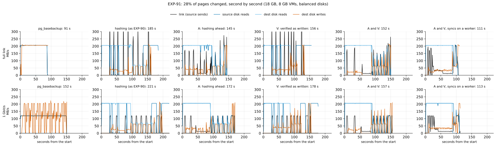
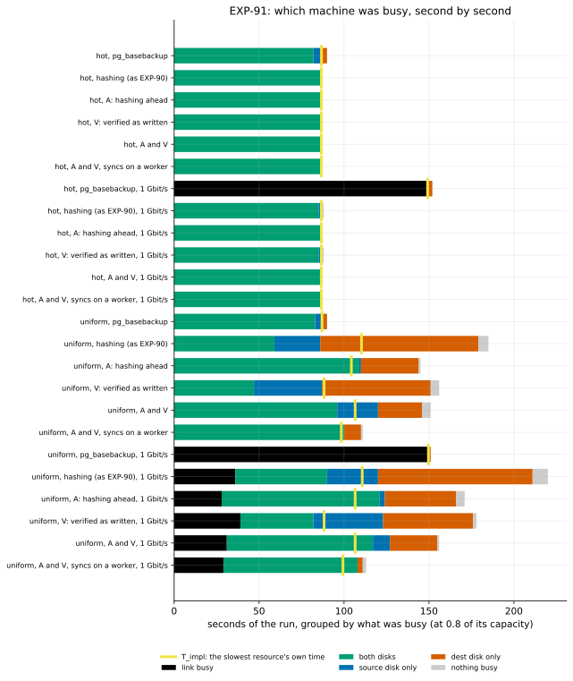

# EXP-91: Hashing ahead and verifying as written, where many pages change

Status: **done October 31, 2026 (UTC).**
- **E1, the deciding prediction, failed.** With both changes, the scattered cell took 0.818x today's hashing at full link (bar 0.70). E2, E3 and E5 failed too. E4 held: where few pages change nothing moved, and `pg_basebackup` stayed at its bound.
- **Each change did what it was built for.** The verification no longer re-reads the disk (4.88 GB to 0.01 GB), and hashing ahead keeps the source reading. Together they exposed a third stall: the receiver syncing each file in its main loop (78.5 s of 151.5 s).
- **With the syncs on the receiver's worker (`hashAVw`, a reported arm), the cell took 0.601x today's hashing and 1.13x its bound. At 1 Gbit/s that is 0.744x `pg_basebackup`:** the first hashing run to beat a re-clone where many pages change. It was one run and not the registered deciding arm, so it is exploratory: EXP-92 is proposed to confirm it.
- **Correctness held:** 20 of 20 VM copies matched. Locally, 1,000 fault trials gave no wrong copy, and all 52 misplaced-write controls were caught.

(Pre-registered October 31, before any scored run; the sections up to "The rules this session runs under" are unchanged since.)

## Why

[EXP-90](EXP-90-where-hashing-time-goes.md) measured, second by second on both VMs, where hashing's time goes at 18 GB with 28% of the pages changed (`uniform`). The run took 187 s, 1.70x its slowest resource's own time:
- **The source stopped reading while a send blocked.** One thread hashes a file and then sends the oldest pending file's pages. While dest wrote those, `send()` blocked (93 s in all), and no file was hashed. The source read nothing for 40 s, then read S's unchanged last 9 GB alone: 28 s of only the source's disk busy, and 7 s of nothing.
- **The verification re-read the disk.** In place, `--verify-scope written` re-reads whole every node with more than an eighth of its pages written: 9,041 nodes. B's reading ahead had evicted them, so 4.86 GB came from the disk, and dest's random reads share one operations budget with its random writes.

At 1 Gbit/s the same run lost to a re-clone (1.37x), though its floor there is 0.71–0.83x one: a systems problem. At full link pipelining can at best tie a re-clone, since all of B is read.

## Question

Do the two changes EXP-90 points to close the gap, and does hashing then beat a re-clone at 1 Gbit/s where many pages change?

## The changes (opt-in; no default changes)

**(a) The sender hashes ahead: `--hash-ahead SIZE`** (`pgdelta/sender.py`, `_Planner`).
- A planner thread hashes S's files, compares them with B's node digests and prepares their leaf requests, up to SIZE bytes of files ahead of the file being sent.
- The sending thread takes the planned files in order. Before each file and each run of pages, it sends the leaf requests the planner queued, so only one thread writes to the connection, and a file's requests always precede its pages.
- The pages a file sends may have left the page cache by then, so they are read on `--read-ahead` threads (8 by default with `--hash-ahead`), as the fast path reads its chosen pages.
- What is sent is unchanged; only the order of the frames on the wire changes.
- EXP-90's write-up proposed this as "the sends on their own thread". It is built the other way round, with the hashing on its own thread, because only that keeps a single writer on the connection.

**(b) The receiver verifies each run as it writes it: `--verify-scope as-written`** (in place; `pgdelta/receiver.py`, `_read_back`).
- Each run of pages is read back from the file right after it is written, from where it was meant to go, while it is still in the page cache, and each page's leaf digest is kept.
- At the file's end, every node is composed from those leaves and B's leaf digests (from the leaf requests, answered before the file was written) for its other pages. Nodes no page was written to keep B's node digests, as with `written`, and the file's digest must equal the source's.
- **What the check catches is unchanged.**
  - **In a node whose leaves were asked for,** every page written differed from B's. A run written elsewhere leaves a page of its own as B had it, so its read-back fails, as the file's digest fails with `written`.
  - **In a node sent whole** (a grown or new file's end, or `--high-churn-node-fraction`), pages may equal B's. A run of like pages, zero pages say, written a page away can read back unchanged and overwrite a neighbour instead. So such a node is checked as by `written`, and the pages on either side of each run that touches one are read again at the file's end. An unwritten node holding such a page is re-read whole.
  - The read-back hashes what the file holds, not what arrived, so a write that changes the bytes fails too.
  - A run that reads back short fails as a verification error.
- **The tests:** both negative controls, the review's misplaced run of zero pages, and EXP-32's misplaced-write switch (`tests/test_pgdelta_exp91.py`).

**An independent review before registration** found two defects, both fixed and tested before any data:
- **(a) hid a hung receiver from the stall watch.** With a live source, the sending thread could wait for the planner while the planner waited, unwatched, for B's digests, holding backup mode open without limit. The planner's wait now counts while the sending thread waits for it.
- **(b) as first built missed the misplaced run of zero pages above,** which `written` catches. The neighbour check above closes it.
- **Two minor findings, also fixed:** a failing run waited up to 10 s for the planner, and the fast path's files were verified page by page.

## Design

**Stage 1: the tests** (`tests/test_pgdelta_exp91.py`, 17 tests):
- both changes on every engine configuration;
- hashing-ahead bounds from one byte to 1 GiB, with and without read-ahead;
- a new copy from a backup, and a live source;
- a planning failure;
- the negative controls: a misplaced write, a corrupted write, a misplaced run of zero pages in a node sent whole, and the misplaced-write switch with and without hashing ahead;
- the stall watch seeing the planner's wait.

**Stage 2: local** (the Mac, PostgreSQL 17.11):
- **The correctness campaign:** EXP-32's randomized fault campaign (`experiments/correctness/campaign.py`) with `--pgdelta-args "--verify-scope as-written --hash-ahead SIZE --read-ahead 3"`:
  - 500 counted trials with SIZE 64K (a few files ahead), then 500 with SIZE 64G (everything ahead);
  - a misplaced-write control every 20 trials.
  - **Stop rule:** a wrong output, a control not caught, or a failed repair stops it. 1,000 counted trials or 2 hours, as in EXP-32.
- **The scale model:** `experiments/network/exp91_local.py --scale 100 --repeats 2 --seed 911`.
  - Arms `hash`, `hashA`, `hashV` and `hashAV` in the hot and scatter cells; every copy started and checked.
  - Its hashAV/hash ratio is rule 13's proxy pair. The Mac holds the database in memory, so it can't show the disk effects this targets, and the VM session isn't gated on it (below).

**Stage 3: the VMs.** The team's baseline (`experiments/baseline/run.sh`) as in EXP-90, with `NAME=exp91 SEED=910`:
- the same two `n2d-highcpu-8` VMs, 150 GB balanced disks, PostgreSQL 17.11 at scale 600;
- the hot and uniform patterns;
- one run per arm, each from a fresh copy of B0 with caches dropped, and its own capacity profile;
- the arms, each also on a link shaped to 1 Gbit/s (`_1g`):

| Arm | Sender | Receiver |
|---|---|---|
| `full` | `pg_basebackup` | |
| `hash` | hashing, as EXP-90 | `--fsync main`, `--verify-scope written` (the defaults) |
| `hashA` | `--hash-ahead 64G --read-ahead 8` | as `hash` |
| `hashV` | as `hash` | `--verify-scope as-written` |
| `hashAV` | `--hash-ahead 64G --read-ahead 8` | `--verify-scope as-written` |
| `hashAVw` | as `hashAV` | as `hashAV`, with `--fsync worker` |

That makes 24 runs. Every pgdelta copy is started and compared with the source. The sampler records both VMs every 0.1 s, as in EXP-90.

**Promotion to the VMs (rule 13):**
- The local scale model can't show these effects: in memory nothing is evicted and no disk binds. Rule 13's log puts local timing outside its band beyond memory (EXP-82, EXP-85).
- So the VM session rests on EXP-90's VM measurements of the mechanism, and is gated by stage 1 and stage 2's correctness, not by a local speed-up.

**The analysis** (committed before the data): `analysis/exp91.py`. It reuses EXP-90's bound arithmetic (`analysis/exp90.py`) and its post-hoc view of which machine was busy and dest's operations (`analysis/exp90_overlap.py`), both now registered.

## Predictions

**Inferred from EXP-90's measurements of the uniform run:**
- **Hashing ahead (A)** removes the 28–35 s of the source alone.
- **Verifying as written (V)** removes 4.86 GB of dest's reads, about 40 s of its operations budget.
- **With both,** dest's work is reading B (87 s) with the 273,000 writes inside it (80 s at the mixed point), from the first changed file at about 25 s. The run should then take about 105–120 s, at full link and at 1 Gbit/s alike, where the link needs 42 s for 5 GB.

| # | Prediction | Bar |
|---|---|---|
| E1 (deciding) | **The gap closes:** uniform, full link, `hashAV` ≤ 0.70x `hash` | 0.70 (predicted 0.56–0.64) |
| E2 | **Hashing beats a re-clone at 1 Gbit/s where many pages change:** uniform `hashAV_1g` ≤ 0.92x `full_1g` | 0.92 (predicted 0.69–0.80) |
| E3 | **Each change helps on its own, and the two add up:** uniform, full link, `hashA` and `hashV` each ≤ 0.92x `hash`, and `hashAV` below both | As stated |
| E4 (no harm, and the bound's control) | **Where few pages change, nothing moves:** hot, every new arm within 1.03x `hash` at its rate. **`pg_basebackup` stays at its bound:** ≤ 1.10x T_impl in all four cells | As stated |
| E5 (the mechanism) | Uniform `hashAV`, full link: **at most 10 s of the source's disk alone** (EXP-90: 28), **at most 0.5 GB of dest's reads beyond the database** (EXP-90: 4.86), and **measured / T_impl ≤ 1.30** (EXP-90: 1.70) | As stated |
| Correctness | Every pgdelta copy matches its source (20 on the VMs). No wrong output in the 1,000 local trials, and every misplaced-write control caught | Any miss stops and is reported |

**Reported:**
- `hashAVw` over `hashAV`;
- each run's bound, binding resource, slack and busy-time split;
- the sender's planner and read-ahead counters, and the receiver's read-back counters;
- **the cross-session controls:** `full` and `hash` against EXP-90's 90.80 s and 186.93 s (uniform), within 1% for `full`;
- the local hashAV/hash ratio beside the VMs' (rule 13's proxy pair);
- **the figures:** `exp91-timelines` (the uniform runs, second by second) and `exp91-busy` (every run's seconds by what was busy).

## What follows

- **If E1 and E2 hold:** hashing beats a re-clone at 1 Gbit/s where many pages change, the scorecard's last loss for hashing on a slow link. RESULTS says so. A default change (`--hash-ahead`, `as-written`) would need a held-out session first (rule 15).
- **If E1 fails:** the timelines show what binds next. Candidates are the receiver's syncs, the source's scattered reads, and the order of B's reads and writes.
- **Either way, at full link** hashing can at best tie a re-clone. The structurally different idea, B's digests kept from the refresh that wrote B, stays next in the idea archive.

## The rules this session runs under

- **Rule 13:** the tests, then the local campaign and scale model, then the VMs. The local/VM pair is logged.
- **Rule 15:** no default changes and no claim leaves the project from this session, so no held-out session is owed. A default change would need one.
- **Rule 16:**
  - `analysis/integrity.py register EXP-91` records the analysis (and EXP-90's, which it reuses), the lab, the baseline script, the sampler, the probes, the campaign, the local script and pgdelta's modules;
  - every copy is checked;
  - the negative controls are the misplaced and corrupted writes (tests), and the misplaced-write switch (campaign);
  - E4's `pg_basebackup` runs control the bound arithmetic.
- **Rule 17:**
  - one run per arm;
  - within a session, two runs differ by up to 2.23% (10 s or more);
  - E1's bar is 6–14 points from its prediction, and E2's 12–23;
  - E4's 1.03 is the noise bar plus a margin;
  - a deciding ratio within 0.03 of its bar gets a second session.

## Results

**The session:**
- **Where and when:** us-west1 (zones b and c), October 31: the profile 18:25–18:33 UTC, the smoke (scale 20, every arm passed), the scored runs 18:41–20:41.
- **Afterwards:** the results were fetched and both VMs deleted (20:43).
- **Rule 16:** `analysis/integrity.py check EXP-91` found 50 of 50 registered files unchanged since 438d08a when the data were scored. Two changed afterwards, neither altering a score:
  - `analysis/exp90.py`'s bounds figure now places arms it has no label for last.
  - The baseline script draws that figure after scoring, and on this session's new arms it had stopped there, after the VMs were deleted and the data fetched.
  - `analysis/exp91.py` doesn't draw it. The second change is a test of it, added to `tests/test_exp90_analysis.py`.
- **The data:**
  - each run's scores: [data/exp91-scored.json](data/exp91-scored.json);
  - the local scale model: [data/exp91-local.csv](data/exp91-local.csv);
  - the fault campaign: [data/exp91-campaign.csv](data/exp91-campaign.csv);
  - the raw samples: `results/exp04/exp91` (not in git).

**The capacities, measured before the runs (as EXP-90's):**
- **Disks:** 205.5 MB/s and 4,195–4,198 ops/s, reading or writing, on both VMs. With sequential reads and random writes at once, the reads ran at 1.000 of alone and the writes at 0.81.
- **The link:** 1,934 MB/s unshaped, and 119.5 MB/s shaped.

**Where many pages change (uniform, 28% of the pages):**

| Rate | Arm | Seconds | Over `hash` | Over `pg_basebackup` | T_impl, set by | Measured / T_impl |
|---|---|---|---|---|---|---|
| full link | `full` | 90.76 | | 1 | 87.04 s, dest's disk | 1.043 |
| full link | `hash` | 185.19 | 1 | 2.040 | 110.29 s, dest's disk | 1.679 |
| full link | `hashA` | 145.35 | 0.785 | 1.601 | 104.32 s, dest's disk | 1.393 |
| full link | `hashV` | 156.50 | 0.845 | 1.724 | 88.27 s, the source's disk | 1.773 |
| full link | `hashAV` | 151.53 | **0.818** | 1.670 | 106.55 s, the source's disk | 1.422 |
| full link | `hashAVw` | 111.23 | 0.601 | 1.226 | 98.39 s, the source's disk | 1.130 |
| 1 Gbit/s | `full_1g` | 151.80 | | 1 | 149.68 s, the link | 1.014 |
| 1 Gbit/s | `hash_1g` | 220.80 | 1 | 1.455 | 110.72 s, dest's disk | 1.994 |
| 1 Gbit/s | `hashA_1g` | 171.54 | 0.777 | 1.130 | 106.55 s, the source's disk | 1.610 |
| 1 Gbit/s | `hashV_1g` | 178.31 | 0.808 | 1.175 | 88.27 s, the source's disk | 2.020 |
| 1 Gbit/s | `hashAV_1g` | 156.93 | 0.711 | **1.034** | 106.55 s, the source's disk | 1.473 |
| 1 Gbit/s | `hashAVw_1g` | 113.01 | 0.512 | 0.744 | 99.35 s, the source's disk | 1.137 |

**Where few pages change (hot, 1% of the rows):**
- Every hashing arm took 87.7–88.4 s, 1.012–1.020x its bound: both disks reading S and B.
- Against `pg_basebackup`, that is 0.970–0.971x (90.44 s) at full link and 0.577–0.581x (152.27 s) at 1 Gbit/s.

**The predictions:**

| # | Prediction | Measured | Verdict |
|---|---|---|---|
| E1 (deciding) | Uniform, full link: `hashAV` ≤ 0.70x `hash` | 0.818 | **Failed.** 0.118 past the bar, beyond the 0.03 that would call for a second session |
| E2 | Uniform: `hashAV_1g` ≤ 0.92x `full_1g` | 1.034 | **Failed** |
| E3 | Uniform, full link: `hashA` and `hashV` each ≤ 0.92x `hash`, and `hashAV` below both | 0.785 and 0.845; `hashAV` 0.818 | **Failed.** Each change helped on its own, but together they didn't add up. `hashAV` took 4.2% longer than `hashA` at full link and 8.5% less at 1 Gbit/s; with one run each, neither order is established |
| E4 | Hot: every new arm within 1.03x `hash` at its rate; `pg_basebackup` ≤ 1.10x T_impl | 0.994–1.001; 1.014–1.043 | Held |
| E5 | Uniform `hashAV`, full link: ≤ 10 s of the source's disk alone; ≤ 0.5 GB of dest's reads beyond the database; ≤ 1.30x T_impl | 24 s; 0.01 GB; 1.422 | **Failed.** The reads part held |
| Correctness | Every copy matches; no wrong output locally; every control caught | 20 of 20 VM copies; 1,000 of 1,000 local trials; 52 of 52 controls | Held |

**The local fault campaign** (EXP-32's, with `--verify-scope as-written --hash-ahead SIZE --read-ahead 3`):

| Fault | Trials | Wrong copy |
|---|---|---|
| None | 365 | 0 |
| B kept writing on its own (diverged) | 169 | 0 |
| The refresh killed partway | 236 | 0 |
| B corrupted | 93 | 0 |
| B truncated | 88 | 0 |
| Another cluster's copy | 49 | 0 |
| **All** | **1,000** | **0** |

- **The controls:** all 52 misplaced-write controls were caught, then repaired.
- **The bound:** the wrong-copy rate is below 0.30% per refresh at 95% confidence, and below 0.69% at 99.9%, as EXP-32's for today's verification.
- **The window:** the first 500 trials hashed 64 KiB ahead (a few files), the second 500 64 GiB (everything).

**Reported:**
- **`hashAVw` over `hashAV`:** 1.001 and 1.000 in hot; **0.734 and 0.720 in uniform** (full link, 1 Gbit/s).
- **The cross-session controls:**
  - `full`: 90.44 s (hot) and 90.76 s (uniform), against EXP-90's 90.51 and 90.80 s: −0.1% and −0.04%, within 1%.
  - `full_1g` (uniform): 151.80 s against 153.35 s, −1.0%.
  - Over seven sessions, `pg_basebackup`'s uniform cell now spreads 0.44% ([noise-floor.csv](../research/noise-floor.csv)).
  - `hash` (uniform): 185.19 s against 186.93 s (−0.9%) at full link, but **220.80 s against 209.92 s (+5.2%) at 1 Gbit/s.** A single run with a pipelining gap moves more than the 2.23% bar, which comes mostly from runs at their bound.
- **The proxy pair (rule 13):** the local hashAV/hash was 1.354 (scatter) and 1.358 (hot), against the VMs' 0.818 and 1.000.
  - In the scattered cell the sign is opposite, far outside rule 13's band.
  - In memory nothing is evicted, so neither stall exists, and the receiver's page-by-page read-back hashing is pure cost.
  - This is the third pair where the local model can't predict a disk effect, after EXP-82 and EXP-85. Every local copy (16 of 16) had equal rows and passed `pg_amcheck`.
- **The counters, uniform at full link:**
  - **the planner** ran up to 11.4–15.7 GB ahead of the sending (64 GiB allowed);
  - **the receiver** read back 618,417 pages in 3.4–7.0 s, composed 8,979 nodes, and re-read 73 nodes (3 pages), against 9,041 nodes re-read by `written`.

## Where the time went (post hoc, not registered)

From the timelines, the split by which machine was busy, and pgdelta's timers, for uniform at full link:

| Arm | Seconds | Source disk alone | Dest disk alone | Dest's reads beyond the database | The receiver's syncs | The sender waited on the receiver | The source disk's bound |
|---|---|---|---|---|---|---|---|
| `hash` | 185.2 | 27 s | 93 s | 4.88 GB | 119.2 s, in the main loop | 0.13 s | 88.3 s |
| `hashA` | 145.4 | 1 s | 34 s | 3.65 GB | 81.0 s, in the main loop | 9.2 s | 104.1 s |
| `hashV` | 156.5 | 40 s | 64 s | 0.01 GB | 79.4 s, in the main loop | 0.13 s | 88.3 s |
| `hashAV` | 151.5 | 24 s | 26 s | 0.01 GB | 78.5 s, in the main loop | 19.7 s | 106.5 s |
| `hashAVw` | 111.2 | 0 s | 10 s | 0.02 GB | 102.2 s on the worker; the loop waited 5.5 s | 0.15 s | 98.4 s |

**What each change did:**
- **Verifying as written did what it was built for.**
  - Dest's reads beyond the database fell from 4.88 GB to 0.01–0.02 GB in every arm with it, and the verification from 81 s to under 2 s.
  - Reading back cost the receiver's main thread 3.4–7.0 s.
- **Hashing ahead did too, at a cost.**
  - Alone, it cut the source's disk alone from 27 s to 1 s.
  - But the planner ran 11–16 GB ahead on VMs with 8 GB of memory, so the pages sent had left the source's cache. The source's disk then needed 104–107 s, against 88 s. This is inferred from the bound: the extra 16–18 s is 3.3–3.7 GB at the disk's rate, most of the 5.07 GB sent read a second time. With the worker, the sending kept closer behind (11.4 GB ahead) and the extra fell to 10 s.
- **Together, a third stall bound: the receiver syncing each file in its main loop.**
  - With the re-read and the source's idle gone, each file's sync (78.5 s in all) stopped the receiver. The sender then blocked: it waited on the receiver 19.7 s, against 0.13 s in `hash`.
  - The source's reads and dest's syncs took turns: in the A-and-V panel after 88 s, the source's disk was busy alone for 24 s and dest's for 26 s.
- **With the syncs on the worker, the turns overlapped.**
  - `hashAVw` had no second of the source's disk alone, and ran at 1.13x its bound.
  - What is left is the source's re-reads (a bound of 98.4 s against 88.3 s) and dest's last writes alone (10 s).

**Why the worker gained only 4–5% in EXP-90:** there, the source's idle and the re-read bound first. The three stalls are in series, so removing one or two moves the bottleneck, and only removing all three closes most of the gap. The pre-registration named the syncs as the first candidate if E1 failed, but predicted that the two changes alone would reach the floor. That was wrong.

**What it means for the floor (inferred):**
- **At 1 Gbit/s:** `hashAVw` took 113 s against `pg_basebackup`'s 152 s (0.744), inside EXP-90's floor estimate of 0.71–0.83x. If the window is held to what the source's cache keeps, its bound returns to about 88 s, and at the same 1.13x the run would take about 0.65x a re-clone.
- **At full link:** 1.226x `pg_basebackup` now, and about 1.10x at a bound of 88 s: still a loss. All of B is read, so the floor at best ties a re-clone, an algorithm problem.

## What follows (from these results)

- **No default changes.** Both changes stay opt-in. `hashAVw` was a reported arm with one run, so its result is a hypothesis, not a claim (rule 11).
- **Proposed next, EXP-92 (systems: a confirmation and one tuning):**
  - `hashAVw` registered as the deciding arm, two runs per arm in uniform at both rates, beside `full` and `hash`;
  - **the window held to the source's cache** (`--hash-ahead 2G` on the 8 GB VMs), predicted to bring the source's bound back to about 88 s;
  - hot again, for no harm;
  - the local fault campaign with all three flags first.
  - **Bars, set from this session:** uniform `hashAVw_1g` ≤ 0.85x `full_1g` (here 0.744), and `hashAVw` ≤ 0.70x `hash` at full link (here 0.601).
  - Making these hashing's defaults would then need a held-out session (rule 15, H9–H12).
- **Beside it, structurally different (rule 14):** B's digests kept from the refresh that wrote B. At full link even the floor ties a re-clone; only not reading B gets past it.

## Workflow check

| | Check | For this experiment |
|---|---|---|
| 1 | Situation, standard, competitor | Hashing against a re-clone (`pg_basebackup`) beyond memory, 28% of the pages changed. **Measured:** both changes took 1.67x a re-clone at full link and 1.03x at 1 Gbit/s, a loss. With the syncs on the worker: 1.23x and **0.744x** (one run, exploratory). Where few pages change: 0.97x and 0.58x |
| 2 | The bottleneck | **By measurement (post hoc):** once the two targeted stalls were gone, the receiver's syncs in its main loop bound. Its syncs took 78.5 s and the sender waited on it 19.7 s; the source's disk was busy alone for 24 s and dest's for 26 s, taking turns |
| 3 | Systems or algorithm | **At 1 Gbit/s, systems:** now inside the floor estimate (0.744 against 0.71–0.83). **At full link, algorithm:** a bound of at least 88 s against a re-clone's 91 s |
| 4 | Papers and prior art | The fast path's syncs on a worker (EXP-68) and its read-ahead (EXP-64b), reused; the mentor's pipelining; EXP-35's composed verification, extended |
| 5 | Committee-grade | Pre-registered, with the analysis committed first. E1–E3 and E5 failed as registered and are reported so. `hashAVw` is a reported arm, exploratory until EXP-92 confirms it. The mechanism is post hoc; the floor is inferred |
| 13 | The cascade | The proxy pair is logged: locally 1.354, on the VMs 0.818, the opposite sign. EXP-92 would run tests, then the local fault campaign, then the VMs, since the local model can't show disk effects |
| 14 | The idea archive | Updated: both changes tested, `hashw` re-tested within `hashAVw`, and the window held to the cache added. Structurally different: B's stored digests |
| 15 | Held-out workloads | None owed: no default changed and no claim left the project. A default would need H9–H12 |
| 16 | Scorer integrity | 50 of 50 files unchanged when scored; two changed since (a figure and its test); 20 of 20 copies matched; 52 of 52 controls caught |
| 17 | The noise bar | E1 is 0.118 past its bar. `hashAVw`'s effect (0.73x) is five times the largest single-run movement seen here (+5.2%), but it is one run, so EXP-92 registers two |

The workflow check as pre-registered

| | Check | For this experiment |
|---|---|---|
| 1 | Situation, standard, competitor | Hashing against a re-clone (`pg_basebackup`) beyond memory where many pages change. EXP-90 measured a loss at both rates (2.06x full link, 1.37x at 1 Gbit/s) |
| 2 | The bottleneck | EXP-90's per-second samples: the source blocked in `send()`, and dest's verification re-reading 4.86 GB that shares the operations budget with its writes |
| 3 | Systems or algorithm | Systems at 1 Gbit/s (floor 0.71–0.83x a re-clone); at full link at best a tie, so the algorithm's floor. E1 and E5 test whether the floor is reached |
| 4 | Papers and prior art | The mentor's batching and pipelining; the fast path's read-ahead (EXP-64b), reused for the pages hashing sends; EXP-35's composed verification, extended to every node |
| 5 | Committee-grade | Pre-registered, with the analysis committed first. Each change also runs alone (E3), with a mechanism check (E5), a control for the bound (E4) and negative controls. The predictions are inferred from EXP-90 |
| 13 | The cascade | Tests, then local correctness and the scale model, then the VMs. Promotion rests on EXP-90's VM measurements, since the local stage can't show disk effects. The proxy pair is logged |
| 14 | The idea archive | Read; both changes are its EXP-91 rows. Structurally different, beside them: B's stored digests, next |
| 15 | Held-out workloads | None owed: opt-in, with no default changed and no claim leaving |
| 16 | Scorer integrity | Registered files; every copy checked; negative controls in the tests and the campaign; E4 controls the bound |
| 17 | The noise bar | 2.23%; the deciding bars are 6–23 points from the predictions |

