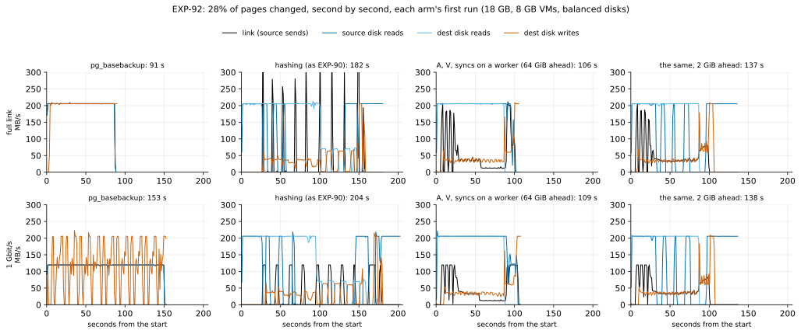
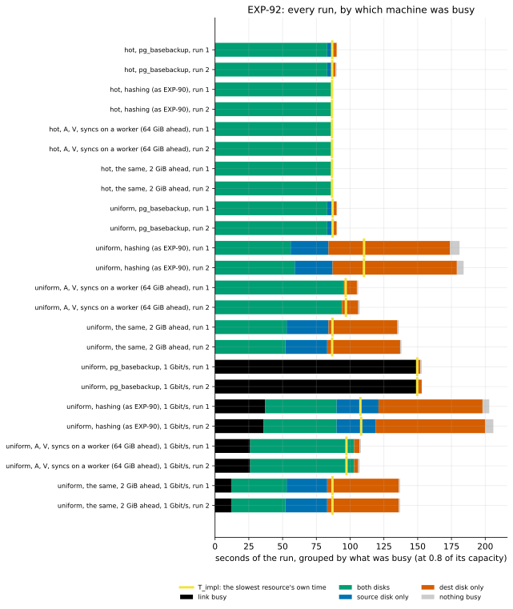

# EXP-92: Confirming hashing with its syncs on a worker, and holding the hashing window to the source's cache

Status: **done November 1, 2026 (UTC).**
- **F1, the deciding prediction, held.** Where many pages change, hashing with all three options (`hashAVw`) took **0.706x `pg_basebackup` at 1 Gbit/s**: 108.1 s against 153.0 s. Its two runs took 0.711x and 0.702x (bar 0.85). EXP-91's single run (0.744) is confirmed in a second session.
- **F2, F4 and F5 held:**
  - F2: 0.584x today's hashing at full link (bar 0.70);
  - F4: where few pages change nothing moved, and `pg_basebackup` stayed at its bound;
  - F5: the receiver waited 5.5 s on its syncs, the source's disk was never busy alone, and the cell took 1.10x its bound.
- **F3, the 2 GiB window, failed.** It ended the second reads: the source's bound fell from 96.8 s to 86.8 s, and the sending waited 0.5 s for its reads instead of 35 s. But the two disks then took turns, and the cell took 1.29x as long as with 64 GiB. The window for a held-out session stays 64 GiB.
- **The destination's disk now binds (post hoc).** With all three options it was busy 104–106 s of every scattered run, and `hashAVw` ended 1–3 s after it. No window can gain more than that here.
- **Correctness held:** 24 of 24 runs valid, and 18 of 18 copies matched. Locally, 1,007 fault trials gave no wrong copy, and 53 of 53 misplaced-write controls were caught.

(Pre-registered October 31, before any scored run; the sections up to "The rules this session runs under" are unchanged since.)

## Why

[EXP-91](EXP-91-hash-ahead-verify-as-written.md) tried two changes to hashing where many pages change (`uniform`, 28% of the pages, 18 GB beyond memory):
- **Each change removed the stall it targeted,** but together they took 0.818x today's hashing (the bar was 0.70). The receiver syncing each file in its main loop then bound: 78.5 s of 151.5 s.
- **A reported arm also put those syncs on the receiver's worker (`hashAVw`).** It took 0.601x today's hashing at full link, 1.13x its slowest resource's own time. At 1 Gbit/s it took 113 s against `pg_basebackup`'s 152 s (0.744): the first hashing run to beat a re-clone where many pages change.
- **That was one run of an arm not registered as deciding,** so it is a hypothesis, not a claim (rule 11). Single hashing runs with a pipelining gap moved up to 5.2% between sessions.
- **Hashing ahead ran too far ahead.** With 64 GiB allowed, the planner ran 11–16 GB ahead of the sending on VMs with 8 GB of memory. The pages sent had left the source's cache, so they were read from disk a second time:
  - the source's disk needed 98–99 s with `hashAVw` (104–107 s with hashing ahead alone or with only the verification), against 88 s;
  - in `hashAVw` the sending waited 40 s (full link) and 52 s (1 Gbit/s) for those reads.

## Question

1. **Does `hashAVw` hold with two runs per arm, in a session of its own?** Deciding: does hashing beat a re-clone at 1 Gbit/s where many pages change?
2. **Does holding the window to what the source's cache keeps remove the second reads,** without bringing back the source's idle?

## What runs (no pgdelta code changes; no default changes)

**The window: `--hash-ahead 2G`.**
- The source VM has 8 GB of memory, and PostgreSQL's `shared_buffers` is 128 MB, so most of it is page cache. That is inferred from the settings, not measured.
- The window counts the file being sent (`pgdelta/sender.py`, `_Planner`). So 2 GiB is that file and about one more 1 GiB file ahead, and the pages a file sends were read for hashing at most about 2 GiB earlier: well under the cache.
- **The risk:** one file of lookahead is about 5 s of the source's disk. When the planner waits for room, the source's disk may idle (EXP-90's stall). F3 tests whether it does. A larger window keeps fewer of the pages cached.

**The lab and the baseline** (opt-in, decides nothing):
- `experiments/network/lab_exp64.sh`: an arm's window may follow its `A`. So `hashA2GVw` is `--hash-ahead 2G`, and `hashAVw` keeps 64 GiB.
- `experiments/baseline/run.sh`: a pattern's own arms (`ARMS_hot`) are passed to the lab, so the hot cell can run fewer arms.

**The arms:**

| Arm | Sender | Receiver |
|---|---|---|
| `full` | `pg_basebackup` | |
| `hash` | hashing, as EXP-90 and EXP-91 | `--fsync main`, `--verify-scope written` (the defaults) |
| `hashAVw` | `--hash-ahead 64G --read-ahead 8` | `--verify-scope as-written --fsync worker` |
| `hashA2GVw` | `--hash-ahead 2G --read-ahead 8` | as `hashAVw` |

**An independent review before registration** found one blocker and seven smaller issues, all fixed before any data:
- **The blocker:** a failed or missing run could pass a prediction, since the analysis averaged whatever runs it found. Cells are now checked for validity (below), and a prediction on an invalid cell is void.
- **F1's mean could hide a bad run:** each run must now pass too.
- **Nothing checked that each arm ran with its options:** the sender's stats are now compared with the arm's.
- **F3's time bar sat inside the noise,** though it chooses the window for a held-out session: it is now "no slower beyond the noise", with a tie rule. Its source-disk bar is now relative to the same session's `hash`.
- **The window counts the file being sent,** so 2 GiB is one file of lookahead, not two. The text and the local window (192 MiB, which held less than one file) are corrected.
- **The campaign's gating half** is now the deciding arm's regime (everything ahead); a half cut short by its time cap has not passed.
- **The VM command and rule 16's file list** are now given in full.

## Design

**Stage 1: the tests.**
- The suite: 1,693 tests, plus 5 new ones.
- **`tests/test_pgdelta_exp92.py` (2):** all three options together, on every engine configuration, with a window smaller than one file (6 pages) and one holding everything (1 GiB); and EXP-32's misplaced-write switch, caught and then repaired.
- **`tests/test_exp92_analysis.py` (3):** a failed, unmatched, missing or misconfigured run makes its cell invalid.
- EXP-91's 17 tests cover each change alone and both together.

**Stage 2: local** (the Mac, PostgreSQL 17.11).
- **The correctness campaign:** EXP-32's randomized fault campaign (`experiments/correctness/campaign.py`), as EXP-91 ran it, with the syncs on the worker added.
  - The flags: `--pgdelta-args "--verify-scope as-written --hash-ahead SIZE --read-ahead 3 --fsync worker"`.
  - **First half:** 500 counted trials with SIZE 2G. The campaign's databases are smaller than that, so everything is planned ahead: the regime of the deciding arm, `hashAVw`.
  - **Second half:** 500 with SIZE 64K, a few files ahead.
  - A misplaced-write control every 20 trials.
  - **Stop rule:** a wrong output, a control not caught, or a failed repair stops it. Each half is 500 counted trials, with at most 2 hours; a half that the time cap stops short of 500 has not passed.
- **The scale model:** `experiments/network/exp92_local.py --scale 100 --repeats 2 --seed 921`.
  - EXP-91's local lab, in the hot and scatter cells, with the arms `hash`, `hashAVw` and `hashA2GVw`.
  - Locally `hashA2GVw` holds 2 GiB too: the same in files as on the VMs (the file being sent and about one more). The 1.6 GB local database fits in it almost whole, so its local ratio says little.
  - Every copy is started and checked.
  - Its ratios are rule 13's proxy pairs. In memory nothing is evicted, so the window's purpose can't show.

**The gate to the VMs (rule 13):**
- Promotion rests on EXP-91's VM measurements: the local model's ratio for these changes had the opposite sign to the VMs' (1.354 against 0.818).
- The VM session starts once the tests pass and the campaign's first half (500 trials) passes.
- The second half may run while the VMs do. A wrong output, a missed control or a failed repair in either half voids the VM session's verdicts.

**Stage 3: the VMs.**
- **The script:** the team's baseline (`experiments/baseline/run.sh`), as in EXP-90 and EXP-91:

```bash
PAIR=ha NAME=exp92 RESULTS=results/exp04/exp92 SEED=920 REPEATS=2 PATTERNS="hot uniform" ARMS="full hash hashAVw hashA2GVw full_1g hash_1g hashAVw_1g hashA2GVw_1g" ARMS_hot="full hash hashAVw hashA2GVw" bash experiments/baseline/run.sh
```

- **The setting:** the same two `n2d-highcpu-8` VMs, 150 GB balanced disks, and PostgreSQL 17.11 at scale 600 (18 GB).
- **The arms:**
  - `uniform`: `full`, `hash`, `hashAVw` and `hashA2GVw`, each also on a link shaped to 1 Gbit/s (`_1g`). Two runs each: 16 runs.
  - `hot`: the same four at full link (`ARMS_hot`). Two runs each: 8 runs. EXP-91 showed hot hashing doesn't use the link (under 1 s of it).
- **Each run:** from a fresh copy of B0, with both VMs' caches dropped, in an order shuffled within each pattern. Every pgdelta copy is started and compared with the source.
- **The sampler:** both VMs every 0.1 s, as in EXP-90 and EXP-91.

**The analysis**, committed before the data: `analysis/exp92.py`.
- It reuses EXP-90's bound arithmetic (`analysis/exp90.py`) and the busy-time view (`analysis/exp90_overlap.py`).
- An arm's time in a cell is the mean of its two runs, and so is each counter. Every run is also reported.
- **A cell is valid when:**
  - it has both its runs, each exited 0 on both sides, and every pgdelta copy matched its source;
  - each run ran with its arm's options, as the sender's stats record them (the window, the receiver's sync mode and its verify scope). A misspelled arm would otherwise run as plain hashing.
- **A prediction that uses a cell that isn't valid is void,** neither held nor failed (`tests/test_exp92_analysis.py`).
- Dry-run on EXP-91's data, it reproduces EXP-91's values.

## Predictions

| # | Prediction | Bar (predicted) |
|---|---|---|
| F1 (deciding) | **Hashing beats a re-clone at 1 Gbit/s where many pages change:** uniform, the mean of `hashAVw_1g`'s runs, and each of them, ≤ 0.85x the mean of `full_1g`'s | 0.85 (0.70–0.79: EXP-91's 0.744, within the 5.2% single hashing runs moved between sessions) |
| F2 | **The gap closes at full link:** uniform `hashAVw` ≤ 0.70x `hash` | 0.70 (0.56–0.65) |
| F3 (the window) | Uniform, at each rate: **`hashA2GVw`'s source-disk bound ≤ 1.04x `hash`'s** (the source reading S once), the sending's wait on the pages' reads **≤ 10 s in all,** and **`hashA2GVw` no slower than `hashAVw` beyond the noise** (≤ 1.0223x) | 1.04 (0.99–1.02); 10 s (under 5); 1.0223 (0.90–0.99) |
| F4 (no harm, and the bound's control) | **Where few pages change, nothing moves:** hot, `hashAVw` and `hashA2GVw` each ≤ 1.03x `hash`. **`pg_basebackup` stays at its bound:** all six runs ≤ 1.10x T_impl | As stated |
| F5 (the mechanism) | Uniform `hashAVw`, full link: the receiver's main loop **waits on its syncs ≤ 10 s,** the source's disk is **busy alone ≤ 5 s,** and **measured / T_impl ≤ 1.20** | EXP-91: 5.5 s, 0 s, 1.130 |
| Correctness | Every cell valid: 24 runs, and every pgdelta copy matches its source (18). No wrong output in the 1,000 local trials, and every misplaced-write control caught | Any miss stops and is reported |

**Reported:**
- each run's time, bound, binding resource and busy-time split;
- **the two runs' spread in each cell,** against rule 17's 2.23%. A cell over it is checked for interference (the samplers' other processes, the disks' counters) before it is scored;
- the sender's planner counters (how far ahead, the waits for room and for B's digests) and the sending's waits on its reads;
- **the cross-session values** against EXP-91's: `full` within 1% for any comparison across sessions, then `hash` and `hashAVw` at both rates;
- the local ratios beside the VMs' (rule 13's proxy pairs);
- **the figures:** `exp92-timelines` (the uniform runs, second by second, each arm's first run) and `exp92-runs` (every run's seconds by which machine was busy, with its bound).

## What follows

- **If F1 and F2 hold:** hashing with these three options beats a re-clone at 1 Gbit/s where many pages change, in a second session with two runs per arm. It still isn't a default or a claim outside the project:
  - before either, a held-out session is owed (rule 15: H9–H12), predicted from this session's results;
  - **the window that goes to it:** 2 GiB only if `hashA2GVw` is faster than `hashAVw` beyond the noise (≤ 0.9777x) at one rate and no slower beyond it at the other. Otherwise 64 GiB, the arm F1 decides on.
- **If F1 fails:** EXP-91's 0.744 didn't reproduce. No claim is made, and the timelines show why.
- **If F3 fails because the source idles** (the planner waiting for room while the source's disk is quiet): try a larger window (4 GiB), or count the window in pages to send rather than files.
- **At full link, at best a tie either way:** all of B is read. B's digests kept from the refresh that wrote B stays the structurally different idea, next in the idea archive.

## The rules this session runs under

- **Rule 13:** the tests, then the local campaign and scale model, then the VMs, as gated above. Both proxy pairs are logged.
- **Rule 14:** the idea archive was read. Its "window held to the cache" row is F3. Structurally different, beside it: B's stored digests.
- **Rule 15:** no default changes and no claim leaves the project from this session, so no held-out session is owed now. One would be before either.
- **Rule 16:**
  - `analysis/integrity.py register EXP-92` records, as of the registration commit:
    - the analysis: `analysis/exp92.py`, and what it reuses (`analysis/exp90.py`, `analysis/exp90_overlap.py`, `analysis/plotting.py`);
    - the VM session: `experiments/baseline/run.sh`, `experiments/network/lab_exp64.sh`, `remote.py`, `util_series.py`, `fio_mixed.sh`, `link_probe.py`, `hashbench.py`, `source_cluster.py`, `experiments/change_patterns/run_study.py`, and `infra/gcp/` (`config.sh`, `create.sh`, `sets/ha.sh`, `startup.sh`, `throttle.sh`);
    - the local stage: `experiments/correctness/campaign.py`, `experiments/network/exp92_local.py` and `exp91_local.py`, `experiments/summaries_off/timing.py` and `trials.py`, `experiments/fastpath_crashed/crashed_standby_trials.py`;
    - the tests: `tests/test_pgdelta_exp92.py`, `tests/test_pgdelta_exp91.py` (whose `heavy_trees` it uses), `tests/test_exp92_analysis.py`;
    - pgdelta's modules (`pgdelta/*.py`);
  - every copy is checked;
  - the negative controls are the misplaced-write switch (the tests and the campaign) and F4's `pg_basebackup` runs, which control the bound arithmetic.
- **Rule 17:**
  - two runs per arm; within a session, two runs of 10 s or more differ by up to 2.23% (EXP-85's noise floor, unchanged by EXP-91);
  - between sessions, `pg_basebackup`'s uniform cell spreads 0.44% over seven sessions;
  - F1's bar is 0.06–0.15 above its predicted range, and F2's 0.05–0.14;
  - a deciding ratio within 0.03 of its bar gets a second session.

## Results

**The session:**
- **Where and when:** us-west1 (zones b and c). On October 31, the VMs were created at 21:47 UTC, the profile ran 21:49–21:58, and the smoke ran 21:58–22:02 (scale 20, every arm passed with its options). The scored runs ran 22:02–23:59.
- **Afterwards:** the results were fetched and both VMs deleted (00:00, November 1).
- **Rule 16:** `analysis/integrity.py check EXP-92` found 51 of 51 registered files unchanged since 282d4ad when the data were scored.
- **The data:**
  - each run's scores: [data/exp92-scored.json](data/exp92-scored.json);
  - the local scale model: [data/exp92-local.csv](data/exp92-local.csv);
  - the fault campaign: [data/exp92-campaign.csv](data/exp92-campaign.csv);
  - the raw samples: `results/exp04/exp92` (not in git).

**The capacities, measured before the runs:**
- **Disks:** 205.5 MB/s and 4,195–4,197 ops/s, reading or writing, on both VMs. With sequential reads and random writes at once, the reads ran at 1.000 of alone and the writes at 0.81.
- **The link:** 1,898 MB/s unshaped, and 119.6 MB/s shaped.

**Where many pages change (uniform, 28% of the pages).** Each row is the mean of two runs:

| Rate | Arm | Seconds | Over `hash` | Over `pg_basebackup` | T_impl, set by | Measured / T_impl |
|---|---|---|---|---|---|---|
| full link | `full` | 90.84 | | 1 | 87.04 s, dest's disk | 1.044 |
| full link | `hash` | 182.97 | 1 | 2.014 | 110.27 s, dest's disk | 1.659 |
| full link | `hashAVw` | 106.86 | **0.584** | 1.176 | 96.81 s, the source's disk | 1.104 |
| full link | `hashA2GVw` | 137.60 | 0.752 | 1.515 | 86.83 s, the source's disk | 1.585 |
| 1 Gbit/s | `full_1g` | 153.04 | | 1 | 149.64 s, the link | 1.023 |
| 1 Gbit/s | `hash_1g` | 204.94 | 1 | 1.339 | 107.89 s, dest's disk | 1.899 |
| 1 Gbit/s | `hashAVw_1g` | 108.10 | 0.527 | **0.706** | 97.31 s, the source's disk | 1.111 |
| 1 Gbit/s | `hashA2GVw_1g` | 137.78 | 0.672 | 0.900 | 86.93 s, the source's disk | 1.585 |

**Where few pages change (hot, 1% of the rows):**
- Every hashing arm took 87.68–87.76 s, 1.012–1.013x its bound: both disks reading S and B.
- Against `pg_basebackup` (90.59 s), that is 0.968x.





**The predictions:**

| # | Prediction | Measured | Verdict |
|---|---|---|---|
| F1 (deciding) | Uniform: `hashAVw_1g` ≤ 0.85x `full_1g`, the mean and each run | 0.706; the runs 0.711 and 0.702 | **Held.** 0.144 inside the bar, so no second session is owed (rule 17). At the low end of the predicted 0.70–0.79 |
| F2 | Uniform, full link: `hashAVw` ≤ 0.70x `hash` | 0.584 | **Held.** Within the predicted 0.56–0.65 |
| F3 (the window) | Uniform, at each rate: `hashA2GVw`'s source-disk bound ≤ 1.04x `hash`'s; the sending's wait on its reads ≤ 10 s; `hashA2GVw` ≤ 1.0223x `hashAVw` | 86.83 and 86.93 s against 88.26 s (0.98); 0.48 and 0.47 s; **1.288 and 1.275** | **Failed** on its last part: the window did what it was for, but the cell slowed |
| F4 | Hot: `hashAVw` and `hashA2GVw` ≤ 1.03x `hash`; all six `pg_basebackup` runs ≤ 1.10x T_impl | 1.000 and 1.000; 1.023–1.044 | Held |
| F5 | Uniform `hashAVw`, full link: the syncs' wait ≤ 10 s; the source's disk alone ≤ 5 s; ≤ 1.20x T_impl | 5.5 s; 0 s; 1.104 | Held |
| Correctness | Every cell valid; every copy matches; no wrong output locally; every control caught | 24 of 24 runs, no invalid cell; 18 of 18 copies; 1,007 local trials; 53 of 53 controls | Held |

**The window for a held-out session: 64 GiB.** `hashA2GVw` was slower than `hashAVw` beyond the noise at both rates, so the pre-registered rule keeps the 64 GiB window, the arm F1 decided on.

**The local fault campaign** (EXP-32's, with `--verify-scope as-written --hash-ahead SIZE --read-ahead 3 --fsync worker`):

| Fault | Trials | Wrong copy |
|---|---|---|
| None | 367 | 0 |
| B kept writing on its own (diverged) | 171 | 0 |
| The refresh killed partway | 237 | 0 |
| B corrupted | 93 | 0 |
| B truncated | 90 | 0 |
| Another cluster's copy | 49 | 0 |
| **All** | **1,007** | **0** |

- **The controls:** all 53 misplaced-write controls were caught, then repaired.
- **The bound:** the wrong-copy rate is below 0.30% per refresh at 95% confidence, and below 0.69% at 99.9%.
- **The halves:**
  - **The first (gating) half:** 500 trials hashed 2 GiB ahead, everything in these databases. It passed before the VM session started, as the gate required.
  - **The second half:** 64 KiB ahead (a few files), run while the VMs did.
  - At trial 1,008 the harness itself stopped. Its stop of a timed-out refresh raised a permission error from `os.killpg`, which on macOS happens when the process group has just exited. No output was wrong, and that trial recorded no outcome.
  - The half resumed from trial 1,008 with the registered harness unchanged (`--first 1008 --trials 119`). It counted 388 trials before the stop and 119 after: 507.

**The local scale model** (`exp92_local.py`, scale 100, two runs per arm):
- All 12 copies had equal rows and passed `pg_amcheck`.
- In the scattered cell, the medians were `hash` 3.58 s, `hashAVw` 4.62 s and `hashA2GVw` 5.31 s. In hot they were 1.59, 2.11 and 2.19 s. All of these runs are under 10 s. The scattered cells' two runs spread up to 15%, and the hot cells' up to 63% (`hashA2GVw`: 1.50 and 2.89 s).

**Reported:**
- **The spread of each cell's two runs:** at most 1.36% (uniform `hash`), against rule 17's 2.23%. No cell needed a check for interference.
- **The cross-session values against EXP-91's:**
  - `full`, the control: +0.2% (hot), +0.1% (uniform) and +0.8% at 1 Gbit/s, all within 1%;
  - `hash`: −0.0% (hot) and −1.2% at full link, but **−7.2% at 1 Gbit/s** (204.9 s against 220.8 s). Today's hashing, with its pipelining gap, moves between sessions more than the controls do, and more than the 5.2% EXP-91 saw;
  - `hashAVw`: −3.9% at full link and −4.3% at 1 Gbit/s, from one run in EXP-91 to two here.
- **The planner, uniform:**
  - with 64 GiB, it ran up to 11.1–11.4 GB ahead, and the sending waited 34–35 s for the pages' reads;
  - with 2 GiB, it ran up to 2.15 GB ahead (the file being sent and one more), waited 49–50 s for room, and the sending waited 0.5 s for its reads.
  - The counter `analysis/exp92.py` prints as "for B's digests" is the sending thread's wait for the planner's next file (`_Planner.take`). It includes the planner's own reading of S, not only B's digests. Only the label is wrong, and it is reported, not scored.
- **The verification as written:** 618,417 pages read back in 4.2–4.5 s; 73 nodes (3 pages) re-read, against 9,041 nodes with `written`. Dest's reads beyond the database: 0.01–0.02 GB, against 4.3–4.9 GB for `hash`.
- **The proxy pairs (rule 13),** logged in [proxy-fidelity.csv](../research/proxy-fidelity.csv):
  - `hashAVw` over `hash`: locally 1.292 (scatter) and 1.332 (hot), against the VMs' 0.584 and 1.000. The opposite sign again, as in EXP-91: in memory nothing is evicted and no sync waits on a disk.
  - `hashA2GVw` over `hashAVw`: locally 1.148 and 1.038, against 1.288 and 1.000. The sign matches but not the mechanism: locally the window holds the 1.6 GB database almost whole, and the scattered cells' runs spread 14–15%.
- **The noise floor (rule 17),** refreshed with this session's 12 cells ([noise-floor.csv](../research/noise-floor.csv)):
  - within a session, the 95th percentile for runs of 10 s or more is now 1.92% (from 2.23%), and still 7.11% under 10 s;
  - between sessions, `pg_basebackup`'s uniform cell spreads 0.44% over eight sessions.

## Where the time went (post hoc, not registered)

From the timelines, the busy-time split, and pgdelta's timers, uniform at full link:

| Seconds (mean of two runs) | `hash` | `hashAVw` (64 GiB) | `hashA2GVw` (2 GiB) |
|---|---|---|---|
| The run | 182.97 | 106.86 | 137.60 |
| Both disks busy | 57.5 | 94.5 | 52.5 |
| The source's disk alone | 28 | 0 | 31 |
| Dest's disk alone | 91 | 11 | 52.5 |
| Dest's disk busy in all | 148.5 | 105.5 | 105 |
| The run less dest's busy seconds | 34.5 | **1.4** | 32.6 |
| The planner waited for room | | 0.0 | 49.7 |
| The sending waited for the pages' reads | | 35.2 | 0.5 |

**The 2 GiB window made the disks take turns,** the risk the pre-registration named:
- With one file of lookahead, the planner could read S only as fast as the sending went. The sending went at the receiver's pace, while dest's disk also read all of B.
- So during B's read the source read S in bursts. It sat idle while the receiver wrote (49.7 s waiting for room).
- Once B was read and the writes caught up (about 105 s), the source read S's last 6 GB alone (31 s), with nothing left to send.
- With 64 GiB the planner read those files during B's read. It paid for that by reading the pages it sent a second time, but those reads overlapped dest's work.

**With all three options, dest's disk binds:**
- **It was busy 104–106 s in every scattered run** of `hashAVw` and `hashA2GVw`, at both rates. `hashAVw`'s runs were only 1.2–2.8 s longer than that.
- **So the source's second reads were hidden behind dest's work,** and no window could gain more than those 1–3 s here.
- **That is more than the bound model allows for dest (86.6 s).** The model counts reading B's 17.8 GB at 205.5 MB/s, with the 271,000–275,000 write operations beside it at the measured mixed point.
- **Measured, the excess is about 19 s.** Dest's disk was busy alone for 11 s after B's last read: the last files' writes and syncs. A file's writes can follow only its B digests, so they trail B's read.
- **Inferred, not separated:** the rest is seconds in which the disk was busy below the model's mixed point.

## What follows (from these results)

- **Hashing with all three options beats a re-clone at 1 Gbit/s where many pages change.** That now rests on two sessions: one run in EXP-91 (0.744) and two runs here (0.706).
- **At full link it still loses:** 1.18x a re-clone. All of B is read, and dest's disk binds.
- **It is not a default, and no claim leaves the project yet.** Before either, a held-out session is owed (rule 15: H9–H12), predicted from this session, with the 64 GiB window.
- **The window's pre-registered follow-ups aren't worth a VM session at these settings.** Those were a 4 GiB window, or counting the window in pages to send. Dest's disk binds, leaving 1–3 s to gain. They matter only where the source binds, for example with less memory beside the database, where more of the sent pages would be read again (inferred).
- **Dest's disk does two things: it reads all of B, and it writes after B's last read.**
  - B's digests kept from the refresh that wrote B (the idea archive's structurally different idea) would end the first.
  - From this session's bounds, dest would then only write, and the source's single read of S (about 87 s) would bind.
  - At that bound it would take about 0.96x a re-clone at full link and 0.57x at 1 Gbit/s. At this session's 1.10x its bound, it would take 1.05x and 0.63x. Both are inferred, not measured.
  - Its open problem is proof that B is unchanged since its digests were stored.
- **Proposed next:** the held-out session for making the three options hashing's defaults. Beside it, B's stored digests.

## Workflow check

| | Check | For this experiment, done |
|---|---|---|
| 1 | Situation, standard, competitor | Hashing against a re-clone (`pg_basebackup`) beyond memory where many pages change. Measured, two runs per arm: with all three options, **0.706x at 1 Gbit/s** (wins), 1.176x at full link (loses); hot 0.968x |
| 2 | The bottleneck | The timelines and busy-time split: with all three options, dest's disk (busy 104–106 s, the runs 1–3 s longer). The 2 GiB window: the disks took turns (the planner waited 50 s for room; the source read its last 6 GB alone) |
| 3 | Systems or algorithm | At full link algorithm: dest reads all of B (86.6 s) and the source all of S (about 87 s), against a re-clone's 91 s. At 1 Gbit/s already won; what is left there is dest's write tail, about 19 s beyond the bound model |
| 4 | Papers and prior art | The window followed Cao, Felten, Karlin and Li (SIGMETRICS 1995): it ended the second reads, as their prefetching rule predicts, but here the second reads were hidden behind dest's work. EXP-68's syncs on a worker, reused |
| 5 | Committee-grade | Pre-registered, the analysis committed first; two runs per arm, every cell valid; F1 measured 0.144 inside its bar; the post-hoc mechanism measured (busy seconds) except the split of dest's excess, inferred |
| 13 | The cascade | Tests, local campaign and scale model, then VMs. Four proxy pairs logged: `hashAVw` over `hash` opposite in sign again, so promotion rests on VM evidence |
| 14 | The idea archive | Updated: syncs on the worker confirmed; the window held to the cache lost here; B's stored digests is the structurally different idea next |
| 15 | Held-out workloads | Owed before the three options become hashing's defaults or the 1 Gbit/s result leaves the project: H9–H12, with the 64 GiB window |
| 16 | Scorer integrity | 51 of 51 files unchanged when scored; 18 of 18 copies matched; 53 of 53 misplaced-write controls caught; `pg_basebackup` at 1.023–1.044x its bound |
| 17 | The noise bar | Each cell's runs within 1.36% (bar 2.23%; now 1.92% with this session); the controls within 1% of EXP-91; F1 0.144 and F2 0.116 from their bars, so no second session |
