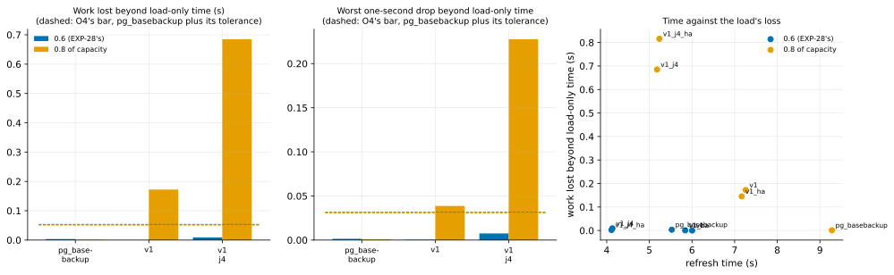

# EXP-93: what the hashing campaign's speed cost the source's load

Status: **done November 6, 2026 — 36 runs, all passing. The campaign's recipe is not O4-safe near saturation,
and the 2×2 says the worker count is why, not hashing ahead.**

`v1_j4_ha` (`--jobs 4 --hash-ahead 64G --read-ahead 8`) costs the load **0.816 s of work lost net at 0.8 of
capacity — 16.3× O4's tolerance** — where the shipped two-worker default costs 0.172 s (3.4×). **Hash-ahead on
its own is load-neutral to slightly protective**: at the shipped cap it costs 0.145 s, *less* than the default.
Going 2→4 workers costs 4.0–5.6×; turning hash-ahead on costs 0.84× at two workers. **At 0.6 of capacity all
four pgdelta arms meet O4, at half the tolerances.** The replication gate held — `v1` reproduced EXP-88 stage
1's miss on a different pair in a different region.

Prediction 6 **failed**: hash-ahead did not shorten the refresh window under load (0.973–1.012×), which EXP-94
independently corroborates — its gain is a round-trip phenomenon and this link was unshaped at 0.155 ms.

Originally **pre-registered November 5, 2026**, before any run and before any VM for it existed, and
re-registered at `717f267` before the session with no run in existence. One session on EXP-88 stage 1's exact
shape (three VMs, a 2 GB cluster on 32 GB of RAM, local NVMe, `us-east1-b`); it took 26 minutes of session and
about 40 minutes of VM time. It asks one question that EXP-90, EXP-91 and EXP-92 could not ask, because all
three ran with the source idle.

## Question

EXP-92 reports hashing at **0.706x `pg_basebackup`** at 1 Gbit/s (108.10 s against 153.04 s), the campaign's
headline result, from the `hashAVw` recipe: `--hash-ahead 64G --read-ahead 8` on the sender, `--fsync worker`
and verify-as-written on the receiver. **Does that configuration still cost a loaded primary no more than one
`pg_basebackup` stream (O4)?**

Nobody knows, and the reason is structural rather than an oversight anyone could have caught at review. The
campaign's driver, `experiments/network/lab_exp64.sh`, applies its change pattern to completion and prints
`workload done` at line 252, and the timed-arm loop begins at line 263. **No transactions run between t0 and
t1 in any EXP-90, EXP-91 or EXP-92 arm.** Searched across all three write-ups, the strings `O4`, `work lost`,
`slowdown`, `pgbench`, `p95`, `p99`, `latency` and `offered load` do not occur. The campaign optimised hashing
for wall-clock time against an idle live primary, which is a legitimate thing to measure and is not what O4 is.

Two further facts make this worth a session rather than a footnote.

**The recipe runs the source at four hashing workers.** `lab_exp64.sh:371` sends with `--jobs 4` on
`--source-kind live`. Because an explicit `--jobs` is always honoured (`pgdelta/cli.py:resolve_jobs`), that
**overrides live mode's shipped cap**, which is one worker per 4 source CPUs (`cli.py:35`, `LIVE_CPUS_PER_JOB`)
and is therefore 2 on the 8-vCPU source the campaign used. The cap exists for O4 reasons specifically: the
help text at `cli.py:154-156` justifies it as the setting that "slowed a busy primary no more than
pg_basebackup (EXP-28, EXP-39)". So the campaign's number is measured at twice the worker count the project
ships for the express purpose of protecting the load, with no load present.

**And the cap's own justification is now contradicted.** EXP-88 stage 1 measured the shipped default - 2
workers, 8 vCPUs, BLAKE2b - **missing O4 at 0.8 of the source's capacity by 5.15x the work-lost tolerance and
2.56x the worst-drop tolerance**, and missing at twice the tolerances too. `docs/RESULTS.md:57` still states
the claim without a load level attached: "Within `pg_basebackup`'s, at live mode's default of one source worker
per 4 CPUs (EXP-28, -30, -39)". EXP-28, EXP-30 and EXP-39 all measured at 0.6 of capacity or below. The claim
is true where it was measured and untested above it.

This experiment does not decide what to ship. It measures what the new configuration costs, so that whoever
decides is deciding with a number.

## What is already settled, and must not be re-claimed here

- **EXP-90, EXP-91, EXP-92 measured time, correctly, with an idle source.** `hashAVw`'s 0.706x at 1 Gbit/s and
  1.176x at the full link stand as time results. This experiment does not re-measure time as a verdict, and a
  slower refresh here is not a refutation of theirs - different question, different conditions.
- **EXP-88 stage 1** settled the shipped default's O4 standing in memory at 0.3, 0.6 and 0.8 of capacity: meets
  at 0.3 and 0.6, misses at 0.8. `v1` is repeated here only as a replication anchor, not as a new claim.
- **EXP-88 stage 2** settled that beyond memory `pg_basebackup` itself stops being free (W_net 0.120-0.124
  against 0.000 in memory), which moves the bar. This experiment runs **in memory**, so stage 1's bar applies,
  not stage 2's.
- **EXP-83's four sessions** settled `summarize_wal`'s standing cost. No arm here varies it; every arm runs
  with the setting EXP-88 stage 1 used, so the two sets of cells are comparable.

## Design

### The shape, and why it is the optimistic case

Identical to EXP-88 stage 1: source and dest `n2-standard-8` with local NVMe, client `n2-standard-4`,
`us-east1-b`, a 2 GB cluster on 32 GB of RAM, scale 130, BLAKE2b, `summarize_wal` on. The set file is reused
unchanged (`infra/gcp/sets/exp88.sh`), so nothing about the machines can differ.

Reusing stage 1's shape buys the one thing that matters: **every new arm here is netted against a null and a
`full` measured on the same machines at the same load levels**, and sits directly beside stage 1's `v1` and
`v1_j4` cells. The only deliberate difference between this session and stage 1 is the engine configuration.

It is also, deliberately, **the condition most favourable to the new configuration.** Hashing 64 GiB ahead
pulls the maximum volume through the primary's page cache in the minimum time, and pgdelta has no source-side
throttle: `git grep -nE "fadvise|O_DIRECT|ioprio|setpriority|throttl" -- pgdelta/` finds only
`POSIX_FADV_WILLNEED` in `prefetch.py`, which is destination-side and pulls pages *into* cache. That
displacement mechanism gets worse beyond memory, which is EXP-83d's unresolved finding. So **a miss in memory
is decisive and a pass in memory proves nothing about DR**, and the registration says so before the data
exists.

### Arms

Six, and the four pgdelta arms form a clean 2x2 so that the worker count and hash-ahead can be read apart
rather than confounded:

| Arm | Sender | Receiver | What it is for |
|---|---|---|---|
| `none` | - | - | the null; every verdict is netted against this |
| `full` | `pg_basebackup` | - | **the bar** |
| `v1` | `--jobs 2` (the shipped cap) | default | replication anchor against EXP-88 stage 1 |
| `v1_j4` | `--jobs 4` | default | **the worker count alone**, hash-ahead off |
| `v1_ha` | `--jobs 2 --hash-ahead 64G --read-ahead 8` | `--fsync worker --verify-scope as-written` | **hash-ahead alone**, at the shipped cap |
| `v1_j4_ha` | `--jobs 4 --hash-ahead 64G --read-ahead 8` | `--fsync worker --verify-scope as-written` | **the campaign's actual recipe** |

`--read-ahead 8` is not an independent choice: `--hash-ahead` turns it on implicitly (`cli.py:_read_ahead`), so
naming it is documentation, not an extra variable. `64G` is `lab_exp64.sh:351`'s value; on a 2 GB cluster it
means the whole database is planned ahead with no link backpressure, which is the campaign's own regime.

The receiver flags in the `_ha` arms are **destination-side** and are not expected to move W or D at all
(`as-written` adds a read-back `pread` on dest, `receiver.py:1319`). They are included so the arm is the recipe
the 0.706x claim actually rests on rather than a reconstruction of it. If `v1_ha` and `v1_j4_ha` differ from
their non-`ha` partners, the source-side flags are the only plausible cause, and that is the reading the 2x2
supports.

### The load, levels and runs

The load is EXP-88's, unchanged: pgbench's built-in TPC-B-like scripts from the client VM, with C measured
first on an unloaded source and the levels set as fractions of it. Two levels:

- **L80 (0.8 x C)** - the deciding level. It is where EXP-88 found the shipped default missing, so it is where a
  configuration with more concurrency has something to show.
- **L60 (0.6 x C)** - the level EXP-28, EXP-30, EXP-39 and EXP-88 all met at. It establishes whether the new
  configuration is safe anywhere, and makes the result readable as a ladder rather than a single point.

6 arms x 2 levels x 3 repeats = **36 runs**, one level block at a time, arms serpentined within a block so a
drift in machine state cannot align with an arm. Comparable to stage 1's 39 runs and about the same session
length. The registered near-the-line rule applies: a cell within 20% of either tolerance earns two more runs,
written to their own session directory (the driver now refuses to overwrite, `lab_exp88.sh`, amendment 6).

### What is measured

Exactly EXP-88's instruments, unchanged, so the cells are comparable: W and D over 1-second buckets in
`[t0, t1+10s]` netted against the matched `none`; verdicts at x0.5, x1 and x2 per K7; p50/p95/p99 and TPS
reported but **not deciding**; failed and skipped transactions and non-zero exits judged; refresh wall time;
`fast_path_used` from both ends' `--stats-json`; per-end disk bytes.

One instrument is known broken going in and is recorded rather than relied on: stage 1's per-end non-WAL
read/write bytes carry `wal_device_separate=False`, because WAL shared the data device, so the bytes are not
"besides WAL" as designed. The same will be true here, on the same shape. **The cache-displacement hypothesis
therefore cannot be tested by this session's disk counters**, and no claim about displacement will be made from
them.

### Recorded before the data, under rule 16

Registering this experiment requires two declarations, because the registered set is wrong in a way that
matters:

1. **`pgdelta/sender.py` and `pgdelta/receiver.py` must be added to the registered module list.** EXP-88
   registered `cli.py`, `fastpath.py`, `hashing.py`, `inplace.py` and `live.py` but **not `sender.py`** - which
   is the module that performs the source-side reads W and D measure, and which gained 225 lines in the
   campaign under test. A registration that cannot detect a change to the code under test is not doing its job.
2. **`experiments/network/lab_exp88.sh` will be edited to add the three new arm names** (`v1_ha`, `v1_j4_ha`,
   and the receiver flags they imply). It is a registered file, so the change is declared here, made before the
   run, and the scorer re-registered at the resulting commit. The driver currently understands only `none`,
   `none_nosum`, `full`, `v1`, `v1_jN` and `v1_fast` (`lab_exp88.sh:333-338`), and launches the receiver with a
   fixed `--jobs 4` and no scope or sync flags (`:315-316`).

`analysis/exp88.py` is reused unchanged: the new arms are arm names, and it nets per level against that level's
own null already.

### Settled before the session, with no run in existence (added November 6, before any VM)

Both declarations above are **done**, and three more things are fixed here rather than left to the session.

3. **Item 2 is complete and needs no further edit.** `lab_exp88.sh` gained the arm names at `051d681`: a
   `*_ha` case adds `--hash-ahead $HASH_AHEAD --read-ahead $READ_AHEAD` on the sender and
   `--fsync worker --verify-scope as-written` on the receiver, and `v1_j*` strips a trailing `_ha` before
   reading the worker count, so `v1_j4_ha` resolves to 4 rather than to `4_ha`. The receiver's fixed
   `--jobs 4` is unchanged and is the same on every arm, so it cannot move the 2x2.
4. **The unplanned-cell trap that hit EXP-88 stages 2 and 3 does not reach this session, and that is checked
   rather than assumed.** Those stages each gained a `v1_j4`/L60 cell nobody asked for, because the driver's
   `${L60_ONLY:-v1_j4}` substitutes its default when the variable is empty *as well as* unset (EXP-88
   amendment 8). EXP-93 is immune for a different reason than the one amendment 8 proposed fixing: the
   diagnostic is only added `if ... arm not in arms` (`lab_exp88.sh:239`), and `v1_j4` is one of EXP-93's six
   arms. Running the driver's own plan generator with this session's arms and levels produces **exactly the
   registered 36 runs** - 6 arms x 2 levels x 3 repeats, no extra cell - and the same generator reproduces
   stages 2 and 3's extra cell when `v1_j4` is left out of `ARMS`, which independently confirms amendment 8's
   account of that deviation. **So the driver is not edited for this session.** The `${VAR:-default}` form is
   still the wrong one and is still the next change to make, but making it now would be an undeclared edit to a
   registered file that changes nothing this session does.
5. **The order seed is `930`,** declared here before the run. `lab_exp88.sh`'s default is `880`, EXP-88's;
   using a different seed is the point (a session that re-ran EXP-88's shuffle would confound run order with
   the arms), and naming it here rather than at the shell is what makes the shuffle reproducible.
6. **`infra/gcp/sets/exp93.sh` is added and registered,** which closes a hole in the registration above: the
   18 registered files included no set file at all, so EXP-93's central hardware claim - "EXP-88 stage 1's
   exact shape" - was not hash-covered, and a change to the shape would not have shown in `check`. The new set
   sources `exp88.sh` rather than restating it (the `dr94.sh` pattern), adds this session's own VM names so
   teardown deletes only its three, and caps the VMs at `MAX_RUN_HOURS=3` server-side. Both `exp93.sh` and the
   `exp88.sh` it sources are registered, since the claim rests on both files.

**Re-registered before the session.** `check EXP-93` against `051d681` reported **12 of 18**: `measure.py`,
`cli.py`, `fastpath.py`, `receiver.py` and `sender.py` had changed, along with `create.sh`. Five of those six
are the engine, and that is not a problem to explain away - **it is this experiment's subject**. EXP-93 exists
to price the configuration EXP-91 and EXP-92 measured, and those sessions' engine arrived on this branch at the
`c77c203` merge, after `051d681` was recorded. Registering against a commit that predates the code under test
would make the check meaningless. There is no EXP-93 run in existence, so there is nothing a re-registration
could retrofit.

**`check EXP-93` now reports 20 of 20 files unchanged since `717f267`,** and that is the commit this session's
data must be read against. 20, not 18: the two set files above are the additions.

**The run line:**

```sh
# on dest, after create/provision/deploy/setup-ssh for the exp93 set
REPEATS=3 ARMS='none full v1 v1_j4 v1_ha v1_j4_ha' LEVELS='L60 L80' \
  setsid nohup bash experiments/network/lab_exp88.sh SOURCE_IP CLIENT_IP 3 930 full \
    > /data/exp04-results/exp93-lab.log 2>&1 < /dev/null &
```

`SCALE` is left at the driver's default of 70, which is EXP-28's and stage 1's ~2 GB cluster, and `HASH` at
`blake2b` for the same reason stage 1 pinned it (amendment 3 there): it is the pessimistic hash, so a cell that
meets O4 on BLAKE2b meets it on the shipped `--hash auto`. `HASH_AHEAD=64G` and `READ_AHEAD=8` are the driver's
defaults and are the campaign's own values.

## Predictions

Committed before any VM exists. Each says what would falsify it.

1. **`v1_j4_ha`, the campaign's recipe, misses O4 at L80 - at x1 and at x2.** Three mechanisms compound in it:
   4 hashing workers (past the cap), a planner thread, and 8 reader threads with a 64 MiB in-flight window. The
   shipped 2-worker default already missed L80 by 5.15x. Falsified if it meets at x1.
2. **Hash-ahead raises D proportionally more than it raises W.** It does not read more of S; it reads the same
   bytes in a shorter, denser burst with no backpressure. W integrates interference over the window and D takes
   its worst second, so concentration should show up in D first. Measured as: the `v1_ha`/`v1` ratio in D
   exceeds the same ratio in W. Falsified if W rises proportionally more.
3. **`v1` at L80 reproduces stage 1's miss**, within the near-the-line band. This is the replication gate for
   the whole session: if the anchor does not reproduce, no other arm here is interpretable and the session is
   reported as a failed replication rather than as six results.
4. **`v1_j4` misses L80 by more than `v1` does**, on both W and D. EXP-28's cliff sat between 2 and 4 workers
   (p95 6.4 -> 74.3 ms), and L80 is a harder condition than the 0.6 that cliff was found at.
5. **At L60 the ordering holds but at least one `_ha` arm still meets O4.** If `v1_ha` misses at 0.6 - a level
   four prior experiments met at - the concentration effect is larger than the worker effect, which would be
   the most consequential outcome here and the one most worth a second session under rule 11.
6. **Hash-ahead shortens the refresh window**, reproducing the campaign's direction under load (its purpose was
   to remove the ~40 s source-idle gap EXP-90 found). This is the prediction that makes the result a trade
   rather than a regression: if it holds *and* prediction 1 holds, the recipe buys time with source impact, and
   that is precisely the exchange O4 exists to adjudicate.
7. **No arm corrupts the copy.** Byte-identity for the hashing arms; failed and skipped transactions and
   non-zero exits judged for every arm. A correctness failure in any arm stops the session and no slowdown
   claim from it is publishable.

Prediction 3 is a gate. Predictions 1, 2, 4 and 5 are the result. Prediction 7 is a stop condition.

## What follows, and what does not

If prediction 1 holds, the project learns that its fastest hashing configuration is not O4-safe near
saturation, in the condition most favourable to it. That bears on three things, **none of which this
experiment decides**:

- whether `--hash-ahead` should ever be a default, and whether its documentation should carry a load caveat;
- whether `lab_exp64.sh`'s `--jobs 4` is a sound configuration to report headline numbers from;
- the load-aware worker cap already queued as an owner decision (D50, D81).

**No shipped default is changed by this experiment**, including the live worker cap. That is the owner's call
and it stays the owner's call. What this produces is the number that call currently lacks.

Two corrections to published text are implied by evidence already in hand, independent of this session's
outcome, and are raised for the owner rather than made unilaterally:

- `docs/RESULTS.md:57` states the slowdown claim with no load level, and EXP-88 stage 1 falsifies it at 0.8.
- `pgdelta/cli.py:154-156` tells users the cap "slowed a busy primary no more than pg_basebackup", citing
  EXP-28 and EXP-39, both of which measured at 0.6 and below.

## Limitations, known before running

- **In memory only.** The displacement mechanism that would hurt most is a beyond-memory mechanism. A pass here
  does not transfer to DR, and the write-up will say so in the result, not only here.
- **One session, one shape, 8 vCPUs.** EXP-30 showed the 4-worker result is session-dependent, and EXP-39
  showed 16 vCPUs behaves differently. Rule 11 applies to any verdict landing near a bar.
- **One load shape.** pgbench's bank scripts, like every slowdown experiment in this project. The TPROC-C
  instrument question (`FIRMNESS.md:402`) stays open.
- **BLAKE2b, not the shipped `auto`.** Matching EXP-28 and EXP-88. EXP-60 measured BLAKE3 at 0.872x BLAKE2b, so
  this is the pessimistic hash for the pgdelta arms - the same deliberate choice EXP-88 amendment 3 records.
- **The disk-bytes instrument is broken on this shape** (above). Displacement is not tested here.
- **Neither fast-path mode is exercised.** `page-lsn` - whose read strategy became a default in K16 and which
  has no load cell at all - remains unmeasured under load after this session. It is the next hole, not this one.

---

## Results

**Run November 6, 2026. The replication gate held, the campaign's recipe is the worst arm at 0.8 of capacity,
and the 2×2 says plainly which of its three mechanisms is responsible: the worker count, not hashing ahead.**

`v1_j4_ha` — `--jobs 4 --hash-ahead 64G --read-ahead 8`, the configuration EXP-92's 0.706× headline rests on —
costs the load **0.816 s of work lost net, 16.3× O4's tolerance**, where the shipped two-worker default costs
0.172 s (3.4×). Hash-ahead **on its own is not the problem**: at two workers it costs 0.145 s, slightly *less*
than the shipped default. Prediction 6 failed: hash-ahead did not shorten the refresh window under load at all,
which is consistent with EXP-94 finding its gain only at a round trip.

### The session

| | |
|---|---|
| **Set** | `pgd-exp93-source` / `-dest` (`n2-standard-8`, 32 GB, 4 local NVMe in RAID 0) and `pgd-exp93-client` (`n2-standard-4`), `us-east1-b` |
| **Shape** | `sets/exp93.sh` sources `sets/exp88.sh` — EXP-88 stage 1's set, unchanged |
| **Image** | `debian-12-bookworm-v20261102`, pinned with `IMAGE=` |
| **Platform** | `Intel Cascade Lake` on all three, read back from the live instances |
| **Cost guard** | `maxRunDuration` 10,800 s; `STOP` on the two local-SSD VMs (Compute Engine refuses `DELETE` for those), `DELETE` on the client. Read back from the live instances |
| **Created** | 06:36:55 UTC; provisioned, deployed and SSH set up by 06:43:53 |
| **Session** | 06:45:30 set-up → **07:11:24 done**, 26 minutes. `B` 2.1 GB. Order seed **930**, declared before the run |
| **Runs** | **36, exactly the registered plan** — 6 arms × 2 levels × 3 repeats. **All 36 exited 0**, 0 failed and 0 skipped transactions in every arm |
| **Torn down** | 07:16:35, verified: the set's three VMs and their disks gone, EXP-94's pair untouched |
| **Rule 16** | `check EXP-93` reported **20 of 20 files unchanged since `717f267`** before the session, and reports the same after it |

**Capacity, measured on an unloaded source before the runs:** C = **35,504.97 tps** (runs 36,284.64 /
35,504.97 / 35,378.30), giving **L60 = 21,300** and **L80 = 28,400** offered transactions a second. The link was
left unshaped, RTT 0.155 ms. `summarize_wal` stayed on for all 36 runs — EXP-93 has no `none_nosum` arm, so the
driver made **0** server-setting changes.

**One discrepancy in this document's own design text, recorded rather than quietly reconciled.** The shape
paragraph above says "scale 130"; the session ran the driver's default, **scale 70**, which
`lab_exp88.sh:69-70` documents as "EXP-28's ~2 GB pilot cluster (stage 1)" — and it produced **B = 2.1 GB**,
the size the registration asks for. Stage 1's run records carry no `scale` key, so the match to stage 1 rests
on both sessions having taken that same documented default. The realized cluster size is the thing the design
depends on and it is correct; the "130" is an error in the prose, not in what ran.

**C is 14% above EXP-88 stage 1's 31,152.54, and that is expected rather than a problem.** Stage 1's VMs were
created before `create.sh` read `MIN_CPU_PLATFORM`, so stage 1 ran on an unpinned host generation and this
session ran on a pinned Cascade Lake. Both levels are 0.6 and 0.8 of their **own** session's measured C, which
is what every verdict here is relative to. A comparison of absolute seconds with stage 1's is labelled
**"platform changed"**, as `sets/exp93.sh` records.

**The data:** [data/exp88-cellsexp93.csv](data/exp88-cellsexp93.csv) (scored by `analysis/exp88.py`, reused
unchanged as registered); the raw session in `results/exp04/sets/exp93/exp93` (386 MB, not in git) with
`exp93-lab.log` beside it.

**One instrument was known broken going in and is not relied on.** Every run carries
`wal_device_separate=False` — WAL shares the data device on this shape — so the per-end non-WAL read/write
bytes are not "besides WAL" as designed. **No claim about cache displacement is made from them**, exactly as
the registration said. `source_cpu_s` is also empty, the `analysis/exp88.py` key-name defect EXP-88's write-up
declared; it is not recovered here because nothing in this session's predictions needs it.

### The cells

`full` is the bar in each level. δ_W = max(0.05 s, 0.15 × W_net(`full`)) = **0.05 s** at both levels, δ_D =
**0.03**. "×δ" is the excess over `full` as a multiple of its tolerance, so **above 1.00 is a miss**.

**L60 — 0.6 of capacity (R = 21,300):**

| Arm | Runs | Refresh (s) | W_net (s) | W over `full` | ×δ_W | D_net | D over `full` | ×δ_D | Meets O4 (½ / 1 / 2) |
|---|---:|---:|---:|---:|---:|---:|---:|---:|---|
| `none` | 3 | 8.00 | 0.000 | — | — | 0.000 | — | — | *the null* |
| `full` | 3 | 5.53 | 0.003 | — | — | 0.001 | — | — | *the bar* |
| `v1` | 3 | 6.00 | 0.000 | −0.003 | −0.06 | 0.000 | −0.001 | −0.03 | ✓ ✓ ✓ |
| `v1_j4` | 3 | 4.13 | 0.009 | +0.006 | +0.12 | 0.007 | +0.006 | +0.20 | ✓ ✓ ✓ |
| `v1_ha` | 3 | 5.84 | 0.000 | −0.003 | −0.06 | 0.000 | −0.001 | −0.03 | ✓ ✓ ✓ |
| `v1_j4_ha` | 3 | 4.11 | 0.002 | −0.001 | −0.02 | 0.002 | +0.001 | +0.03 | ✓ ✓ ✓ |

**All four pgdelta arms meet O4 at 0.6 of capacity, and all four meet it at half the tolerances.** At this level
the configuration question does not arise.

**L80 — 0.8 of capacity (R = 28,400):**

| Arm | Runs | Refresh (s) | W_net (s) | W over `full` | ×δ_W | D_net | D over `full` | ×δ_D | Meets O4 (½ / 1 / 2) |
|---|---:|---:|---:|---:|---:|---:|---:|---:|---|
| `none` | 3 | 8.00 | 0.000 | — | — | 0.000 | — | — | *the null* |
| `full` | 3 | 9.28 | 0.001 | — | — | 0.001 | — | — | *the bar* |
| `v1` | 3 | 7.26 | 0.172 | +0.171 | **+3.42** | 0.039 | +0.038 | **+1.27** | ✗ ✗ ✗ |
| `v1_j4` | 3 | 5.18 | **0.685** | +0.684 | **+13.7** | 0.228 | +0.227 | **+7.57** | ✗ ✗ ✗ |
| `v1_ha` | 3 | 7.17 | 0.145 | +0.144 | **+2.88** | 0.034 | +0.033 | **+1.10** | ✗ ✗ ✗ **near** |
| `v1_j4_ha` | 3 | 5.24 | **0.816** | +0.815 | **+16.3** | 0.242 | +0.242 | **+8.07** | ✗ ✗ ✗ |

**Not one pgdelta arm meets O4 at 0.8 of capacity, at any multiple of the tolerances.**

**The 2×2, which is what this session was built for.** Work lost net, L80, as a multiple of `v1`'s:

| | 2 workers (shipped cap) | 4 workers |
|---|---:|---:|
| **hash-ahead off** | 0.172 s — **1.00×** | 0.685 s — **3.98×** |
| **hash-ahead on** | 0.145 s — **0.84×** | 0.816 s — **4.74×** |

Reading the margins: **going from 2 workers to 4 costs 3.98× (off) and 5.63× (on). Turning hash-ahead on costs
0.84× at two workers and 1.19× at four.** The worker count is the dominant term by a factor of four or more, and
hash-ahead at the shipped cap is **slightly protective** rather than harmful.



### The latency the load saw

Reported, not deciding. `lag` is the transaction waiting its turn; `exec` is the server executing it.

| Level | Arm | p50 (ms) | p95 (ms) | p99 (ms) | p99 increase | lag p99 | exec p99 | TPS loss |
|---|---|---:|---:|---:|---:|---:|---:|---:|
| L60 | `none` | 0.9 | 1.5 | 2.7 | — | 0.1 | 2.7 | — |
| L60 | `full` | 1.0 | 2.2 | 4.8 | +76% | 0.1 | 4.3 | −0.1% |
| L60 | `v1` | 1.0 | 2.3 | 4.3 | +58% | 0.1 | 4.1 | 0.0% |
| L60 | `v1_ha` | 1.0 | 2.4 | 4.4 | +63% | 0.1 | 4.3 | −0.2% |
| L60 | `v1_j4` | 1.0 | 7.8 | 20.0 | +642% | 12.6 | 13.1 | −0.2% |
| L60 | `v1_j4_ha` | 1.0 | 7.6 | 20.2 | +647% | 11.2 | 12.7 | −0.2% |
| L80 | `none` | 1.2 | 3.1 | 4.7 | — | 0.1 | 4.6 | — |
| L80 | `full` | 1.2 | 4.2 | 9.4 | +101% | 3.4 | 7.2 | +0.1% |
| L80 | `v1` | 1.7 | 231.6 | 296.5 | +6,215% | 291.9 | 17.0 | +0.1% |
| L80 | `v1_ha` | 1.9 | 179.1 | 249.1 | +5,206% | 245.0 | 17.1 | +0.1% |
| L80 | `v1_j4` | 3.1 | 656.8 | 752.3 | +15,923% | 745.6 | 17.3 | +0.2% |
| L80 | `v1_j4_ha` | 3.7 | 767.7 | 895.2 | +18,968% | 891.9 | 17.4 | +0.1% |

**The same pattern EXP-88 found: the damage is queueing, not server work.** At L80 `v1_j4_ha`'s p99 is 895 ms, of
which **892 ms is lag and 17 ms is exec** — and `exec` p99 is 17.0–17.4 ms in *every* L80 pgdelta arm, barely
moving between the best and worst. TPS stayed inside ±0.2% everywhere, including the 895 ms cell. A
throughput-only view would have called all twelve cells healthy.

### The predictions

| # | Prediction | Measured | Verdict |
|---|---|---|---|
| 1 | `v1_j4_ha`, the campaign's recipe, misses O4 at L80 — at ×1 **and** ×2. Falsified if it meets at ×1 | W excess **+0.815 (16.3×δ_W)**, D excess **+0.242 (8.07×δ_D)**; misses at ½, 1 and 2 | **Held.** The project's fastest hashing configuration is not O4-safe near saturation, in the shape most favourable to it (2 GB, wholly in cache, unshaped link) |
| 2 | Hash-ahead raises D proportionally more than it raises W, measured as the `v1_ha`/`v1` ratio in D exceeding the same ratio in W | L80: W ratio **0.843**, D ratio **0.872**. D does exceed W. But **both are below 1** — hash-ahead *lowered* both. At L60 both arms net to 0.000, so the ratio is undefined and the cell is not readable | **Held as written, and vacuous.** The inequality the registration asked for is satisfied, but its premise is not: nothing was raised, so "raises D more than W" describes a rise that did not happen. Reported as held-but-uninformative rather than as support for the concentration story |
| **3** | **The gate: `v1` at L80 reproduces stage 1's miss** | Stage 1: W excess +0.258, **5.15×δ_W**, missing at ½/1/2. Here: +0.171, **3.42×δ_W**, missing at ½/1/2 | **Held.** The anchor reproduces: the shipped default misses O4 at 0.8 of capacity, decisively, in a second session on a different pair in a different region. The magnitudes differ by a third, which is why the session's verdicts are its own within-session ratios and not stage 1's numbers |
| 4 | `v1_j4` misses L80 by more than `v1` does, on both W and D | W **13.7×δ_W against 3.42×** (4.0× the excess); D **7.57×δ_D against 1.27×** (6.0×) | **Held, on both numbers.** EXP-28's 2→4 worker cliff reproduces at 0.8 of capacity and is far wider there |
| 5 | At L60 the ordering holds but at least one `_ha` arm still meets O4 | **Both** `_ha` arms meet O4 at L60, at half the tolerances: `v1_ha` −0.06×δ_W, `v1_j4_ha` −0.02×δ_W | **Held.** The concentration effect is not larger than the worker effect at 0.6, so the most consequential outcome the registration feared did not occur |
| **6** | Hash-ahead shortens the refresh window, reproducing the campaign's direction under load | L60 `v1` 6.00 → `v1_ha` **5.84 s (0.973×)**; `v1_j4` 4.13 → `v1_j4_ha` **4.11 (0.995×)**. L80 `v1` 7.26 → **7.17 (0.988×)**; `v1_j4` 5.18 → **5.24 (1.012×, slower)** | **Failed.** At best 2.7% faster, and 1.2% *slower* in one cell. The campaign's 0.706× was measured at 1 Gbit/s over a shaped link; this session's link is unshaped at 0.155 ms RTT, where there is no sender stall to remove. **EXP-94 is the direct cross-check and agrees**: its own `2:0:default` cell puts hash-ahead at 0.990× of `v1`, and its gains appear only once a round trip exists |
| 7 | No arm corrupts the copy; failed and skipped transactions and non-zero exits judged | **36 of 36 runs exit 0**; **0 failed and 0 skipped transactions** in all 12 cells | **Held on the half this driver judges.** Byte-identity for the hashing arms is **not** checked by `lab_exp88.sh` — the same gap EXP-88's amendment 2 recorded — so correctness here leans on EXP-86 (320 of 320 on Linux) and this session adds no new correctness evidence |

**Scorecard: 5 held (1, 3, 4, 5, 7), 1 held-but-vacuous (2), 1 failed (6).**

**Two more runs are owed, by the registration's own near-the-line rule.** `v1_ha` at L80 has a D excess of
**+0.033 against δ_D = 0.03** — 10% over the bar, inside the 20% band that earns two extra runs in their own
session directory. It changes no verdict (the arm misses on W by 2.88×δ_W regardless), but the rule is
registered and the debt is recorded rather than quietly skipped.

## What follows (from these results)

- **The headline the project needed: `--hash-ahead` is not what makes the campaign's recipe unsafe under load —
  `--jobs 4` is.** At 0.8 of capacity, four workers cost 4.0× (hash-ahead off) to 5.6× (on) what two cost, while
  hash-ahead at the shipped cap costs **0.84×** — a small improvement. Anyone reading EXP-92's 0.706× as "this
  configuration is ready" should read the worker count as the thing to change, not the hashing.
- **`lab_exp64.sh`'s `--jobs 4` is not a sound configuration to report headline numbers from** without the load
  caveat. That was one of the three questions the registration said this session would bear on; it is answered,
  and the answer is no. The two others remain the owner's.
- **Nothing here changes a shipped default**, including the live worker cap. What this produces is the number
  the queued owner decision (D50, D81) lacked: at 0.6 of capacity every configuration tested is safe; at 0.8
  none is, and the penalty scales with worker count, not with hashing ahead.
- **`--hash-ahead`'s documentation should carry a load caveat only in its four-worker form.** On the evidence
  here the flag itself is load-neutral at the shipped cap. That is a narrower and more useful statement than
  the registration anticipated.
- **Prediction 6's failure is a consistency check passed, not a loose end.** Hash-ahead removing nothing at
  0.155 ms is exactly what EXP-94 measured at 0 ms (0.990×) on the same day with a different harness. The two
  sessions agree that the flag's benefit is a round-trip phenomenon.
- **Owed:** the two near-the-line runs for `v1_ha`/L80; and, if the 2×2 is to be read as causal at 0.6 as well
  as 0.8, a level between them — every arm meets O4 at 0.6 and none at 0.8, so the session brackets the
  transition without locating it. EXP-88 left the same gap between its own 0.6 and 0.8.
- **Still raised, not done** (as the registration asks): `pgdelta/cli.py:154-156` tells users the live worker
  cap "slowed a busy primary no more than `pg_basebackup`", citing EXP-28 and EXP-39, both measured at 0.6 and
  below. EXP-88 and now EXP-93 both contradict it at 0.8. `cli.py` is a registered file of this session and was
  deliberately left untouched. The companion item, `docs/RESULTS.md:57`, **has been corrected** — it stated the
  slowdown claim with no load level at all, and narrowing a claim the data contradicts is a correction rather
  than a product decision.

## Workflow check

| | Check | For this experiment, done |
|---|---|---|
| 1 | Situation, standard, competitor | The campaign's recipe (`--jobs 4 --hash-ahead 64G --read-ahead 8`) against `pg_basebackup` on a live primary at 0.6 and 0.8 of its own measured capacity, with a 2×2 separating the worker count from hashing ahead. Measured: **16.3×δ_W at 0.8**, and every arm safe at 0.6 |
| 2 | The bottleneck | Queueing, measured: 892 ms of the worst arm's 895 ms p99 is lag, and `exec` p99 is 17.0–17.4 ms across every L80 arm — the server is not slower per statement, the load cannot get in. Which resource is contended is **not** identified, and the session's disk counters cannot say, because WAL shares the data device (declared before the run) |
| 3 | Systems or algorithm | Systems. Same algorithm and same bytes in all four pgdelta arms; the cost moves 4.7× with concurrency settings alone |
| 4 | Papers and prior art | EXP-28's W/D method, δ floors and 2→4 worker cliff, reused unchanged; EXP-88 stage 1's shape and its `v1`/L80 miss as the replication anchor; EXP-91's and EXP-92's recipe as the arm under test; EXP-86 as the standing correctness evidence |
| 5 | Committee-grade | Pre-registered with the scorer reused unchanged; the set file added **before** the session to close a hole in its own registration; the order seed declared before the run; 7 predictions with falsifiers, **1 failed and 1 reported as vacuous rather than as support** |
| 8 | Amendments | Five items settled before the session and recorded with their position relative to the runs, including a checked demonstration that the driver's unplanned-cell trap cannot reach this plan |
| 11 | Second session | Not triggered: the deciding miss is 16.3×δ_W, nowhere near its bar. Two near-the-line runs are owed for `v1_ha`/L80 on D |
| 13 | The cascade | The driver's own plan generator run locally first to confirm 36 runs, then the session. 36 of 36 runs exited 0 on the first attempt |
| 16 | Scorer integrity | **20 of 20 unchanged since `717f267`**, before and after the session. Re-registered before the runs with no data in existence, because five of the six files that had drifted are the engine this experiment exists to price |
| 17 | The noise bar | 3 repeats a cell, as stage 1 ran. The near-the-line rule fired once (`v1_ha`/L80 on D, 10% over δ_D) and its two runs are recorded as owed |
