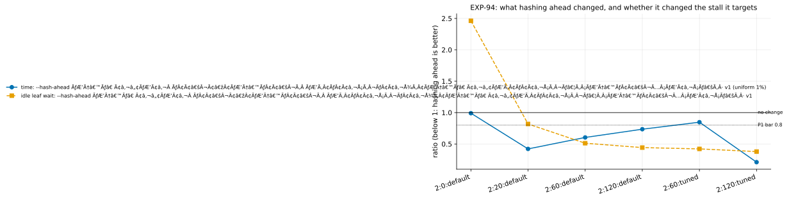

# EXP-94: Does the sender keeping its stream full remove v1's need for BBR at DR round trips?

Status: **done November 6, 2026 — 222 runs, every one passing. The deciding prediction held, and `--hash-ahead`
reached BBR's DR verdict rows on plain cubic.** At 120 ms with tuned buffers it took uniform 1% from **30.0 s to
6.3 s** (`R_fast` 2.851 → 0.599), against BBR's 8.4 s, and its 120 ms row is firmer than BBR's — BBR's is
provisional under rule 11 and this one is not. It needs no host setting and takes nothing from other flows,
which BBR does (EXP-26: 81–96% of a shared link).

**Two predictions failed, and they undercut the stated mechanism rather than the result.** The arm is twice as
fast in **hot** at the longer round trips, where the registered mechanism says there is nothing to run ahead of
(P3), and it removes about **half** the idle leaf wait, not the predicted three-quarters (P6). The leading
candidate is `--read-ahead 8`, which the registration dismissed as "documentation, not an extra variable" and
which rides along with `--hash-ahead`; it is separable with a 12-run arm and no code change. So this session
supports *"`--hash-ahead 64G --read-ahead 8` is the DR fix"* and does **not** support *"keeping the stream full
is why"*. A **scorer defect** found in this session's own output is declared in [Results](#results); it moved
four of the seven readings.

Originally **pre-registered November 5, 2026**, before any VM existed (rule 16), and re-registered at
`af27174` before the session with no run in existence. One fresh `n2-standard-8` pair, EXP-13's set
(`infra/gcp/sets/exp13.sh`); it took about 105 minutes of scored runs and 2h 05m of VM time.

This is EXP-20's and EXP-24's cells again, with one arm added on each congestion control: v1 with the sender
hashing ahead of the file it is sending (`--hash-ahead`, EXP-91). It closes gap **G3** of the
[November 5 survey](../research/2026-11-05-codebase-and-latency-survey.md) and re-establishes **G5**.

## Why this experiment

[EXP-21](EXP-21-tcp-diagnosis.md) traced v1's DR slowdown for scattered changes to cubic's congestion
window, not to buffers or round trips: v1's page stream is **short and bursty** (610 MB), so a burst that loses
segments early sets cubic's threshold low and it grows back slowly, while one `pg_basebackup` stream escapes the
same fate by sending 2.1 GB continuously. EXP-21's "what follows" says pgdelta

> can avoid needing [BBR] by keeping its stream full between files.

[EXP-24](EXP-24-dr-with-bbr.md) then fixed it from the transport side instead, and v1 with BBR holds at every DR
round trip. But [EXP-26](EXP-26-bbr-fairness.md) found a BBR newcomer taking 81–96% of a shared link from cubic
traffic, so **BBR stays opt-in** and needs a host setting on the source.

`--hash-ahead` (EXP-91) is the sender-side fix EXP-21 described, built later for an unrelated reason — removing
a sender stall at 1 Gbit/s — and **never measured at any round trip**. It needs no host setting and takes
nothing from other flows. If it does what EXP-21 predicted, it is worth more than BBR.

Three facts make this a measurement rather than a guess:

- **The mechanism matches.** EXP-91's `--hash-ahead` keeps a planner thread hashing ahead so the sending thread
  always has frames to write. That is precisely "keeping its stream full between files".
- **It is already measured, at no delay.** EXP-91: 0.785 and 0.777 of plain hashing in uniform (full link and
  1 Gbit/s), and 0.99–1.00 in hot. At 0.1 ms there is no slow mode to avoid, so that gain is the *floor* this
  session tests against, not the ceiling.
- **The cells where cubic's slow mode bites are known.** [EXP-23](EXP-23-slow-mode-rate.md): cubic fell into it in
  12 of 15 runs at 20 ms and 0 of 15 at 60 ms tuned; BBR in 0 of 30.

## Design

- **VMs:** one fresh `n2-standard-8` pair in `us-central1-a`, local NVMe RAID 0, ext4, Debian 12, minimum
  platform Intel Cascade Lake — **EXP-13's set, unchanged** (`infra/gcp/sets/exp13.sh`), which is what EXP-20
  and EXP-24 both ran on. The hardware is held identical on purpose: rule 17's cross-session comparison has no
  meaning if the pair shape moves. The resolved image name is recorded here at session start.
- **Conditions** (`RATE:RTT_MS:HOST`): **EXP-20's and EXP-24's own set**, unchanged - `2:0:default`,
  `2:20:default`, `2:60:default`, `2:120:default`, `2:60:tuned`, `2:120:tuned` (the `2:0:tuned` anchor, which
  EXP-20 ran for `v1` and `full` only, is dropped).

  An earlier draft of this registration picked four cells by the size of EXP-24's measured cubic-to-BBR gap and
  kept `2:60:default` as EXP-20's headline cell. Writing the test that checks a stated reason against the data
  (`tests/test_exp94_plan.py`) showed the reason did not hold: **`2:60:default` has almost no gap in EXP-24**
  (uniform `R_fast` 1.645 cubic against 1.629 BBR, a gap of 0.016), because cubic did not fall into its slow
  mode there in that session - while in **EXP-20's** session the same cell and the same arm gave **2.578**. Two
  sessions disagreeing by 57% in one cell is itself the thing rule 17's gate exists for.

  So the selection is dropped rather than re-justified. Running every cell those sessions ran removes the
  selection argument a reviewer would otherwise make, makes prediction 2's comparability gate apply in every
  cell, and keeps the cell where the prior sessions disagree most instead of quietly choosing around it.
- **`parcopy16` at `2:120:default` only**, as EXP-20 ran it, because `B_fast` there is `min(parcopy8,
  parcopy16)` and 8 default windows may not fill the link at 120 ms. Without it `R_fast` in that cell would not
  be the same quantity EXP-20 and EXP-24 reported.
- **Arms** (7; `parcopy16` at one condition):

  | Arm | What it is | Why it is here |
  |---|---|---|
  | `pgdelta_direct_inplace` | v1 as shipped, cubic | rule 17's control against EXP-20 and EXP-24's cubic v1 |
  | `pgdelta_direct_inplace_bbr` | v1 asking for BBR on its data socket | rule 17's control against EXP-24's BBR v1, and the fix to beat |
  | **`pgdelta_direct_inplace_ha`** | **v1, cubic, `--hash-ahead 64G --read-ahead 8`** | **the deciding arm** |
  | **`pgdelta_direct_inplace_bbr_ha`** | **the same with BBR** | whether the two fixes address the same stall |
  | `full` | one `pg_basebackup` stream | the `R_F0` denominator, and the between-session control (rule 17) |
  | `parcopy8` | the 8-stream parallel copy | the `R_fast` denominator, rule 3's yardstick |
  | `parcopy16` | the same over 16 streams, at `2:120:default` only | `B_fast` there, as EXP-20 measured it |

- **`--hash-ahead 64G`** is EXP-91's `hashA` value, kept deliberately: **EXP-92 measured a smaller window and it
  was slower** (2 GiB came out at 1.288 and 1.275 of 64 GiB, because the disks took turns while the planner
  waited for room). At 64 GiB over a 2.1 GB dataset the planner is never the limit, so the arm measures hashing
  ahead rather than a particular budget. `--read-ahead` is pinned at 8 — pgdelta's own default *with*
  `--hash-ahead` — because that default is derived from `--hash-ahead` rather than fixed, and a change to that
  rule must not be able to move what this arm measures.
- **EXP-91's one known cost should not appear here.** On its 8 GB VMs the planner ran 11–16 GB ahead, so the
  source read the pages it sent a second time (its disk 98–107 s against 88 s). These VMs have 32 GB and the
  dataset is 2.1 GB, so the whole of S fits in the page cache. Prediction 5 checks that rather than assuming it.
- **Workloads:** hot and uniform 1% (scale 70, about 2.1 GB) - EXP-20's, unchanged. **3 repeats.**
  **Order seed 940.** That is 6 arms x 6 conditions x 3 repeats, plus `parcopy16`'s 3, per workload: **111 a
  workload, 222 in all.** At EXP-24's measured pace (150 runs in 71 minutes, 28.4 s a run) about **105
  minutes**.
- **Durability and verification:** EXP-13's, unchanged, including check (a)'s 4 MiB limit at every window
  length.
- **A short smoke first** (scale 5, hot, 1 repeat, at `2:0:default` and `2:60:tuned`), then the run. It checks
  three things before the session spends time: the emulation (the round trips and the one-stream rate, as
  EXP-20's smoke did), that both new arms' flags are accepted on both ends, and - by running the two BBR arms -
  that the source really allows BBR, which nothing in the harness would otherwise refuse (prediction 4).
- **Analysis:** two scorers, both committed before the data.
  - `analysis/exp20.py`, the committed and already-registered scorer, run four times:
    `--v1 pgdelta_direct_inplace --tag exp94-cubic`, `--v1 pgdelta_direct_inplace_bbr --tag exp94-bbr`,
    `--v1 pgdelta_direct_inplace_ha --tag exp94-ha`, `--v1 pgdelta_direct_inplace_bbr_ha --tag exp94-bbr-ha`.
    It gives each arm its DR verdict rows against the full copies, unchanged from how EXP-20 and EXP-24 were
    scored.
  - `analysis/exp94.py`, new, for the arm-against-arm readings EXP-20's scorer has no notion of: predictions 1,
    3, 4, 5, 6 and 7, each printed beside its registered bar and its noise band, plus the rule-17 gate against
    EXP-24's committed `full` times. It reuses EXP-23's slow-mode rule and its Clopper-Pearson interval rather
    than restating either. `tests/test_exp94_analysis.py` scores synthetic records through it, so what the
    predictions mean is fixed in code before the data exists.

### Prep: the one host setting (EXP-24's, on the source only)

BBR has to be allowed before an unprivileged sender may ask for it. The host's *default* stays cubic, so
`pg_basebackup`, the parallel copies and every other connection are unaffected; only pgdelta's own data socket
asks for BBR, and each run's statistics record what it got.

```sh
# on the source VM, once, before the session
sudo modprobe tcp_bbr
sudo sysctl -qw net.ipv4.tcp_allowed_congestion_control="reno cubic bbr"
sysctl -n net.ipv4.tcp_allowed_congestion_control net.ipv4.tcp_congestion_control   # record both in the write-up
```

`tcp_allowed_congestion_control` is not one of the sysctls the preflight guard compares with Debian's defaults
(those are `tcp_rmem`, `tcp_wmem`, `rmem_max`, `wmem_max`, `tcp_congestion_control`, `default_qdisc`,
`tcp_slow_start_after_idle`, `tcp_adv_win_scale`), and `tcp_congestion_control` is left at cubic, so the guard
still passes - as it did in EXP-24.

**Run lines** (the shape):

```sh
NOISE=5:4,30:4,120:4   # dest's idle Dirty + Writeback noise, MiB, per window length in s (EXP-13's smoke item 18)
AT=2:0:default,2:20:default,2:60:default,2:120:default,2:60:tuned,2:120:tuned
ARMS=full,parcopy8,pgdelta_direct_inplace,pgdelta_direct_inplace_bbr,pgdelta_direct_inplace_ha,pgdelta_direct_inplace_bbr_ha
COMMON="--manifest-checksums CRC32C --dirty-noise-table $NOISE --control-port 2222 --link-test-seconds 6 --link-test-warmup 3 --tuned-tcp-max-bytes 134217728"
# the smoke first (scale 5, hot, 1 repeat, two conditions), read before the scored runs start. parcopy16 is not
# in it: it runs only at 2:120:default, which the smoke does not visit, and the harness refuses a
# --method-conditions naming a condition outside --conditions (which is how this was caught).
python3 experiments/network/remote.py start exp94-smoke -- --patterns hot --hot-percent 1.0 --scale 5     $COMMON --methods $ARMS --repeats 1 --conditions 2:0:default,2:60:tuned --order-seed 939
# the scored runs: both workloads in one invocation, so one summary.csv holds the session, as EXP-20's did.
# 6 arms x 6 conditions x 3 repeats + parcopy16's 3 = 111 a workload, 222 in all
python3 experiments/network/remote.py start exp94 -- --patterns hot,uniform --fractions 0.01 --hot-percent 1.0     $COMMON --methods $ARMS,parcopy16 --method-conditions parcopy16=2:120:default     --repeats 3 --conditions $AT --order-seed 940 --first-visit-link-streams 16@2:120:default
```


Both workloads run in **one** invocation rather than two, so the session lands in one `summary.csv` and
`analysis/exp20.py` reads it with its own `--sweep`, exactly as it read EXP-20's and EXP-24's. Every arm runs at
every condition and in every repeat, baselines included: `full` is this session's
between-session control (rule 17, prediction 2) and `parcopy8` is the `R_fast` denominator, so neither may be
sampled at a subset of repeats the way EXP-13's `--baseline-repeats` sampled them.
`tests/test_exp94_plan.py` parses this block and checks the plan it produces is those 222 runs, so the
registration's run count is verified rather than asserted.

## Predictions

Registered before the VMs exist. Numbered so the write-up answers each one.

1. **(Deciding.)** For **uniform 1%**, `pgdelta_direct_inplace_ha` is **at most 0.80×**
   `pgdelta_direct_inplace`. 0.80 is EXP-91's own measured ratio for the same flag at no delay (0.785, 0.777);
   a round trip gives it the stall it was predicted to remove as well, so it should do at least as well. A
   ratio in 0.80–0.98 is a real but smaller gain than the mechanism implies, and is reported as such rather
   than as a pass.
   - **Where it has to hold, and why that is not named in advance.** The ratio is reported at **every** cell,
     and the prediction is judged at the cells where **cubic is in the slow mode in this session**, by
     prediction 7's rule applied to this session's own runs. The cells are not listed here because *the two
     prior sessions disagree about which they are*: EXP-20 measured uniform `R_fast` 2.578 at `2:60:default`
     and EXP-24 measured 1.645 in the same cell with the same arm, because cubic fell into its slow mode there
     in one session and not the other. Naming a cell list from either session would therefore be naming the
     wrong cells roughly half the time. Prediction 7's rule is mechanical and registered before the data
     (`page_send_s` above 2.0× the measured link floor), so selecting by it is not a post-hoc choice; selecting
     by *outcome* would be, and is not what this does. A cell where cubic never enters the slow mode is a cell
     where the mechanism predicts nothing to remove, and prediction 6 is what says whether that is true of it.
2. **The comparability gate (rule 17).** This session's `full` is **within 1%** of EXP-24's `full` in each
   shared cell. If it is not, no cross-session claim is made: the session is then read only within itself,
   where all seven arms share one pair and one hour, and EXP-20's and EXP-24's numbers are quoted as history
   rather than compared.
3. **Hot is the negative control.** For **hot**, `_ha` is within **1.03×** of `pgdelta_direct_inplace` at every
   condition. Few pages change, so there is little for a planner to run ahead of and nothing to gain; EXP-91's
   own hot arms came out at 0.994–1.001. A gain in hot would mean the arm is measuring something other than the
   stall, and would call the deciding reading into question.
4. **Whether the two fixes are the same fix.** For **uniform 1%**, `_bbr_ha` is within **1.05×** of `_bbr` at
   every condition. If BBR already keeps the window open, hashing ahead has little left to add. `_bbr_ha`
   clearly faster than `_bbr` would mean the two address *different* stalls, and would be reported as a new
   finding rather than folded into prediction 1.
   - **This prediction is gated, because a BBR arm can silently run cubic.** pgdelta asks for BBR with
     `setsockopt(TCP_CONGESTION)` and **does not fail if the host refuses**: an unprivileged process may
     choose only what `net.ipv4.tcp_allowed_congestion_control` lists, and `transport.set_congestion_control`
     records `{'effective': 'cubic', 'error': ...}` while the transfer goes on. `run_exp04.py` checks nothing
     about it. So if the prep step above is forgotten or does not stick, both BBR arms run cubic, **every run
     still passes**, and this prediction becomes prediction 1 again under another name. `analysis/exp94.py`
     therefore reads every run's statistics first and reports prediction 4 as **"not readable"** unless every
     run that asked for BBR got it with no error. Absent statistics count as unknown, not as success. The
     smoke run exercises both BBR arms, so a missing host setting shows before the scored session starts.
5. **EXP-91's cost does not reappear at this size.** In every `_ha` cell the source's disk **read bytes over
   the timed phases** (`measure.phase_disk_bytes(record, 'source', 'read_bytes')`, from each run's `run.json`;
   `run_exp04.py` surfaces only dest's as a CSV column) are within **1.05×** the matching
   `pgdelta_direct_inplace` cell's. EXP-91's cost was the source reading the pages it sends a second time, on
   8 GB VMs with the planner 11-16 GB ahead; here the whole of S is 2.1 GB on a 32 GB VM, so it should stay in
   the page cache and the extra reads should not appear at all.
6. **The mechanism, measured directly, not inferred.** `--hash-ahead` is supposed to keep the stream full
   between files, and the harness already times exactly that: `leaf_wait_idle_s` is the time the sender was
   blocked waiting for leaf digests **while its socket had nothing unsent and nothing in flight**
   (`pgdelta/waits.py` splits each wait into busy and idle parts from `SIOCOUTQNSD` and `SIOCOUTQ`). An idle
   leaf wait *is* a stream that is not full. Prediction: for **uniform 1%**, `_ha`'s median `leaf_wait_idle_s`
   is at most **0.25×** `pgdelta_direct_inplace`'s at every condition.
   - This is independent of prediction 1 on purpose. If 6 holds and 1 fails, the stall was real and removing it
     did not help, which is what EXP-90 and EXP-91 found at 0.1 ms when another resource bound instead. If 6
     fails, the arm is not doing what its flag claims, and prediction 1 says nothing either way.
7. **The slow mode, counted by EXP-23's own rule.** A run is in the slow mode when `page_send_s` exceeds
   **2.0×** the time the condition's measured one-stream link rate needs for the bytes it sent - EXP-23's
   definition, reused unchanged so the counts are comparable with EXP-23's and EXP-24's. Prediction:
   `pgdelta_direct_inplace` is in the slow mode in **at least 2 of its 3** uniform 1% runs at `2:20:default`
   (EXP-23 found 12 of 15 there; EXP-24's prediction 4 was the same and held), and `_ha` in **0 of 3**, as BBR
   was in 0 of 57 runs across three sessions. Reported with an exact (Clopper-Pearson) 95% interval, as EXP-23
   reported it; with 3 runs a cell the interval is wide, and that is stated rather than hidden.

**What follows:**

- **If 1 and 2 hold:** `--hash-ahead` is the DR fix for scattered changes, and it needs no host setting and is
  fair to other flows, which BBR is not (EXP-26). That makes it a **candidate default** — and a default change
  owes a held-out session first (rule 15, H9–H12), so the write-up proposes one rather than changing anything.
  D29 ("hash 4 files ahead") gets its latency reading, and the idea archive's `--hash-ahead` row gains its DR
  conditions.
- **If 1 fails and 4 holds:** keeping the stream full is not what rescues scattered changes at a round trip, and
  EXP-24's transport fix stands alone. EXP-21's "what follows" is then recorded as **not borne out**, which is
  worth as much as a win: it is the project's standing explanation of the DR slowdown.
- **If 2 fails:** the session still decides prediction 1 within itself (all four v1 arms ran in the same
  repeats), but G5 stays open and EXP-20's and EXP-24's verdicts remain attached to the October 25 engine.

## Rules

| Rule | Answer |
|---|---|
| **11** | One session. A deciding ratio within 20% of its threshold is reported as provisional, as in EXP-20 and EXP-24. |
| **13** | **Stage 3 (the VMs).** Stage 1 (tests) is green. **Stage 2 is skipped, and why is stated rather than hidden:** the local scale model has no round trip, and a round trip is the entire subject. So this session logs **no new local/VM pair** in [proxy-fidelity.csv](../research/proxy-fidelity.csv). What stands in for stage 2 is EXP-91's already-measured VM gain for the same flag at no delay (0.785), which prediction 1 uses as its bar. |
| **14** | Idea archive read. The `--hash-ahead` row (opt-in, EXP-91; EXP-92 settled 64 GiB) gains DR conditions; the **"fast path at DR round trips"** row stays **open** — it needs `--source-kind live`, which `run_exp04.py` does not have, and is EXP-95. The structurally different idea beside this tuning is that one: labels instead of hashing, at latency. |
| **15** | **No held-out session is owed by this experiment,** because it changes no default — both new arms are opt-in. A held-out session (H9–H12) *is* owed before `--hash-ahead` becomes a default, which is what prediction 1 holding would propose. |
| **16** | Registered below. **Correctness gate:** EXP-13's, unchanged — every copy compared with the source, every run's `pg_verifybackup`, and pgdelta's reported switches checked against what each arm pins. **Negative control:** hot (prediction 3), a workload where the mechanism predicts no gain. |
| **17** | **Noise, as of EXP-92:** two runs of a cell differ by up to 1.92% at the 95th percentile for runs of 10 s or more and 7.11% under 10 s; between sessions `pg_basebackup` in the same cell moves about 0.3%. Prediction 1's bar (0.80) and prediction 3's (1.03) both sit outside the within-session spread for the uniform cells, which run 16–38 s. **Hot runs are 3–6 s, so they fall in the 7.11% band:** prediction 3's 1.03 is inside it, and a hot difference under 7.11% is therefore reported as a tie, never as a gain. Prediction 2's 1% gate is the cross-session control. Refreshed by `analysis/noise_floor.py` with this session. |

## Limitations

An emulated WAN in one zone (EXP-15 is the real-link check). One session, one VM type, 2.1 GB in page cache —
which is exactly why prediction 5 exists, and also why this says nothing about the larger datasets where
EXP-91 found its cost. `--hash-ahead` is measured only on v1's hashing path with a cleanly stopped source; the
fast path cannot run here at all, since it requires `--source-kind live` (EXP-95).

## Registered files

Rule 16 records the hash of every file that **scores, runs or is under test** at the registration commit.
`analysis/integrity.py register EXP-94 -- <these>`:

**The scorers** — `analysis/exp20.py` (the verdict rows, unchanged from EXP-20 and EXP-24),
`analysis/exp94.py` (the predictions above), `analysis/exp23.py` (its slow-mode rule and exact interval, which
prediction 7 uses), `analysis/noise_floor.py` (rule 17's refresh), `analysis/plotting.py`.

**The harness that runs it** — `experiments/network/run_exp04.py`, `experiments/network/measure.py`
(the two new arms live here), `experiments/network/agent.py`, `experiments/network/remote.py`,
`experiments/network/parcopy.py`, `experiments/network/source_cluster.py`,
`experiments/change_patterns/run_study.py`.

**The infrastructure** — `infra/gcp/config.sh`, `infra/gcp/create.sh`, `infra/gcp/teardown.sh`,
`infra/gcp/wan.sh`, `infra/gcp/throttle.sh`, `infra/gcp/vmset.sh`, `infra/gcp/startup.sh`,
`infra/gcp/sets/dr94.sh` **and** `infra/gcp/sets/exp13.sh`, which it sources - the hardware claim rests on both
files, so both are registered.

**The engine under test** — `pgdelta/cli.py`, `pgdelta/sender.py`, `pgdelta/receiver.py`,
`pgdelta/transport.py`, `pgdelta/waits.py` (prediction 6 reads what it measures), `pgdelta/inplace.py`,
`pgdelta/hashing.py`, `pgdelta/datadir.py`, `pgdelta/fastpath.py`.

**The tests that fix what the plan and the predictions mean** — `tests/test_exp94_plan.py`,
`tests/test_exp94_analysis.py`. They are registered because they are the only thing holding the bars in
`analysis/exp94.py` to the numbers written above: loosening a bar without the document disagreeing should not
be possible, and a changed test hash is how that would show.

### Re-registered at `af27174` before the session, with no scored data in existence (rule 16)

The first registration recorded the 32 files at `918c58e`. One of them then changed: `infra/gcp/create.sh` at
`6965d97`, "the self-termination guard could not create a local-SSD VM" — the bug that stopped this very
session's pair from being created at all, since `dr94.sh` asks for four local NVMe SSDs *and* a 4-hour cap.
`check` reported 31 of 32.

Re-registering is legitimate here and only here: **no EXP-94 run exists**. The first attempt created a pair and
provisioned it, but the gcloud credential expired before the smoke, the `MAX_RUN_HOURS=4` cap stopped the pair
unattended at about 00:40 UTC on 6 November, and both VMs and their boot disks were deleted. Not one scored run
was produced, so there is nothing for a re-registration to retrofit. `check EXP-94` now reports **32 of 32
unchanged since `af27174`**, and that is the commit this session's data must be read against.

**The test environment, recorded because it hid a false alarm.** `tests/test_exp94_plan.py` and
`tests/test_exp94_analysis.py` are **48 tests, all passing** on Python 3.11 (the Debian 12 image the VMs run,
and `tests/docker`). On Python 3.10 — which is what WSL's Ubuntu 22.04 has, and what drives the session from
this laptop — 33 of the 48 fail in `setUp` on `TestCase.enterContext`, added in 3.11. That is the harness
version, not the analysis. **Consequence for this session: the scoring runs in the Docker image, never in
WSL,** even though WSL is what drives `remote.py`.

## Results

**Run November 6, 2026, on one fresh pair, with every arm in the same hour.** The deciding prediction held, and
`--hash-ahead` reached BBR's DR verdict rows on **plain cubic** — at 120 ms with tuned buffers it is better than
BBR's, because BBR's row there is provisional and this one is not. Two of the seven predictions failed in ways
that bear directly on *why*, and they are not folded away: the arm gains where the registered mechanism says it
should gain nothing, and it removes only about half the stall it was predicted to remove. **A scorer defect
found while reading the session is declared below**; it changed four of the seven readings.

### The session

| | |
|---|---|
| **Pair** | `pgd-dr94-source` / `pgd-dr94-dest`, `n2-standard-8` ×2, 4 local NVMe in RAID 0, ext4 |
| **Zone** | `us-central1-a` — EXP-13's set (`sets/dr94.sh` sources `sets/exp13.sh`), unchanged |
| **Image** | `debian-12-bookworm-v20261102`, resolved from the `debian-12` family at session start and pinned with `IMAGE=` |
| **Platform** | `Intel Cascade Lake` on both VMs, **read back from the live instances**, not assumed from the set file |
| **Cost guard** | `maxRunDuration` 14,400 s with `instanceTerminationAction STOP`, also read back from both live instances |
| **Created** | 06:21 UTC. Provisioned 06:24–06:26 (wal-g v3.0.9, SHA-256 matched its published `.sha256`), deployed 06:28:47, SSH set up 06:28:55 |
| **Smoke** | 06:29:14–06:31:27, scale 5, hot, 1 repeat, `2:0:default` and `2:60:tuned`, order seed 939. **12 of 12 passed** |
| **Scored runs** | 06:36:16–08:07:19, `done: pass`. **222 runs, every one `pass`**. Order seed 940 |
| **Fetched** | 08:24:48, verified locally (222 summary rows, 222 per-run records, 186 source stats logs) |
| **Torn down** | 08:26:11–08:26:42. Project checked afterwards: **0 instances, 0 disks** |

**Total VM time about 2h 05m for the pair**, well inside the 4-hour cap the set imposes.

**The prep step took, and is recorded as the registration asks.** On the source only:

```
net.ipv4.tcp_allowed_congestion_control = reno cubic bbr
net.ipv4.tcp_congestion_control         = cubic
```

The host default stays cubic, so `pg_basebackup`, the parallel copies and every other connection are
unaffected; only pgdelta's own data socket asks for BBR.

**The emulation, measured in every scored run** (median `minrtt_ms`, and the one-stream link rate):

| Condition | minrtt measured | Link rate |
|---|---:|---:|
| `2:0:default` | 0.044 ms | 1.9104 Gbit/s |
| `2:20:default` | 20.057 ms | 1.9104 Gbit/s |
| `2:60:default` | 60.056 ms | 1.9104 Gbit/s |
| `2:60:tuned` | 60.000 ms | 1.9104 Gbit/s |
| `2:120:default` | 120.059 ms | 1.9104 Gbit/s |
| `2:120:tuned` | 120.057 ms | 1.9104 Gbit/s |

1.9104 Gbit/s against a nominal 2, identically in all six cells.

**The BBR gate passed, and it is the reason prediction 4 is readable at all: 72 of 72 runs that asked for BBR
got it,** with no `setsockopt` error. The smoke had already shown 4 of 4 before the session spent an hour.

**The data:** [data/exp94-cells.csv](data/exp94-cells.csv) (the predictions),
[exp20-cellsexp94-cubic.csv](data/exp20-cellsexp94-cubic.csv) and the `-bbr`, `-ha`, `-bbr-ha` tags beside it
(the DR verdict rows, one file per judged arm); the raw session in `results/exp04/sets/dr94/exp94` (38 MB, not
in git).

### Rule 16: a scorer defect, found in this session's own output and declared

`analysis/integrity.py check EXP-94` exits 1 and reports:

```
CHANGED since af27174cf69c: analysis/exp94.py (1 file changed, 8 insertions(+), 2 deletions(-))
CHANGED since af27174cf69c: tests/test_exp94_analysis.py (1 file changed, 49 insertions(+), 5 deletions(-))
EXP-94: 30 of 32 files unchanged since af27174cf69c
```

**What was wrong.** `exp94.runs()` globbed `runs/*.json`. `run_exp04.py` writes `runs/<sweep>/<name>.json`, one
level deeper. So against the real session it returned **0 of 222 records**, and because predictions 5, 6 and 7
read those records — and prediction 1's deciding-cell selection is prediction 7's rule applied to them — the
first scoring run printed:

- P5, P6, P7: `(no cell has both arms passing)`;
- and, worse because it looks like a finding rather than an absence, **`deciding cells for P1: none — cubic did
  not enter the slow mode in any cell of this session`**. Cubic was in the slow mode in two cells. The scorer
  had simply read nothing.

**Why 48 passing tests said nothing about it.** `tests/test_exp94_analysis.py`'s fixture wrote the run records
flat, under a docstring claiming it built "a sweep directory **as run_exp04 leaves one**". The fixture agreed
with the bug, so the tests could only ever confirm it. This is the second instance of this exact failure mode
in the project — EXP-88's amendment 4 recorded the first, and its wording fits here unchanged: *the test that
asserted the old wording was itself encoding the bug.*

**What was changed, and what it moved.** Three edits, all after the data existed, so all post-hoc and none of
them re-registered:

1. `analysis/exp94.py`: the glob reads `runs/*/*.json`.
2. `tests/test_exp94_analysis.py`: the fixture writes the nested layout `run_exp04.py` actually writes, and a
   new `RunRecordLayout` case asserts both directions — that records are read from the per-sweep directory, and
   that a flat layout yields 0, which is the shape of the bug.
3. `tests/test_exp94_analysis.py`: `test_the_scored_cells_go_where_out_says_not_into_docs` asserted
   `docs/experiments/data/exp94-cells.csv` **does not exist**, which can only hold before this experiment is
   ever scored. It now asserts the call did not create or rewrite that file, which is the property it was
   written to protect. Without this it would fail for the one reason that is not a defect.

**50 tests pass** after the change (48 before, plus the 2 new layout cases).

| Reading | As the registered scorer printed it | Corrected |
|---|---|---|
| Records read | **0** | 222 |
| P1's deciding cells | "none — cubic did not enter the slow mode" | **`2:20:default` and `2:120:tuned`** |
| **P1 (deciding)** | nothing to decide; all cells reported | **held at both deciding cells** |
| P5 | no cell | **held, 1.000 at all six** |
| P6 | no cell | **failed at all six** |
| P7 | no cell | **held, both halves** |
| P2, P3, P4, BBR gate | unaffected — they read `summary.csv` and the source stats logs | identical |

**Added 12 November: `experiments/network/measure.py` has since changed too, so the check now reports 29 of
32.** [EXP-95](EXP-95-read-ahead-or-hash-ahead.md) gave it the `pgdelta_direct_inplace_ra` arm — reading ahead
with no hashing ahead — to settle the attribution that predictions 3 and 6 below leave open. The change is
**purely additive**: one name in a new `RA_V1_ARMS` tuple and one entry in `PGDELTA_ENGINES`, with
`tests/test_exp95_arm.py` asserting that this session's own arms are untouched, and EXP-94's 14 plan tests
still passing over it. **It changes no number in this document.**

**The registration is deliberately not refreshed at the corrected commit.** Re-registering would record this
data as scored by code written after it, and would erase the fact that the first reading of this session was
wrong. The check exiting 1 with both files accounted for is the honest record. Every number below is the
corrected scorer's, and the table above says exactly which ones the correction moved.

### The DR verdict rows, by arm

`analysis/exp20.py`, run once per v1 arm, unchanged from how EXP-20 and EXP-24 were scored. This is the
headline table.

| Arm | 20 ms | 60 ms | 120 ms |
|---|---|---|---|
| `v1`, cubic | 3. Local changes only | 2. Holds with tuned buffers | 3. Local changes only |
| `v1`, BBR | **1. Holds as shipped** | 2. Holds with tuned buffers | 2. Holds with tuned buffers *(provisional: a deciding ratio within 20% of its threshold)* |
| **`v1` + `--hash-ahead`, cubic** | **1. Holds as shipped** | 2. Holds with tuned buffers | **2. Holds with tuned buffers** |
| `v1` + `--hash-ahead` + BBR | **1. Holds as shipped** | 2. Holds with tuned buffers | 2. Holds with tuned buffers |

**`--hash-ahead` on plain cubic reaches every row BBR reaches, and its 120 ms row is firmer than BBR's.** BBR's
is provisional under rule 11 — a deciding ratio within 20% of its threshold, which owes a second session.
Hash-ahead's is not provisional. In all four arms the qualifier "v1 faster than one `pg_basebackup` stream on
default hosts" is yes at 60 and 120 ms; at 20 ms it is no for cubic `v1` alone and yes for the other three.

### Uniform 1%: what the arms cost, and `R_fast`

Medians of 3 runs. `R_fast` is v1 against the faster of the parallel copies, EXP-20's own denominator.

| Condition | `v1` cubic | `v1` BBR | **`_ha` cubic** | `_bbr_ha` | `full` | `R_fast` cubic → `_ha` |
|---|---:|---:|---:|---:|---:|---|
| `2:0:default` | 4.661 | 4.646 | 4.616 | 4.613 | 10.296 | 0.501 → 0.496 |
| `2:20:default` | 15.828 | 6.722 | **6.673** | 6.471 | 16.117 | **1.636 → 0.690** |
| `2:60:default` | 24.755 | 15.943 | **14.954** | 15.129 | 43.966 | **2.518 → 1.521** |
| `2:120:default` | 37.455 | 31.823 | **27.546** | 28.764 | 87.003 | **3.312 → 2.436** |
| `2:60:tuned` | 6.269 | 6.159 | **5.311** | 5.273 | 11.586 | 0.635 → 0.538 |
| `2:120:tuned` | 30.015 | 8.433 | **6.311** | 6.421 | 13.248 | **2.851 → 0.599** |

The largest single effect is `2:120:tuned`: **30.0 s → 6.3 s**, `R_fast` 2.851 → 0.599, a cell where cubic `v1`
was 2.9× the parallel copy and hash-ahead puts it at 0.6×. BBR gets 8.4 s there; hash-ahead gets 6.3 s.



### The predictions

| # | Prediction | Measured | Verdict |
|---|---|---|---|
| **1** | **(Deciding.)** uniform 1%: `_ha` ≤ **0.80×** `v1`, at the cells where cubic is in the slow mode in this session | Deciding cells, selected by prediction 7's registered rule: **`2:20:default` 0.422** and **`2:120:tuned` 0.210**. Reported elsewhere: 0.990 (`2:0`), 0.604 (`2:60:default`), 0.735 (`2:120:default`), 0.847 (`2:60:tuned`) | **Held, at both deciding cells, with room** — 0.422 and 0.210 against a 0.80 bar. EXP-21's own proposed fix works at DR round trips |
| 2 | Rule 17's gate: this session's `full` within **1%** of EXP-24's in each shared cell | **9 of 12 held.** Failed: hot `2:60:default` 0.982, uniform `2:60:default` 0.982, hot `2:120:tuned` 1.014 | **Failed in 3 of 12 cells.** The registered consequence applies to those cells: **no cross-session claim is made at `2:60:default` or at hot `2:120:tuned`**, and EXP-20's and EXP-24's numbers there are history, not comparanda. It does **not** touch the arm-against-arm result: all seven arms ran in the same hour on the same pair, which is what prediction 1 compares |
| 3 | Hot is the negative control: `_ha` within **1.03×** of `v1` at every condition | 1.006 (`2:0`, a tie inside the noise band), then **0.774, 0.544, 0.527, 0.696, 0.477.** In seconds, `2:120:tuned` hot: 6.123 → 2.919 | **Failed, and this is the most informative failure in the session.** Hash-ahead makes hot **twice as fast** at the longer round trips, where few pages change and the registered mechanism says there is nothing to run ahead of. Its own falsifier text applies: *"A gain in hot would mean the arm is measuring something other than the stall, and would call the deciding reading into question."* |
| 4 | uniform 1%: `_bbr_ha` within **1.05×** of `_bbr` at every condition | 0.993 and 0.963 at `2:0` and `2:20` (held); **0.949, 0.904, 0.856, 0.761** at the four longer-RTT cells | **Held at the two short cells; a further gain at the four longer ones.** Reported as the registration asks — as a new finding, not folded into prediction 1: at 60 ms and beyond the two fixes address **different** stalls, and hash-ahead still has something to add on top of BBR |
| 5 | In every `_ha` cell the source's disk read bytes over the timed phases within **1.05×** the matching `v1` cell | **1.000 at all six cells** | **Held, exactly.** EXP-91's cost — the source reading the pages it sends a second time, on 8 GB VMs with the planner 11–16 GB ahead — does not reappear at 2.1 GB on 32 GB. The page cache absorbs it, as predicted |
| **6** | **The mechanism:** uniform median `leaf_wait_idle_s` of `_ha` ≤ **0.25×** `v1`'s at every condition | **2.462, 0.819, 0.512, 0.443, 0.422, 0.379** — failed at all six against the 0.25 bar | **Failed on magnitude, held in direction.** The absolutes matter: `v1`'s idle leaf wait scales with the round trip exactly as the stall model says (0.005 s at `2:0`, 0.271 at 20 ms, 0.836 at 60 ms, 1.914 at 120 ms, 2.237 at `2:120:tuned`), and `_ha` roughly **halves** it (0.848 s at `2:120:tuned`). The 2.462 at `2:0:default` is 0.0053 s against 0.0130 s — noise on a cell with no stall to remove, and it should not be read as a 2.5× regression. So hash-ahead does remove idle leaf wait, about half of it, not the three-quarters registered |
| 7 | The slow mode by EXP-23's rule: `v1` slow in **≥2 of 3** uniform runs at `2:20:default`; `_ha` in **0 of 3** | `v1` **2 of 3** (exact 95% interval 9–99%); `_ha` **0 of 3** (0–71%). Both halves as predicted. Reported beyond the prediction: `v1` is also 2 of 3 slow at `2:120:tuned` and 1 of 3 at `2:60:tuned`; **every BBR arm and every `_ha` arm is 0 of 3 in all six cells** | **Held, both halves.** With 3 runs a cell the intervals are wide, which is stated rather than hidden |

**Scorecard: 4 held (1, 5, 7, and 4 at its two short cells), 2 failed (3, 6), 1 failed in 3 of 12 cells (2),
and 1 new finding (4 at the four longer cells).**

## What the session does not settle (post hoc, not registered)

**Predictions 3 and 6 together say the registered diagnosis is incomplete.** The arm is much faster; the
reason given for why it would be faster is only partly what is happening. Taken together:

- it gains in **hot**, where the leaf-digest stall has almost nothing to remove (P3);
- it removes about **half** the idle leaf wait, not the predicted three-quarters (P6);
- yet at the deciding cells it is **0.42× and 0.21×** `v1` (P1).

**The leading candidate is the flag that rides along.** `pgdelta_direct_inplace_ha` sets exactly two things
against `pgdelta_direct_inplace` — `hash_ahead: '64G'` and `read_ahead: 8` (`measure.py:304`) — and nothing on
the receiver, so the arm is not confounded by `--fsync` or verify scope. But the registration dismissed
`--read-ahead` as "not an independent choice ... naming it is documentation, not an extra variable", because
`--hash-ahead` turns it on implicitly. That reasoning is fine for *running* the arm and wrong for *attributing*
its gain: reading 8 files ahead should help whether or not many pages changed, which is exactly the shape of
the hot result.

**It is separable, cheaply, and the engine already allows it.** `cli.py:_read_ahead` returns an explicit
`--read-ahead` whenever one is given, with or without `--hash-ahead`, so a `--read-ahead 8`-only arm is
expressible today with no code change. One arm at `2:120:tuned` and `2:20:default`, hot and uniform, 3 repeats
— 12 runs, well under an hour of one pair — would split the gain into the part that is hashing ahead and the
part that is reading ahead. **Until that runs, this session supports "`--hash-ahead 64G --read-ahead 8` is the
DR fix" and does not support "keeping the stream full is why".**

Two smaller things worth recording:

- **BBR and hash-ahead are not the same fix past 60 ms** (P4's four cells). If they addressed one stall, adding
  hash-ahead to BBR would do nothing; it takes `2:120:tuned` from 8.433 s to 6.421 s. Whatever hash-ahead does,
  BBR does not already do all of it.
- **`full` at `2:60:default` and `2:120:default` is very slow** — 43.97 s and 87.00 s against 11.59 s and
  13.25 s with tuned buffers. That is the known default-buffer behaviour of a single stream at a round trip,
  and it is why `R_F0` and `R_fast` disagree so sharply in those cells. It is EXP-13's result, reproduced, not
  a new one.

## What follows (from these results)

- **Prediction 1 held, so `--hash-ahead` is the DR fix for scattered changes — and it is the better-behaved of
  the two.** It needs **no host setting** (BBR needs `tcp_allowed_congestion_control` changed on the source)
  and it is fair to other flows, which BBR is not: EXP-26 measured BBR taking 81–96% of a shared bottleneck
  from cubic flows. On plain cubic it reaches every DR row BBR reaches, and its 120 ms row is not provisional.
- **It is a candidate default and this experiment does not make it one.** Rule 15 owes a held-out session
  (H9–H12) before any default change, and prediction 3's unexplained hot gain should be resolved first — a
  default justified by a mechanism that the data does not support is a default that will be wrong in some
  condition nobody tested. **Proposed order: (1) the `--read-ahead 8`-only arm, 12 runs; (2) the held-out
  session; (3) the owner's decision.**
- **Prediction 2 failed in 3 of 12 cells, so G5 stays open for those cells.** EXP-20's and EXP-24's verdicts at
  `2:60:default` remain attached to the engine they ran on. The 9 cells that held are comparable, and the gate
  did its job: it told us which cells not to trust rather than letting a 1.8% drift pass as a result.
- **EXP-21's "what follows" is borne out.** Its proposed fix — keeping the stream full between files — was the
  project's standing explanation of the DR slowdown, and the arm built from it is decisively faster at DR round
  trips. What is *not* borne out is that the stated mechanism is the whole of it (P3, P6).
- **D29 ("hash 4 files ahead") now has its latency reading**, at 64 GiB rather than 4 files, and the idea
  archive's `--hash-ahead` row gains its DR conditions: 1.9 Gbit/s, 20–120 ms, 2.1 GB, scattered 1% and hot.
- **Raised, not done:** `pgdelta/cli.py:154-156` tells users the live worker cap "slowed a busy primary no more
  than `pg_basebackup`", citing EXP-28 and EXP-39 — both measured at 0.6 of capacity and below, and EXP-88 now
  contradicts it at 0.8. That is user-facing text about a shipped default, so it is the owner's; it is noted
  here because `cli.py` is a registered file of this session and was deliberately left untouched.

## Workflow check

| | Check | For this experiment, done |
|---|---|---|
| 1 | Situation, standard, competitor | v1 with `--hash-ahead 64G --read-ahead 8` against v1 as shipped, v1 with BBR, one `pg_basebackup` stream and the 8- and 16-stream parallel copies, at 0–120 ms. Measured: **0.422× and 0.210× v1 at the two slow-mode cells**, and BBR's DR rows on plain cubic |
| 2 | The bottleneck | Measured directly, not inferred: `leaf_wait_idle_s` — the sender blocked with an idle socket — scales 0.005 → 2.237 s with the round trip and is roughly halved by the arm. **Half, not the registered three-quarters**, and the hot gain says part of the benefit is not this stall at all |
| 3 | Systems or algorithm | Systems: same bytes, same hash, same pages; only when the sender hashes and reads changes |
| 4 | Papers and prior art | EXP-21's proposed fix, tested at last; EXP-23's slow-mode rule and exact interval reused unchanged; EXP-20's and EXP-24's conditions, arms and denominators reused; EXP-91's `hashA` window value kept because EXP-92 measured a smaller one as slower; EXP-26's fairness result is why cubic mattering is the point |
| 5 | Committee-grade | Pre-registered with the scorer committed first and re-registered before the session with no run in existence; 7 predictions with falsifiers, **2 failed and reported as failures that undercut the stated mechanism**; the deciding cells chosen by a registered mechanical rule, not by outcome; a scorer defect found in the session's own output, declared with a before/after table rather than quietly fixed |
| 11 | Second session | Not triggered for prediction 1 (0.422 and 0.210 against 0.80). Noted for BBR: its own 120 ms row is provisional under this rule, which is why hash-ahead's firmer row matters |
| 13 | The cascade | 50 plan and analysis tests, then a 12-run smoke read before the session spent an hour, then 222 scored runs. The smoke caught nothing this time and would have caught a missing BBR setting, which is what it is for |
| 15 | Held-out workloads | Owed before any default change: H9–H12, and now also the `--read-ahead`-only arm |
| 16 | Scorer integrity | **Exits 1: 30 of 32 unchanged.** Both changes are this write-up's own declared post-hoc corrections — the record glob and the fixture that agreed with it. Registration deliberately left at `af27174`. The BBR gate is the other half of integrity here: **72 of 72** runs that asked for BBR got it, so prediction 4 is a comparison and not a tautology |
| 17 | The noise bar | 3 repeats a cell. Rule 17's cross-session control is prediction 2, and it **failed in 3 of 12 cells**, which restricts the cross-session reading to the other 9 |
