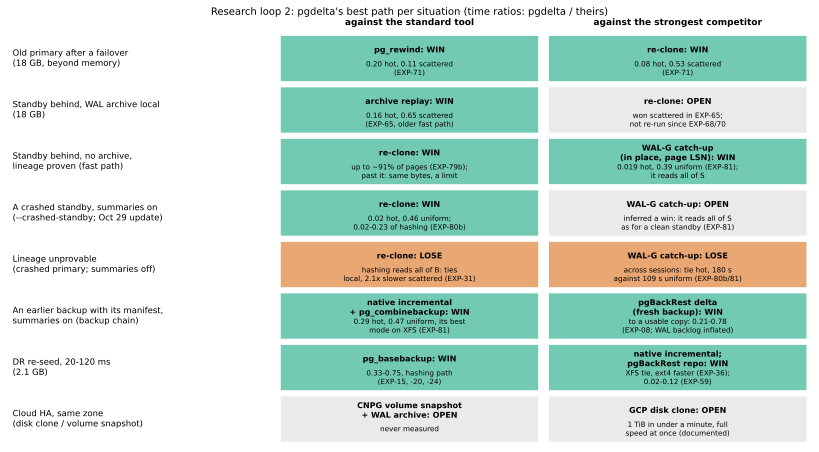

# Research loop 2 (October 28, 2026): the scorecard redone, and where to attack next

The owner's loop (decision K13), second pass. Research loop 1 (October 27) built the first scorecard. Its follow-ups since then (EXP-64 to EXP-79b) changed the fast path a great deal, so the table is redone here from scratch:
1. per situation, the standard tool and the strongest competitor, checked against primary sources;
2. whether pgdelta's best path beats them, with the measurement, or "open" where it was never measured;
3. for each open or losing row, a bound: could any implementation of our algorithm win (a systems problem), or not (an algorithm problem)?
4. a pick of where to attack, with a committee's reading.

Tags: **measured** (an experiment), **documented** (a primary source), **inferred** (arithmetic or reasoning not yet tested).

**Where the competitor facts come from:** one research pass on October 28, against official docs, release notes and source code. The versions current then:
- PostgreSQL 18 (19 is at RC1);
- pgBackRest 2.60.0, WAL-G 3.0.9, Barman 3.20.1, pg_probackup 2.5.16;
- CloudNativePG 1.30.1, Patroni 4.1.5;
- Google Cloud's disk documentation.

## 1. Is the fast path novel? (documented)

**No tool found applies WAL summaries, or a WAL-scan block list, in place to refresh an existing copy.** The search covered code using `pg_wal_summary_contents` and `pg_walsummary`, the PostgreSQL 18 and 19 release notes, pgsql-hackers, and the web. The nearest things all differ:
- **PostgreSQL's own incremental backup** always writes a new directory. `pg_combinebackup` opens its output files with `O_CREAT|O_EXCL` (`reconstruct.c`), and it rebuilds every relation file with even one changed block as a complete new file, block by block. `--clone` (17) and `--link` (18) apply only to files that need no block from a newer incremental. *Corrected October 29 (EXP-81's registration):* `--copy-file-range` (17) also copies each block of a rebuilt file with `copy_file_range` (`write_reconstructed_file`), which on XFS with reflinks shares the block instead of copying it. ([pg_combinebackup](https://www.postgresql.org/docs/18/app-pgcombinebackup.html))
- **`pg_rewind`** reads the old primary's WAL itself, not summary files.
- **WAL-G's catch-up** (`catchup-send` / `catchup-receive`) updates a stopped replica in place: files whose modification time matches are skipped, and changed files send only pages whose LSN is at or after the replica's checkpoint ([WAL-G docs](https://github.com/wal-g/wal-g/blob/master/docs/PostgreSQL.md)).
- **`pg_probackup catchup`:** DELTA mode reads every data file; PTRACK needs the ptrack extension.
- **pgBackRest delta restore** compares block checksums of the existing files against a repository backup.
- **Barman's `--delta-restore`** is rsync, file by file, local only.
- **The closest idea** is Robert Haas's 2019 pgsql-hackers thread on finding changed blocks by scanning WAL; nothing was built from it.

## 2. The scorecard (pgdelta's best path, time ratios pgdelta ÷ theirs)

| Situation | Standard tool (who uses it) | pgdelta against it | Strongest competitor | pgdelta against it |
|---|---|---|---|---|
| **Old primary after a failover** | `pg_rewind` (Patroni `use_pg_rewind`, CloudNativePG); else a re-clone | **Win, measured:** 0.20 (hot rows), 0.11 (scattered), 18 GB beyond memory (EXP-71) | A re-clone | **Win, measured:** 0.08 and 0.53 (EXP-71) |
| **Standby behind, WAL archive on its disk** | Replay the archive (CloudNativePG catches replicas up from it) | **Win, measured:** 0.16 (hot), 0.65 (scattered), with the fast path before EXP-68 and EXP-70 (EXP-65) | A re-clone | **Open:** a re-clone won the scattered case in EXP-65 (91 s against 166 s). Since then the fast path's scattered cell fell to about 42 s (EXP-79b), so it likely wins now (**inferred**, not re-run) |
| **Standby behind, no archive, lineage provable** (stopped cleanly, `summarize_wal` on) | A re-clone with `pg_basebackup` (Patroni `reinit`, CloudNativePG's join, Omni's operator) | **Win up to about 91% of the pages changed, measured** (0.60 at 53%, EXP-79; 0.51 at 28%, EXP-70, and about 0.46 now, EXP-79's 42.0 s against EXP-70's full copy, across sessions). **Past 91% it loses:** both send the same bytes, so pgdelta's fixed costs decide it, an algorithm limit. `--selector` says so | WAL-G catch-up, in place by page LSN (**documented**) | **Open:** never timed against the fast path |
| **Lineage unprovable:** a crashed copy, or `summarize_wal` off (the default), or PostgreSQL before 17 | A re-clone | **Lose, measured:** hashing must read all of B. At 12 GB beyond memory it tied for local changes and was 2.1x slower for scattered ones (EXP-31). Correct, and a win only at DR round trips | WAL-G catch-up (needs no summaries) | **Open** |
| **An earlier backup with its manifest, summaries on** (a backup chain) | `pg_basebackup --incremental` + `pg_combinebackup` | **Open:** it beat pgdelta's hashing in all 42 cells at 0.1 ms in memory (EXP-04b, the old code), and was never timed against the fast path | pgBackRest delta restore (2.60.0; needs a repository) | **Win, measured:** to a usable copy, 0.21–0.78 from a backup taken just before (EXP-08; that WAL backlog was harness-inflated), 0.02–0.12 from a day-old one (EXP-59, -59b) |
| **DR re-seed across a WAN** (20–120 ms) | A re-seed with `pg_basebackup` | **Win, measured:** 0.33–0.75 with the hashing path (EXP-15, -20, -24). The fast path over a WAN is unmeasured | Native incremental; a pgBackRest repository | **Win or tie, measured:** faster on ext4, a tie on XFS with block sharing (EXP-36); 0.02–0.12 against pgBackRest (EXP-59) |
| **Cloud HA, same zone** | CloudNativePG: a replica from a volume snapshot, caught up from the WAL archive (**documented**) | **Open** | A Google Cloud disk clone: "1 TiB typically in under a minute", "full performance immediately after creation", same zone only (**documented**) | **Open** |

**Not competitors here, by their own prerequisites (documented):**
- **Native incremental** can't refresh a running standby or any copy without its backup manifest: `--incremental` needs "the backup manifest to an earlier backup from the same server".
- **pgBackRest's delta restore** always starts from a repository backup.
- **Google Cloud's asynchronous disk replication** re-protects after a failover only by replicating to a new secondary disk; no partial resync is documented.

## 3. Bounding the open and losing rows (inferred, from the measured disk constants)

The constants are EXP-48's, EXP-68's and EXP-70's, on a 150 GiB balanced persistent disk: about 210 MB/s either way; 4,100 random reads and 4,790 random writes a second; 447 µs for one read at a time. N = 18 GB.

- **Lineage unprovable, hashing (the measured loss).** Hashing must read every page of B before it can know what to write, which is N/R ≈ 86 s, already a full copy's time. **No systems work removes that term: it is an algorithm limit.** The only way out is a different source of labels, so the fast path's bound applies (0.02–0.6 of a full copy below about 91%). Two sources exist:
  - **A crashed copy:** finish its crash recovery first, then prove its lineage as for a clean stop. `pg_rewind` does exactly this: "if the target server is not shut down cleanly, pg_rewind starts the target server in single-user mode to complete crash recovery first" ([pg_rewind](https://www.postgresql.org/docs/18/app-pgrewind.html), `--no-ensure-shutdown`).
  - **Summaries off, or PostgreSQL before 17:** take the labels from S's WAL since B's redo point. That is what `pg_rewind` does with the old primary's WAL, and what `pg_probackup`'s PAGE mode does. It needs that WAL kept or archived.
- **WAL-G catch-up against the fast path.** Its source reads every file whose modification time changed, in full. For scattered changes that is nearly every 1 GiB segment, about N/R ≈ 86 s before its writes. The fast path reads only the chosen pages (42 s in all for the uniform cell, EXP-79b). For local changes WAL-G reads the few changed segments in full, a few seconds each, against the fast path's 2 s. **Prediction: the fast path wins both, by algorithm,** since WAL-G's page-LSN test needs every page read. Unmeasured.
- **Native incremental against the fast path.** `pg_combinebackup` rebuilds every relation file with a changed block (documented).
  - **Scattered changes:** nearly every file has one, so it rewrites about N ≈ 86 s, plus the incremental transfer, and needs a second copy's space.
  - **Local changes:** it rebuilds the few changed segments, roughly 5 s each, and clones or links the rest.
  - **Prediction:** the fast path wins scattered changes by about 2x or more, and local changes by about 2–5x. It is an algorithm difference: in place, page by page, against a whole-file rebuild into a new directory. Unmeasured.
- **Cloud disk clones.** Their speed is the storage layer's, not something a host-level tool can match for large changes: an 18 GB clone should take seconds (documented), plus the copy's own recovery. **For small lag the fast path likely wins** (2 s for local changes); **for large changes in the same zone, a clone likely does.** It is a different layer, with different limits: same zone only, the provider's API, and a crash-consistent image that needs WAL. The line between them is unmeasured.

## 4. Where to attack, and why (a committee's reading)

**The pick: the "lineage unprovable" row, starting with the crashed copy.**
- **It is the only measured loss that isn't a hard limit.** The past-91% loss is the same bytes either way; the cloud clone is another layer.
- **The bound says it is an algorithm problem,** so tuning can't fix it, and the fix is known: give the fast path labels for these copies.
- **It matters in HA:** a standby or primary that crashed and came back is the common way to end up with a stale copy. Today pgdelta can only hash it, or refuse it.
- **The mechanism is PostgreSQL's own:** `pg_rewind` finishes a crashed target's recovery before rewinding. So the guard's proof stays the same proof, run on a copy that is now cleanly stopped.
- **Its risk is narrow and testable.**
  - A crashed standby that is still in archive recovery may not finish its recovery in single-user mode the way a crashed primary does; that is not documented either way.
  - Crash recovery needs B's WAL as far as its last write. A copy whose WAL was lost must still be refused.

**The first experiment (EXP-80, local, then VMs).**
- **What gets built:** crash recovery first (`pg_rewind`'s documented step), then the fast path's usual guard.
- **Trials:** crashed primaries and crashed standbys (`pg_ctl -m immediate`, and SIGKILL), over many randomized cases.
- **Negative controls:** a crashed copy with its last WAL segment removed, and one with a torn `pg_control`. Each must be refused, or hashed, never refreshed wrong.
- **Predicted, before any run:**
  - every crashed copy with its WAL intact is refreshed by the fast path and verifies (amcheck and the rows);
  - every control is refused;
  - on the VMs beyond memory, at 0.2 or less of hashing's time for local changes.

**Then, in one VM session, firming the open rows on our own ground:** the fast path against native incremental + `pg_combinebackup`, and against WAL-G catch-up, each in the competitor's best mode (XFS with `--clone` or `--link` for `pg_combinebackup`), on the uniform and hot cells.
- **Why second:** both are predicted wins by algorithm. A committee would ask for both, but neither is a loss we know of.

**After that:**
- **Labels when summaries are off:** S's WAL scanned since B's redo point. Larger: a WAL parser, or `pg_waldump`.
- **The cloud-clone line:** where the fast path stops beating an 18 GB disk clone plus recovery, in the same zone.

**Not chosen:** more fixed-cost tuning past 91% of pages changed. It chases a tie that a full copy wins on principle (section 3), which is the drift the loop warns against.

## 5. Update, October 29: what the pick came to (EXP-80, EXP-80b)

- **Crash recovery first was dropped before registration.** Its pilot reopened EXP-62's blind spot: a crashed old primary that lost its WAL was accepted after crash recovery, and its copy was wrong. EXP-80 confirmed it on 3 of 3 fresh builds.
- **Built instead:** `--crashed-standby`. A standby left in recovery by a crash is proven by its minimum recovery point. 100 of 100 randomized crashed standbys came out correct (EXP-80).
- **Section 4's timing prediction held:** 0.2 or less of hashing's time for local changes. Beyond memory it took 0.023 of hashing's time for hot rows and 0.233 for uniform ones, and 0.02 and 0.46 of a re-clone (EXP-80b).
- **So the "lineage unprovable" row splits:**
  - **a crashed standby:** a win against the standard tool, measured;
  - **a crashed primary:** still hashed (taking it is unsound);
  - **summaries off:** still hashed (WAL-scan labels unbuilt).
- **The scorecard figure above carries the split.**
- **Next, as section 4 planned:** the VM session against native incremental with `pg_combinebackup` and against WAL-G catch-up.
