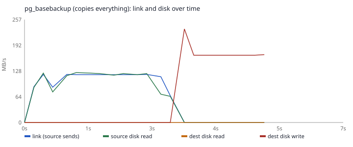
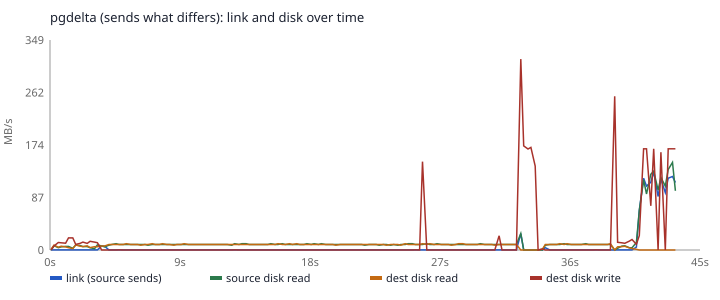

# Run gcp-smoke-1


**Where:** gcp. **Database:** pgbench scale 20 (625.8 MB on disk). **Change:** 1% of rows, hot. **Repeats:** 1.

**VMs:** two n2-standard-4 in us-central1-a, us-central1-b, each with a 50 GB pd-balanced data disk; Debian 13, PostgreSQL 17.12. **Link:** 1gbit. **Round trip:** 1.053 ms. VMs deleted: yes.

## Results

| Lane | Time | Sent | Of S's files | Round trips | vs pg_basebackup |
|---|---|---|---|---|---|
| pg_basebackup (copies everything) | 6.78 s | 340.9 MB | 54.5% | – | 1.00× |
| pgdelta (sends what differs) | 43.41 s | 293.9 MB | 47.0% | 41174 | 6.40× |

`pg_basebackup` skips old WAL and temporary files, so it sends less than S's whole directory.


## Correctness

The refreshed copy was started; its rows and balance (2000000|140000) match the source (2000000|140000). pgdelta also checked every file against the source's digest.

## Link and disk over time

From the 0.1-second samplers on both VMs.




## Cost

Estimated before the run: about 12.3 minutes and $0.08 (approximate list prices for us-central1; a guide, not billing).

## Reproduce

```bash
python -m bench run --config runs/gcp-smoke-1/config.json
```

Watch it: `python -m viz serve`, then pick "gcp-smoke-1".
