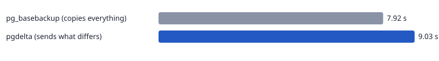
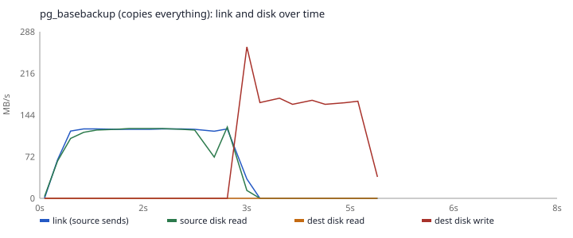
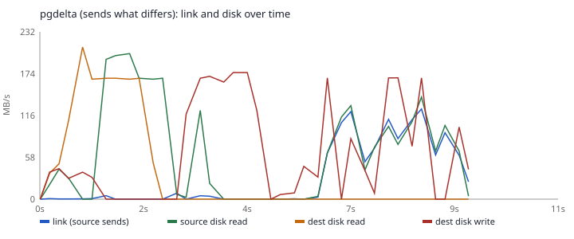

# Run gcp-stream-1


**Where:** gcp. **Database:** pgbench scale 20 (625.8 MB on disk). **Change:** 1% of rows, hot. **Repeats:** 1.

**VMs:** two n2-standard-4 in us-central1-a, us-central1-b, each with a 50 GB pd-balanced data disk; Debian 13, PostgreSQL 17.12. **Link:** 1gbit. **Round trip:** 0.786 ms. VMs deleted: yes.

## Results

| Lane | Time | Sent | Of S's files | Round trips | Chunks asked | Copy runs | Digest waits | vs pg_basebackup |
|---|---|---|---|---|---|---|---|---|
| pg_basebackup (copies everything) | 7.92 s | 340.9 MB | 54.5% | – | – | – | – | 1.00× |
| pgdelta (sends what differs) | 9.03 s | 292.6 MB | 46.8% | 30 | 41174 | 808 | 28 | 1.14× |

Round trips counts every time the sender blocked on the peer; what that buys varies by when a run was recorded. **Streamed** (issue #36 step 2, both copy runs and digest waits present): round trips no longer scales with chunks at all — it's ACCEPT, each digest wait, and RESULT — so it stays a handful regardless of size; copy runs counts run-length `CHUNK_COPY` instructions (one for an untouched file), and digest waits is how many of those round trips were spent waiting for a digest that had not arrived yet. **Batched** (issue #36 step 1, chunks asked present but copy runs and digest waits a dash): round trips counted `CHUNK_HASHES`/`VERDICTS` exchanges, each covering up to `--batch` chunks, and chunks asked is how many chunks those exchanges covered. **Stop-and-wait** (chunks asked also a dash): round trips counted chunks directly, one per round trip, so it meant what chunks asked means in the other two generations.

`pg_basebackup` skips old WAL and temporary files, so it sends less than S's whole directory.



## Correctness

The refreshed copy was started; its rows and balance (2000000|140000) match the source (2000000|140000). pgdelta also checked every file against the source's digest.

## Link and disk over time

From the 0.1-second samplers on both VMs.




## Cost

Estimated before the run: about 3.4 minutes and $0.02 (approximate list prices for us-central1; a guide, not billing).

## Reproduce

```bash
python -m bench run --config runs/gcp-stream-1/config.json
```

Watch it: `python -m viz serve`, then pick "gcp-stream-1".
